# G20F/fig5-4 · 架构支撑产品与冲刺待办列表定义

类型：`process-or-method-model`。说明架构工作在敏捷交付中的位置：架构迭代（冲刺）本身要交付特性、需求、增强、技术债修复等；架构规格为产品待办与冲刺待办提供输入与约束（有意架构），并接受运营反馈与新需求，形成持续治理闭环。

英文 PDF 物理页：[44]。本页为架构语义分析，原文与原图分别保留。

## 原图与可编辑图


[完整 JSON](fig5-4.json) · [可编辑 Mermaid](fig5-4.mmd) · [仅关系图](fig5-4.relations.mmd) · [层级分解图](fig5-4.hierarchy.mmd)

图形重建表达语义，不复制源图布局。虚线表示解释、矩阵映射或分组关系，不自动表示不确定性的概率。

```mermaid
flowchart TB
  %% Semantic reconstruction; see original source image for exact layout.
  n0["Architecture Supports Product and Sprint Backlog Definition"]
  n1["A Sprint – Architecture Iteration Should Deliver:"]
  n2["Features"]
  n3["Requirements"]
  n4["Enhancements"]
  n5["Bugs Correction (Technical Debt)"]
  n6["Product/Solution Knowledge"]
  n7["Interdependencies"]
  n8["Input to Conform the Product Backlog"]
  n9["Support for the User Stories Definition (Sprint Backlog)"]
  n10["High Priority Items"]
  n11["Envision – Strategic Planning"]
  n12["Roadmap – Intentional Architecture"]
  n13["Initial Strategic Planning"]
  n14["Architecture Vision"]
  n15["Initial Modeling"]
  n16["Requirements Definition"]
  n17["Product Backlog"]
  n18["Sprint Backlog"]
  n19["Intentional Architecture Reconciled with Emergent Architecture"]
  n20["Two Weeks"]
  n21["Daily Scrum"]
  n22["Sprint"]
  n23["Delivery"]
  n24["Potentially Shippable Product"]
  n25["Operation Maintenance Management"]
  n26["New Requirements Change Management Continuous Governance"]
  n27["发布堆叠（立体层）"]
  n28["第一层（橙色，最高价值）"]
  n29["第二层（蓝色）"]
  n30["第三层（深灰）"]
  n31["第四层（浅色淡出）"]
  n32["Release 1"]
  n33["Release 2"]
  n34["Release n"]
  n35["无标签箭头（指向第一层）"]
  n36["High Business Value Key Features"]
  n37["Further Priorities-Based Product Roadmap"]
  n38["Less Important Features – Additional, Optional"]
  n39["未命名积压条目图符1"]
  n40["未命名积压条目图符2"]
  n41["未命名积压条目图符3"]
  n42["未命名积压条目图符4"]
  n43["未命名积压条目图符5"]
  n44["未命名积压条目图符6"]
  n45["未命名积压条目图符7"]
  n46["未命名积压条目图符8"]
  n47["未命名积压条目图符1"]
  n48["未命名积压条目图符2"]
  n49["未命名积压条目图符3"]
  n50["未命名积压条目图符4"]
  n51["左向反馈及向上回到积压的空白区域"]
  n52["可交付产品的船只图标"]
  n17 -->|"流动"| n18
  n10 -.-|"关联"| n17
  n22 -->|"流动"| n24
  n24 -->|"流动"| n25
  n25 -->|"feedback"| n51
  n51 -->|"feedback"| n18
  n20 -->|"迭代"| n20
  n21 -->|"迭代"| n21
  n1 -.->|"分组"| n2
  n1 -.->|"分组"| n3
  n1 -.->|"分组"| n4
  n1 -.->|"分组"| n5
  n1 -.->|"分组"| n6
  n1 -.->|"分组"| n7
  n1 -.->|"分组"| n8
  n1 -.->|"分组"| n9
  n27 -.->|"分组"| n28
  n27 -.->|"分组"| n29
  n27 -.->|"分组"| n30
  n27 -.->|"分组"| n31
  n17 -.->|"visual_containment_only"| n39
  n17 -.->|"visual_containment_only"| n40
  n17 -.->|"visual_containment_only"| n41
  n17 -.->|"visual_containment_only"| n42
  n17 -.->|"visual_containment_only"| n43
  n17 -.->|"visual_containment_only"| n44
  n17 -.->|"visual_containment_only"| n45
  n17 -.->|"visual_containment_only"| n46
  n18 -.->|"visual_containment_only"| n47
  n18 -.->|"visual_containment_only"| n48
  n18 -.->|"visual_containment_only"| n49
  n18 -.->|"visual_containment_only"| n50
  n24 -.->|"visual_containment_only"| n52
```



## 架构分析

左上为冲刺交付八项清单，中部是Product Backlog到Sprint Backlog的抽取箭头以及两周冲刺/每日Scrum循环，右侧为潜在可交付产品、交付与运维。底部有Release文字、分界线和价值范围括号。运维长反馈线向左止于空白；另一独立上弯箭头进入Sprint Backlog，两者几何上有间隙。橙色New Requirements/Change Management/Continuous Governance说明不作连线中转节点。

- 本图有 53 个具名或隐含元素、8 条关系和 25 条包含/分组记录。
- 包含/分组树最大深度为 1；根节点为 架构支撑产品与冲刺待办列表定义、一个冲刺——架构迭代应交付：、高优先级事项、构想——战略规划、路线图——有意架构、初始战略规划、架构愿景、初始建模、需求定义、产品待办列表、冲刺待办列表、有意架构与涌现架构相协调、两周、每日 Scrum、冲刺、交付、潜在可交付产品、运营/维护/管理、新需求 / 变革管理 / 持续治理、发布堆叠（立体层）、发布 1、发布 2、发布 n、无标签箭头（指向第一层）、高业务价值关键特性、进一步基于优先级的产品路线图、次要特性——附加、可选、左向反馈及向上回到积压的空白区域。
- 本图没有可直接确认为人员直属汇报的关系；视觉上下位置、能力分解和治理职责分别读取。
- 包含分组后有 22 个连通分量；分离可能源于图例、并列分类或独立示例，未自动补边。
- 逐项核对39个历史文字/堆叠元素和新增12个积压条目图符、船只图符；交付清单8项完整。
- 核对Product→Sprint Backlog黑弯箭头、Sprint交付产品、产品→运营维护，以及底部两段几何分离反馈箭头。橙色治理说明框没有连接端点。
- Release左侧线是范围分界，右侧花括号覆盖层范围；拒绝误造的Release→层和花括号→单层边。

### 如何用于项目

- 按阶段/事件/行为关系读取入口、出口、责任和产物；检查循环与例外路径。
- 工作流先后不表示组织管理权；在项目中显式记录条件和完成标准。

### 结构所表达的逻辑

- 架构冲刺交付八项内容，包括对产品待办及用户故事/冲刺待办的支持。
- 产品待办顶部为高优先级，弯箭头抽取到冲刺待办；两周循环与Daily Scrum为两个循环。
- 潜在可交付产品经交付进入运维。
- Intentional Architecture Reconciled with Emergent Architecture是原则说明。
- Release标签置于水平分界线之间，右侧价值括号覆盖范围，不能逐标签造箭头指向单个堆叠层。
- 运维长反馈线与进入Sprint Backlog的上弯箭头分开绘制；概念反馈可结合正文理解，但不把未连接间隙补成显式汇合。

## 上下级与包含

版式分冲刺清单、待办与迭代、交付运维、底部发布与反馈区。Backlog条纹与船为图符；Release及价值括号是范围注记。

|父项|子项|层级类型|依据与解释|
|---|---|---|---|
|一个冲刺——架构迭代应交付：|特性|visual_grouping|框、泳道、域或分类组的成员归属；没有额外证据不提升为业务组合或管理关系。|
|一个冲刺——架构迭代应交付：|需求|visual_grouping|框、泳道、域或分类组的成员归属；没有额外证据不提升为业务组合或管理关系。|
|一个冲刺——架构迭代应交付：|增强|visual_grouping|框、泳道、域或分类组的成员归属；没有额外证据不提升为业务组合或管理关系。|
|一个冲刺——架构迭代应交付：|缺陷修复（技术债务）|visual_grouping|框、泳道、域或分类组的成员归属；没有额外证据不提升为业务组合或管理关系。|
|一个冲刺——架构迭代应交付：|产品/解决方案知识|visual_grouping|框、泳道、域或分类组的成员归属；没有额外证据不提升为业务组合或管理关系。|
|一个冲刺——架构迭代应交付：|相互依赖|visual_grouping|框、泳道、域或分类组的成员归属；没有额外证据不提升为业务组合或管理关系。|
|一个冲刺——架构迭代应交付：|对产品待办列表的输入|visual_grouping|框、泳道、域或分类组的成员归属；没有额外证据不提升为业务组合或管理关系。|
|一个冲刺——架构迭代应交付：|对用户故事定义（冲刺待办列表）的支持|visual_grouping|框、泳道、域或分类组的成员归属；没有额外证据不提升为业务组合或管理关系。|
|发布堆叠（立体层）|第一层（橙色，最高价值）|visual_grouping|框、泳道、域或分类组的成员归属；没有额外证据不提升为业务组合或管理关系。|
|发布堆叠（立体层）|第二层（蓝色）|visual_grouping|框、泳道、域或分类组的成员归属；没有额外证据不提升为业务组合或管理关系。|
|发布堆叠（立体层）|第三层（深灰）|visual_grouping|框、泳道、域或分类组的成员归属；没有额外证据不提升为业务组合或管理关系。|
|发布堆叠（立体层）|第四层（浅色淡出）|visual_grouping|框、泳道、域或分类组的成员归属；没有额外证据不提升为业务组合或管理关系。|
|产品待办列表|未命名积压条目图符1|visual_containment_only|保存原图解释中的包含；业务关系类型需要图例或正文进一步限定。|
|产品待办列表|未命名积压条目图符2|visual_containment_only|保存原图解释中的包含；业务关系类型需要图例或正文进一步限定。|
|产品待办列表|未命名积压条目图符3|visual_containment_only|保存原图解释中的包含；业务关系类型需要图例或正文进一步限定。|
|产品待办列表|未命名积压条目图符4|visual_containment_only|保存原图解释中的包含；业务关系类型需要图例或正文进一步限定。|
|产品待办列表|未命名积压条目图符5|visual_containment_only|保存原图解释中的包含；业务关系类型需要图例或正文进一步限定。|
|产品待办列表|未命名积压条目图符6|visual_containment_only|保存原图解释中的包含；业务关系类型需要图例或正文进一步限定。|
|产品待办列表|未命名积压条目图符7|visual_containment_only|保存原图解释中的包含；业务关系类型需要图例或正文进一步限定。|
|产品待办列表|未命名积压条目图符8|visual_containment_only|保存原图解释中的包含；业务关系类型需要图例或正文进一步限定。|
|冲刺待办列表|未命名积压条目图符1|visual_containment_only|保存原图解释中的包含；业务关系类型需要图例或正文进一步限定。|
|冲刺待办列表|未命名积压条目图符2|visual_containment_only|保存原图解释中的包含；业务关系类型需要图例或正文进一步限定。|
|冲刺待办列表|未命名积压条目图符3|visual_containment_only|保存原图解释中的包含；业务关系类型需要图例或正文进一步限定。|
|冲刺待办列表|未命名积压条目图符4|visual_containment_only|保存原图解释中的包含；业务关系类型需要图例或正文进一步限定。|
|潜在可交付产品|可交付产品的船只图标|visual_containment_only|保存原图解释中的包含；业务关系类型需要图例或正文进一步限定。|

## 全部元素与角色

|元素ID|原文名称|类型|含义|直接父项|深度|
|---|---|---|---|---|---|
|fig_title|Architecture Supports Product and Sprint Backlog Definition|note|说明：架构支撑产品与冲刺待办列表定义|—||
|box_sprint_deliver|A Sprint – Architecture Iteration Should Deliver:|group|分组：一个冲刺——架构迭代应交付：|—||
|d_features|Features|artifact|制品：特性|一个冲刺——架构迭代应交付：|1|
|d_requirements|Requirements|artifact|制品：需求|一个冲刺——架构迭代应交付：|1|
|d_enhancements|Enhancements|artifact|制品：增强|一个冲刺——架构迭代应交付：|1|
|d_bugs|Bugs Correction (Technical Debt)|artifact|制品：缺陷修复（技术债务）|一个冲刺——架构迭代应交付：|1|
|d_knowledge|Product/Solution Knowledge|artifact|制品：产品/解决方案知识|一个冲刺——架构迭代应交付：|1|
|d_interdependencies|Interdependencies|artifact|制品：相互依赖|一个冲刺——架构迭代应交付：|1|
|d_input_backlog|Input to Conform the Product Backlog|artifact|制品：对产品待办列表的输入|一个冲刺——架构迭代应交付：|1|
|d_user_stories|Support for the User Stories Definition (Sprint Backlog)|artifact|制品：对用户故事定义（冲刺待办列表）的支持|一个冲刺——架构迭代应交付：|1|
|high_priority|High Priority Items|note|说明：高优先级事项|—||
|envision|Envision – Strategic Planning|note|说明：构想——战略规划|—||
|roadmap_intent|Roadmap – Intentional Architecture|note|说明：路线图——有意架构|—||
|initial_planning|Initial Strategic Planning|process|流程：初始战略规划|—||
|arch_vision|Architecture Vision|artifact|制品：架构愿景|—||
|initial_modeling|Initial Modeling|process|流程：初始建模|—||
|requirements_def|Requirements Definition|process|流程：需求定义|—||
|product_backlog|Product Backlog|artifact|制品：产品待办列表|—||
|sprint_backlog|Sprint Backlog|artifact|制品：冲刺待办列表|—||
|intentional_box|Intentional Architecture Reconciled with Emergent Architecture|note|说明：有意架构与涌现架构相协调|—||
|sprint_loop|Two Weeks|time|时间：两周|—||
|daily_scrum|Daily Scrum|event|事件：每日 Scrum|—||
|sprint_arrow|Sprint|process|流程：冲刺|—||
|delivery|Delivery|note|说明：交付|—||
|psp|Potentially Shippable Product|product|产品：潜在可交付产品|—||
|operation|Operation Maintenance Management|process|流程：运营/维护/管理|—||
|new_req|New Requirements Change Management Continuous Governance|process|流程：新需求 / 变革管理 / 持续治理|—||
|release_stack|发布堆叠（立体层）|group|分组：发布堆叠（立体层）|—||
|layer_1|第一层（橙色，最高价值）|artifact|制品：第一层（橙色，最高价值）|发布堆叠（立体层）|1|
|layer_2|第二层（蓝色）|artifact|制品：第二层（蓝色）|发布堆叠（立体层）|1|
|layer_3|第三层（深灰）|artifact|制品：第三层（深灰）|发布堆叠（立体层）|1|
|layer_4|第四层（浅色淡出）|artifact|制品：第四层（浅色淡出）|发布堆叠（立体层）|1|
|release_1|Release 1|artifact|制品：发布 1|—||
|release_2|Release 2|artifact|制品：发布 2|—||
|release_n|Release n|artifact|制品：发布 n|—||
|arrow_unlabeled|无标签箭头（指向第一层）|other|其他：无标签箭头（指向第一层）|—||
|brace_high|High Business Value Key Features|note|说明：高业务价值关键特性|—||
|brace_roadmap|Further Priorities-Based Product Roadmap|note|说明：进一步基于优先级的产品路线图|—||
|brace_optional|Less Important Features – Additional, Optional|note|说明：次要特性——附加、可选|—||
|product_backlog_item_1|未命名积压条目图符1|artifact|仅示意条目：Product第1条蓝色，其余白色；Sprint4条蓝色。不表示固定真实条目数。|产品待办列表|1|
|product_backlog_item_2|未命名积压条目图符2|artifact|仅示意条目：Product第1条蓝色，其余白色；Sprint4条蓝色。不表示固定真实条目数。|产品待办列表|1|
|product_backlog_item_3|未命名积压条目图符3|artifact|仅示意条目：Product第1条蓝色，其余白色；Sprint4条蓝色。不表示固定真实条目数。|产品待办列表|1|
|product_backlog_item_4|未命名积压条目图符4|artifact|仅示意条目：Product第1条蓝色，其余白色；Sprint4条蓝色。不表示固定真实条目数。|产品待办列表|1|
|product_backlog_item_5|未命名积压条目图符5|artifact|仅示意条目：Product第1条蓝色，其余白色；Sprint4条蓝色。不表示固定真实条目数。|产品待办列表|1|
|product_backlog_item_6|未命名积压条目图符6|artifact|仅示意条目：Product第1条蓝色，其余白色；Sprint4条蓝色。不表示固定真实条目数。|产品待办列表|1|
|product_backlog_item_7|未命名积压条目图符7|artifact|仅示意条目：Product第1条蓝色，其余白色；Sprint4条蓝色。不表示固定真实条目数。|产品待办列表|1|
|product_backlog_item_8|未命名积压条目图符8|artifact|仅示意条目：Product第1条蓝色，其余白色；Sprint4条蓝色。不表示固定真实条目数。|产品待办列表|1|
|sprint_backlog_item_1|未命名积压条目图符1|artifact|仅示意条目：Product第1条蓝色，其余白色；Sprint4条蓝色。不表示固定真实条目数。|冲刺待办列表|1|
|sprint_backlog_item_2|未命名积压条目图符2|artifact|仅示意条目：Product第1条蓝色，其余白色；Sprint4条蓝色。不表示固定真实条目数。|冲刺待办列表|1|
|sprint_backlog_item_3|未命名积压条目图符3|artifact|仅示意条目：Product第1条蓝色，其余白色；Sprint4条蓝色。不表示固定真实条目数。|冲刺待办列表|1|
|sprint_backlog_item_4|未命名积压条目图符4|artifact|仅示意条目：Product第1条蓝色，其余白色；Sprint4条蓝色。不表示固定真实条目数。|冲刺待办列表|1|
|feedback_region|左向反馈及向上回到积压的空白区域|junction|几何上两个箭头未首尾相接；此区域仅作视觉路由定位，语义由底部新需求/变更/治理注记说明。|—||
|ship_glyph|可交付产品的船只图标|annotation|图中元素：可交付产品的船只图标|潜在可交付产品|1|

## 全部关系

产品待办抽取箭头进入冲刺待办；大冲刺箭头朝潜在可交付产品，交付箭头向下到运维。两周与每日Scrum为自循环。底部运维反馈长线向左止于空白，独立上弯箭头进入Sprint Backlog；Release水平分界与右侧花括号不连接具体标签到堆叠层。

|主体|语义关系|客体|显式线/隐式|原文标签|依据|
|---|---|---|---|---|---|
|产品待办列表|流动|冲刺待办列表|显式连线||深色弯箭头：把产品待办顶部的高优先级条目拉入冲刺待办|
|高优先级事项|关联|产品待办列表|implicit||文字位于待办柱正上方，指示待办顶部的深色段为高优先级|
|冲刺|流动|潜在可交付产品|显式连线||蓝色粗长箭头，冲刺指向潜在可交付产品|
|潜在可交付产品|流动|运营/维护/管理|显式连线||向下细箭头：交付后进入运营/维护/管理|
|运营/维护/管理|feedback|左向反馈及向上回到积压的空白区域|显式连线||底部青色长弯线由运营维护区域朝左，箭头终点位于空白区域，不在橙色说明框。|
|左向反馈及向上回到积压的空白区域|feedback|冲刺待办列表|显式连线||独立向上弯线终点在Sprint Backlog下方；图上与左返长线之间有间隙。|
|两周|迭代|两周|显式连线||大循环Two Weeks，示例时长，不连接独立实体。|
|每日 Scrum|迭代|每日 Scrum|显式连线||Daily Scrum小循环，位于大循环上方。|

## 本轮否定的历史关系

以下旧解释保留用于追溯，不进入当前关系图、层级或知识图谱的有效边。

|旧记录|主体|旧关系|客体|否定依据|
|---|---|---|---|---|
|4|两周|iteration|冲刺|Two Weeks与Daily Scrum为各自循环箭头图符，不是小循环节点向大循环/直箭头的连线。|
|5|每日 Scrum|iteration|两周|Two Weeks与Daily Scrum为各自循环箭头图符，不是小循环节点向大循环/直箭头的连线。|
|6|运营/维护/管理|flow|新需求 / 变革管理 / 持续治理|运营后的长回返箭头向左止于空白回访区域、另有独立上弯箭头向backlog；橙色New Requirements文字框没有箭头接入/接出，不能当连线中转节点。|
|7|新需求 / 变革管理 / 持续治理|iteration|冲刺待办列表|运营后的长回返箭头向左止于空白回访区域、另有独立上弯箭头向backlog；橙色New Requirements文字框没有箭头接入/接出，不能当连线中转节点。|
|8|新需求 / 变革管理 / 持续治理|iteration|进一步基于优先级的产品路线图|运营后的长回返箭头向左止于空白回访区域、另有独立上弯箭头向backlog；橙色New Requirements文字框没有箭头接入/接出，不能当连线中转节点。|
|9|发布 1|assignment|第二层（蓝色）|堆叠左侧Release文字处于水平分界线之间；除顶部无名箭头外各线无箭头，不能构成Release→某单层的分配关系。顶部箭头本身也不是独立实体。|
|10|发布 2|assignment|第三层（深灰）|堆叠左侧Release文字处于水平分界线之间；除顶部无名箭头外各线无箭头，不能构成Release→某单层的分配关系。顶部箭头本身也不是独立实体。|
|11|发布 n|assignment|第四层（浅色淡出）|堆叠左侧Release文字处于水平分界线之间；除顶部无名箭头外各线无箭头，不能构成Release→某单层的分配关系。顶部箭头本身也不是独立实体。|
|12|无标签箭头（指向第一层）|assignment|第一层（橙色，最高价值）|堆叠左侧Release文字处于水平分界线之间；除顶部无名箭头外各线无箭头，不能构成Release→某单层的分配关系。顶部箭头本身也不是独立实体。|
|13|高业务价值关键特性|association|第一层（橙色，最高价值）|右侧花括号圈定堆叠范围并配文字，不是注释节点到单一层的连接；范围另存转录表。|
|14|进一步基于优先级的产品路线图|association|第二层（蓝色）|右侧花括号圈定堆叠范围并配文字，不是注释节点到单一层的连接；范围另存转录表。|
|15|次要特性——附加、可选|association|第三层（深灰）|右侧花括号圈定堆叠范围并配文字，不是注释节点到单一层的连接；范围另存转录表。|

## 发布堆栈的范围说明

```json
{
  "id": "release_annotation_ranges",
  "title_zh": "发布堆栈的范围说明",
  "columns": [
    "位置",
    "原文字/形状",
    "观察边界"
  ],
  "rows": [
    [
      "左侧",
      "Release 1；Release 2；Release n",
      "文字分别位于水平分隔线之间，没有从文字发出的箭头。"
    ],
    [
      "右上花括号",
      "High Business Value Key Features",
      "覆盖橙色高价值顶块。"
    ],
    [
      "右中花括号",
      "Further Priorities-Based Product Roadmap",
      "覆盖蓝/灰中部块范围。"
    ],
    [
      "右下花括号",
      "Less Important Features – Additional, Optional",
      "覆盖浅色淡出下部范围。"
    ],
    [
      "顶部无名箭头",
      "青色箭头指向橙色顶块",
      "未标注的方向符号，不生成名为箭头的业务实体关系。"
    ]
  ]
}
```

## 本轮语义修正

- Two Weeks与Daily Scrum为各自循环箭头图符，不是小循环节点向大循环/直箭头的连线。
- Two Weeks与Daily Scrum为各自循环箭头图符，不是小循环节点向大循环/直箭头的连线。
- 运营后的长回返箭头向左止于空白回访区域、另有独立上弯箭头向backlog；橙色New Requirements文字框没有箭头接入/接出，不能当连线中转节点。
- 运营后的长回返箭头向左止于空白回访区域、另有独立上弯箭头向backlog；橙色New Requirements文字框没有箭头接入/接出，不能当连线中转节点。
- 运营后的长回返箭头向左止于空白回访区域、另有独立上弯箭头向backlog；橙色New Requirements文字框没有箭头接入/接出，不能当连线中转节点。
- 堆叠左侧Release文字处于水平分界线之间；除顶部无名箭头外各线无箭头，不能构成Release→某单层的分配关系。顶部箭头本身也不是独立实体。
- 堆叠左侧Release文字处于水平分界线之间；除顶部无名箭头外各线无箭头，不能构成Release→某单层的分配关系。顶部箭头本身也不是独立实体。
- 堆叠左侧Release文字处于水平分界线之间；除顶部无名箭头外各线无箭头，不能构成Release→某单层的分配关系。顶部箭头本身也不是独立实体。
- 堆叠左侧Release文字处于水平分界线之间；除顶部无名箭头外各线无箭头，不能构成Release→某单层的分配关系。顶部箭头本身也不是独立实体。
- 右侧花括号圈定堆叠范围并配文字，不是注释节点到单一层的连接；范围另存转录表。
- 右侧花括号圈定堆叠范围并配文字，不是注释节点到单一层的连接；范围另存转录表。
- 右侧花括号圈定堆叠范围并配文字，不是注释节点到单一层的连接；范围另存转录表。
- 底部青色长弯线由运营维护区域朝左，箭头终点位于空白区域，不在橙色说明框。
- 独立向上弯线终点在Sprint Backlog下方；图上与左返长线之间有间隙。
- 大循环Two Weeks，示例时长，不连接独立实体。
- Daily Scrum小循环，位于大循环上方。

## 误读检查

- New Requirements等说明文字不是反馈线中转节点。
- 不要把底部长线与独立上弯箭头之间的几何间隙补成原图可见连接。
- Release标签与价值括号表明范围，不是逐项业务关系。
- 条纹与图符数量是原图示意，不代表固定迭代容量。

## 原文证据

### [PDF 第 44 页](../../../documents/G20F.md#page-44)

> The output of the Strategic Architecture gives input to define the product backlog that is defined in further detail in the Segment Architecture. At the Capability Architecture level, the spring backlog is defined and also the intentional architecture that will guide implementation (deploy target).
> Change management will address any new requirements and features and will support the refinement and prioritization for the product backlog, for them to be distributed in different releases.

## 来源与分析状态

所有元素/关系均有来源定位；未把历史解释重命名为本轮逐线视觉确认。源图与语义图是两种视图，布局不证明汇报或因果。

源 PDF SHA-256：`a8fe6569c7d6045ce4ac8d5320c09a3abdc556a0fc1cbcd584bd76a75f3f84be`。

源图记录：[原始解释与转录](../../../figures/G20F/fig5-4.json)。

```json
{
  "quality": {
    "graph_integrity": "checked",
    "semantic_analysis": "typed-graph-and-context-analysis",
    "visual_review": "source-content-audited",
    "notice_zh": "所有元素/关系均有来源定位；未把历史解释重命名为本轮逐线视觉确认。源图与语义图是两种视图，布局不证明汇报或因果。"
  },
  "source_uncertainty": {
    "confidence": "high",
    "uncertainties_zh": [
      "四层发布堆叠与 Release 1/2/n 三个标签的对应关系存在歧义：标签位于箭头上方，按行高判断为“无标签箭头→橙色顶层，Release 1→蓝层，Release 2→深灰层，Release n→浅色层”，但也可读成标签标注其上方箭头。",
      "回流曲线在图中穿过“新需求/变革管理/持续治理”框附近，未与框线相接；把它归因于该框是依据位置与正文的判断。",
      "产品待办为 9 段、冲刺待办为 4 段，按条纹计数，仅示意优先级切分。"
    ],
    "analyzed_from": [
      "英文 PDF 第 44 页原图截图（figctx GT crop + 400dpi 与 600dpi 局部）",
      "英文 PDF 第 43–44 页 5.3.1–5.3.3 正文",
      "中文稿 G20Fe_赋能企业敏捷性.md 第 600–631 行",
      "figs/g20fe_fig5-4_en.png、figs/zh/g20fe_fig5-4_zh.png 与 figs/zh/g20fe_fig5-4_zh.svg"
    ],
    "date": "2026-10-31"
  },
  "source_conflicts": []
}
```
