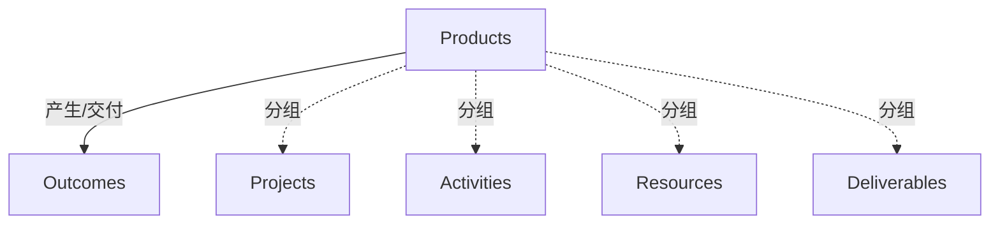

# G20F/fig5-5 · 产品与项目

类型：`decomposition-or-organization-model`。说明产品与项目的关系：产品管理比项目管理更宽，覆盖发现、开发、交付、长期支持维护与处置的完整生命周期；在这个生命周期内会启动多个项目与过程，项目是产品内的一个执行单元。

英文 PDF 物理页：[45]。本页为架构语义分析，原文与原图分别保留。

## 原图与可编辑图


[完整 JSON](fig5-5.json) · [可编辑 Mermaid](fig5-5.mmd) · [仅关系图](fig5-5.relations.mmd) · [层级分解图](fig5-5.hierarchy.mmd)

图形重建表达语义，不复制源图布局。虚线表示解释、矩阵映射或分组关系，不自动表示不确定性的概率。



## 架构分析

Products总框包含Projects与Deliverables；Activities/Resources跨越Projects下边界，但仍在Products之内。唯一粗箭头从Products右边界朝外部Outcomes，未从内部Deliverables框出发。

- 本图有 6 个具名或隐含元素、1 条关系和 4 条包含/分组记录。
- 包含/分组树最大深度为 1；根节点为 产品、成果。
- 本图没有可直接确认为人员直属汇报的关系；视觉上下位置、能力分解和治理职责分别读取。
- 核对Products外框、Projects内框以及Activities/Resources两个跨越Projects下边界的框：它们处于Products内，未完全包含于Projects。
- Deliverables完全在Products内而在Projects外；右侧粗箭头由产品整体区域指向Outcomes，未画内部活动/资源→交付物线。

### 如何用于项目

- 按父项展开所有直接子项，检查同层粒度、重叠和缺项。
- 保留组成、分类、能力分解与组织汇报的区别；将示例名称替换为已确认的项目对象。

### 结构所表达的逻辑

- 产品生命周期可涉及多个项目及过程。
- Activities和Resources跨越项目边界，不能作为完全包含于Projects的子节点。
- Deliverables位于Products之内、Projects之外。
- 唯一可见箭头为Products→Outcomes；交付物与成果的概念关系可由正文讨论，但原图不是Deliverables→Outcomes线。

## 上下级与包含

Products视觉包含Projects、Deliverables及跨Projects边界的Activities/Resources；后两项的group_parent为Products，并另记与Projects重叠。Outcomes在外。

|父项|子项|层级类型|依据与解释|
|---|---|---|---|
|产品|项目|visual_grouping|框、泳道、域或分类组的成员归属；没有额外证据不提升为业务组合或管理关系。|
|产品|活动|visual_grouping|框、泳道、域或分类组的成员归属；没有额外证据不提升为业务组合或管理关系。|
|产品|资源|visual_grouping|框、泳道、域或分类组的成员归属；没有额外证据不提升为业务组合或管理关系。|
|产品|交付物|visual_grouping|框、泳道、域或分类组的成员归属；没有额外证据不提升为业务组合或管理关系。|

## 全部元素与角色

|元素ID|原文名称|类型|含义|直接父项|深度|
|---|---|---|---|---|---|
|products|Products|group|分组：产品|—||
|projects|Projects|group|分组：项目|产品|1|
|activities|Activities|process|跨越Projects下边界，属于产品生命周期整体；不完全嵌套在Projects。|产品|1|
|resources|Resources|resource|跨越Projects下边界，不应记录严格视觉Projects包含。|产品|1|
|deliverables|Deliverables|artifact|制品：交付物|产品|1|
|outcomes|Outcomes|goal|目标/成果：成果|—||

## 全部关系

唯一粗空心箭头从Products整体边界向右指向Outcomes；其余关系由包含和重叠表达，无Activities→Deliverables或Resources→Projects连接。

|主体|语义关系|客体|显式线/隐式|原文标签|依据|
|---|---|---|---|---|---|
|产品|产生/交付|成果|显式连线||粗空心箭头置于Products外框右边与Outcomes之间，不起于内部Deliverables框。|

## 本轮否定的历史关系

以下旧解释保留用于追溯，不进入当前关系图、层级或知识图谱的有效边。

|旧记录|主体|旧关系|客体|否定依据|
|---|---|---|---|---|
|1|活动|produces|交付物|源图没有Activities→Deliverables连线。|
|2|资源|serving|项目|源图没有Resources→Projects连线。|

## 本轮语义修正

- 粗空心箭头置于Products外框右边与Outcomes之间，不起于内部Deliverables框。
- 源图没有Activities→Deliverables连线。
- 源图没有Resources→Projects连线。

## 误读检查

- Activities/Resources不能完整归入Projects框。
- 箭头的可见起点是Products边界，不是内部Deliverables框。
- 框位置不表示活动先后或人员汇报关系。

## 原文证据

### [PDF 第 44 页](../../../documents/G20F.md#page-44)

> Project and product management are closely related, but in general product management is a broader discipline than project management. Product management covers the full lifecycle of discovery, development, delivery, long-term support and maintenance, and disposal, although disposal is often a relatively trivial step with digital products. Within this product lifecycle, there are likely to be a number of projects and processes invoked; e.g., a project for each major product deliverable, and a process to handle support requests from product users. Figure 5-5 shows the relationship between products and projects.
### [PDF 第 45 页](../../../documents/G20F.md#page-45)

> Figure 5-5: Products and Projects, based on Figure 43 from the Digital Practitioner Body of Knowledge™

## 来源与分析状态

所有元素/关系均有来源定位；未把历史解释重命名为本轮逐线视觉确认。源图与语义图是两种视图，布局不证明汇报或因果。

源 PDF SHA-256：`a8fe6569c7d6045ce4ac8d5320c09a3abdc556a0fc1cbcd584bd76a75f3f84be`。

源图记录：[原始解释与转录](../../../figures/G20F/fig5-5.json)。

```json
{
  "quality": {
    "graph_integrity": "checked",
    "semantic_analysis": "typed-graph-and-context-analysis",
    "visual_review": "source-content-audited",
    "notice_zh": "所有元素/关系均有来源定位；未把历史解释重命名为本轮逐线视觉确认。源图与语义图是两种视图，布局不证明汇报或因果。"
  },
  "source_uncertainty": {
    "confidence": "high",
    "uncertainties_zh": [
      "图中没有文字说明“交叠”的含义，Activities/Resources 压过项目边线表示跨项目边界属版式推断。",
      "原图内无标题，中文图题“产品与项目”按英文标题直译；英文标题另注明基于 DPBoK 标准 Figure 43。"
    ],
    "analyzed_from": [
      "英文 PDF 第 45 页原图截图（figctx GT crop + 2x2 放大块）",
      "英文 PDF 第 44–45 页正文与图题",
      "中文稿 G20Fe_赋能企业敏捷性.md 第 635–641 行",
      "figs/g20fe_fig5-5_en.png 与 figs/zh/g20fe_fig5-5_zh.png"
    ],
    "date": "2026-10-31"
  },
  "source_conflicts": []
}
```
