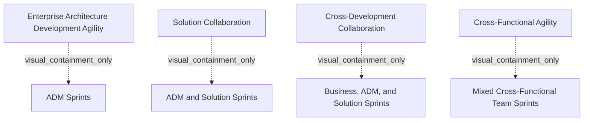

# G210/fig3-1 · 敏捷企业架构的协作方式

类型：`analytical-view`。作为第3章的导航图，列出四种协作方式及其冲刺构成；成熟度是正文所说的常见相关因素，不构成图中强制实施路径。

英文 PDF 物理页：[19]。本页为架构语义分析，原文与原图分别保留。

## 原图与可编辑图


[完整 JSON](fig3-1.json) · [可编辑 Mermaid](fig3-1.mmd) · [仅关系图](fig3-1.relations.mmd) · [层级分解图](fig3-1.hierarchy.mmd)

图形重建表达语义，不复制源图布局。虚线表示解释、矩阵映射或分组关系，不自动表示不确定性的概率。



## 架构分析

从左上开始，先左后右、先上后下：左上＝企业架构开发敏捷，右上＝解决方案协作，左下＝跨开发协作，右下＝跨职能敏捷。每个框第一行是方式名称，第二行写明该方式用哪些冲刺（ADM 冲刺 / ADM 与解决方案冲刺 / 业务、ADM 与解决方案冲刺 / 混合跨职能团队冲刺）。图中没有箭头，四个框是并列的可选方式，不是必经流程。

- 本图有 8 个具名或隐含元素、0 条关系和 4 条包含/分组记录。
- 包含/分组树最大深度为 1；根节点为 企业架构开发敏捷、解决方案协作、跨开发协作、跨职能敏捷。
- 本图没有可直接确认为人员直属汇报的关系；视觉上下位置、能力分解和治理职责分别读取。
- 原图靠嵌套表达结构，没有连线；新语义图将包含单独显式化，不补造流程、数据流或依赖。
- 包含分组后有 4 个连通分量；分离可能源于图例、并列分类或独立示例，未自动补边。
- 核对四个并列框中的方式名及冲刺构成，原图没有成熟度轴、阶梯或流程连线。正文说按组织需要采用，协作方式常与成熟度相关。

### 如何用于项目

- 围绕作者目的读取本图实体、分组与连线，并用对应原文限定其含义。
- 把参考模型与项目事实分开，实际范围、约束、值和责任须有项目证据。

### 结构所表达的逻辑

- 四种方式对应四种冲刺组合：只做 ADM 冲刺；ADM＋解决方案冲刺；业务＋ADM＋解决方案三套冲刺；混合跨职能团队冲刺。每个框的第二行就是这个组合。
- 四格的差别本质上是“参与协作的团队范围”逐级扩大：只有架构团队 → 架构＋解决方案 → 业务＋架构＋解决方案 → 三类能力收进同一个混合团队。
- 正文强调四种方式“取决于组织敏捷实践的需要”，并且这些协作层级“往往与企业的敏捷成熟度相一致”——成熟度是相关因素，不是图里画出来的坐标。
- 图中没有箭头或阶梯，四格地位并列；把四格读成必须依次经过的四个阶段是过度解读。
- 四种方式分别在 3.3.5（图 3-2）、3.3.6（图 3-3）、3.3.7（图 3-4）、3.3.8（图 3-5）展开，所以本图是全章的目录图，四张后续图各是其中一格的下钻。
- 第三种“跨开发协作”在正文里另有一句限定：交付企业架构有多种语境，每种语境下对冲刺、成果与成员的解释会不同（详见第 5 章），所以本图给出的只是最粗的分类。

## 上下级与包含

只有一层：四个并列的协作方式框，互相之间没有上下级。每个框内部是“方式名称（第一行）＋冲刺构成（第二行）”的主从关系，第二行从属于第一行，用来解释该方式怎么做。

|父项|子项|层级类型|依据与解释|
|---|---|---|---|
|企业架构开发敏捷|ADM 冲刺|visual_containment_only|保存原图解释中的包含；业务关系类型需要图例或正文进一步限定。|
|解决方案协作|ADM 与解决方案冲刺|visual_containment_only|保存原图解释中的包含；业务关系类型需要图例或正文进一步限定。|
|跨开发协作|业务、ADM 与解决方案冲刺|visual_containment_only|保存原图解释中的包含；业务关系类型需要图例或正文进一步限定。|
|跨职能敏捷|混合跨职能团队冲刺|visual_containment_only|保存原图解释中的包含；业务关系类型需要图例或正文进一步限定。|

## 全部元素与角色

|元素ID|原文名称|类型|含义|直接父项|深度|
|---|---|---|---|---|---|
|mode_ea_dev|Enterprise Architecture Development Agility|concept|ADM冲刺交付企业架构。|—||
|mode_ea_dev_sprints|ADM Sprints|note|该方式采用“ADM 冲刺”，即把 ADM 阶段 A–F 切片分到各冲刺。|企业架构开发敏捷|1|
|mode_solution_collab|Solution Collaboration|concept|ADM与解决方案冲刺协作。|—||
|mode_solution_collab_sprints|ADM and Solution Sprints|note|每个冲刺同时含 EA 与解决方案开发。|解决方案协作|1|
|mode_cross_dev|Cross-Development Collaboration|concept|业务、ADM和解决方案冲刺协作。|—||
|mode_cross_dev_sprints|Business, ADM, and Solution Sprints|note|业务开发、企业架构、解决方案三类冲刺同时存在。|跨开发协作|1|
|mode_cross_functional|Cross-Functional Agility|concept|具备三类能力的混合跨职能团队进行冲刺。|—||
|mode_cross_functional_sprints|Mixed Cross-Functional Team Sprints|note|由混合的跨职能团队承担冲刺，不再有专门团队。|跨职能敏捷|1|

## 全部关系

原图没有任何连线、箭头或坐标轴。四格的先后只能由排版顺序（左上→右上→左下→右下）和正文的叙述顺序暗示，属于阅读顺序而不是流程。

|主体|语义关系|客体|显式线/隐式|原文标签|依据|
|---|---|---|---|---|---|

## 误读检查

- 不要把 2×2 当成带两条轴的“四象限”分析：图里没有坐标轴，四格地位相同，也不存在“横轴高/纵轴低”的取值。
- 不要以为必须从第一种走到第四种；正文说的是“取决于需要”，成熟度只是常与这些层级相关。
- 不要忽略每格第二行——它才是“这种协作方式到底用哪些冲刺”的答案，名称本身并不说明做法。
- 中文稿当前引用的 figs/g210_fig3-1.svg 把四格排成一行并加了 ①②③④ 箭头和“敏捷成熟度 →”轴，还补了四条解释；这些是重绘者的加工，原图没有，不能反过来当作原图的含义。

## 原文证据

### [PDF 第 19 页](../../../documents/G210.md#page-19)

> There are many ways to collaborate between architects, business, and solution development. The roadmap to a more Agile way of doing Enterprise Architecture in this document is divided into four different methods that can be applied (see Figure 3-1), depending on the needs of the Agile practice in the organization. Often these collaboration levels coincide with the Agile maturity level of the enterprise.
### [PDF 第 20 页](../../../documents/G210.md#page-20)

> • Cross-Development Collaboration: deliver the solutions with collaborating Agile business development, Agile Enterprise Architecture, and Agile solution development sprints
> Each sprint contains Agile business development, Agile Enterprise Architecture, and Agile solution development. The business development team will create MVBDs for subsequent Enterprise Architecture sprints, and the Enterprise Architecture team will create MVAs for subsequent development sprints. Delivering Enterprise Architecture has contexts and within each context the interpretation of the sprint, outcome, and membership will vary. For more details, see Chapter 5.

## 来源与分析状态

所有元素/关系均有来源定位；未把历史解释重命名为本轮逐线视觉确认。源图与语义图是两种视图，布局不证明汇报或因果。

源 PDF SHA-256：`289803b369a49bc7f49c0d587b7f4af87899eebea8d834a6f52cbb2c3a657a58`。

源图记录：[原始解释与转录](../../../figures/G210/fig3-1.json)。

```json
{
  "quality": {
    "graph_integrity": "checked",
    "semantic_analysis": "typed-graph-and-context-analysis",
    "visual_review": "source-content-audited",
    "notice_zh": "所有元素/关系均有来源定位；未把历史解释重命名为本轮逐线视觉确认。源图与语义图是两种视图，布局不证明汇报或因果。"
  },
  "source_uncertainty": {
    "confidence": "high",
    "uncertainties_zh": [
      "四格在版面上是 2×2，但阅读顺序（先左后右再下一行）是推断，图中无编号或箭头明确标示。",
      "框内第二行副标题与第一行名称的对应关系（即“该方式用哪些冲刺”）依据正文 p20 与中文稿 L206–L209 补足；图上仅并列两行文字。"
    ],
    "analyzed_from": [
      "figctx.py G210/fig3-1 的 220 dpi 原图裁切（英文 PDF p19）与 2x2 放大分块",
      "英文 PDF p19（图题与正文）、p20（四种方式逐条说明）",
      "中文稿 G210e_以敏捷冲刺应用TOGAF_ADM.md L188–L209",
      "figs/g210_fig3-1.svg 源码（对比重绘版式与文字）"
    ],
    "date": "2026-10-31"
  },
  "source_conflicts": []
}
```
