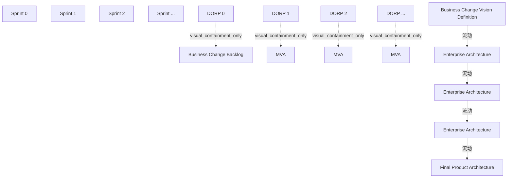

# G210/fig3-2 · ADM 中的企业架构开发冲刺

类型：`architecture-evolution-or-plan`。展示企业架构开发敏捷及DORP处的待办列表/MVA成果，读图时同时保留第23–24页关于切片实施的范围限定。

英文 PDF 物理页：[24]。本页为架构语义分析，原文与原图分别保留。

## 原图与可编辑图


[完整 JSON](fig3-2.json) · [可编辑 Mermaid](fig3-2.mmd) · [仅关系图](fig3-2.relations.mmd) · [层级分解图](fig3-2.hierarchy.mmd)

图形重建表达语义，不复制源图布局。虚线表示解释、矩阵映射或分组关系，不自动表示不确定性的概率。



## 架构分析

从左往右读。最左是企业架构团队与业务的输入“业务变革愿景定义”；它进入冲刺 0 的 DORP（橙色竖条）——竖条内的白色椭圆是冲刺 0 的成果“业务变革待办列表”。之后每一根竖条是一个冲刺末的 DORP，竖条之间的“Enterprise Architecture”框是该冲刺产出的架构切片，竖条内的虚线圆圈 MVA 是该冲刺交付的最小可行架构。最后一根竖条之后收束为“最终产品架构”。竖条不是活动框，而是“冲刺边界 + 演示/成果/回顾/规划/发布”的关口。

- 本图有 17 个具名或隐含元素、4 条关系和 4 条包含/分组记录。
- 包含/分组树最大深度为 1；根节点为 冲刺 0、冲刺 1、冲刺 2、冲刺 …、DORP 0、DORP 1、DORP 2、DORP …、业务变革愿景定义、企业架构、企业架构、企业架构、最终产品架构。
- 本图没有可直接确认为人员直属汇报的关系；视觉上下位置、能力分解和治理职责分别读取。
- 包含分组后有 9 个连通分量；分离可能源于图例、并列分类或独立示例，未自动补边。
- 核对17个标签/产物和4条连续蓝色箭头；DORP竖条被箭头穿过而非每段线的终点。
- 第24页图采用架构先行示例，但第23–24页正文明确允许已定义/可解耦切片直接或并行实施，不能概括为唯一禁止并行的方式。

### 如何用于项目

- 为每个演进状态/工作包登记前置条件、交付物、依赖和实际决策人。
- 时间轴表达计划顺序；架构范围、已批准计划和资源承诺须另有项目证据。

### 结构所表达的逻辑

- Sprint 0、1、2、…构成开放时间轴，DORP分别对应0、1、2、…。
- Business Change Backlog位于DORP 0，三个MVA标记位于之后的DORP区域。
- 每个切片可含ADM A–F的相关内容；正文允许直接实施或在整个EA完成后实施。
- 图终点是Final Product Architecture，没有绘制实施活动。
- MVA的虚线轮廓表示可交付但非总是必需，不能据此称每个可见标记都是强制门禁。

## 上下级与包含

两层：上层是时间轴（冲刺 0 → 1 → 2 → …），下层是各冲刺的产出物。纵向 DORP 竖条是冲刺关口，竖条内的椭圆/圆圈（待办列表、MVA）视觉上从属该竖条；企业架构框位于两根竖条之间，属于左侧冲刺的产出。

|父项|子项|层级类型|依据与解释|
|---|---|---|---|
|DORP 0|业务变革待办列表|visual_containment_only|保存原图解释中的包含；业务关系类型需要图例或正文进一步限定。|
|DORP 1|MVA（最小可行架构）|visual_containment_only|保存原图解释中的包含；业务关系类型需要图例或正文进一步限定。|
|DORP 2|MVA（最小可行架构）|visual_containment_only|保存原图解释中的包含；业务关系类型需要图例或正文进一步限定。|
|DORP …|MVA（最小可行架构）|visual_containment_only|保存原图解释中的包含；业务关系类型需要图例或正文进一步限定。|

## 全部元素与角色

|元素ID|原文名称|类型|含义|直接父项|深度|
|---|---|---|---|---|---|
|sprint_0|Sprint 0|time|准备冲刺（正文 3.3.4 亦称冲刺零/战略冲刺），只产出愿景与待办列表。|—||
|sprint_1|Sprint 1|time|时间：冲刺 1|—||
|sprint_2|Sprint 2|time|时间：冲刺 2|—||
|sprint_ellipsis|Sprint ...|time|省略号表示后续冲刺可继续任意次。|—||
|dorp_0|DORP 0|event|冲刺 0 末的演示/成果/回顾/规划/发布关口；柱内是业务变革待办列表。|—||
|dorp_1|DORP 1|event|冲刺 1 的 DORP；柱内是 MVA。|—||
|dorp_2|DORP 2|event|冲刺 2 的 DORP；柱内是 MVA。|—||
|dorp_ellipsis|DORP ...|event|后续冲刺的 DORP，柱内是 MVA。|—||
|bc_vision|Business Change Vision Definition|artifact|整条时间轴的输入。|—||
|bc_backlog|Business Change Backlog|artifact|冲刺 0 的成果，实线边框表示必需成果。|DORP 0|1|
|mva_1|MVA|artifact|冲刺 1 交付的最小可行架构。|DORP 1|1|
|mva_2|MVA|artifact|制品：MVA（最小可行架构）|DORP 2|1|
|mva_ellipsis|MVA|artifact|制品：MVA（最小可行架构）|DORP …|1|
|ea_1|Enterprise Architecture|artifact|冲刺 1 产出的企业架构切片。|—||
|ea_2|Enterprise Architecture|artifact|制品：企业架构|—||
|ea_ellipsis|Enterprise Architecture|artifact|制品：企业架构|—||
|final_arch|Final Product Architecture|artifact|图中的最终产品架构。此图示例未展开实施；正文同时允许切片直接或并行实施。|—||

## 全部关系

4条蓝色实线箭头连接愿景、连续EA切片与Final Product Architecture，穿过DORP竖条。待办列表/MVA标记位于相应DORP区域；MVA虚线轮廓在图例中定义为可交付但不总必需。

|主体|语义关系|客体|显式线/隐式|原文标签|依据|
|---|---|---|---|---|---|
|业务变革愿景定义|流动|企业架构|显式连线||连续水平箭头穿过DORP 0/待办列表区域，箭头尖端在第一个EA框左侧。|
|企业架构|流动|企业架构|显式连线||连续箭头穿过DORP 1，终点为下一个EA框。|
|企业架构|流动|企业架构|显式连线||连续箭头穿过DORP 2，终点为后续EA框。|
|企业架构|流动|最终产品架构|显式连线||连续箭头穿过最后DORP，终点为Final Product Architecture。|

## 本轮否定的历史关系

以下旧解释保留用于追溯，不进入当前关系图、层级或知识图谱的有效边。

|旧记录|主体|旧关系|客体|否定依据|
|---|---|---|---|---|
|1|DORP 0|flow|企业架构|这是同一愿景到EA框箭头的DORP后半段；DORP不是独立箭头起点，合并到当前连续连接。|
|3|DORP 1|flow|企业架构|DORP 1后的半段属于EA 1到EA 2同一连续连接，不另建DORP起点。|
|5|DORP 2|flow|企业架构|DORP 2后的半段属于EA 2到后续EA同一连续连接。|
|7|DORP …|flow|最终产品架构|最后DORP后的半段属于EA到Final Product Architecture同一连续连接。|

## 本轮语义修正

- 连续水平箭头穿过DORP 0/待办列表区域，箭头尖端在第一个EA框左侧。
- 这是同一愿景到EA框箭头的DORP后半段；DORP不是独立箭头起点，合并到当前连续连接。
- 连续箭头穿过DORP 1，终点为下一个EA框。
- DORP 1后的半段属于EA 1到EA 2同一连续连接，不另建DORP起点。
- 连续箭头穿过DORP 2，终点为后续EA框。
- DORP 2后的半段属于EA 2到后续EA同一连续连接。
- 连续箭头穿过最后DORP，终点为Final Product Architecture。
- 最后DORP后的半段属于EA到Final Product Architecture同一连续连接。

## 误读检查

- 不要将DORP竖条误作连续箭头的实际终点。
- 不要把该示例概括为所有情况下必须全部架构完成才允许实施。
- MVA标记的存在不证明对应冲刺必须完整交付全部架构。

## 原文证据

### [PDF 第 23 页](../../../documents/G210.md#page-23)

> The next sprints will pick up the most value-generating business change backlog items and create the next version of the solution.
> At the end of sprint zero, a DORP will be performed as for any other sprint. Only the next sprint is planned in detail; no other sprints are pre-planned.
### [PDF 第 24 页](../../../documents/G210.md#page-24)

> The solutions can be done using Agile or any other method, adapting the governance way of working to the implementation method. This will depend on the organization’s maturity level. Figure 3-2 shows how the Enterprise Architecture work can be divided into sprints. Using this collaboration pattern, the entire Enterprise Architecture is created before implementation is started. But the Enterprise Architecture team should consider the scope and depth of the Enterprise Architecture in relation to the implementation method.

## 来源与分析状态

所有元素/关系均有来源定位；未把历史解释重命名为本轮逐线视觉确认。源图与语义图是两种视图，布局不证明汇报或因果。

源 PDF SHA-256：`289803b369a49bc7f49c0d587b7f4af87899eebea8d834a6f52cbb2c3a657a58`。

源图记录：[原始解释与转录](../../../figures/G210/fig3-2.json)。

```json
{
  "quality": {
    "graph_integrity": "checked",
    "semantic_analysis": "typed-graph-and-context-analysis",
    "visual_review": "source-content-audited",
    "notice_zh": "所有元素/关系均有来源定位；未把历史解释重命名为本轮逐线视觉确认。源图与语义图是两种视图，布局不证明汇报或因果。"
  },
  "source_uncertainty": {
    "confidence": "high",
    "uncertainties_zh": [
      "冲刺 0 竖条内只有待办列表、没有 MVA，与“每个冲刺交付一个 MVA”的正文表述略有张力；按图如实记录为“冲刺 0 产出待办列表”。",
      "竖条宽度较窄，MVA 圆圈压在竖条边框上，圆圈是否完全属于竖条内部按视觉包含处理。"
    ],
    "analyzed_from": [
      "figctx.py G210/fig3-2 的 220 dpi 原图裁切（英文 PDF p24）与 2x2 放大分块、整页 80 dpi 概览",
      "英文 PDF p23–p24 正文与图题",
      "中文稿 G210e_以敏捷冲刺应用TOGAF_ADM.md L281–L307",
      "figs/g210_fig3-2.svg 源码（对比重绘版式与文字）"
    ],
    "date": "2026-10-31"
  },
  "source_conflicts": []
}
```
