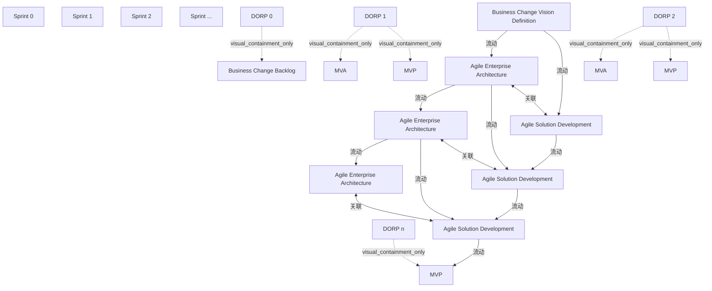

# G210/fig3-3 · ADM 中的架构与解决方案冲刺

类型：`architecture-evolution-or-plan`。在图 3-2 的单泳道之上加入解决方案开发泳道，说明“解决方案协作”：每个冲刺同时包含企业架构与敏捷解决方案开发；EA 团队为后续冲刺提供恰好及时的 MVA，解决方案团队为该 MVA 开发解决方案；两泳道在同一 DORP 中演示，并以虚线保持协作与治理支持。

英文 PDF 物理页：[26]。本页为架构语义分析，原文与原图分别保留。

## 原图与可编辑图


[完整 JSON](fig3-3.json) · [可编辑 Mermaid](fig3-3.mmd) · [仅关系图](fig3-3.relations.mmd) · [层级分解图](fig3-3.hierarchy.mmd)

图形重建表达语义，不复制源图布局。虚线表示解释、矩阵映射或分组关系，不自动表示不确定性的概率。



## 架构分析

沿上下两条并列泳道阅读连续冲刺。蓝色实线从愿景直接到冲刺1的EA及解决方案框；每个EA框续接下一EA，并斜向连接下一冲刺解决方案框；解决方案框沿本泳道续接，末端箭头到最后MVP。这些线穿过DORP竖条，DORP不是实际箭头终点。MVA/MVP位于对应DORP区域；竖向双端虚线表示同冲刺协作与治理支持。

- 本图有 21 个具名或隐含元素、12 条关系和 6 条包含/分组记录。
- 包含/分组树最大深度为 1；根节点为 冲刺 0、冲刺 1、冲刺 2、冲刺 …、DORP 0、DORP 1、DORP 2、DORP n、业务变革愿景定义、敏捷企业架构、敏捷企业架构、敏捷企业架构、敏捷解决方案开发、敏捷解决方案开发、敏捷解决方案开发。
- 本图没有可直接确认为人员直属汇报的关系；视觉上下位置、能力分解和治理职责分别读取。
- 包含分组后有 8 个连通分量；分离可能源于图例、并列分类或独立示例，未自动补边。
- 全部21个标签/产物、9条实线箭头和3条双向虚线均核对。跨泳道的实线直接到下一冲刺解决方案卡，DORP只是途经区域。
- 末端箭头落在最后MVP标记；叠放卡片表达多个团队，不能确定恰为三支团队。
- 补充图文对照：DORP图例包含“& Releases”，正文和附录定义四项；发布频率独立于冲刺，不能把图例解释为每轮必须发布。

### 如何用于项目

- 为每个演进状态/工作包登记前置条件、交付物、依赖和实际决策人。
- 时间轴表达计划顺序；架构范围、已批准计划和资源承诺须另有项目证据。

### 结构所表达的逻辑

- EA与解决方案团队在各冲刺内协作；EA为之后的解决方案冲刺创建及时的MVA。
- EA 1直接向下一EA及下一解决方案泳道输出，EA 2同样续接；DORP处提供演示、成果、回顾、规划与发布语境。
- DORP 1/2中有MVA与MVP，最后DORP n中仅画MVP；未画某标记不能推导未发生相应工作。
- 3条双向虚线为同冲刺协作、治理与支持，不是时间顺序。
- MVA与MVP的虚线轮廓按图例为可交付但不总必需；叠放卡不确定确切团队数。
- DORP原图图例含“& Releases”；正文明确四项活动，发布仅为条件性可能结果，需保留差异说明。
- 虚线双箭头表示协作/敏捷治理/支持，虚线成果轮廓表示可交付但不总必需；两类符号不得套用同一语义。

## 上下级与包含

EA与解决方案为并列泳道；DORP柱内放置成果标记，不是组织上下级。叠放卡片表示团队复数，具体人数/团队数量未规定。

|父项|子项|层级类型|依据与解释|
|---|---|---|---|
|DORP 0|业务变革待办列表|visual_containment_only|保存原图解释中的包含；业务关系类型需要图例或正文进一步限定。|
|DORP 1|MVA（最小可行架构）|visual_containment_only|保存原图解释中的包含；业务关系类型需要图例或正文进一步限定。|
|DORP 2|MVA（最小可行架构）|visual_containment_only|保存原图解释中的包含；业务关系类型需要图例或正文进一步限定。|
|DORP 1|MVP（最小可行产品）|visual_containment_only|保存原图解释中的包含；业务关系类型需要图例或正文进一步限定。|
|DORP 2|MVP（最小可行产品）|visual_containment_only|保存原图解释中的包含；业务关系类型需要图例或正文进一步限定。|
|DORP n|MVP（最小可行产品）|visual_containment_only|保存原图解释中的包含；业务关系类型需要图例或正文进一步限定。|

## 全部元素与角色

|元素ID|原文名称|类型|含义|直接父项|深度|
|---|---|---|---|---|---|
|sprint_0|Sprint 0|time|时间：冲刺 0|—||
|sprint_1|Sprint 1|time|时间：冲刺 1|—||
|sprint_2|Sprint 2|time|时间：冲刺 2|—||
|sprint_ellipsis|Sprint ...|time|时间：冲刺 …|—||
|dorp_0|DORP 0|event|冲刺 0 的 DORP；柱内是业务变革待办列表椭圆。|—||
|dorp_1|DORP 1|event|冲刺 1 的 DORP；柱内上为 MVA、下为 MVP。|—||
|dorp_2|DORP 2|event|冲刺 2 的 DORP；柱内上为 MVA、下为 MVP。|—||
|dorp_n|DORP n|event|最后一个冲刺的 DORP；柱内只有 MVP。|—||
|bc_vision|Business Change Vision Definition|artifact|同时向两条泳道供料：水平线进 EA 泳道、斜线进解决方案泳道。|—||
|bc_backlog|Business Change Backlog|artifact|制品：业务变革待办列表|DORP 0|1|
|ea_1|Agile Enterprise Architecture|artifact|制品：敏捷企业架构|—||
|ea_2|Agile Enterprise Architecture|artifact|制品：敏捷企业架构|—||
|ea_ellipsis|Agile Enterprise Architecture|artifact|制品：敏捷企业架构|—||
|asd_1|Agile Solution Development|process|流程：敏捷解决方案开发|—||
|asd_2|Agile Solution Development|process|流程：敏捷解决方案开发|—||
|asd_ellipsis|Agile Solution Development|process|流程：敏捷解决方案开发|—||
|mva_1|MVA|artifact|制品：MVA（最小可行架构）|DORP 1|1|
|mva_2|MVA|artifact|制品：MVA（最小可行架构）|DORP 2|1|
|mvp_1|MVP|artifact|制品：MVP（最小可行产品）|DORP 1|1|
|mvp_2|MVP|artifact|制品：MVP（最小可行产品）|DORP 2|1|
|mvp_n|MVP|artifact|制品：MVP（最小可行产品）|DORP n|1|

## 全部关系

9条实线箭头：愿景到冲刺1的EA/解决方案；每个已完成EA框到下一冲刺的EA与解决方案；解决方案框沿本泳道续接，末端到MVP。线穿过DORP柱而不止于柱。3条竖直虚线均有双端箭头，按第26页表示协作、敏捷治理与支持。

|主体|语义关系|客体|显式线/隐式|原文标签|依据|
|---|---|---|---|---|---|
|业务变革愿景定义|流动|敏捷企业架构|显式连线||按原生图连续箭头的可见起点、终点转录；不在DORP柱处人为拆线。|
|业务变革愿景定义|流动|敏捷解决方案开发|显式连线||按原生图连续箭头的可见起点、终点转录；不在DORP柱处人为拆线。|
|敏捷企业架构|流动|敏捷企业架构|显式连线||按原生图连续箭头的可见起点、终点转录；不在DORP柱处人为拆线。|
|敏捷企业架构|流动|敏捷解决方案开发|显式连线||按原生图连续箭头的可见起点、终点转录；不在DORP柱处人为拆线。|
|敏捷解决方案开发|流动|敏捷解决方案开发|显式连线||按原生图连续箭头的可见起点、终点转录；不在DORP柱处人为拆线。|
|敏捷企业架构|流动|敏捷企业架构|显式连线||按原生图连续箭头的可见起点、终点转录；不在DORP柱处人为拆线。|
|敏捷企业架构|流动|敏捷解决方案开发|显式连线||按原生图连续箭头的可见起点、终点转录；不在DORP柱处人为拆线。|
|敏捷解决方案开发|流动|敏捷解决方案开发|显式连线||按原生图连续箭头的可见起点、终点转录；不在DORP柱处人为拆线。|
|敏捷解决方案开发|流动|MVP（最小可行产品）|显式连线||按原生图连续箭头的可见起点、终点转录；不在DORP柱处人为拆线。|
|敏捷企业架构|关联|敏捷解决方案开发|显式连线||青色竖直虚线双箭头：同冲刺内协作与敏捷治理/支持|
|敏捷企业架构|关联|敏捷解决方案开发|显式连线||同上|
|敏捷企业架构|关联|敏捷解决方案开发|显式连线||同上|

## 本轮否定的历史关系

以下旧解释保留用于追溯，不进入当前关系图、层级或知识图谱的有效边。

|旧记录|主体|旧关系|客体|否定依据|
|---|---|---|---|---|
|1|DORP 0|flow|敏捷企业架构|历史记录将连续箭头拆成DORP起点的半段；该端点没有独立原图箭头，当前保留完整连接。|
|4|DORP 1|flow|敏捷企业架构|历史记录将连续箭头拆成DORP起点的半段；该端点没有独立原图箭头，当前保留完整连接。|
|8|DORP 2|flow|敏捷企业架构|历史记录将连续箭头拆成DORP起点的半段；该端点没有独立原图箭头，当前保留完整连接。|

## 本轮语义修正

- 按原生图连续箭头的可见起点、终点转录；不在DORP柱处人为拆线。
- 历史记录将连续箭头拆成DORP起点的半段；该端点没有独立原图箭头，当前保留完整连接。
- 按原生图连续箭头的可见起点、终点转录；不在DORP柱处人为拆线。
- 按原生图连续箭头的可见起点、终点转录；不在DORP柱处人为拆线。
- 历史记录将连续箭头拆成DORP起点的半段；该端点没有独立原图箭头，当前保留完整连接。
- 按原生图连续箭头的可见起点、终点转录；不在DORP柱处人为拆线。
- 按原生图连续箭头的可见起点、终点转录；不在DORP柱处人为拆线。
- 按原生图连续箭头的可见起点、终点转录；不在DORP柱处人为拆线。
- 历史记录将连续箭头拆成DORP起点的半段；该端点没有独立原图箭头，当前保留完整连接。
- 按原生图连续箭头的可见起点、终点转录；不在DORP柱处人为拆线。
- 按原生图连续箭头的可见起点、终点转录；不在DORP柱处人为拆线。
- 按原生图连续箭头的可见起点、终点转录；不在DORP柱处人为拆线。

## 误读检查

- DORP位于连线经过的区域，不能把其后半段当作独立DORP到团队箭头。
- 跨泳道实线从上一冲刺EA框直接指向下一冲刺解决方案框，不止于成果柱。
- 叠放的三张卡不能换算为准确三支团队或三个人。
- 不能以DORP图例中的Releases推导自动发布、每冲刺必须发布或已经得到发布批准。
- 不能把可选成果的虚线语义用于协作箭头，也不能把协作箭头解释成强制串行交接。

## 原文证据

### [PDF 第 24 页](../../../documents/G210.md#page-24)

> The solutions can be done using Agile or any other method, adapting the governance way of working to the implementation method. This will depend on the organization’s maturity level. Figure 3-2 shows how the Enterprise Architecture work can be divided into sprints. Using this collaboration pattern, the entire Enterprise Architecture is created before implementation is started. But the Enterprise Architecture team should consider the scope and depth of the Enterprise Architecture in relation to the implementation method.
> An example is that the Enterprise Architecture team defines slices (partitions) of the architecture for the business change in each sprint. A slice can contain any relevant ADM Phase A to F. Each slice can be implemented directly, or after the entire Enterprise Architecture is completed.
### [PDF 第 25 页](../../../documents/G210.md#page-25)

> As Figure 3-3 shows, during the first sprint (sprint zero), the result is the same as when just doing the Enterprise Architecture using sprints.
### [PDF 第 26 页](../../../documents/G210.md#page-26)

> The dashed lines indicate collaboration and Agile governance and support.
> An example is that the Enterprise Architecture team defines slices of the architecture for the business change in each sprint and the solution teams develops solutions for these slices.

## 来源与分析状态

所有元素/关系均有来源定位；未把历史解释重命名为本轮逐线视觉确认。源图与语义图是两种视图，布局不证明汇报或因果。

源 PDF SHA-256：`289803b369a49bc7f49c0d587b7f4af87899eebea8d834a6f52cbb2c3a657a58`。

源图记录：[原始解释与转录](../../../figures/G210/fig3-3.json)。

```json
{
  "quality": {
    "graph_integrity": "checked",
    "semantic_analysis": "typed-graph-and-context-analysis",
    "visual_review": "source-content-audited",
    "notice_zh": "所有元素/关系均有来源定位；未把历史解释重命名为本轮逐线视觉确认。源图与语义图是两种视图，布局不证明汇报或因果。"
  },
  "source_uncertainty": {
    "confidence": "high",
    "uncertainties_zh": [
      "每个 DORP 柱向右射出的两条短箭头（一条位于 MVP 圆上方、一条在下方）在原图中没有文字说明；解析按“上方＝架构成果跨泳道移交、下方＝解决方案增量延续”处理，二者都指向同一组解决方案卡。",
      "最后一个 EA 方框（Sprint … 列）右侧没有连线进入 DORP n，与其余列不同；按原图如实记录为不再向后连接。"
    ],
    "analyzed_from": [
      "figctx.py G210/fig3-3 的 220 dpi 原图裁切（英文 PDF p26）、2x2 与 3x3 放大分块、整页 80 dpi 概览",
      "英文 PDF p25–p26 正文与图题",
      "中文稿 G210e_以敏捷冲刺应用TOGAF_ADM.md L324–L342",
      "figs/g210_fig3-3.svg 源码（对比重绘版式与文字）",
      "自绘 420 dpi 裁切 + 像素级连线/箭头位置核对"
    ],
    "date": "2026-10-31"
  },
  "source_conflicts": [
    {
      "id": "G210:dorp-text-figure-difference:3-3",
      "kind": "text-versus-figure-definition-difference",
      "pdf_page": 26,
      "literal_figure_legend": "DORP = Demo, Outcome, Retrospective, Planning, & Releases",
      "body_activity_count": 4,
      "body_activity_names": [
        "Demo",
        "Outcome management",
        "Retrospective",
        "Planning"
      ],
      "resolution_zh": "图例逐字保留；正文2、3.3.2及附录A定义四活动。结合3.2发布频率可跨多冲刺，Releases只能视为条件性可能结果，不能增加为每冲刺强制第五项，也不能代替演示批准或发布授权。",
      "text_evidence": [
        {
          "source_unit_id": "G210:p0015:c014",
          "pdf_page": 15,
          "source_block_ids": [
            "G210:p0015:b029",
            "G210:p0015:b030",
            "G210:p0015:b031"
          ],
          "quote_en": "four activities",
          "source_path": "togaf-standard-10th/G210e.pdf",
          "source_sha256": "289803b369a49bc7f49c0d587b7f4af87899eebea8d834a6f52cbb2c3a657a58"
        },
        {
          "source_unit_id": "G210:p0018:c009",
          "pdf_page": 18,
          "source_block_ids": [
            "G210:p0018:b017",
            "G210:p0018:b018",
            "G210:p0018:b019",
            "G210:p0018:b020",
            "G210:p0018:b021",
            "G210:p0018:b022"
          ],
          "quote_en": "delivered once after several sprints",
          "source_path": "togaf-standard-10th/G210e.pdf",
          "source_sha256": "289803b369a49bc7f49c0d587b7f4af87899eebea8d834a6f52cbb2c3a657a58"
        },
        {
          "source_unit_id": "G210:p0033:c005",
          "pdf_page": 33,
          "source_block_ids": [
            "G210:p0033:b008"
          ],
          "quote_en": "approved demo",
          "source_path": "togaf-standard-10th/G210e.pdf",
          "source_sha256": "289803b369a49bc7f49c0d587b7f4af87899eebea8d834a6f52cbb2c3a657a58"
        },
        {
          "source_unit_id": "G210:p0039:c018",
          "pdf_page": 39,
          "source_block_ids": [
            "G210:p0039:b019"
          ],
          "quote_en": "Demo, Outcome, Retrospective, and Planning",
          "source_path": "togaf-standard-10th/G210e.pdf",
          "source_sha256": "289803b369a49bc7f49c0d587b7f4af87899eebea8d834a6f52cbb2c3a657a58"
        }
      ],
      "visual_evidence": {
        "source_path": "togaf-standard-10th/G210e.pdf",
        "source_sha256": "289803b369a49bc7f49c0d587b7f4af87899eebea8d834a6f52cbb2c3a657a58",
        "pdf_page": 26,
        "local_page_image": "togaf-standard-10th-ai/maintenance/work/G210/pdf-page-26.png",
        "figure_crop_sha256": [
          "398d521ae93623e85ef62d33613cd4801103b6ab7e4f396b9b67765153564cfb"
        ]
      }
    }
  ]
}
```
