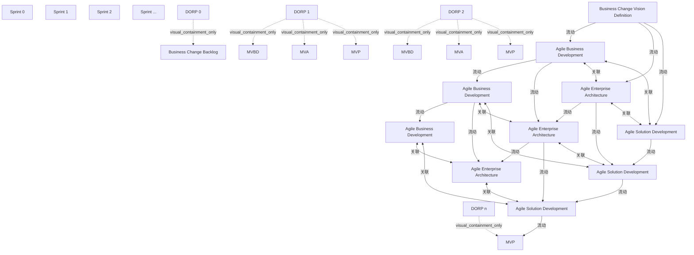

# G210/fig3-4 · 跨开发协作

类型：`architecture-evolution-or-plan`。展示“跨开发协作”：业务开发也以敏捷方式进入冲刺，三条泳道（业务开发、企业架构、解决方案）在同一冲刺内并行工作，但成果隔一个冲刺逐级交接，形成 MVBD→MVA→MVP 的恰好及时链；虚线表示三者之间在同一冲刺内的协作、治理与支持。

英文 PDF 物理页：[27]。本页为架构语义分析，原文与原图分别保留。

## 原图与可编辑图


[完整 JSON](fig3-4.json) · [可编辑 Mermaid](fig3-4.mmd) · [仅关系图](fig3-4.relations.mmd) · [层级分解图](fig3-4.hierarchy.mmd)

图形重建表达语义，不复制源图布局。虚线表示解释、矩阵映射或分组关系，不自动表示不确定性的概率。



## 架构分析

三条泳道共用一条时间轴：最上“Agile Business Development”，中间“Agile Enterprise Architecture”，最下“Agile Solution Development”（三张叠放卡＝多个团队）。橙色竖条是每个冲刺末的 DORP，柱内自上而下排列三类交付标记：MVBD（上）、MVA（中）、MVP（下）。横向细箭头是同一泳道穿过 DORP 进入下一冲刺；斜向细箭头是跨泳道交接——本冲刺的业务成果进入下一冲刺的架构，架构成果进入下一冲刺的解决方案。青色竖直虚线双箭头是同一冲刺内的协作与治理。

- 本图有 26 个具名或隐含元素、23 条关系和 8 条包含/分组记录。
- 包含/分组树最大深度为 1；根节点为 冲刺 0、冲刺 1、冲刺 2、冲刺 …、DORP 0、DORP 1、DORP 2、DORP n、业务变革愿景定义、敏捷业务开发、敏捷业务开发、敏捷业务开发、敏捷企业架构、敏捷企业架构、敏捷企业架构、敏捷解决方案开发、敏捷解决方案开发、敏捷解决方案开发。
- 本图没有可直接确认为人员直属汇报的关系；视觉上下位置、能力分解和治理职责分别读取。
- 包含分组后有 8 个连通分量；分离可能源于图例、并列分类或独立示例，未自动补边。
- 全部26个标签/产物、14条实线箭头及9条双向虚线均核对。业务到下一冲刺EA、EA到下一冲刺解决方案的斜线保留实际端点。
- 原生图冲刺0到业务开发1的短斜线箭头尖端位于业务框一侧，指向业务框；旧描述称起端箭头不能作为原图证据。
- 冲刺1解决方案叠放卡采用虚线轮廓；图例说明虚线成果可交付但非总必需。
- 补充图文对照：DORP图例包含“& Releases”，正文和附录定义四项；发布频率独立于冲刺，不能把图例解释为每轮必须发布。

### 如何用于项目

- 为每个演进状态/工作包登记前置条件、交付物、依赖和实际决策人。
- 时间轴表达计划顺序；架构范围、已批准计划和资源承诺须另有项目证据。

### 结构所表达的逻辑

- 每冲刺同时包含业务开发、企业架构及解决方案开发协作。
- 正文例子为业务冲刺1形成MVBD，EA冲刺2形成其MVA，解决方案冲刺3实现该MVA；图中跨泳道线相应指向下一冲刺。
- DORP 1/2中画MVBD、MVA、MVP；最后柱中仅画MVP。
- 冲刺1解决方案卡及各成果的虚线轮廓表示可交付但不总必需，不代表没有团队。
- 每冲刺三对双向虚线保留业务↔EA、EA↔解决方案、业务↔解决方案的协作、治理与支持。
- DORP原图图例含“& Releases”；正文明确四项活动，发布仅为条件性可能结果，需保留差异说明。
- 虚线双箭头表示协作/敏捷治理/支持，虚线成果轮廓表示可交付但不总必需；两类符号不得套用同一语义。

## 上下级与包含

业务开发、EA与解决方案为三个并列泳道；成果按泳道位置置于DORP。卡片叠放不确定确切团队数。

|父项|子项|层级类型|依据与解释|
|---|---|---|---|
|DORP 0|业务变革待办列表|visual_containment_only|保存原图解释中的包含；业务关系类型需要图例或正文进一步限定。|
|DORP 1|MVBD（最小可行业务开发）|visual_containment_only|保存原图解释中的包含；业务关系类型需要图例或正文进一步限定。|
|DORP 2|MVBD（最小可行业务开发）|visual_containment_only|保存原图解释中的包含；业务关系类型需要图例或正文进一步限定。|
|DORP 1|MVA（最小可行架构）|visual_containment_only|保存原图解释中的包含；业务关系类型需要图例或正文进一步限定。|
|DORP 2|MVA（最小可行架构）|visual_containment_only|保存原图解释中的包含；业务关系类型需要图例或正文进一步限定。|
|DORP 1|MVP（最小可行产品）|visual_containment_only|保存原图解释中的包含；业务关系类型需要图例或正文进一步限定。|
|DORP 2|MVP（最小可行产品）|visual_containment_only|保存原图解释中的包含；业务关系类型需要图例或正文进一步限定。|
|DORP n|MVP（最小可行产品）|visual_containment_only|保存原图解释中的包含；业务关系类型需要图例或正文进一步限定。|

## 全部元素与角色

|元素ID|原文名称|类型|含义|直接父项|深度|
|---|---|---|---|---|---|
|sprint_0|Sprint 0|time|时间：冲刺 0|—||
|sprint_1|Sprint 1|time|时间：冲刺 1|—||
|sprint_2|Sprint 2|time|时间：冲刺 2|—||
|sprint_ellipsis|Sprint ...|time|时间：冲刺 …|—||
|dorp_0|DORP 0|event|冲刺 0 的 DORP；柱内只有业务变革待办列表椭圆。|—||
|dorp_1|DORP 1|event|柱内自上而下：MVBD、MVA、MVP。|—||
|dorp_2|DORP 2|event|柱内自上而下：MVBD、MVA、MVP。|—||
|dorp_n|DORP n|event|柱内只有 MVP。|—||
|bc_vision|Business Change Vision Definition|artifact|向三条泳道分别发出水平线与一上一下两条斜线。|—||
|bc_backlog|Business Change Backlog|artifact|制品：业务变革待办列表|DORP 0|1|
|abd_1|Agile Business Development|process|流程：敏捷业务开发|—||
|abd_2|Agile Business Development|process|流程：敏捷业务开发|—||
|abd_ellipsis|Agile Business Development|process|流程：敏捷业务开发|—||
|ea_1|Agile Enterprise Architecture|artifact|制品：敏捷企业架构|—||
|ea_2|Agile Enterprise Architecture|artifact|制品：敏捷企业架构|—||
|ea_ellipsis|Agile Enterprise Architecture|artifact|制品：敏捷企业架构|—||
|asd_1|Agile Solution Development|process|该列解决方案卡以虚线绘制，对应图例“可交付但非必需”。|—||
|asd_2|Agile Solution Development|process|流程：敏捷解决方案开发|—||
|asd_ellipsis|Agile Solution Development|process|流程：敏捷解决方案开发|—||
|mvbd_1|MVBD|artifact|制品：MVBD（最小可行业务开发）|DORP 1|1|
|mvbd_2|MVBD|artifact|制品：MVBD（最小可行业务开发）|DORP 2|1|
|mva_1|MVA|artifact|制品：MVA（最小可行架构）|DORP 1|1|
|mva_2|MVA|artifact|制品：MVA（最小可行架构）|DORP 2|1|
|mvp_1|MVP|artifact|制品：MVP（最小可行产品）|DORP 1|1|
|mvp_2|MVP|artifact|制品：MVP（最小可行产品）|DORP 2|1|
|mvp_n|MVP|artifact|制品：MVP（最小可行产品）|DORP n|1|

## 全部关系

14条实线单向箭头保留实际连续端点：愿景进入3类团队、各泳道续接及业务→下一EA、EA→下一解决方案，末端解决方案到MVP。9条竖向双向虚线表示同冲刺各团队之间的协作与敏捷治理/支持；没有上下级含义。

|主体|语义关系|客体|显式线/隐式|原文标签|依据|
|---|---|---|---|---|---|
|业务变革愿景定义|流动|敏捷业务开发|显式连线||按原生图实线及箭头尖端记录连续连接，保留跨泳道真实端点。|
|业务变革愿景定义|流动|敏捷企业架构|显式连线||按原生图实线及箭头尖端记录连续连接，保留跨泳道真实端点。|
|业务变革愿景定义|流动|敏捷解决方案开发|显式连线||按原生图实线及箭头尖端记录连续连接，保留跨泳道真实端点。|
|敏捷业务开发|流动|敏捷业务开发|显式连线||按原生图实线及箭头尖端记录连续连接，保留跨泳道真实端点。|
|敏捷企业架构|流动|敏捷企业架构|显式连线||按原生图实线及箭头尖端记录连续连接，保留跨泳道真实端点。|
|敏捷业务开发|流动|敏捷企业架构|显式连线||按原生图实线及箭头尖端记录连续连接，保留跨泳道真实端点。|
|敏捷解决方案开发|流动|敏捷解决方案开发|显式连线||按原生图实线及箭头尖端记录连续连接，保留跨泳道真实端点。|
|敏捷企业架构|流动|敏捷解决方案开发|显式连线||按原生图实线及箭头尖端记录连续连接，保留跨泳道真实端点。|
|敏捷业务开发|流动|敏捷业务开发|显式连线||按原生图实线及箭头尖端记录连续连接，保留跨泳道真实端点。|
|敏捷企业架构|流动|敏捷企业架构|显式连线||按原生图实线及箭头尖端记录连续连接，保留跨泳道真实端点。|
|敏捷业务开发|流动|敏捷企业架构|显式连线||按原生图实线及箭头尖端记录连续连接，保留跨泳道真实端点。|
|敏捷解决方案开发|流动|敏捷解决方案开发|显式连线||按原生图实线及箭头尖端记录连续连接，保留跨泳道真实端点。|
|敏捷企业架构|流动|敏捷解决方案开发|显式连线||按原生图实线及箭头尖端记录连续连接，保留跨泳道真实端点。|
|敏捷解决方案开发|流动|MVP（最小可行产品）|显式连线||按原生图实线及箭头尖端记录连续连接，保留跨泳道真实端点。|
|敏捷业务开发|关联|敏捷企业架构|显式连线||业务开发↔企业架构的协作与治理支持|
|敏捷企业架构|关联|敏捷解决方案开发|显式连线||企业架构↔解决方案开发的协作与治理支持|
|敏捷业务开发|关联|敏捷解决方案开发|显式连线||业务开发↔解决方案开发的直接协作（本图比图 3-3 多出的一条）|
|敏捷业务开发|关联|敏捷企业架构|显式连线||业务开发↔企业架构|
|敏捷企业架构|关联|敏捷解决方案开发|显式连线||企业架构↔解决方案开发|
|敏捷业务开发|关联|敏捷解决方案开发|显式连线||业务开发↔解决方案开发|
|敏捷业务开发|关联|敏捷企业架构|显式连线||业务开发↔企业架构|
|敏捷企业架构|关联|敏捷解决方案开发|显式连线||企业架构↔解决方案开发|
|敏捷业务开发|关联|敏捷解决方案开发|显式连线||业务开发↔解决方案开发|

## 本轮否定的历史关系

以下旧解释保留用于追溯，不进入当前关系图、层级或知识图谱的有效边。

|旧记录|主体|旧关系|客体|否定依据|
|---|---|---|---|---|
|1|DORP 0|flow|敏捷业务开发|DORP后的半段已合并回完整实线；原图没有把DORP作为独立连接起点。|
|5|DORP 1|flow|敏捷业务开发|DORP后的半段已合并回完整实线；原图没有把DORP作为独立连接起点。|
|11|DORP 2|flow|敏捷业务开发|DORP后的半段已合并回完整实线；原图没有把DORP作为独立连接起点。|

## 本轮语义修正

- 按原生图实线及箭头尖端记录连续连接，保留跨泳道真实端点。
- DORP后的半段已合并回完整实线；原图没有把DORP作为独立连接起点。
- 按原生图实线及箭头尖端记录连续连接，保留跨泳道真实端点。
- 按原生图实线及箭头尖端记录连续连接，保留跨泳道真实端点。
- 按原生图实线及箭头尖端记录连续连接，保留跨泳道真实端点。
- DORP后的半段已合并回完整实线；原图没有把DORP作为独立连接起点。
- 按原生图实线及箭头尖端记录连续连接，保留跨泳道真实端点。
- 按原生图实线及箭头尖端记录连续连接，保留跨泳道真实端点。
- 按原生图实线及箭头尖端记录连续连接，保留跨泳道真实端点。
- 按原生图实线及箭头尖端记录连续连接，保留跨泳道真实端点。
- 按原生图实线及箭头尖端记录连续连接，保留跨泳道真实端点。
- DORP后的半段已合并回完整实线；原图没有把DORP作为独立连接起点。
- 按原生图实线及箭头尖端记录连续连接，保留跨泳道真实端点。
- 按原生图实线及箭头尖端记录连续连接，保留跨泳道真实端点。
- 按原生图实线及箭头尖端记录连续连接，保留跨泳道真实端点。
- 按原生图实线及箭头尖端记录连续连接，保留跨泳道真实端点。
- 按原生图实线及箭头尖端记录连续连接，保留跨泳道真实端点。

## 误读检查

- 三泳道并行，不是一个必须先后完成的三阶段瀑布。
- DORP柱不是跨泳道箭头的实际终点。
- 冲刺0到业务框的实际箭头指向业务框，不能采用旧文称起端箭头来改写方向。
- 叠放卡不确定具体人数或确切团队数。
- 不能以DORP图例中的Releases推导自动发布、每冲刺必须发布或已经得到发布批准。
- 不能把可选成果的虚线语义用于协作箭头，也不能把协作箭头解释成强制串行交接。

## 原文证据

### [PDF 第 26 页](../../../documents/G210.md#page-26)

> Business development should also be done in an Agile way. This collaboration pattern defines how the Agile business development, Enterprise Architecture, and Agile solution teams are actively collaborating in the process of creating the solution(s), as shown in Figure 3-4.
### [PDF 第 27 页](../../../documents/G210.md#page-27)

> prioritize the content of future sprints in collaboration between the business development, Enterprise Architecture, and Agile solution teams.
> At each demo, each Agile team will demo the current solution increments, proposed business development (MVBD), and Enterprise Architecture (MVA) for the next sprints. The MVBD and MVA are created to ensure that all stakeholders understand what they are getting and how they can affect the outcome. Potential customers can start using the product increment(s).
### [PDF 第 28 页](../../../documents/G210.md#page-28)

> As an example, the business team works on an MVBD in Sprint 1, the Enterprise Architecture team defines a just-in-time Enterprise Architecture (MVA) for that MVBD in Sprint 2, and the solution teams create solutions for that MVA in Sprint 3.
> The MVBD could be a set of incremental value stream changes and corresponding capability changes.

## 来源与分析状态

所有元素/关系均有来源定位；未把历史解释重命名为本轮逐线视觉确认。源图与语义图是两种视图，布局不证明汇报或因果。

源 PDF SHA-256：`289803b369a49bc7f49c0d587b7f4af87899eebea8d834a6f52cbb2c3a657a58`。

源图记录：[原始解释与转录](../../../figures/G210/fig3-4.json)。

```json
{
  "quality": {
    "graph_integrity": "checked",
    "semantic_analysis": "typed-graph-and-context-analysis",
    "visual_review": "source-content-audited",
    "notice_zh": "所有元素/关系均有来源定位；未把历史解释重命名为本轮逐线视觉确认。源图与语义图是两种视图，布局不证明汇报或因果。"
  },
  "source_uncertainty": {
    "confidence": "medium",
    "uncertainties_zh": [
      "冲刺 0 柱到“Agile Business Development”的短箭头，箭头画在柱的一侧（起端箭头），与其余列方向相反；按语义记为“柱→业务开发”。",
      "每条斜向交接线在穿过 DORP 柱时被柱体遮住，柱体两侧的线是否属同一条无法从像素上完全确认；解析按“同一折线穿过柱体”处理。",
      "冲刺 1 的解决方案堆叠卡为虚线边框，其余列为实线；图中未注明原因，按图例“虚线成果＝可交付但非必需”理解，属推断。",
      "每个 DORP 柱向右的两条短箭头（MVP 圆上/下）在原图中无文字说明，按“架构成果跨泳道移交 + 解决方案增量延续”处理。"
    ],
    "analyzed_from": [
      "figctx.py G210/fig3-4 的 220 dpi 原图裁切（英文 PDF p27）、2x2 放大分块",
      "英文 PDF p27–p28 正文与图题",
      "中文稿 G210e_以敏捷冲刺应用TOGAF_ADM.md L344–L374",
      "figs/g210_fig3-4.svg 源码（对比重绘版式与文字）",
      "自绘 420 dpi 裁切与像素级连线/虚线位置核对（竖直虚线每列 3 条）"
    ],
    "date": "2026-10-31"
  },
  "source_conflicts": [
    {
      "id": "G210:dorp-text-figure-difference:3-4",
      "kind": "text-versus-figure-definition-difference",
      "pdf_page": 27,
      "literal_figure_legend": "DORP = Demo, Outcome, Retrospective, Planning, & Releases",
      "body_activity_count": 4,
      "body_activity_names": [
        "Demo",
        "Outcome management",
        "Retrospective",
        "Planning"
      ],
      "resolution_zh": "图例逐字保留；正文2、3.3.2及附录A定义四活动。结合3.2发布频率可跨多冲刺，Releases只能视为条件性可能结果，不能增加为每冲刺强制第五项，也不能代替演示批准或发布授权。",
      "text_evidence": [
        {
          "source_unit_id": "G210:p0015:c014",
          "pdf_page": 15,
          "source_block_ids": [
            "G210:p0015:b029",
            "G210:p0015:b030",
            "G210:p0015:b031"
          ],
          "quote_en": "four activities",
          "source_path": "togaf-standard-10th/G210e.pdf",
          "source_sha256": "289803b369a49bc7f49c0d587b7f4af87899eebea8d834a6f52cbb2c3a657a58"
        },
        {
          "source_unit_id": "G210:p0018:c009",
          "pdf_page": 18,
          "source_block_ids": [
            "G210:p0018:b017",
            "G210:p0018:b018",
            "G210:p0018:b019",
            "G210:p0018:b020",
            "G210:p0018:b021",
            "G210:p0018:b022"
          ],
          "quote_en": "delivered once after several sprints",
          "source_path": "togaf-standard-10th/G210e.pdf",
          "source_sha256": "289803b369a49bc7f49c0d587b7f4af87899eebea8d834a6f52cbb2c3a657a58"
        },
        {
          "source_unit_id": "G210:p0033:c005",
          "pdf_page": 33,
          "source_block_ids": [
            "G210:p0033:b008"
          ],
          "quote_en": "approved demo",
          "source_path": "togaf-standard-10th/G210e.pdf",
          "source_sha256": "289803b369a49bc7f49c0d587b7f4af87899eebea8d834a6f52cbb2c3a657a58"
        },
        {
          "source_unit_id": "G210:p0039:c018",
          "pdf_page": 39,
          "source_block_ids": [
            "G210:p0039:b019"
          ],
          "quote_en": "Demo, Outcome, Retrospective, and Planning",
          "source_path": "togaf-standard-10th/G210e.pdf",
          "source_sha256": "289803b369a49bc7f49c0d587b7f4af87899eebea8d834a6f52cbb2c3a657a58"
        }
      ],
      "visual_evidence": {
        "source_path": "togaf-standard-10th/G210e.pdf",
        "source_sha256": "289803b369a49bc7f49c0d587b7f4af87899eebea8d834a6f52cbb2c3a657a58",
        "pdf_page": 27,
        "local_page_image": "togaf-standard-10th-ai/maintenance/work/G210/pdf-page-27.png",
        "figure_crop_sha256": [
          "a30855e08f9093e5e33eb2955bf0fc557c2c91f9f525fd73ea63697f8a807fb9"
        ]
      }
    }
  ]
}
```
