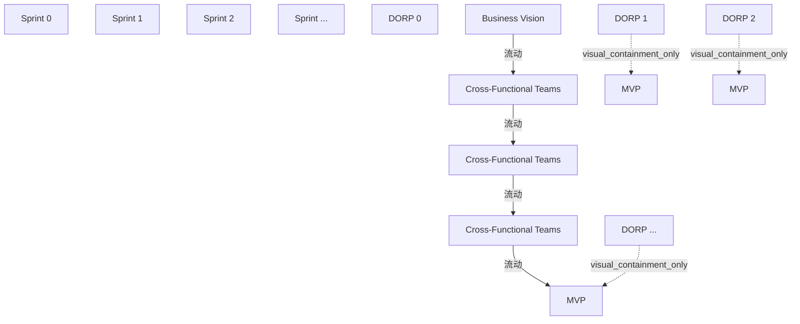

# G210/fig3-5 · 使用冲刺的敏捷改进型企业

类型：`architecture-evolution-or-plan`。展示混合跨职能自组织团队在每个冲刺内共同开展业务开发、EA及解决方案工作，并在冲刺末协调。

英文 PDF 物理页：[29]。本页为架构语义分析，原文与原图分别保留。

## 原图与可编辑图


[完整 JSON](fig3-5.json) · [可编辑 Mermaid](fig3-5.mmd) · [仅关系图](fig3-5.relations.mmd) · [层级分解图](fig3-5.hierarchy.mmd)

图形重建表达语义，不复制源图布局。虚线表示解释、矩阵映射或分组关系，不自动表示不确定性的概率。



## 架构分析

从业务愿景沿时间轴到连续冲刺中的Cross-Functional Teams，再到最后MVP。DORP柱是演示/成果/回顾/规划与发布语境；正文仍要求demo展示当前解决方案增量以及后续MVBD/MVA。

- 本图有 15 个具名或隐含元素、4 条关系和 3 条包含/分组记录。
- 包含/分组树最大深度为 1；根节点为 冲刺 0、冲刺 1、冲刺 2、冲刺 …、DORP 0、DORP 1、DORP 2、DORP …、业务愿景、跨职能团队、跨职能团队、跨职能团队。
- 本图没有可直接确认为人员直属汇报的关系；视觉上下位置、能力分解和治理职责分别读取。
- 包含分组后有 8 个连通分量；分离可能源于图例、并列分类或独立示例，未自动补边。
- 核对15个标签/产物、4条连续实线箭头；图仅画MVP，但第28页仍明确demo包含MVBD、MVA。
- 图例只明示MVP/DORP定义，没有本图专有的虚线成果语义说明；保留可见双层/虚线轮廓但不单凭本图补出强制与否。
- 补充图文对照：DORP图例包含“& Releases”，正文和附录定义四项；发布频率独立于冲刺，不能把图例解释为每轮必须发布。

### 如何用于项目

- 为每个演进状态/工作包登记前置条件、交付物、依赖和实际决策人。
- 时间轴表达计划顺序；架构范围、已批准计划和资源承诺须另有项目证据。

### 结构所表达的逻辑

- 图只保留一类跨职能团队卡，不再分3类专门团队泳道。
- 正文第28页明确每个团队具备业务开发、EA和解决方案开发能力，并在demo展示当前增量与后续MVBD/MVA。
- 图仅绘MVP标记，未绘MVA/MVBD不能推导这些成果被取消。
- 叠放卡表示团队复数，团队数量及是否为同一人员组成均未规定。
- 第29页正文说明团队在每冲刺末协调；图没有单独绘制团队间协调连接。
- DORP原图图例含“& Releases”；正文明确四项活动，发布仅为条件性可能结果，需保留差异说明。
- 本图MVP周围可见虚线轮廓，但未像图3-3/3-4那样另列可选成果说明；不自动补入别图图例。

## 上下级与包含

单层时间轴和跨职能团队；MVP位于相应DORP区域。团队内能力来自正文，图内不绘制内部层级。

|父项|子项|层级类型|依据与解释|
|---|---|---|---|
|DORP 1|MVP（最小可行产品）|visual_containment_only|保存原图解释中的包含；业务关系类型需要图例或正文进一步限定。|
|DORP 2|MVP（最小可行产品）|visual_containment_only|保存原图解释中的包含；业务关系类型需要图例或正文进一步限定。|
|DORP …|MVP（最小可行产品）|visual_containment_only|保存原图解释中的包含；业务关系类型需要图例或正文进一步限定。|

## 全部元素与角色

|元素ID|原文名称|类型|含义|直接父项|深度|
|---|---|---|---|---|---|
|sprint_0|Sprint 0|time|时间：冲刺 0|—||
|sprint_1|Sprint 1|time|时间：冲刺 1|—||
|sprint_2|Sprint 2|time|时间：冲刺 2|—||
|sprint_ellipsis|Sprint ...|time|时间：冲刺 …|—||
|dorp_0|DORP 0|event|冲刺 0 的 DORP，柱内无 MVP。|—||
|dorp_1|DORP 1|event|柱内为 MVP 标记。|—||
|dorp_2|DORP 2|event|柱内为 MVP 标记。|—||
|dorp_ellipsis|DORP ...|event|柱内为 MVP 标记。|—||
|business_vision|Business Vision|artifact|整条时间轴的输入，对应正文“冲刺零定义初始业务变革需求”。|—||
|cft_1|Cross-Functional Teams|organization_unit|组织单元：跨职能团队|—||
|cft_2|Cross-Functional Teams|organization_unit|组织单元：跨职能团队|—||
|cft_ellipsis|Cross-Functional Teams|organization_unit|组织单元：跨职能团队|—||
|mvp_1|MVP|artifact|制品：MVP（最小可行产品）|DORP 1|1|
|mvp_2|MVP|artifact|制品：MVP（最小可行产品）|DORP 2|1|
|mvp_ellipsis|MVP|artifact|制品：MVP（最小可行产品）|DORP …|1|

## 全部关系

4条连续蓝色单向实线连接愿景、连续跨职能团队卡及最后MVP；中间DORP/MVP区域位于箭头路径，不能人为拆成DORP起点的额外箭头。图没有团队间协作虚线；MVP轮廓有虚线，但本图图例没有定义其必要性。

|主体|语义关系|客体|显式线/隐式|原文标签|依据|
|---|---|---|---|---|---|
|业务愿景|流动|跨职能团队|显式连线||业务愿景到冲刺1跨职能团队的连续箭头经过DORP 0。|
|跨职能团队|流动|跨职能团队|显式连线||团队间的水平箭头经过DORP 1/MVP区域，终点为下一冲刺团队。|
|跨职能团队|流动|跨职能团队|显式连线||团队间水平箭头经过DORP 2/MVP区域，终点为后续冲刺团队。|
|跨职能团队|流动|MVP（最小可行产品）|显式连线||末端箭头尖端落在最后MVP标记左侧。|

## 本轮否定的历史关系

以下旧解释保留用于追溯，不进入当前关系图、层级或知识图谱的有效边。

|旧记录|主体|旧关系|客体|否定依据|
|---|---|---|---|---|
|1|DORP 0|flow|跨职能团队|DORP 0后的半段属于愿景到团队同一连续箭头。|
|3|DORP 1|flow|跨职能团队|DORP 1后的半段属于跨职能团队1到团队2同一连续箭头。|
|5|DORP 2|flow|跨职能团队|DORP 2后的半段属于团队2到后续团队同一连续箭头。|

## 本轮语义修正

- 业务愿景到冲刺1跨职能团队的连续箭头经过DORP 0。
- DORP 0后的半段属于愿景到团队同一连续箭头。
- 团队间的水平箭头经过DORP 1/MVP区域，终点为下一冲刺团队。
- DORP 1后的半段属于跨职能团队1到团队2同一连续箭头。
- 团队间水平箭头经过DORP 2/MVP区域，终点为后续冲刺团队。
- DORP 2后的半段属于团队2到后续团队同一连续箭头。
- 末端箭头尖端落在最后MVP标记左侧。

## 误读检查

- 图只绘MVP不等于正文取消MVBD或MVA。
- 叠放的3张卡不是具体3支团队，也不指定跨冲刺人员完全相同。
- 本图只有MVP/DORP定义；必要性解释须引用其他图/正文而非冒称本图有色标或虚线图例。
- 不能以DORP图例中的Releases推导自动发布、每冲刺必须发布或已经得到发布批准。
- 不能只凭虚线样式把图3-3/3-4的可选成果图例无条件移植到本图。

## 原文证据

### [PDF 第 28 页](../../../documents/G210.md#page-28)

> The first sprint (sprint zero) will define the initial business change needs that will help to prioritize the content of future sprints in collaboration between the business development, Enterprise Architecture, and Agile solution development teams (see Figure 3-5).
### [PDF 第 29 页](../../../documents/G210.md#page-29)

> As an example, a number of cross-functional teams each with some level of Enterprise Architecture capability creates solutions in each sprint. The teams coordinate their efforts at the end of each sprint.

## 来源与分析状态

所有元素/关系均有来源定位；未把历史解释重命名为本轮逐线视觉确认。源图与语义图是两种视图，布局不证明汇报或因果。

源 PDF SHA-256：`289803b369a49bc7f49c0d587b7f4af87899eebea8d834a6f52cbb2c3a657a58`。

源图记录：[原始解释与转录](../../../figures/G210/fig3-5.json)。

```json
{
  "quality": {
    "graph_integrity": "checked",
    "semantic_analysis": "typed-graph-and-context-analysis",
    "visual_review": "source-content-audited",
    "notice_zh": "所有元素/关系均有来源定位；未把历史解释重命名为本轮逐线视觉确认。源图与语义图是两种视图，布局不证明汇报或因果。"
  },
  "source_uncertainty": {
    "confidence": "high",
    "uncertainties_zh": [
      "三张叠放卡表示“多个团队”属推断（正文称“若干跨职能团队”），图中没有数量或团队名称。",
      "MVP 标记由白圆与偏移的虚线圆叠成，虚线外圈按图例理解为“可交付但非总是必需”。"
    ],
    "analyzed_from": [
      "figctx.py G210/fig3-5 的 220 dpi 原图裁切（英文 PDF p29）与 2x2 放大分块",
      "英文 PDF p28–p29 正文与图题",
      "中文稿 G210e_以敏捷冲刺应用TOGAF_ADM.md L376–L399",
      "figs/g210_fig3-5.svg 源码（对比重绘版式与文字）"
    ],
    "date": "2026-10-31"
  },
  "source_conflicts": [
    {
      "id": "G210:dorp-text-figure-difference:3-5",
      "kind": "text-versus-figure-definition-difference",
      "pdf_page": 29,
      "literal_figure_legend": "DORP = Demo, Outcome, Retrospective, Planning, & Releases",
      "body_activity_count": 4,
      "body_activity_names": [
        "Demo",
        "Outcome management",
        "Retrospective",
        "Planning"
      ],
      "resolution_zh": "图例逐字保留；正文2、3.3.2及附录A定义四活动。结合3.2发布频率可跨多冲刺，Releases只能视为条件性可能结果，不能增加为每冲刺强制第五项，也不能代替演示批准或发布授权。",
      "text_evidence": [
        {
          "source_unit_id": "G210:p0015:c014",
          "pdf_page": 15,
          "source_block_ids": [
            "G210:p0015:b029",
            "G210:p0015:b030",
            "G210:p0015:b031"
          ],
          "quote_en": "four activities",
          "source_path": "togaf-standard-10th/G210e.pdf",
          "source_sha256": "289803b369a49bc7f49c0d587b7f4af87899eebea8d834a6f52cbb2c3a657a58"
        },
        {
          "source_unit_id": "G210:p0018:c009",
          "pdf_page": 18,
          "source_block_ids": [
            "G210:p0018:b017",
            "G210:p0018:b018",
            "G210:p0018:b019",
            "G210:p0018:b020",
            "G210:p0018:b021",
            "G210:p0018:b022"
          ],
          "quote_en": "delivered once after several sprints",
          "source_path": "togaf-standard-10th/G210e.pdf",
          "source_sha256": "289803b369a49bc7f49c0d587b7f4af87899eebea8d834a6f52cbb2c3a657a58"
        },
        {
          "source_unit_id": "G210:p0033:c005",
          "pdf_page": 33,
          "source_block_ids": [
            "G210:p0033:b008"
          ],
          "quote_en": "approved demo",
          "source_path": "togaf-standard-10th/G210e.pdf",
          "source_sha256": "289803b369a49bc7f49c0d587b7f4af87899eebea8d834a6f52cbb2c3a657a58"
        },
        {
          "source_unit_id": "G210:p0039:c018",
          "pdf_page": 39,
          "source_block_ids": [
            "G210:p0039:b019"
          ],
          "quote_en": "Demo, Outcome, Retrospective, and Planning",
          "source_path": "togaf-standard-10th/G210e.pdf",
          "source_sha256": "289803b369a49bc7f49c0d587b7f4af87899eebea8d834a6f52cbb2c3a657a58"
        }
      ],
      "visual_evidence": {
        "source_path": "togaf-standard-10th/G210e.pdf",
        "source_sha256": "289803b369a49bc7f49c0d587b7f4af87899eebea8d834a6f52cbb2c3a657a58",
        "pdf_page": 29,
        "local_page_image": "togaf-standard-10th-ai/maintenance/work/G210/pdf-page-29.png",
        "figure_crop_sha256": [
          "e3dfcf1a208888207abf798ea612721512922ea5f38e85aed1e28953ba71ee0f"
        ]
      }
    }
  ]
}
```
