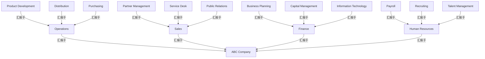

# G211/fig3-1 · ABC 公司组织架构图

类型：`decomposition-or-organization-model`。第 3.1.1 节的示例：组织结构是起草业务能力地图的三个信息来源之一。正文以本图为起点，访谈各业务单元负责人得到按单元分组的初始能力集，再按业务对象修正为一级能力候选清单（最终形成图 3-2）；同时提醒不要把组织架构图直接套成能力地图的框架。

英文 PDF 物理页：[16]。本页为架构语义分析，原文与原图分别保留。

## 原图与可编辑图


[完整 JSON](fig3-1.json) · [可编辑 Mermaid](fig3-1.mmd) · [仅关系图](fig3-1.relations.mmd) · [层级分解图](fig3-1.hierarchy.mmd)

图形重建表达语义，不复制源图布局。虚线表示解释、矩阵映射或分组关系，不自动表示不确定性的概率。



## 架构分析

自上而下读：顶部粗体框是 ABC 公司；第二行四个框是四个职能领域（业务单元），由一条横向蓝线接到 ABC 公司；每个职能领域框左下方伸出一条竖线，竖线上的短横线连到右侧的三个部门框，这三个部门向该职能领域汇报。部门框向右错开约半个框宽，看起来位于相邻两个职能领域之间，判断归属时要顺着竖线找，不要看正上方是哪个框。

- 本图有 17 个具名或隐含元素、16 条关系和 0 条包含/分组记录。
- 保留来源解释中的 16 条汇报/组织归属关系，其主体类型为 {'organization_unit': 16}；组织单元不是具体员工，来源示例不能变成项目现行人事结构。
- 17个组织单元与16条组织连接逐项核对；正文明确部门向所属业务单位汇报。
- 部门偏右布局不改变连线归属；此图不能直接转成能力地图。

### 如何用于项目

- 按父项展开所有直接子项，检查同层粒度、重叠和缺项。
- 保留组成、分类、能力分解与组织汇报的区别；将示例名称替换为已确认的项目对象。

### 结构所表达的逻辑

- 共三层 17 个组织单元：ABC 公司 → 4 个职能领域 → 12 个部门。运营：产品开发、分销、采购；销售：合作伙伴管理、服务台、公共关系；财务：业务规划、资本管理、信息技术；人力资源：薪资发放、招聘、人才管理。
- 图中只有正式的上下级汇报关系：每个部门只有一个上级，没有横向协作、跨单元团队或外部伙伴（这些是 G206 组织地图才表达的内容）。
- 本图是第 3.1.1 节的输入：正文访谈图中各业务单元负责人后，按单元列出初始能力集（销售 6 项、财务 2 项、人力资源 1 项、运营 8 项），再按业务对象分析修正，得到图 3-2 所用的一级能力候选清单。
- 图中的名称是部门/职能名（如 Payroll、Recruiting、Service Desk），不是“名词+动词”形式的能力名；正文要求避免让业务单元的职能名称与顶层能力一一对应，因为组织结构比能力更易变，一项能力也常由多个单元共同交付。
- 图与正文清单并不一一对应：图中“资本管理”和“业务规划”是财务下的部门，而正文初始能力集把资本管理列在运营下，并把业务规划视为没有明确归属单元的能力，在候选清单中单列到“ABC 公司”层级。
- 财务下的“信息技术”部门对应正文初始能力集中的“IT 管理”；正文指出 IT 常是能力重复的来源，并以“信息”为业务对象把它改为“信息管理”。

## 上下级与包含

三层树：第 0 层 ABC 公司；第 1 层 4 个职能领域（运营、销售、财务、人力资源，正文称业务单元/职能领域）；第 2 层 12 个部门，每个职能领域 3 个。上下级由连线表达，不是框的嵌套。

|父项|子项|层级类型|依据与解释|
|---|---|---|---|
|—|—|无视觉包含|关系中明确的组成/特化见 JSON semantic_hierarchy。|

### 明确汇报关系

|父项/范围/类型|子项/责任对象/实例|语义|
|---|---|---|
|ABC 公司|运营|reports_to|
|ABC 公司|销售|reports_to|
|ABC 公司|财务|reports_to|
|ABC 公司|人力资源|reports_to|
|运营|产品开发|reports_to|
|运营|分销|reports_to|
|运营|采购|reports_to|
|销售|合作伙伴管理|reports_to|
|销售|服务台|reports_to|
|销售|公共关系|reports_to|
|财务|业务规划|reports_to|
|财务|资本管理|reports_to|
|财务|信息技术|reports_to|
|人力资源|薪资发放|reports_to|
|人力资源|招聘|reports_to|
|人力资源|人才管理|reports_to|

## 全部元素与角色

|元素ID|原文名称|类型|含义|直接父项|深度|
|---|---|---|---|---|---|
|ou_abc|ABC Company|organization_unit|组织单元：ABC 公司|—||
|ou_operations|Operations|organization_unit|组织单元：运营|—||
|ou_sales|Sales|organization_unit|组织单元：销售|—||
|ou_finance|Finance|organization_unit|组织单元：财务|—||
|ou_hr|Human Resources|organization_unit|组织单元：人力资源|—||
|d_product_development|Product Development|organization_unit|组织单元：产品开发|—||
|d_distribution|Distribution|organization_unit|组织单元：分销|—||
|d_purchasing|Purchasing|organization_unit|组织单元：采购|—||
|d_partner_management|Partner Management|organization_unit|组织单元：合作伙伴管理|—||
|d_service_desk|Service Desk|organization_unit|组织单元：服务台|—||
|d_public_relations|Public Relations|organization_unit|组织单元：公共关系|—||
|d_business_planning|Business Planning|organization_unit|组织单元：业务规划|—||
|d_capital_management|Capital Management|organization_unit|组织单元：资本管理|—||
|d_information_technology|Information Technology|organization_unit|组织单元：信息技术|—||
|d_payroll|Payroll|organization_unit|组织单元：薪资发放|—||
|d_recruiting|Recruiting|organization_unit|组织单元：招聘|—||
|d_talent_management|Talent Management|organization_unit|组织单元：人才管理|—||

## 全部关系

所有连线都是蓝色直角折线，没有箭头，表示汇报关系：下级在下、上级在上。职能领域通过顶部横线接到 ABC 公司；部门通过所属职能领域左侧的竖线和短横线相连。关系清单中 reports_to 记为 from=下级、to=上级。

|主体|语义关系|客体|显式线/隐式|原文标签|依据|
|---|---|---|---|---|---|
|运营|汇报于|ABC 公司|显式连线||汇报于|
|销售|汇报于|ABC 公司|显式连线||汇报于|
|财务|汇报于|ABC 公司|显式连线||汇报于|
|人力资源|汇报于|ABC 公司|显式连线||汇报于|
|产品开发|汇报于|运营|显式连线||汇报于|
|分销|汇报于|运营|显式连线||汇报于|
|采购|汇报于|运营|显式连线||汇报于|
|合作伙伴管理|汇报于|销售|显式连线||汇报于|
|服务台|汇报于|销售|显式连线||汇报于|
|公共关系|汇报于|销售|显式连线||汇报于|
|业务规划|汇报于|财务|显式连线||汇报于|
|资本管理|汇报于|财务|显式连线||汇报于|
|信息技术|汇报于|财务|显式连线||汇报于|
|薪资发放|汇报于|人力资源|显式连线||汇报于|
|招聘|汇报于|人力资源|显式连线||汇报于|
|人才管理|汇报于|人力资源|显式连线||汇报于|

## 误读检查

- 部门框右移了半格，例如“合作伙伴管理”位于销售与财务之间，“业务规划”位于财务与人力资源之间；归属以连线为准（合作伙伴管理属销售，业务规划属财务）。
- 部门名中的“Management”（如 Partner Management、Capital Management、Talent Management）是部门名称，不等于业务能力；本图不是能力地图。
- 运营与销售、财务、人力资源是并列的四个职能领域，都直接向 ABC 公司汇报；中文稿当前引用的 figs/g211_fig3-1.svg 把运营画在财务下面，并缺少全部 12 个部门。

## 原文证据

### [PDF 第 16 页](../../../documents/G211.md#page-16)

> For example, ABC Company has four main functional areas, each with smaller departments that report up to the parent business unit, as shown in Figure 3-1.
### [PDF 第 17 页](../../../documents/G211.md#page-17)

> An initial investigation with the managers responsible for each of the business units in the organization chart yields the following starter set of business capabilities, where names are modified
> While organizational structure is roughly aligned to capabilities, the alignment is not perfect. It is not uncommon to find duplication or silos of capabilities in organization structures, because organizations do not align clearly to business objects. So, the starter set of capabilities needs to be analyzed to identify the business objects and refine the capability map for better alignment to business objects.
### [PDF 第 18 页](../../../documents/G211.md#page-18)

> Looking at the starter set of capabilities above there are cases in which it is not clear what the operative business concept is:
> • IT Management: IT is generally an organization that handles all aspects of information technology systems

## 来源与分析状态

所有元素/关系均有来源定位；未把历史解释重命名为本轮逐线视觉确认。源图与语义图是两种视图，布局不证明汇报或因果。

源 PDF SHA-256：`93fa7ac115956d34c0ad2161c46a5fd01cbc972d5f85a0f19f2f5b9d8c0a2b34`。

源图记录：[原始解释与转录](../../../figures/G211/fig3-1.json)。

```json
{
  "quality": {
    "graph_integrity": "checked",
    "semantic_analysis": "typed-graph-and-context-analysis",
    "visual_review": "source-content-audited",
    "notice_zh": "所有元素/关系均有来源定位；未把历史解释重命名为本轮逐线视觉确认。源图与语义图是两种视图，布局不证明汇报或因果。"
  },
  "source_uncertainty": {
    "confidence": "high",
    "uncertainties_zh": [
      "部门的中文译名（如“服务台”“薪资发放”“人才管理”）由解析者拟定，中文稿没有本图的标签对照；职能领域译名沿用中文稿正文（运营、销售、财务、人力资源）。"
    ],
    "analyzed_from": [
      "英文 PDF 第 16 页原图截图（220 dpi）",
      "英文 PDF 第 16–19 页正文",
      "中文稿 G211e_业务能力.md 第 187–219 行",
      "figs/g211_fig3-1.svg 源码"
    ],
    "date": "2026-10-31"
  },
  "source_conflicts": []
}
```
