# G211/fig3-2 · ABC 公司一级业务能力地图

类型：`mapping-or-assessment-matrix`。示范第 3.2.1 节的“分层”：把 20–30 项能力分类到不同层，让不同利益相关者聚焦各自关注的部分。本图综合了第 3.1 节的各项输入（组织结构、业务模式、战略/财务计划），也是第 5.1 节热力图（图 5-1）的底图。

英文 PDF 物理页：[20]。本页为架构语义分析，原文与原图分别保留。

## 原图与可编辑图


[完整 JSON](fig3-2.json) · [可编辑 Mermaid](fig3-2.mmd) · [仅关系图](fig3-2.relations.mmd) · [层级分解图](fig3-2.hierarchy.mmd)

图形重建表达语义，不复制源图布局。虚线表示解释、矩阵映射或分组关系，不自动表示不确定性的概率。

```mermaid
flowchart TB
  %% Semantic reconstruction; see original source image for exact layout.
  n0["Strategic"]
  n1["Core"]
  n2["Supporting"]
  n3["Business Planning"]
  n4["Market Planning"]
  n5["Partner Management"]
  n6["Capital Management"]
  n7["Policy Management"]
  n8["Regulatory Compliance Management"]
  n9["Account Management"]
  n10["Product Management"]
  n11["Distribution Management"]
  n12["Customer Management"]
  n13["Channel Management"]
  n14["Agent Management"]
  n15["Financial Management"]
  n16["HR Management"]
  n17["Asset Management"]
  n18["Information Management"]
  n19["Training Management"]
  n20["Operations Management"]
  n0 -.->|"分组"| n3
  n0 -.->|"分组"| n4
  n0 -.->|"分组"| n5
  n0 -.->|"分组"| n6
  n0 -.->|"分组"| n7
  n0 -.->|"分组"| n8
  n1 -.->|"分组"| n9
  n1 -.->|"分组"| n10
  n1 -.->|"分组"| n11
  n1 -.->|"分组"| n12
  n1 -.->|"分组"| n13
  n1 -.->|"分组"| n14
  n2 -.->|"分组"| n15
  n2 -.->|"分组"| n16
  n2 -.->|"分组"| n17
  n2 -.->|"分组"| n18
  n2 -.->|"分组"| n19
  n2 -.->|"分组"| n20
```



## 架构分析

左列自上而下是三层：Strategic（战略）、Core（核心）、Supporting（支撑）。每层右侧占两行，每行三格，共 6 项一级能力；某项能力属于哪一层，看它所在行对应的左列层名。同层内格子的行列位置没有含义。

- 本图有 21 个具名或隐含元素、0 条关系和 18 条包含/分组记录。
- 包含/分组树最大深度为 1；根节点为 战略层、核心层、支撑层。
- 本图没有可直接确认为人员直属汇报的关系；视觉上下位置、能力分解和治理职责分别读取。
- 原图靠嵌套表达结构，没有连线；新语义图将包含单独显式化，不补造流程、数据流或依赖。
- 包含分组后有 3 个连通分量；分离可能源于图例、并列分类或独立示例，未自动补边。
- 18个一级能力和Strategic/Core/Supporting三类逐格核对；三类是分层分类，不是不同能力深度。

### 如何用于项目

- 先固定行、列所代表的维度及单元格含义，再登记有证据的映射或评分。
- 空白、无关系、未测量和不适用分别处理；颜色不自动等于优先级。

### 结构所表达的逻辑

- 战略层（顶层，面向高管的战略与方向设定）：业务规划、市场规划、合作伙伴管理、资本管理、政策管理、监管合规管理。
- 核心层（中层，面向客户的核心业务）：账户管理、产品管理、分销管理、客户管理、渠道管理、代理商管理。
- 支撑层（底层，企业运转必需但在幕后支撑）：财务管理、人力资源管理、资产管理、信息管理、培训管理、运营管理。
- 分层与组织单元无关：初始清单中同属销售的能力分布在战略层（市场规划、合作伙伴管理）和核心层（账户、客户、渠道、代理商管理）；同属运营的能力分布在三层。这正是第 3.1.1 节“不要把组织架构图套到能力地图上”的体现。
- 18 项能力基本对应正文修正后的一级能力候选清单，但原图仍保留了正文建议改作价值流阶段处理的“分销管理”；原图写 Financial Management，正文清单写 Finance Management。
- 本图只回答“有哪些一级能力、各属哪一层”，不表达成熟度、重要性或归属单元；在同一版式上按成熟度着色就是图 5-1 的热力图。
- 每格都是一级（L1）能力；图 3-3 以其中的“人力资源管理”为例，向下分解出二级、三级能力。

## 上下级与包含

表格的行/列标题提供分类或交叉映射，不是人员上下级，也不表示能力粒度的父子关系。

|父项|子项|层级类型|依据与解释|
|---|---|---|---|
|战略层|业务规划|classified_under|行/列标题下的能力分类；原图标题没有包围能力单元的上级容器边框。|
|战略层|市场规划|classified_under|行/列标题下的能力分类；原图标题没有包围能力单元的上级容器边框。|
|战略层|合作伙伴管理|classified_under|行/列标题下的能力分类；原图标题没有包围能力单元的上级容器边框。|
|战略层|资本管理|classified_under|行/列标题下的能力分类；原图标题没有包围能力单元的上级容器边框。|
|战略层|政策管理|classified_under|行/列标题下的能力分类；原图标题没有包围能力单元的上级容器边框。|
|战略层|监管合规管理|classified_under|行/列标题下的能力分类；原图标题没有包围能力单元的上级容器边框。|
|核心层|账户管理|classified_under|行/列标题下的能力分类；原图标题没有包围能力单元的上级容器边框。|
|核心层|产品管理|classified_under|行/列标题下的能力分类；原图标题没有包围能力单元的上级容器边框。|
|核心层|分销管理|classified_under|行/列标题下的能力分类；原图标题没有包围能力单元的上级容器边框。|
|核心层|客户管理|classified_under|行/列标题下的能力分类；原图标题没有包围能力单元的上级容器边框。|
|核心层|渠道管理|classified_under|行/列标题下的能力分类；原图标题没有包围能力单元的上级容器边框。|
|核心层|代理商管理|classified_under|行/列标题下的能力分类；原图标题没有包围能力单元的上级容器边框。|
|支撑层|财务管理|classified_under|行/列标题下的能力分类；原图标题没有包围能力单元的上级容器边框。|
|支撑层|人力资源管理|classified_under|行/列标题下的能力分类；原图标题没有包围能力单元的上级容器边框。|
|支撑层|资产管理|classified_under|行/列标题下的能力分类；原图标题没有包围能力单元的上级容器边框。|
|支撑层|信息管理|classified_under|行/列标题下的能力分类；原图标题没有包围能力单元的上级容器边框。|
|支撑层|培训管理|classified_under|行/列标题下的能力分类；原图标题没有包围能力单元的上级容器边框。|
|支撑层|运营管理|classified_under|行/列标题下的能力分类；原图标题没有包围能力单元的上级容器边框。|

## 全部元素与角色

|元素ID|原文名称|类型|含义|直接父项|深度|
|---|---|---|---|---|---|
|tier_strategic|Strategic|group|分组：战略层|—||
|tier_core|Core|group|分组：核心层|—||
|tier_supporting|Supporting|group|分组：支撑层|—||
|c_business_planning|Business Planning|capability|能力：业务规划|战略层|1|
|c_market_planning|Market Planning|capability|能力：市场规划|战略层|1|
|c_partner_mgmt|Partner Management|capability|能力：合作伙伴管理|战略层|1|
|c_capital_mgmt|Capital Management|capability|能力：资本管理|战略层|1|
|c_policy_mgmt|Policy Management|capability|能力：政策管理|战略层|1|
|c_reg_compliance_mgmt|Regulatory Compliance Management|capability|能力：监管合规管理|战略层|1|
|c_account_mgmt|Account Management|capability|能力：账户管理|核心层|1|
|c_product_mgmt|Product Management|capability|能力：产品管理|核心层|1|
|c_distribution_mgmt|Distribution Management|capability|能力：分销管理|核心层|1|
|c_customer_mgmt|Customer Management|capability|能力：客户管理|核心层|1|
|c_channel_mgmt|Channel Management|capability|能力：渠道管理|核心层|1|
|c_agent_mgmt|Agent Management|capability|能力：代理商管理|核心层|1|
|c_financial_mgmt|Financial Management|capability|能力：财务管理|支撑层|1|
|c_hr_mgmt|HR Management|capability|图 3-3 对它做了分解。|支撑层|1|
|c_asset_mgmt|Asset Management|capability|能力：资产管理|支撑层|1|
|c_information_mgmt|Information Management|capability|能力：信息管理|支撑层|1|
|c_training_mgmt|Training Management|capability|能力：培训管理|支撑层|1|
|c_operations_mgmt|Operations Management|capability|能力：运营管理|支撑层|1|

## 全部关系

图中没有连线，表格边框只用来分隔单元格。能力属于哪一层由它所在的行带隐含表达，元素清单中用 parent 记录。

|主体|语义关系|客体|显式线/隐式|原文标签|依据|
|---|---|---|---|---|---|

## 一级能力地图（按原图逐行转录）

```json
{
  "id": "t_l1_map",
  "title_zh": "一级能力地图（按原图逐行转录）",
  "columns": [
    "层",
    "第 1 列",
    "第 2 列",
    "第 3 列"
  ],
  "rows": [
    [
      "战略 Strategic",
      "业务规划 Business Planning",
      "市场规划 Market Planning",
      "合作伙伴管理 Partner Management"
    ],
    [
      "战略 Strategic",
      "资本管理 Capital Management",
      "政策管理 Policy Management",
      "监管合规管理 Regulatory Compliance Management"
    ],
    [
      "核心 Core",
      "账户管理 Account Management",
      "产品管理 Product Management",
      "分销管理 Distribution Management"
    ],
    [
      "核心 Core",
      "客户管理 Customer Management",
      "渠道管理 Channel Management",
      "代理商管理 Agent Management"
    ],
    [
      "支撑 Supporting",
      "财务管理 Financial Management",
      "人力资源管理 HR Management",
      "资产管理 Asset Management"
    ],
    [
      "支撑 Supporting",
      "信息管理 Information Management",
      "培训管理 Training Management",
      "运营管理 Operations Management"
    ]
  ],
  "notes_zh": "原图每层两行，层名写在左列的合并单元格中；这里每行重复写出层名。"
}
```

## 误读检查

- 同层内行列位置只是排版，不表示分组、优先级或先后。
- 层不是组织单元，也不说明由哪个部门执行（能力与组织的对应见图 5-2 的做法）。
- 本图没有着色；成熟度差距着色在图 5-1 中才出现。
- 中文稿当前引用的 figs/g211_fig3-2.svg 只有 15 项能力（缺分销管理、培训管理、运营管理），且把市场规划、合作伙伴管理、资本管理、政策管理、监管合规管理、产品管理放到了与原图不同的层，不能据它判断分层。

## 原文证据

### [PDF 第 18 页](../../../documents/G211.md#page-18)

> Looking at the starter set of capabilities above there are cases in which it is not clear what the operative business concept is:
> • IT Management: IT is generally an organization that handles all aspects of information technology systems
### [PDF 第 19 页](../../../documents/G211.md#page-19)

> This detail enables the identification of duplication, redundancy, or gaps in capabilities across organizational units.
> Business capabilities provide the building blocks upon which to execute an organization’s business model. If an overarching business model exists, individual business capabilities (which support each of the core business model elements) can be derived from that. Mapping individual business capabilities back to the business model also ensures that the organization’s activities and investments are tightly aligned or targeted in support of the overall enterprise vision and strategy.
### [PDF 第 20 页](../../../documents/G211.md#page-20)

> Figure 3-2 represents an example of a Level 1 business capability map for ABC Company, derived from all the inputs discussed in the previous section.

## 来源与分析状态

所有元素/关系均有来源定位；未把历史解释重命名为本轮逐线视觉确认。源图与语义图是两种视图，布局不证明汇报或因果。

源 PDF SHA-256：`93fa7ac115956d34c0ad2161c46a5fd01cbc972d5f85a0f19f2f5b9d8c0a2b34`。

源图记录：[原始解释与转录](../../../figures/G211/fig3-2.json)。

```json
{
  "quality": {
    "graph_integrity": "checked",
    "semantic_analysis": "typed-graph-and-context-analysis",
    "visual_review": "source-content-audited",
    "notice_zh": "所有元素/关系均有来源定位；未把历史解释重命名为本轮逐线视觉确认。源图与语义图是两种视图，布局不证明汇报或因果。"
  },
  "source_uncertainty": {
    "confidence": "high",
    "uncertainties_zh": [
      "层名 Strategic/Core/Supporting 的中文“战略层/核心层/支撑层”由解析者拟定；中文稿正文用“顶层/中层/底层”描述。"
    ],
    "analyzed_from": [
      "英文 PDF 第 20 页原图截图（220 dpi）",
      "英文 PDF 第 17–20 页正文",
      "中文稿 G211e_业务能力.md 第 211–243 行",
      "figs/g211_fig3-2.svg 源码"
    ],
    "date": "2026-10-31"
  },
  "source_conflicts": []
}
```
