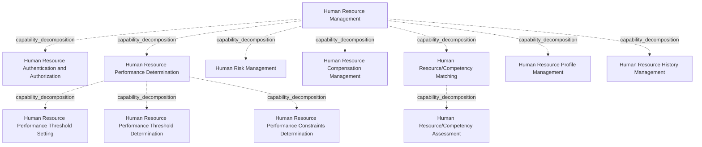

# G211/fig3-3 · 人力资源管理能力分解

类型：`decomposition-or-organization-model`。示范第 3.2.2 节的“分级”：把顶层（一级）能力逐层分解，以适合不同受众的细节程度沟通。高管可能只看一级视图，架构师和规划者需要更细的粒度；实践中常见 3–6 级。

英文 PDF 物理页：[21]。本页为架构语义分析，原文与原图分别保留。

## 原图与可编辑图


[完整 JSON](fig3-3.json) · [可编辑 Mermaid](fig3-3.mmd) · [仅关系图](fig3-3.relations.mmd) · [层级分解图](fig3-3.hierarchy.mmd)

图形重建表达语义，不复制源图布局。虚线表示解释、矩阵映射或分组关系，不自动表示不确定性的概率。



## 架构分析

外层蓝框的粗体标题是一级能力“人力资源管理”。框内纵向排列的 7 个蓝框是二级能力，每框首行是名称；框内缩进的小字是该二级能力下的三级能力。上下级完全由框的嵌套和缩进表达，没有连线；7 个二级框的上下次序没有含义。

- 本图有 12 个具名或隐含元素、0 条关系和 11 条包含/分组记录。
- 包含/分组树最大深度为 2；根节点为 人力资源管理。
- 本图没有可直接确认为人员直属汇报的关系；视觉上下位置、能力分解和治理职责分别读取。
- 原图靠嵌套表达结构，没有连线；新语义图将包含单独显式化，不补造流程、数据流或依赖。
- 1个L1能力、7个L2能力、4个L3条目（其中Performance Determination下三个、Competency Matching下一个）完整核对。
- 图只以嵌套表示分解，没有流程或汇报箭头。

### 如何用于项目

- 按父项展开所有直接子项，检查同层粒度、重叠和缺项。
- 保留组成、分类、能力分解与组织汇报的区别；将示例名称替换为已确认的项目对象。

### 结构所表达的逻辑

- 7 项二级能力：人力资源认证与授权、人力资源绩效测定、人员风险管理、人力资源薪酬管理、人力资源/胜任力匹配、人力资源档案管理、人力资源历史管理。
- “人力资源绩效测定”分解为 3 项三级能力：绩效阈值设定、绩效阈值测定、绩效约束测定。
- “人力资源/胜任力匹配”下也缩进列出一项“人力资源/胜任力评估”；正文只提到绩效测定的 3 项三级能力，没有提这一项。
- 分解深度不均匀：只有部分二级能力继续向下分解；正文说明分解层数只取决于向目标受众传达信息、或支撑能力差距决策的需要。
- 能力名都围绕业务对象“人力资源（人员）”展开（认证授权、绩效、风险、薪酬、胜任力、档案、历史），符合第 2.1.1 节以业务对象为名词核心的命名约定；分解的是能力本身，不是 HR 部门的组织或流程。
- 本图 7 项与同文档图 5-3 中“人力资源管理”下出现的二级能力（胜任力管理、员工供需管理、职位广告、技能评估、福利/条款/薪酬管理、入职跟踪）基本不重合，只有薪酬一项近似；两图都是示例，正文没有说明二者的关系。

## 上下级与包含

三级：一级能力“人力资源管理”（外框）→ 7 项二级能力（内框）→ 三级能力（内框中的缩进小字：绩效测定下 3 项，胜任力匹配下 1 项）。上下级只由嵌套和缩进表达。

|父项|子项|层级类型|依据与解释|
|---|---|---|---|
|人力资源管理|人力资源认证与授权|capability_decomposition|同类能力的包含分解；能力实例与能力类型另以实例化关系记录。|
|人力资源管理|人力资源绩效测定|capability_decomposition|同类能力的包含分解；能力实例与能力类型另以实例化关系记录。|
|人力资源绩效测定|人力资源绩效阈值设定|capability_decomposition|同类能力的包含分解；能力实例与能力类型另以实例化关系记录。|
|人力资源绩效测定|人力资源绩效阈值测定|capability_decomposition|同类能力的包含分解；能力实例与能力类型另以实例化关系记录。|
|人力资源绩效测定|人力资源绩效约束测定|capability_decomposition|同类能力的包含分解；能力实例与能力类型另以实例化关系记录。|
|人力资源管理|人员风险管理|capability_decomposition|同类能力的包含分解；能力实例与能力类型另以实例化关系记录。|
|人力资源管理|人力资源薪酬管理|capability_decomposition|同类能力的包含分解；能力实例与能力类型另以实例化关系记录。|
|人力资源管理|人力资源/胜任力匹配|capability_decomposition|同类能力的包含分解；能力实例与能力类型另以实例化关系记录。|
|人力资源/胜任力匹配|人力资源/胜任力评估|capability_decomposition|同类能力的包含分解；能力实例与能力类型另以实例化关系记录。|
|人力资源管理|人力资源档案管理|capability_decomposition|同类能力的包含分解；能力实例与能力类型另以实例化关系记录。|
|人力资源管理|人力资源历史管理|capability_decomposition|同类能力的包含分解；能力实例与能力类型另以实例化关系记录。|

## 全部元素与角色

|元素ID|原文名称|类型|含义|直接父项|深度|
|---|---|---|---|---|---|
|c_hrm|Human Resource Management|capability|能力：人力资源管理|—||
|c_hr_authn_authz|Human Resource Authentication and Authorization|capability|能力：人力资源认证与授权|人力资源管理|1|
|c_hr_perf_determination|Human Resource Performance Determination|capability|能力：人力资源绩效测定|人力资源管理|1|
|c_hr_perf_threshold_setting|Human Resource Performance Threshold Setting|capability|能力：人力资源绩效阈值设定|人力资源绩效测定|2|
|c_hr_perf_threshold_determination|Human Resource Performance Threshold Determination|capability|能力：人力资源绩效阈值测定|人力资源绩效测定|2|
|c_hr_perf_constraints_determination|Human Resource Performance Constraints Determination|capability|能力：人力资源绩效约束测定|人力资源绩效测定|2|
|c_human_risk_mgmt|Human Risk Management|capability|能力：人员风险管理|人力资源管理|1|
|c_hr_compensation_mgmt|Human Resource Compensation Management|capability|能力：人力资源薪酬管理|人力资源管理|1|
|c_hr_competency_matching|Human Resource/Competency Matching|capability|能力：人力资源/胜任力匹配|人力资源管理|1|
|c_hr_competency_assessment|Human Resource/Competency Assessment|capability|原图有，正文未提及。|人力资源/胜任力匹配|2|
|c_hr_profile_mgmt|Human Resource Profile Management|capability|能力：人力资源档案管理|人力资源管理|1|
|c_hr_history_mgmt|Human Resource History Management|capability|能力：人力资源历史管理|人力资源管理|1|

## 全部关系

图中没有连线。外框包含内框表示一级包含二级；内框中缩进的小字表示该二级能力下的三级能力。元素清单用 parent 记录这种包含关系。

|主体|语义关系|客体|显式线/隐式|原文标签|依据|
|---|---|---|---|---|---|

## 误读检查

- 二级框的上下排列不表示优先级或流程顺序。
- 缩进的小字是三级能力，不是对二级能力的说明文字。
- 原图第三项写作“Human Risk Management”（少了 Resource），按原图记录。
- 中文稿当前引用的 figs/g211_fig3-3.svg 换成了另一套通用 HR 职能，三级能力也不同，并画成连线错乱的树，不能据它理解本图。

## 原文证据

### [PDF 第 21 页](../../../documents/G211.md#page-21)

> Figure 3-3 shows the Human Resource Management business capability decomposition. Here, Human Resource Management is the Level 1 business capability. There are seven Level 2 business capabilities, including Human Resource Performance Determination, which in turn has been decomposed into three Level 3 business capabilities.

## 来源与分析状态

所有元素/关系均有来源定位；未把历史解释重命名为本轮逐线视觉确认。源图与语义图是两种视图，布局不证明汇报或因果。

源 PDF SHA-256：`93fa7ac115956d34c0ad2161c46a5fd01cbc972d5f85a0f19f2f5b9d8c0a2b34`。

源图记录：[原始解释与转录](../../../figures/G211/fig3-3.json)。

```json
{
  "quality": {
    "graph_integrity": "checked",
    "semantic_analysis": "typed-graph-and-context-analysis",
    "visual_review": "source-content-audited",
    "notice_zh": "所有元素/关系均有来源定位；未把历史解释重命名为本轮逐线视觉确认。源图与语义图是两种视图，布局不证明汇报或因果。"
  },
  "source_uncertainty": {
    "confidence": "high",
    "uncertainties_zh": [
      "二级、三级能力的中文译名由解析者拟定；中文稿只给出“人力资源绩效测定”一项。",
      "“人力资源/胜任力评估”按缩进记为三级能力；正文只说绩效测定下有三级能力，没有说明这一项。"
    ],
    "analyzed_from": [
      "英文 PDF 第 21 页原图截图（220 dpi）",
      "英文 PDF 第 21 页正文",
      "中文稿 G211e_业务能力.md 第 247–253 行",
      "figs/g211_fig3-3.svg 源码（文字与连线路径）"
    ],
    "date": "2026-10-31"
  },
  "source_conflicts": []
}
```
