# G211/fig5-1 · ABC 公司业务能力热力图

类型：`mapping-or-assessment-matrix`。示范第 5.1 节的热力映射：用颜色突出能力差距，让业务领导据此排定投资和项目优先级，把紫、红、黄的能力提升到期望成熟度。正文还指出同一能力地图可按其他视角（战略贡献、绩效、收入/成本贡献、覆盖度、关键性）生成不同热力图。

英文 PDF 物理页：[24]。本页为架构语义分析，原文与原图分别保留。

## 原图与可编辑图


[完整 JSON](fig5-1.json) · [可编辑 Mermaid](fig5-1.mmd) · [仅关系图](fig5-1.relations.mmd) · [层级分解图](fig5-1.hierarchy.mmd)

图形重建表达语义，不复制源图布局。虚线表示解释、矩阵映射或分组关系，不自动表示不确定性的概率。

```mermaid
flowchart TB
  %% Semantic reconstruction; see original source image for exact layout.
  n0["Strategic"]
  n1["Core"]
  n2["Supporting"]
  n3["Business Planning"]
  n4["Market Planning"]
  n5["Partner Management"]
  n6["Capital Management"]
  n7["Policy Management"]
  n8["Government Relations Management"]
  n9["Account Management"]
  n10["Product Management"]
  n11["Distribution Management"]
  n12["Customer Management"]
  n13["Channel Management"]
  n14["Agent Management"]
  n15["Financial Management"]
  n16["HR Management"]
  n17["Procurement Management"]
  n18["IT Management"]
  n19["Training Management"]
  n20["Operations Management"]
  n0 -.->|"分组"| n3
  n0 -.->|"分组"| n4
  n0 -.->|"分组"| n5
  n0 -.->|"分组"| n6
  n0 -.->|"分组"| n7
  n0 -.->|"分组"| n8
  n1 -.->|"分组"| n9
  n1 -.->|"分组"| n10
  n1 -.->|"分组"| n11
  n1 -.->|"分组"| n12
  n1 -.->|"分组"| n13
  n1 -.->|"分组"| n14
  n2 -.->|"分组"| n15
  n2 -.->|"分组"| n16
  n2 -.->|"分组"| n17
  n2 -.->|"分组"| n18
  n2 -.->|"分组"| n19
  n2 -.->|"分组"| n20
```



## 架构分析

版式与图 3-2 相同：左列三层（Strategic、Core、Supporting），每层右侧 2 × 3 格。先看颜色：绿 = 已达到期望成熟度；黄 = 差一级；红 = 差两级及以上；紫 = 今天不存在、未来需要。图上没有图例，颜色含义来自第 5.1 节正文。

- 本图有 21 个具名或隐含元素、0 条关系和 18 条包含/分组记录。
- 包含/分组树最大深度为 1；根节点为 战略层、核心层、支撑层。
- 本图没有可直接确认为人员直属汇报的关系；视觉上下位置、能力分解和治理职责分别读取。
- 原图靠嵌套表达结构，没有连线；新语义图将包含单独显式化，不补造流程、数据流或依赖。
- 包含分组后有 3 个连通分量；分离可能源于图例、并列分类或独立示例，未自动补边。
- 18项能力及颜色逐格核对：11绿、3黄、3红、1紫；颜色含义由PDF23页正文解释。
- 与图3-2的名称确有3项差异，保留源图差异，不合并为相同能力定义。

### 如何用于项目

- 先固定行、列所代表的维度及单元格含义，再登记有证据的映射或评分。
- 空白、无关系、未测量和不适用分别处理；颜色不自动等于优先级。

### 结构所表达的逻辑

- 红色（需立即关注）：市场规划、政府关系管理（均在战略层）、人力资源管理（支撑层）。
- 黄色（有问题但优先级较低）：合作伙伴管理（战略层）、客户管理（核心层）、培训管理（支撑层）。
- 紫色：代理商管理（核心层），是企业希望发展的新能力；正文说明能力缺失意味着重大差距。
- 其余 11 项为绿色，已达到期望成熟度。需要改进的能力分布在三层，没有集中在某一层。
- 本图与图 3-2 版式相同，但有 3 格名称不同：本图写政府关系管理、采购管理、IT 管理，图 3-2 同位置为监管合规管理、资产管理、信息管理（第 3.1.1 节修正后的名称）；正文解读本图时也沿用“政府关系管理”。
- 颜色只表达“成熟度”这一个视角；正文列出的战略贡献、绩效/有效性、收入贡献、成本贡献、覆盖度、关键性等视角可在同一能力地图上生成其他热力图。
- 热力图的结论用于投资决策：业务领导据此确保投资和项目举措按适当水平排序并获得资金。

## 上下级与包含

表格的行/列标题提供分类或交叉映射，不是人员上下级，也不表示能力粒度的父子关系。

|父项|子项|层级类型|依据与解释|
|---|---|---|---|
|战略层|业务规划|classified_under|行/列标题下的能力分类；原图标题没有包围能力单元的上级容器边框。|
|战略层|市场规划|classified_under|行/列标题下的能力分类；原图标题没有包围能力单元的上级容器边框。|
|战略层|合作伙伴管理|classified_under|行/列标题下的能力分类；原图标题没有包围能力单元的上级容器边框。|
|战略层|资本管理|classified_under|行/列标题下的能力分类；原图标题没有包围能力单元的上级容器边框。|
|战略层|政策管理|classified_under|行/列标题下的能力分类；原图标题没有包围能力单元的上级容器边框。|
|战略层|政府关系管理|classified_under|行/列标题下的能力分类；原图标题没有包围能力单元的上级容器边框。|
|核心层|账户管理|classified_under|行/列标题下的能力分类；原图标题没有包围能力单元的上级容器边框。|
|核心层|产品管理|classified_under|行/列标题下的能力分类；原图标题没有包围能力单元的上级容器边框。|
|核心层|分销管理|classified_under|行/列标题下的能力分类；原图标题没有包围能力单元的上级容器边框。|
|核心层|客户管理|classified_under|行/列标题下的能力分类；原图标题没有包围能力单元的上级容器边框。|
|核心层|渠道管理|classified_under|行/列标题下的能力分类；原图标题没有包围能力单元的上级容器边框。|
|核心层|代理商管理|classified_under|行/列标题下的能力分类；原图标题没有包围能力单元的上级容器边框。|
|支撑层|财务管理|classified_under|行/列标题下的能力分类；原图标题没有包围能力单元的上级容器边框。|
|支撑层|人力资源管理|classified_under|行/列标题下的能力分类；原图标题没有包围能力单元的上级容器边框。|
|支撑层|采购管理|classified_under|行/列标题下的能力分类；原图标题没有包围能力单元的上级容器边框。|
|支撑层|IT 管理|classified_under|行/列标题下的能力分类；原图标题没有包围能力单元的上级容器边框。|
|支撑层|培训管理|classified_under|行/列标题下的能力分类；原图标题没有包围能力单元的上级容器边框。|
|支撑层|运营管理|classified_under|行/列标题下的能力分类；原图标题没有包围能力单元的上级容器边框。|

## 全部元素与角色

|元素ID|原文名称|类型|含义|直接父项|深度|
|---|---|---|---|---|---|
|tier_strategic|Strategic|group|分组：战略层|—||
|tier_core|Core|group|分组：核心层|—||
|tier_supporting|Supporting|group|分组：支撑层|—||
|c_business_planning|Business Planning|capability|能力：业务规划|战略层|1|
|c_market_planning|Market Planning|capability|需立即关注。|战略层|1|
|c_partner_mgmt|Partner Management|capability|有问题，优先级较低。|战略层|1|
|c_capital_mgmt|Capital Management|capability|能力：资本管理|战略层|1|
|c_policy_mgmt|Policy Management|capability|能力：政策管理|战略层|1|
|c_gov_relations_mgmt|Government Relations Management|capability|需立即关注。图 3-2 同位置为“监管合规管理”。|战略层|1|
|c_account_mgmt|Account Management|capability|能力：账户管理|核心层|1|
|c_product_mgmt|Product Management|capability|能力：产品管理|核心层|1|
|c_distribution_mgmt|Distribution Management|capability|能力：分销管理|核心层|1|
|c_customer_mgmt|Customer Management|capability|有问题，优先级较低。|核心层|1|
|c_channel_mgmt|Channel Management|capability|能力：渠道管理|核心层|1|
|c_agent_mgmt|Agent Management|capability|企业希望发展的新能力（今天不存在）。|核心层|1|
|c_financial_mgmt|Financial Management|capability|能力：财务管理|支撑层|1|
|c_hr_mgmt|HR Management|capability|需立即关注。|支撑层|1|
|c_procurement_mgmt|Procurement Management|capability|图 3-2 同位置为“资产管理”。|支撑层|1|
|c_it_mgmt|IT Management|capability|图 3-2 同位置为“信息管理”。|支撑层|1|
|c_training_mgmt|Training Management|capability|有问题，优先级较低。|支撑层|1|
|c_operations_mgmt|Operations Management|capability|能力：运营管理|支撑层|1|

### 业务规划：属性

```json
{
  "heat": "green"
}
```

### 市场规划：属性

```json
{
  "heat": "red"
}
```

### 合作伙伴管理：属性

```json
{
  "heat": "yellow"
}
```

### 资本管理：属性

```json
{
  "heat": "green"
}
```

### 政策管理：属性

```json
{
  "heat": "green"
}
```

### 政府关系管理：属性

```json
{
  "heat": "red"
}
```

### 账户管理：属性

```json
{
  "heat": "green"
}
```

### 产品管理：属性

```json
{
  "heat": "green"
}
```

### 分销管理：属性

```json
{
  "heat": "green"
}
```

### 客户管理：属性

```json
{
  "heat": "yellow"
}
```

### 渠道管理：属性

```json
{
  "heat": "green"
}
```

### 代理商管理：属性

```json
{
  "heat": "purple"
}
```

### 财务管理：属性

```json
{
  "heat": "green"
}
```

### 人力资源管理：属性

```json
{
  "heat": "red"
}
```

### 采购管理：属性

```json
{
  "heat": "green"
}
```

### IT 管理：属性

```json
{
  "heat": "green"
}
```

### 培训管理：属性

```json
{
  "heat": "yellow"
}
```

### 运营管理：属性

```json
{
  "heat": "green"
}
```

## 全部关系

图中没有连线。能力属于哪一层由所在行带表达；成熟度状态由单元格底色表达（见元素 attributes.heat 和表格的 cell_legend）。

|主体|语义关系|客体|显式线/隐式|原文标签|依据|
|---|---|---|---|---|---|

## 能力成熟度热力图（按原图逐行转录，括号内为单元格颜色）

```json
{
  "id": "t_heatmap",
  "title_zh": "能力成熟度热力图（按原图逐行转录，括号内为单元格颜色）",
  "columns": [
    "层",
    "第 1 列",
    "第 2 列",
    "第 3 列"
  ],
  "rows": [
    [
      "战略 Strategic",
      "业务规划 Business Planning（绿）",
      "市场规划 Market Planning（红）",
      "合作伙伴管理 Partner Management（黄）"
    ],
    [
      "战略 Strategic",
      "资本管理 Capital Management（绿）",
      "政策管理 Policy Management（绿）",
      "政府关系管理 Government Relations Management（红）"
    ],
    [
      "核心 Core",
      "账户管理 Account Management（绿）",
      "产品管理 Product Management（绿）",
      "分销管理 Distribution Management（绿）"
    ],
    [
      "核心 Core",
      "客户管理 Customer Management（黄）",
      "渠道管理 Channel Management（绿）",
      "代理商管理 Agent Management（紫）"
    ],
    [
      "支撑 Supporting",
      "财务管理 Financial Management（绿）",
      "人力资源管理 HR Management（红）",
      "采购管理 Procurement Management（绿）"
    ],
    [
      "支撑 Supporting",
      "IT 管理 IT Management（绿）",
      "培训管理 Training Management（黄）",
      "运营管理 Operations Management（绿）"
    ]
  ],
  "cell_legend": [
    "绿 = 已达到期望成熟度",
    "黄 = 差一级",
    "红 = 差两级及以上",
    "紫 = 今天不存在、未来需要",
    "（原图无图例，含义取自第 5.1 节正文）"
  ],
  "notes_zh": "格子位置与图 3-2 一一对应；第 2 行第 3 列、第 5 行第 3 列、第 6 行第 1 列的名称与图 3-2 不同。"
}
```

## 误读检查

- 颜色表示与期望成熟度的差距，不表示能力的重要性或成本；红色是差距最大的，不是最重要的。
- 紫色表示今天不存在但未来需要，不是“比红色更差”的成熟度等级。
- 政府关系管理、采购管理、IT 管理与图 3-2 同位置的监管合规管理、资产管理、信息管理名称不同，原文没有解释；更像是沿用了修正前的名称，而不是新增或删除了能力（解析者推断）。
- 中文稿当前引用的 figs/g211_fig5-1.svg 按颜色重排了格子、去掉了分层，并混入了图 3-2 的能力名，不能据它对照各能力在地图上的位置。

## 原文证据

### [PDF 第 23 页](../../../documents/G211.md#page-23)

> The heat map example shown in Figure 5-1 represents ABC Company’s business capabilities when viewed from a capability maturity perspective.
### [PDF 第 24 页](../../../documents/G211.md#page-24)

> Here, we can see that Market Planning, Government Relations Management, and HR Management are in need of immediate attention. Partner Management, Customer Management, and Training Management have some issues but are of lower priority. Agent Management is a new business capability that the business wishes to develop. Business leaders can then take this information and ensure that investments and project initiatives are prioritized and funded at an appropriate level to bring those business capabilities shown in purple, red, or yellow up to the desired level of maturity.
> Different heat maps can be generated from the same business capability map, depending on what criteria, perspective, or lens the business wishes to apply. Other heat mapping examples include:

## 来源与分析状态

所有元素/关系均有来源定位；未把历史解释重命名为本轮逐线视觉确认。源图与语义图是两种视图，布局不证明汇报或因果。

源 PDF SHA-256：`93fa7ac115956d34c0ad2161c46a5fd01cbc972d5f85a0f19f2f5b9d8c0a2b34`。

源图记录：[原始解释与转录](../../../figures/G211/fig5-1.json)。

```json
{
  "quality": {
    "graph_integrity": "checked",
    "semantic_analysis": "typed-graph-and-context-analysis",
    "visual_review": "source-content-audited",
    "notice_zh": "所有元素/关系均有来源定位；未把历史解释重命名为本轮逐线视觉确认。源图与语义图是两种视图，布局不证明汇报或因果。"
  },
  "source_uncertainty": {
    "confidence": "high",
    "uncertainties_zh": [
      "原图没有图例，颜色含义按第 5.1 节对成熟度热力图的说明解释。",
      "3 格名称与图 3-2 不同的原因原文没有说明。"
    ],
    "analyzed_from": [
      "英文 PDF 第 24 页原图截图（220 dpi）",
      "英文 PDF 第 23–24 页正文",
      "中文稿 G211e_业务能力.md 第 296–311、353 行",
      "figs/g211_fig5-1.svg 源码（格子与颜色）"
    ],
    "date": "2026-10-31"
  },
  "source_conflicts": []
}
```
