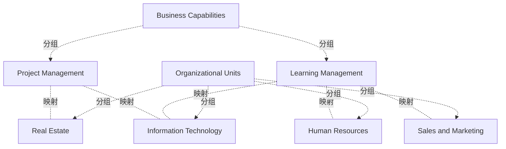

# G211/fig5-2 · 能力/组织映射示例

类型：`mapping-or-assessment-matrix`。示范第 5.2.1 节的能力/组织映射：多数能力只对应一个组织部分，但同一能力在多个部分执行可能导致部署不一致和低效。矩阵显示同一能力出现在哪些单元，叠加热力着色后还能看出整合或统一的机会。

英文 PDF 物理页：[25]。本页为架构语义分析，原文与原图分别保留。

## 原图与可编辑图


[完整 JSON](fig5-2.json) · [可编辑 Mermaid](fig5-2.mmd) · [仅关系图](fig5-2.relations.mmd) · [层级分解图](fig5-2.hierarchy.mmd)

图形重建表达语义，不复制源图布局。虚线表示解释、矩阵映射或分组关系，不自动表示不确定性的概率。



## 架构分析

逐行读：每行一项业务能力，向右看四个组织单元列。着色的格子表示该单元执行这项能力，空白表示不执行；颜色沿用第 5.1 节的红绿灯含义（绿好、黄有差距、红差距大）。同一行中颜色不同，说明同一能力在不同单元的表现不一致。

- 本图有 8 个具名或隐含元素、5 条关系和 6 条包含/分组记录。
- 包含/分组树最大深度为 1；根节点为 组织单元、业务能力。
- 本图没有可直接确认为人员直属汇报的关系；视觉上下位置、能力分解和治理职责分别读取。
- 2×4矩阵共8个业务单元/能力交叉格：3绿、1黄、1红、3白。
- 白格没有显示映射；颜色代表能力在组织单元中的状态，不是关系强度或岗位熟练等级。

### 如何用于项目

- 先固定行、列所代表的维度及单元格含义，再登记有证据的映射或评分。
- 空白、无关系、未测量和不适用分别处理；颜色不自动等于优先级。

### 结构所表达的逻辑

- 项目管理：在房地产（绿）和信息技术（黄）执行，人力资源、销售与市场不执行。
- 学习管理：在人力资源（绿）、信息技术（绿）、销售与市场（红）执行，房地产不执行。
- 两项能力都分布在多个单元，正是正文所说可能导致部署不一致和低效的情形；第 3.1.1 节从组织架构图识别能力时假设每项能力只对应一个业务单元，没有考察这种重复。
- 热力着色增加了一个维度：同一能力在各单元表现不同（如学习管理在销售与市场为红，在人力资源和信息技术为绿），提示可以整合或统一该能力。
- 正文给出两种整合思路：在能力内统一使用一套工具；或把能力完全重新归并到某个特定组织单元，以优化能力的全部组件。
- 本图的组织单元（人力资源、房地产、信息技术、销售与市场）不是图 3-1 中 ABC 公司的单元，是独立的通用示例。

## 上下级与包含

表格的行/列标题提供分类或交叉映射，不是人员上下级，也不表示能力粒度的父子关系。

|父项|子项|层级类型|依据与解释|
|---|---|---|---|
|组织单元|人力资源|classified_under|行/列标题下的能力分类；原图标题没有包围能力单元的上级容器边框。|
|组织单元|房地产|classified_under|行/列标题下的能力分类；原图标题没有包围能力单元的上级容器边框。|
|组织单元|信息技术|classified_under|行/列标题下的能力分类；原图标题没有包围能力单元的上级容器边框。|
|组织单元|销售与市场|classified_under|行/列标题下的能力分类；原图标题没有包围能力单元的上级容器边框。|
|业务能力|项目管理|classified_under|行/列标题下的能力分类；原图标题没有包围能力单元的上级容器边框。|
|业务能力|学习管理|classified_under|行/列标题下的能力分类；原图标题没有包围能力单元的上级容器边框。|

## 全部元素与角色

|元素ID|原文名称|类型|含义|直接父项|深度|
|---|---|---|---|---|---|
|grp_org_units|Organizational Units|group|横跨四个单元列的表头|—||
|grp_capabilities|Business Capabilities|group|行标题列的表头|—||
|ou_hr|Human Resources|organization_unit|组织单元：人力资源|组织单元|1|
|ou_real_estate|Real Estate|organization_unit|组织单元：房地产|组织单元|1|
|ou_it|Information Technology|organization_unit|组织单元：信息技术|组织单元|1|
|ou_sales_marketing|Sales and Marketing|organization_unit|组织单元：销售与市场|组织单元|1|
|c_project_mgmt|Project Management|capability|能力：项目管理|业务能力|1|
|c_learning_mgmt|Learning Management|capability|能力：学习管理|业务能力|1|

## 全部关系

没有连线。能力与组织单元的对应由单元格是否着色表达（关系清单中记为 maps_to，explicit=false），颜色写在关系说明和表格中。

|主体|语义关系|客体|显式线/隐式|原文标签|依据|
|---|---|---|---|---|---|
|项目管理|映射|房地产|implicit||单元格为绿色|
|项目管理|映射|信息技术|implicit||单元格为黄色|
|学习管理|映射|人力资源|implicit||单元格为绿色|
|学习管理|映射|信息技术|implicit||单元格为绿色|
|学习管理|映射|销售与市场|implicit||单元格为红色|

## 业务能力 × 组织单元（按原图逐行转录，单元格为颜色）

```json
{
  "id": "t_cap_org",
  "title_zh": "业务能力 × 组织单元（按原图逐行转录，单元格为颜色）",
  "columns": [
    "业务能力 Business Capabilities",
    "人力资源 Human Resources",
    "房地产 Real Estate",
    "信息技术 Information Technology",
    "销售与市场 Sales and Marketing"
  ],
  "rows": [
    [
      "项目管理 Project Management",
      "（空白）",
      "绿",
      "黄",
      "（空白）"
    ],
    [
      "学习管理 Learning Management",
      "绿",
      "（空白）",
      "绿",
      "红"
    ]
  ],
  "cell_legend": [
    "绿/黄/红 = 该单元执行此能力，颜色按第 5.1 节红绿灯含义表示表现或成熟度",
    "（空白）= 该单元不执行此能力",
    "原图没有图例，以上含义为推断"
  ],
  "notes_zh": "原图四个组织单元列上方还有一行横跨的表头“Organizational Units”。"
}
```

## 误读检查

- 空白格按常规理解为该单元不执行此能力；原文没有明说空白是“不执行”还是“未评估”。
- 颜色是该单元执行该能力的热力评价，不是能力整体的评分；同一能力在不同单元可以是不同颜色。
- 本图的组织单元与图 3-1 的 ABC 公司不同，不要套用 ABC 公司的组织结构。
- 中文稿当前引用的 figs/g211_fig5-2.svg 换成了另一套 5 × 5 的能力与组织，并自拟“核心承担单元/可能重复”的颜色含义，不能据它理解本图。

## 原文证据

### [PDF 第 24 页](../../../documents/G211.md#page-24)

> Here, we can see that Market Planning, Government Relations Management, and HR Management are in need of immediate attention. Partner Management, Customer Management, and Training Management have some issues but are of lower priority. Agent Management is a new business capability that the business wishes to develop. Business leaders can then take this information and ensure that investments and project initiatives are prioritized and funded at an appropriate level to bring those business capabilities shown in purple, red, or yellow up to the desired level of maturity.
> Different heat maps can be generated from the same business capability map, depending on what criteria, perspective, or lens the business wishes to apply. Other heat mapping examples include:
### [PDF 第 25 页](../../../documents/G211.md#page-25)

> Many business capabilities align to one and only one part of an organization. Business capabilities executed in many different parts of the organization can sometimes lead to inconsistent deployment and inefficiency. In the earlier example of looking at the organization chart to identify business capabilities, each business capability aligned to a specific business unit. In this case we did not look at duplicated capabilities. The matrix shown in Figure 5-2 shows how the same business capability can exist across different organizational units.

## 来源与分析状态

所有元素/关系均有来源定位；未把历史解释重命名为本轮逐线视觉确认。源图与语义图是两种视图，布局不证明汇报或因果。

源 PDF SHA-256：`93fa7ac115956d34c0ad2161c46a5fd01cbc972d5f85a0f19f2f5b9d8c0a2b34`。

源图记录：[原始解释与转录](../../../figures/G211/fig5-2.json)。

```json
{
  "quality": {
    "graph_integrity": "checked",
    "semantic_analysis": "typed-graph-and-context-analysis",
    "visual_review": "source-content-audited",
    "notice_zh": "所有元素/关系均有来源定位；未把历史解释重命名为本轮逐线视觉确认。源图与语义图是两种视图，布局不证明汇报或因果。"
  },
  "source_uncertainty": {
    "confidence": "medium",
    "uncertainties_zh": [
      "原图没有图例；绿/黄/红按第 5.1 节红绿灯含义解释，空白按“不执行”解释，原文均未明说。",
      "“Real Estate”译为“房地产”（指不动产/物业职能）由解析者拟定。"
    ],
    "analyzed_from": [
      "英文 PDF 第 25 页原图截图（220 dpi）",
      "英文 PDF 第 24–25 页正文",
      "中文稿 G211e_业务能力.md 第 315–325 行",
      "figs/g211_fig5-2.svg 源码（行列与颜色）"
    ],
    "date": "2026-10-31"
  },
  "source_conflicts": []
}
```
