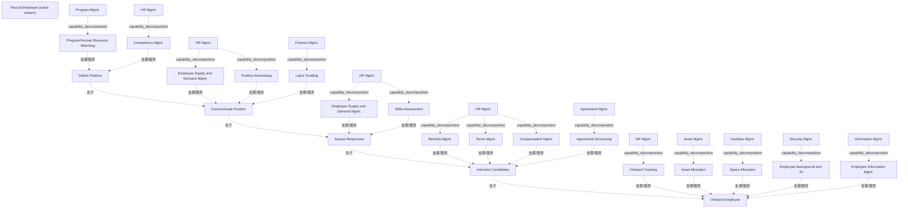

# G211/fig5-3 · 能力/价值流映射示例

类型：`mapping-or-assessment-matrix`。示范第 5.2.2 节的做法：识别完整实现价值流所需的能力后，按阶段走查并把能力映射到各阶段，从而看出哪些能力对价值交付更关键、哪些能力被多个阶段或多个价值流复用，为投资排序与举措规划提供依据。正文说明每项能力使能一个或多个价值阶段，并指出该示例是“招聘员工”价值流。

英文 PDF 物理页：[26]。本页为架构语义分析，原文与原图分别保留。

## 原图与可编辑图


[完整 JSON](fig5-3.json) · [可编辑 Mermaid](fig5-3.mmd) · [仅关系图](fig5-3.relations.mmd) · [层级分解图](fig5-3.hierarchy.mmd)

图形重建表达语义，不复制源图布局。虚线表示解释、矩阵映射或分组关系，不自动表示不确定性的概率。



## 架构分析

从左到右读顶部 5 个 V 形箭头，这是价值流阶段的先后顺序。每个箭头正下方那一列灰框，是使能该阶段的能力：框左上角较大字号的字是一级能力，框内深灰色条是该一级能力下被选中的二级能力。同一列内的多个框是并列关系，上下次序没有含义。图中没有连线，能力与阶段的对应完全由“在哪一列”表达。

- 本图有 34 个具名或隐含元素、20 条关系和 16 条包含/分组记录。
- 包含/分组树最大深度为 1；根节点为 招聘员工（价值流）、定义岗位、发布职位、评估应聘、面试候选人、入职、项目群管理、人力资源管理、财务管理、协议管理、资产管理、设施管理、安全管理、信息管理、人力资源管理（2阶段出现）、人力资源管理（3阶段出现）、人力资源管理（4阶段出现）、人力资源管理（5阶段出现）。
- 本图没有可直接确认为人员直属汇报的关系；视觉上下位置、能力分解和治理职责分别读取。
- 包含分组后有 2 个连通分量；分离可能源于图例、并列分类或独立示例，未自动补边。
- 五个阶段、各列能力组与子能力逐项核对；跨列重复HR Mgmt.和Employee Supply and Demand Mgmt.保留独立出现。
- 图未画能力→阶段连接线，按列布局和正文映射语义记录；阶段顺序由相邻人字形指示。

### 如何用于项目

- 先固定行、列所代表的维度及单元格含义，再登记有证据的映射或评分。
- 空白、无关系、未测量和不适用分别处理；颜色不自动等于优先级。

### 结构所表达的逻辑

- 价值流由 5 个有序阶段构成：定义岗位 → 发布职位 → 评估应聘 → 面试候选人 → 入职；这张图只画阶段，不画阶段的进入/退出标准。
- 人力资源管理是贯穿型一级能力，5 个阶段都出现，但每个阶段调用的二级能力不同：胜任力管理（定义）、员工供需管理与职位广告（发布）、员工供需管理与技能评估（评估）、福利/条款/薪酬管理（面试）、入职跟踪（入职）。
- 同一个二级能力可以支撑多个阶段：员工供需管理同时出现在“发布职位”和“评估应聘”下，说明能力与阶段是多对多映射。
- “入职”阶段涉及的一级能力最多（人力资源、资产、设施、安全、信息管理 5 项），是跨职能协作最重的阶段。
- 图中只列出与阶段直接相关的二级能力（如“入职”只列入职跟踪），没有把每个一级能力下的全部子能力都展开；未列出的子能力不表示不存在。
- 本图只表达“能力使能阶段”，不表达能力成熟度、绩效或差距；把能力映射到多个价值流的复用分析也只用文字说明，图上没有画。
- 交叉映射的比较价值在正文中明确指出：同一能力被多个价值流使用时，对运营与业务成功更重要；本图只画一个价值流，因此这一层复用分析要靠组织定义完整价值流集合后另行完成。

## 上下级与包含

能力框内部为能力分解；各列对齐表示能力支撑阶段。重复出现的HR框分开保存，阶段不被一个未画出的Recruit Employee外框视觉包含。

|父项|子项|层级类型|依据与解释|
|---|---|---|---|
|项目群管理|项目群/人力资源匹配|capability_decomposition|同类能力的包含分解；能力实例与能力类型另以实例化关系记录。|
|人力资源管理|胜任力管理|capability_decomposition|同类能力的包含分解；能力实例与能力类型另以实例化关系记录。|
|人力资源管理（2阶段出现）|员工供需管理|capability_decomposition|同类能力的包含分解；能力实例与能力类型另以实例化关系记录。|
|人力资源管理（2阶段出现）|职位广告|capability_decomposition|同类能力的包含分解；能力实例与能力类型另以实例化关系记录。|
|人力资源管理（3阶段出现）|技能评估|capability_decomposition|同类能力的包含分解；能力实例与能力类型另以实例化关系记录。|
|人力资源管理（4阶段出现）|福利管理|capability_decomposition|同类能力的包含分解；能力实例与能力类型另以实例化关系记录。|
|人力资源管理（4阶段出现）|雇佣条款管理|capability_decomposition|同类能力的包含分解；能力实例与能力类型另以实例化关系记录。|
|人力资源管理（4阶段出现）|薪酬管理|capability_decomposition|同类能力的包含分解；能力实例与能力类型另以实例化关系记录。|
|人力资源管理（5阶段出现）|入职跟踪|capability_decomposition|同类能力的包含分解；能力实例与能力类型另以实例化关系记录。|
|财务管理|人工经费|capability_decomposition|同类能力的包含分解；能力实例与能力类型另以实例化关系记录。|
|协议管理|协议架构设计|capability_decomposition|同类能力的包含分解；能力实例与能力类型另以实例化关系记录。|
|资产管理|资产分配|capability_decomposition|同类能力的包含分解；能力实例与能力类型另以实例化关系记录。|
|设施管理|空间分配|capability_decomposition|同类能力的包含分解；能力实例与能力类型另以实例化关系记录。|
|安全管理|员工背景调查与身份|capability_decomposition|同类能力的包含分解；能力实例与能力类型另以实例化关系记录。|
|信息管理|员工信息管理|capability_decomposition|同类能力的包含分解；能力实例与能力类型另以实例化关系记录。|
|人力资源管理（3阶段出现）|员工供需管理（评估响应列）|capability_decomposition|同类能力的包含分解；能力实例与能力类型另以实例化关系记录。|

## 全部元素与角色

|元素ID|原文名称|类型|含义|直接父项|深度|
|---|---|---|---|---|---|
|vs_recruit|Recruit Employee (value stream)|value_stream|正文命名Recruit Employee价值流；图内没有该名称的封闭外框，五阶段组成关系来自正文。|—||
|st_define|Define Position|value_stream_stage|价值流阶段：定义岗位|—||
|st_communicate|Communicate Position|value_stream_stage|价值流阶段：发布职位|—||
|st_assess|Assess Responses|value_stream_stage|价值流阶段：评估应聘|—||
|st_interview|Interview Candidates|value_stream_stage|价值流阶段：面试候选人|—||
|st_onboard|Onboard Employee|value_stream_stage|价值流阶段：入职|—||
|c_program|Program Mgmt.|capability|能力：项目群管理|—||
|c_hr|HR Mgmt.|capability|5 个阶段下都出现，但每个阶段调用的二级能力不同。|—||
|c_finance|Finance Mgmt.|capability|能力：财务管理|—||
|c_agreement|Agreement Mgmt.|capability|能力：协议管理|—||
|c_asset|Asset Mgmt.|capability|能力：资产管理|—||
|c_facilities|Facilities Mgmt.|capability|能力：设施管理|—||
|c_security|Security Mgmt.|capability|能力：安全管理|—||
|c_information|Information Mgmt.|capability|能力：信息管理|—||
|c_prog_hr_match|Program/Human Resource Matching|capability|能力：项目群/人力资源匹配|项目群管理|1|
|c_competency|Competency Mgmt.|capability|能力：胜任力管理|人力资源管理|1|
|c_supply_demand|Employee Supply and Demand Mgmt.|capability|同时支撑“发布职位”和“评估应聘”。|人力资源管理（2阶段出现）|1|
|c_position_ad|Position Advertising|capability|能力：职位广告|人力资源管理（2阶段出现）|1|
|c_skills_assess|Skills Assessment|capability|能力：技能评估|人力资源管理（3阶段出现）|1|
|c_benefits|Benefits Mgmt.|capability|能力：福利管理|人力资源管理（4阶段出现）|1|
|c_terms|Terms Mgmt.|capability|能力：雇佣条款管理|人力资源管理（4阶段出现）|1|
|c_compensation|Compensation Mgmt.|capability|能力：薪酬管理|人力资源管理（4阶段出现）|1|
|c_onboard_track|Onboard Tracking|capability|能力：入职跟踪|人力资源管理（5阶段出现）|1|
|c_labor_funding|Labor Funding|capability|能力：人工经费|财务管理|1|
|c_agreement_struct|Agreement Structuring|capability|能力：协议架构设计|协议管理|1|
|c_asset_alloc|Asset Allocation|capability|能力：资产分配|资产管理|1|
|c_space_alloc|Space Allocation|capability|能力：空间分配|设施管理|1|
|c_background_id|Employee Background and ID|capability|能力：员工背景调查与身份|安全管理|1|
|c_employee_info|Employee Information Mgmt.|capability|能力：员工信息管理|信息管理|1|
|c_hr_communicate|HR Mgmt.|capability|同名能力在该阶段的绘图出现，非另一种HR能力。|—||
|c_hr_assess|HR Mgmt.|capability|同名能力在该阶段的绘图出现，非另一种HR能力。|—||
|c_hr_interview|HR Mgmt.|capability|同名能力在该阶段的绘图出现，非另一种HR能力。|—||
|c_hr_onboard|HR Mgmt.|capability|同名能力在该阶段的绘图出现，非另一种HR能力。|—||
|c_supply_demand_assess|Employee Supply and Demand Mgmt.|capability|同名能力的第二次出现，与Communicate Position列分别保留位置。|人力资源管理（3阶段出现）|1|

## 全部关系

图中没有任何连接线。V 形箭头首尾相接表示阶段的先后顺序（关系清单中记为显式 sequence）；能力与阶段的使能关系由“灰框位于该阶段箭头正下方”隐含表达（explicit=false, line=implicit）；二级能力与一级能力的上下级由框内嵌套表达。这种“能力位于阶段下方”的画法对应价值流建模中的“能力使能价值阶段”关系（背景知识）。

|主体|语义关系|客体|显式线/隐式|原文标签|依据|
|---|---|---|---|---|---|
|定义岗位|先于|发布职位|adjacent-chevron-shapes||相邻人字形表示阶段顺序，没有独立连接线。|
|发布职位|先于|评估应聘|adjacent-chevron-shapes||相邻人字形表示阶段顺序，没有独立连接线。|
|评估应聘|先于|面试候选人|adjacent-chevron-shapes||相邻人字形表示阶段顺序，没有独立连接线。|
|面试候选人|先于|入职|adjacent-chevron-shapes||相邻人字形表示阶段顺序，没有独立连接线。|
|项目群/人力资源匹配|支撑/服务|定义岗位|implicit||位于“定义岗位”列下方|
|胜任力管理|支撑/服务|定义岗位|implicit||支撑/服务|
|员工供需管理|支撑/服务|发布职位|implicit||支撑/服务|
|职位广告|支撑/服务|发布职位|implicit||支撑/服务|
|人工经费|支撑/服务|发布职位|implicit||支撑/服务|
|员工供需管理（评估响应列）|支撑/服务|评估应聘|implicit||评估响应列使用该列内的员工供需管理出现节点，不与前列同名形状混为一个位置。|
|技能评估|支撑/服务|评估应聘|implicit||支撑/服务|
|福利管理|支撑/服务|面试候选人|implicit||支撑/服务|
|雇佣条款管理|支撑/服务|面试候选人|implicit||支撑/服务|
|薪酬管理|支撑/服务|面试候选人|implicit||支撑/服务|
|协议架构设计|支撑/服务|面试候选人|implicit||支撑/服务|
|入职跟踪|支撑/服务|入职|implicit||支撑/服务|
|资产分配|支撑/服务|入职|implicit||支撑/服务|
|空间分配|支撑/服务|入职|implicit||支撑/服务|
|员工背景调查与身份|支撑/服务|入职|implicit||支撑/服务|
|员工信息管理|支撑/服务|入职|implicit||支撑/服务|

## 阶段 × 能力交叉映射（按原图逐列转录，列内自上而下）

```json
{
  "id": "t_crossmap",
  "title_zh": "阶段 × 能力交叉映射（按原图逐列转录，列内自上而下）",
  "columns": [
    "价值流阶段",
    "一级能力",
    "二级能力"
  ],
  "rows": [
    [
      "定义岗位 Define Position",
      "项目群管理 Program Mgmt.",
      "项目群/人力资源匹配 Program/Human Resource Matching"
    ],
    [
      "定义岗位 Define Position",
      "人力资源管理 HR Mgmt.",
      "胜任力管理 Competency Mgmt."
    ],
    [
      "发布职位 Communicate Position",
      "人力资源管理 HR Mgmt.",
      "员工供需管理 Employee Supply and Demand Mgmt.；职位广告 Position Advertising"
    ],
    [
      "发布职位 Communicate Position",
      "财务管理 Finance Mgmt.",
      "人工经费 Labor Funding"
    ],
    [
      "评估应聘 Assess Responses",
      "人力资源管理 HR Mgmt.",
      "员工供需管理 Employee Supply and Demand Mgmt.；技能评估 Skills Assessment"
    ],
    [
      "面试候选人 Interview Candidates",
      "人力资源管理 HR Mgmt.",
      "福利管理 Benefits Mgmt.；雇佣条款管理 Terms Mgmt.；薪酬管理 Compensation Mgmt."
    ],
    [
      "面试候选人 Interview Candidates",
      "协议管理 Agreement Mgmt.",
      "协议架构设计 Agreement Structuring"
    ],
    [
      "入职 Onboard Employee",
      "人力资源管理 HR Mgmt.",
      "入职跟踪 Onboard Tracking"
    ],
    [
      "入职 Onboard Employee",
      "资产管理 Asset Mgmt.",
      "资产分配 Asset Allocation"
    ],
    [
      "入职 Onboard Employee",
      "设施管理 Facilities Mgmt.",
      "空间分配 Space Allocation"
    ],
    [
      "入职 Onboard Employee",
      "安全管理 Security Mgmt.",
      "员工背景调查与身份 Employee Background and ID"
    ],
    [
      "入职 Onboard Employee",
      "信息管理 Information Mgmt.",
      "员工信息管理 Employee Information Mgmt."
    ]
  ],
  "notes_zh": "每行对应原图中的一个灰色一级能力框；同一阶段多行即该列从上到下的多个框。英文按图原样记录。"
}
```

## 本轮语义修正

- 相邻人字形表示阶段顺序，没有独立连接线。
- 相邻人字形表示阶段顺序，没有独立连接线。
- 相邻人字形表示阶段顺序，没有独立连接线。
- 相邻人字形表示阶段顺序，没有独立连接线。
- 评估响应列使用该列内的员工供需管理出现节点，不与前列同名形状混为一个位置。

## 误读检查

- 不要把同一列中灰框的上下顺序理解为优先级或时间先后，它们是并列的。
- 多次出现的“HR Mgmt.”是同一个一级能力在不同阶段被引用，不是 5 个不同的能力。
- 本图不是热力图，没有红/黄/绿差距含义；差距着色在图 4-4（G178）中才引入。
- 中文稿第 335 行引用的 figs/g211_fig5-3.svg 是自拟的 5×5 矩阵，漏掉全部二级能力和 4 个一级能力，还混入了“政策发布”，不能据它理解本图。

## 原文证据

### [PDF 第 25 页](../../../documents/G211.md#page-25)

> Figure 5-3 shows a sample recruit employee value stream and the various value stages mapped to different business capabilities. Each capability enables one or more value stages.
### [PDF 第 26 页](../../../documents/G211.md#page-26)

> After identifying which business capabilities are needed to fully realize the value stream, further analysis can look at whether each of those business capabilities exists at the required level of maturity, performance, or effectiveness. Once an organization has defined its entire set of value streams, capability/value stream cross-mapping can also highlight which business capabilities are used in multiple value streams and thus have an even higher level of importance to the operation and in the success of the business.
> In order to clarify the relationship between business processes and business capabilities, it helps to be clear about the relationship between business processes and value streams. As the process management community becomes more focused on end-to-end processes and using more abstract representations beyond task, role, decision, and event descriptions to show how to implement a process, their similarity to value streams starts to emerge. Value stream principles become more suitable for modeling high-level business processes at an abstract, end-to-end level.

## 来源与分析状态

所有元素/关系均有来源定位；未把历史解释重命名为本轮逐线视觉确认。源图与语义图是两种视图，布局不证明汇报或因果。

源 PDF SHA-256：`93fa7ac115956d34c0ad2161c46a5fd01cbc972d5f85a0f19f2f5b9d8c0a2b34`。

源图记录：[原始解释与转录](../../../figures/G211/fig5-3.json)。

```json
{
  "quality": {
    "graph_integrity": "checked",
    "semantic_analysis": "typed-graph-and-context-analysis",
    "visual_review": "source-content-audited",
    "notice_zh": "所有元素/关系均有来源定位；未把历史解释重命名为本轮逐线视觉确认。源图与语义图是两种视图，布局不证明汇报或因果。"
  },
  "source_uncertainty": {
    "confidence": "high",
    "uncertainties_zh": [
      "二级能力的中文译名（如“项目群/人力资源匹配”“协议架构设计”“人工经费”“雇佣条款管理”）为解析者拟定，中文稿只给出 5 个阶段名和 5 个一级能力名。",
      "“Recruit Employee”价值流名未印在图内，取自英文正文 p25 与图 4-2。",
      "V 形箭头之间是否有独立箭头符号：原图为相邻 chevron 首尾相接，未画箭杆，顺序由形状表达。"
    ],
    "analyzed_from": [
      "英文 PDF 第 26 页原图截图（2×2 放大分块）",
      "英文 PDF 第 25–26 页正文",
      "中文稿 G211e_业务能力.md 第 328–339 行",
      "figs/g211_fig5-3.svg 源码与文字"
    ],
    "date": "2026-10-31"
  },
  "source_conflicts": []
}
```
