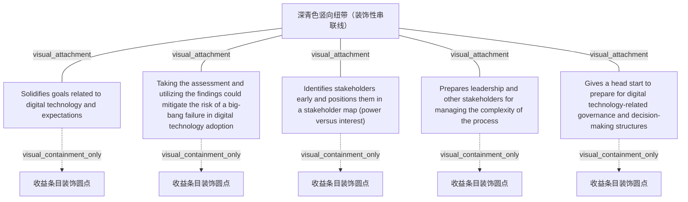

# G212/fig3-1 · 开展 DTRA 的五项关键收益

类型：`analytical-view`。第 3 章论证 DTRA 的影响与收益是多方面的、是架构师的赋能工具；作者用这张图把正文归纳的五项关键收益并列展示，便于在向管理层说明“为什么要做评估”时逐条引用。

英文 PDF 物理页：[25]。本页为架构语义分析，原文与原图分别保留。

## 原图与可编辑图


[完整 JSON](fig3-1.json) · [可编辑 Mermaid](fig3-1.mmd) · [仅关系图](fig3-1.relations.mmd) · [层级分解图](fig3-1.hierarchy.mmd)

图形重建表达语义，不复制源图布局。虚线表示解释、矩阵映射或分组关系，不自动表示不确定性的概率。



## 架构分析

自上而下读 5 条深青色横条，每条是一独立收益；左侧白色圆点只是把横条挂到竖向纽带上的标记，不是步骤编号或评分。纽带把五条串成一个整体，但没有箭头，也没有先后含义。

- 本图有 11 个具名或隐含元素、5 条关系和 5 条包含/分组记录。
- 包含/分组树最大深度为 1；根节点为 深青色竖向纽带（装饰性串联线）、巩固与数字技术相关的目标及期望、开展评估并利用评估发现，可降低数字技术采用中“大爆炸式”失败的风险、及早识别利益相关者，并将其纳入利益相关者地图（权力—利益）、使领导层及其他利益相关者为管理该过程的复杂性做好准备、为筹备数字技术相关的治理与决策结构赢得先机。
- 本图没有可直接确认为人员直属汇报的关系；视觉上下位置、能力分解和治理职责分别读取。
- 核对5项收益全部英文句子及左侧5个白圆和装饰纽带；没有因果箭头或执行顺序。

### 如何用于项目

- 围绕作者目的读取本图实体、分组与连线，并用对应原文限定其含义。
- 把参考模型与项目事实分开，实际范围、约束、值和责任须有项目证据。

### 结构所表达的逻辑

- 五项收益分别对应：巩固数字技术目标与期望、降低“大爆炸式”失败风险、及早识别利益相关者、让领导层为过程复杂性做好准备、为治理与决策结构赢得先机。
- 五项收益可大致分为三段：先对齐目标（第 1 条），评估中识别利益相关者（第 3 条），评估后形成治理与决策结构（第 5 条）。
- 第 2 条是五项中唯一直接谈风险的：开展评估并利用发现，可降低数字技术采用中“大爆炸式”失败的风险。
- 第 3 条把“权力—利益”利益相关者地图明确为评估产出，而不只是沟通手段；这与 TOGAF 的利益相关者管理做法一致（背景知识）。
- 第 4、5 条针对领导层：既为管理过程复杂性做准备，也为后续治理与决策结构铺路，说明评估的价值不止于一份诊断报告。
- 图中没有编号、箭头或优先级标记，五条是并列收益，自上而下的顺序不代表实施步骤或重要性排序。

## 上下级与包含

只有一层：5 条并列的收益陈述，统一挂在一条装饰性纽带上；没有上下级，也没有分组。

|父项|子项|层级类型|依据与解释|
|---|---|---|---|
|巩固与数字技术相关的目标及期望|收益条目装饰圆点|visual_containment_only|保存原图解释中的包含；业务关系类型需要图例或正文进一步限定。|
|开展评估并利用评估发现，可降低数字技术采用中“大爆炸式”失败的风险|收益条目装饰圆点|visual_containment_only|保存原图解释中的包含；业务关系类型需要图例或正文进一步限定。|
|及早识别利益相关者，并将其纳入利益相关者地图（权力—利益）|收益条目装饰圆点|visual_containment_only|保存原图解释中的包含；业务关系类型需要图例或正文进一步限定。|
|使领导层及其他利益相关者为管理该过程的复杂性做好准备|收益条目装饰圆点|visual_containment_only|保存原图解释中的包含；业务关系类型需要图例或正文进一步限定。|
|为筹备数字技术相关的治理与决策结构赢得先机|收益条目装饰圆点|visual_containment_only|保存原图解释中的包含；业务关系类型需要图例或正文进一步限定。|

## 全部元素与角色

|元素ID|原文名称|类型|含义|直接父项|深度|
|---|---|---|---|---|---|
|spine|深青色竖向纽带（装饰性串联线）|other|把 5 个白色圆点串起来的装饰性曲线，无箭头、无文字。|—||
|b_goals|Solidifies goals related to digital technology and expectations|goal|目标/成果：巩固与数字技术相关的目标及期望|—||
|b_bigbang|Taking the assessment and utilizing the findings could mitigate the risk of a big-bang failure in digital technology adoption|goal|目标/成果：开展评估并利用评估发现，可降低数字技术采用中“大爆炸式”失败的风险|—||
|b_stakeholders|Identifies stakeholders early and positions them in a stakeholder map (power versus interest)|goal|目标/成果：及早识别利益相关者，并将其纳入利益相关者地图（权力—利益）|—||
|b_leadership|Prepares leadership and other stakeholders for managing the complexity of the process|goal|目标/成果：使领导层及其他利益相关者为管理该过程的复杂性做好准备|—||
|b_governance|Gives a head start to prepare for digital technology-related governance and decision-making structures|goal|目标/成果：为筹备数字技术相关的治理与决策结构赢得先机|—||
|bullet_1|收益条目装饰圆点|annotation|图中元素：收益条目装饰圆点|巩固与数字技术相关的目标及期望|1|
|bullet_2|收益条目装饰圆点|annotation|图中元素：收益条目装饰圆点|开展评估并利用评估发现，可降低数字技术采用中“大爆炸式”失败的风险|1|
|bullet_3|收益条目装饰圆点|annotation|图中元素：收益条目装饰圆点|及早识别利益相关者，并将其纳入利益相关者地图（权力—利益）|1|
|bullet_4|收益条目装饰圆点|annotation|图中元素：收益条目装饰圆点|使领导层及其他利益相关者为管理该过程的复杂性做好准备|1|
|bullet_5|收益条目装饰圆点|annotation|图中元素：收益条目装饰圆点|为筹备数字技术相关的治理与决策结构赢得先机|1|

## 全部关系

唯一的图形连线是左侧深青色竖向纽带：它串起 5 个白色圆点，每个圆点与右侧横条相接，表示“这 5 条属于同一组收益”。纽带不是时间线或流程线，没有箭头；圆点也不是序号，关系清单中记为无方向的关联（arrow=none）。

|主体|语义关系|客体|显式线/隐式|原文标签|依据|
|---|---|---|---|---|---|
|深青色竖向纽带（装饰性串联线）|visual_attachment|巩固与数字技术相关的目标及期望|显式连线||只是装饰纽带挂接该收益条，不表示因果、依赖或顺序。|
|深青色竖向纽带（装饰性串联线）|visual_attachment|开展评估并利用评估发现，可降低数字技术采用中“大爆炸式”失败的风险|显式连线||只是装饰纽带挂接该收益条，不表示因果、依赖或顺序。|
|深青色竖向纽带（装饰性串联线）|visual_attachment|及早识别利益相关者，并将其纳入利益相关者地图（权力—利益）|显式连线||只是装饰纽带挂接该收益条，不表示因果、依赖或顺序。|
|深青色竖向纽带（装饰性串联线）|visual_attachment|使领导层及其他利益相关者为管理该过程的复杂性做好准备|显式连线||只是装饰纽带挂接该收益条，不表示因果、依赖或顺序。|
|深青色竖向纽带（装饰性串联线）|visual_attachment|为筹备数字技术相关的治理与决策结构赢得先机|显式连线||只是装饰纽带挂接该收益条，不表示因果、依赖或顺序。|

## 本轮语义修正

- 只是装饰纽带挂接该收益条，不表示因果、依赖或顺序。
- 只是装饰纽带挂接该收益条，不表示因果、依赖或顺序。
- 只是装饰纽带挂接该收益条，不表示因果、依赖或顺序。
- 只是装饰纽带挂接该收益条，不表示因果、依赖或顺序。
- 只是装饰纽带挂接该收益条，不表示因果、依赖或顺序。

## 误读检查

- 不要把 5 条收益读成 5 个先后步骤：图中没有编号、没有箭头，纽带只表示同属一组。
- 白色圆点不是评分、勾选状态或里程碑，只是横条与纽带的连接标记。
- 第 1 条“巩固目标”与第 5 条“治理结构”不是首尾闭环，本图不表达循环。
- 中文稿引用的 figs/zh/g212e_fig3-1_zh.png 把第 2–5 条改成浅底白字，并给右端加了深色块；不要据此认为第一条被特别强调。

## 原文证据

### [PDF 第 25 页](../../../documents/G212.md#page-25)

> The impact and benefits of conducting a DTRA is multi-faceted. The DTRA provides an opportunity to analyze the as-is state pertaining to the digital technology of an enterprise. It helps to evaluate the organization circumventing certain key factors – what the organization is doing well, what needs improvement, and how to prioritize their transformation/adoption strategy.
> This is an empowering tool for Enterprise Architects. With the DTRA as a toolkit, Enterprise Architects can leverage the learning for designing processes to overcome the barriers for digital technology adoption.

## 来源与分析状态

所有元素/关系均有来源定位；未把历史解释重命名为本轮逐线视觉确认。源图与语义图是两种视图，布局不证明汇报或因果。

源 PDF SHA-256：`1c6871264e1ca327066eec5783ec273014ce1615b13e0ef236e79b017ad4ac7b`。

源图记录：[原始解释与转录](../../../figures/G212/fig3-1.json)。

```json
{
  "quality": {
    "graph_integrity": "checked",
    "semantic_analysis": "typed-graph-and-context-analysis",
    "visual_review": "source-content-audited",
    "notice_zh": "所有元素/关系均有来源定位；未把历史解释重命名为本轮逐线视觉确认。源图与语义图是两种视图，布局不证明汇报或因果。"
  },
  "source_uncertainty": {
    "confidence": "high",
    "uncertainties_zh": [
      "纽带与圆点只是版式装饰，原图未说明其含义；“同属一组”的判断来自图形连缀方式。",
      "第 3 条中的“stakeholder map (power versus interest)”在图中为小写斜体括注，中文稿译为“利益相关者地图（权力—利益）”。"
    ],
    "analyzed_from": [
      "英文 PDF 第 25 页原图截图（2×2 放大分块）",
      "英文 PDF 第 25 页正文",
      "中文稿 G212e_数字技术采用就绪度评估.md 第 225–247 行",
      "figs/zh/g212e_fig3-1_zh.png",
      "figs/g212e_fig3-1_en.png（自动相似度 0.97）"
    ],
    "date": "2026-10-31"
  },
  "source_conflicts": []
}
```
