# G212/fig4-1 · 数字技术采用的影响因素

类型：`architecture-concept-or-system-model`。表 4-1 只把 15 个因素分成基础/影响/持续三类，作者再用这张依赖图说明它们并非并列清单：愿景、赞助、范围、实施方法等相互牵动，最终共同决定组织就绪度。正文明确说图中只画“最强、最主要”的关系，避免把所有弱关系都堆上去。

英文 PDF 物理页：[27]。本页为架构语义分析，原文与原图分别保留。

## 原图与可编辑图


[完整 JSON](fig4-1.json) · [可编辑 Mermaid](fig4-1.mmd) · [仅关系图](fig4-1.relations.mmd) · [层级分解图](fig4-1.hierarchy.mmd)

图形重建表达语义，不复制源图布局。虚线表示解释、矩阵映射或分组关系，不自动表示不确定性的概率。

```mermaid
flowchart TB
  %% Semantic reconstruction; see original source image for exact layout.
  n0["Vision"]
  n1["Sponsorship and Direction"]
  n2["Scope and Scale"]
  n3["Business Rationale"]
  n4["Funding and Resources"]
  n5["Culture"]
  n6["Organization&#x27;s Digital Technology Readiness"]
  n7["Governance and Compliance"]
  n8["Implementation Approach"]
  n9["IT Capability"]
  n10["Value Realization"]
  n11["Technology Maturity"]
  n12["Ecosystem"]
  n13["Skills and Competence"]
  n14["Policy and Regulations"]
  n15["Business Model Adaptability"]
  n0 -->|"影响"| n1
  n0 -->|"影响"| n2
  n4 -->|"影响"| n1
  n1 -->|"影响"| n2
  n3 -->|"影响"| n2
  n15 -->|"影响"| n3
  n2 -->|"影响"| n6
  n5 -->|"影响"| n6
  n7 -->|"影响"| n8
  n10 -->|"影响"| n8
  n8 -->|"影响"| n6
  n9 -->|"影响"| n8
  n13 -->|"影响"| n9
  n12 -->|"影响"| n9
  n12 -->|"影响"| n11
  n11 -->|"影响"| n8
  n14 -->|"影响"| n11
```



## 架构分析

先看图例认三种形状，再找中心的菱形“Organization's Digital Technology Readiness”，这是全图汇聚点。然后从左上“Vision”读起：箭头旁的深青色斜体动词说明源因素如何影响目标因素（Aspires、Triggers、Defines 等）。箭头是“影响/促成”，不是流程步骤；同一因素可以有多条进出箭头。

- 本图有 16 个具名或隐含元素、17 条关系和 0 条包含/分组记录。
- 本图没有可直接确认为人员直属汇报的关系；视觉上下位置、能力分解和治理职责分别读取。
- 核对15因素、就绪度菱形、3种形状图例及17条具名方向连接，含Value Realization与Technology Maturity在进入Implementation Approach前共享末端线段。
- 更正Conduces文字；原图没有任何+/-极性，清除全部17条历史附加正极性。

### 如何用于项目

- 围绕作者目的读取本图实体、分组与连线，并用对应原文限定其含义。
- 把参考模型与项目事实分开，实际范围、约束、值和责任须有项目证据。

### 结构所表达的逻辑

- 15 个因素分三类：基础 7 个（愿景、赞助与方向、IT 能力、文化、范围与规模、业务理由、实施方法）、影响 5 个（治理与合规、技能与胜任力、业务模式适应性、技术成熟度、生态系统）、持续 3 个（价值实现、政策与法规、资金与资源）。
- 愿景位于最上方，同时“期望”赞助与方向、“触发”范围与规模；正文解释清晰的愿景有助于找到赞助者、设定方向并界定范围。
- 范围与规模是上游汇聚点：赞助与方向“定义”它、业务理由“刺激”它、资金与资源“协助”赞助、业务模式适应性“催化”业务理由；范围再“导致”组织就绪度。
- 实施方法是操作层面的枢纽：治理与合规“治理”它、价值实现“量化”它、IT 能力“增强”它、技术成熟度“传导”它，它再“驱动”组织就绪度。
- 技术成熟度受政策与法规“扩充”、并被生态系统“导致”；生态系统同时“补充”IT 能力，技能与胜任力“提升”IT 能力。
- 文化直接“赋能”组织就绪度，是唯一不经实施方法/范围而直达中心的因素，说明组织文化被视为横贯性的使能条件。
- 图中只画强而主导的关系，不能当作因果全集；缺失的弱关系不代表不存在。

## 上下级与包含

没有上下级包含关系，是一张以“组织数字技术就绪度”为中心的依赖网络。三类因素用形状区分（矩形/平行四边形/圆角矩形），但图上没有用分区或泳道把它们摆成三层；类别只由形状和图例表达。

|父项|子项|层级类型|依据与解释|
|---|---|---|---|
|—|—|无视觉包含|关系中明确的组成/特化见 JSON semantic_hierarchy。|

## 全部元素与角色

|元素ID|原文名称|类型|含义|直接父项|深度|
|---|---|---|---|---|---|
|vision|Vision|concept|概念：愿景|—||
|sponsorship|Sponsorship and Direction|concept|概念：赞助与方向|—||
|scope|Scope and Scale|concept|概念：范围与规模|—||
|business_rationale|Business Rationale|concept|概念：业务理由|—||
|funding|Funding and Resources|concept|概念：资金与资源|—||
|culture|Culture|concept|概念：文化|—||
|readiness|Organization's Digital Technology Readiness|metric|全图汇聚点，评估的整体状态；不是表 4-1 中的第 16 个因素。|—||
|governance|Governance and Compliance|concept|概念：治理与合规|—||
|implementation|Implementation Approach|concept|概念：实施方法|—||
|it_capability|IT Capability|concept|概念：IT 能力|—||
|value_realization|Value Realization|concept|概念：价值实现|—||
|technology_maturity|Technology Maturity|concept|概念：技术成熟度|—||
|ecosystem|Ecosystem|concept|概念：生态系统|—||
|skills|Skills and Competence|concept|概念：技能与胜任力|—||
|policy|Policy and Regulations|concept|概念：政策与法规|—||
|business_model|Business Model Adaptability|concept|概念：业务模式适应性|—||

### 愿景：属性

```json
{
  "factor_class": "foundational"
}
```

### 赞助与方向：属性

```json
{
  "factor_class": "foundational"
}
```

### 范围与规模：属性

```json
{
  "factor_class": "foundational"
}
```

### 业务理由：属性

```json
{
  "factor_class": "foundational"
}
```

### 资金与资源：属性

```json
{
  "factor_class": "sustaining"
}
```

### 文化：属性

```json
{
  "factor_class": "foundational"
}
```

### 治理与合规：属性

```json
{
  "factor_class": "impact"
}
```

### 实施方法：属性

```json
{
  "factor_class": "foundational"
}
```

### IT 能力：属性

```json
{
  "factor_class": "foundational"
}
```

### 价值实现：属性

```json
{
  "factor_class": "sustaining"
}
```

### 技术成熟度：属性

```json
{
  "factor_class": "impact"
}
```

### 生态系统：属性

```json
{
  "factor_class": "impact"
}
```

### 技能与胜任力：属性

```json
{
  "factor_class": "impact"
}
```

### 政策与法规：属性

```json
{
  "factor_class": "sustaining"
}
```

### 业务模式适应性：属性

```json
{
  "factor_class": "impact"
}
```

## 全部关系

全部为黑色实线箭头，箭头指向被影响的因素；箭头旁的深青色斜体词是关系标签（Aspires/Triggers/Assists/Defines/Stimulates/Catalyzes/Leads to/Empowers/Governs/Quantifies/Drives/Strengthens/Complements/Results in/Conducts/Augments/Enhances）。折线只用于避让，转角不代表中间节点。所有关系均为正向促进（polarity=+），图中没有负向或反馈箭头。

|主体|语义关系|客体|显式线/隐式|原文标签|依据|
|---|---|---|---|---|---|
|愿景|影响|赞助与方向|显式连线|Aspires|源图有具名方向箭头，但没有+/-极性符号或数值；删除历史补出的正极性。|
|愿景|影响|范围与规模|显式连线|Triggers|源图有具名方向箭头，但没有+/-极性符号或数值；删除历史补出的正极性。|
|资金与资源|影响|赞助与方向|显式连线|Assists|源图有具名方向箭头，但没有+/-极性符号或数值；删除历史补出的正极性。|
|赞助与方向|影响|范围与规模|显式连线|Defines|源图有具名方向箭头，但没有+/-极性符号或数值；删除历史补出的正极性。|
|业务理由|影响|范围与规模|显式连线|Stimulates|源图有具名方向箭头，但没有+/-极性符号或数值；删除历史补出的正极性。|
|业务模式适应性|影响|业务理由|显式连线|Catalyzes|源图有具名方向箭头，但没有+/-极性符号或数值；删除历史补出的正极性。|
|范围与规模|影响|组织数字技术就绪度|显式连线|Leads to|源图有具名方向箭头，但没有+/-极性符号或数值；删除历史补出的正极性。|
|文化|影响|组织数字技术就绪度|显式连线|Empowers|源图有具名方向箭头，但没有+/-极性符号或数值；删除历史补出的正极性。|
|治理与合规|影响|实施方法|显式连线|Governs|源图有具名方向箭头，但没有+/-极性符号或数值；删除历史补出的正极性。|
|价值实现|影响|实施方法|显式连线|Quantifies|源图有具名方向箭头，但没有+/-极性符号或数值；删除历史补出的正极性。|
|实施方法|影响|组织数字技术就绪度|显式连线|Drives|源图有具名方向箭头，但没有+/-极性符号或数值；删除历史补出的正极性。|
|IT 能力|影响|实施方法|显式连线|Strengthens|源图有具名方向箭头，但没有+/-极性符号或数值；删除历史补出的正极性。|
|技能与胜任力|影响|IT 能力|显式连线|Enhances|源图有具名方向箭头，但没有+/-极性符号或数值；删除历史补出的正极性。|
|生态系统|影响|IT 能力|显式连线|Complements|源图有具名方向箭头，但没有+/-极性符号或数值；删除历史补出的正极性。|
|生态系统|影响|技术成熟度|显式连线|Results in|源图有具名方向箭头，但没有+/-极性符号或数值；删除历史补出的正极性。|
|技术成熟度|影响|实施方法|显式连线|Conduces|原图标签为Conduces，不是Conducts；没有正负极性标记。|
|政策与法规|影响|技术成熟度|显式连线|Augments|源图有具名方向箭头，但没有+/-极性符号或数值；删除历史补出的正极性。|

## 本轮语义修正

- 源图有具名方向箭头，但没有+/-极性符号或数值；删除历史补出的正极性。
- 源图有具名方向箭头，但没有+/-极性符号或数值；删除历史补出的正极性。
- 源图有具名方向箭头，但没有+/-极性符号或数值；删除历史补出的正极性。
- 源图有具名方向箭头，但没有+/-极性符号或数值；删除历史补出的正极性。
- 源图有具名方向箭头，但没有+/-极性符号或数值；删除历史补出的正极性。
- 源图有具名方向箭头，但没有+/-极性符号或数值；删除历史补出的正极性。
- 源图有具名方向箭头，但没有+/-极性符号或数值；删除历史补出的正极性。
- 源图有具名方向箭头，但没有+/-极性符号或数值；删除历史补出的正极性。
- 源图有具名方向箭头，但没有+/-极性符号或数值；删除历史补出的正极性。
- 源图有具名方向箭头，但没有+/-极性符号或数值；删除历史补出的正极性。
- 源图有具名方向箭头，但没有+/-极性符号或数值；删除历史补出的正极性。
- 源图有具名方向箭头，但没有+/-极性符号或数值；删除历史补出的正极性。
- 源图有具名方向箭头，但没有+/-极性符号或数值；删除历史补出的正极性。
- 源图有具名方向箭头，但没有+/-极性符号或数值；删除历史补出的正极性。
- 源图有具名方向箭头，但没有+/-极性符号或数值；删除历史补出的正极性。
- 原图标签为Conduces，不是Conducts；没有正负极性标记。
- 源图有具名方向箭头，但没有+/-极性符号或数值；删除历史补出的正极性。

## 误读检查

- 箭头不是流程步骤：例如“Leads to”“Results in”只表示因素间的影响，不表示时间先后或阶段转换。
- 形状编码的是因素类别而不是重要性：治理与合规画成平行四边形（影响因素），尽管“治理”听起来像基础因素；业务理由画成矩形（基础因素），尽管它靠近右侧的影响因素。
- 中心菱形不是第 16 个因素，表 4-1 只有 15 个；它是被评估的整体状态。
- 图中关系不完整：正文明确只画最强、最主要的关系，不能据图推断两个未连线因素之间没有影响。
- 中文稿引用的 figs/g212_fig4-1.svg 是三列清单，17 条关系全部丢失，还在类别之间自拟了递进箭头；不能据它理解本图。
- 中文稿的 figs/zh/g212e_fig4-1_zh.png 平行四边形和中心菱形边框破损，形状编码不完整，应以英文原图核对类别。

## 原文证据

### [PDF 第 26 页](../../../documents/G212.md#page-26)

> In Table 4-1, factors are arranged in each category. To map the relations amongst the factors, a factor dependency diagram is created (see Figure 4-1). This diagram highlights how these factors are inter- dependent, depicting only the strong and dominant relationships among the factors. The subsequent chapters describe the factors along with short case contexts in practical settings to enable deeper thinking and reflection.
### [PDF 第 27 页](../../../documents/G212.md#page-27)

> The vision for adopting a specific digital technology is the organization’s desire to grow, progress, or become more efficient in sustainability or in competition by using specific digital technology. In general, it expresses the willingness or propensity of the organization to experiment, adopt, or adapt new technology for its benefit toward the overall vision, mission, or strategy of the organization. It also lays out the desired outcome and the timeline required to achieve it. The existence of such a vision shows the commitment of the organization to the technology adoption, and the clarity of its actions.
> Here, the existence of the vision, motivation, and organization’s commitment to technology adoption is validated.

## 来源与分析状态

所有元素/关系均有来源定位；未把历史解释重命名为本轮逐线视觉确认。源图与语义图是两种视图，布局不证明汇报或因果。

源 PDF SHA-256：`1c6871264e1ca327066eec5783ec273014ce1615b13e0ef236e79b017ad4ac7b`。

源图记录：[原始解释与转录](../../../figures/G212/fig4-1.json)。

```json
{
  "quality": {
    "graph_integrity": "checked",
    "semantic_analysis": "typed-graph-and-context-analysis",
    "visual_review": "source-content-audited",
    "notice_zh": "所有元素/关系均有来源定位；未把历史解释重命名为本轮逐线视觉确认。源图与语义图是两种视图，布局不证明汇报或因果。"
  },
  "source_uncertainty": {
    "confidence": "high",
    "uncertainties_zh": [
      "17 条箭头的文字均为图内斜体小字，已按 2×2 放大块逐条核对；其中“Conducts”在中文稿对照表中缺失，译名“传导”为解析者拟定。",
      "“Aspires”的主语可理解为组织对愿景的期望，图中只给出 Vision → Sponsorship and Direction 的方向；本分析按箭头方向记录，不扩展语义。",
      "所有关系按正向影响处理（polarity=+），图中没有负号或减弱标记。"
    ],
    "analyzed_from": [
      "英文 PDF 第 27 页原图截图（2×2 放大分块）",
      "英文 PDF 第 26–27 页正文（含表 4-1 与 Vision 段落）",
      "中文稿 G212e_数字技术采用就绪度评估.md 第 250–295 行（含图内标签对照表 L272–L295）",
      "figs/zh/g212e_fig4-1_zh.png",
      "figs/g212_fig4-1.svg 源码",
      "figs/g212e_fig4-1_en.png（自动相似度 0.994）"
    ],
    "date": "2026-10-31"
  },
  "source_conflicts": []
}
```
