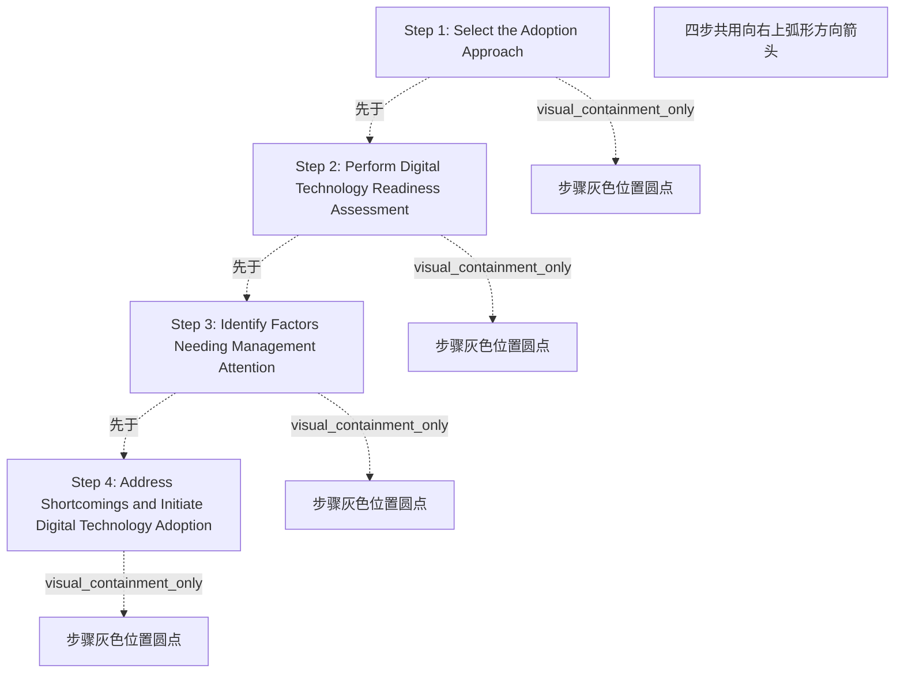

# G212/fig5-1 · 数字技术采用的四步路线图

类型：`process-or-method-model`。第 5 章开篇先给全局：作者用一条上升箭头把后面 5.1–5.4 节要展开的四步一次列出，让读者先看到路线，再逐节深入；正文说明四个步骤随后会详细解释。

英文 PDF 物理页：[39]。本页为架构语义分析，原文与原图分别保留。

## 原图与可编辑图


[完整 JSON](fig5-1.json) · [可编辑 Mermaid](fig5-1.mmd) · [仅关系图](fig5-1.relations.mmd) · [层级分解图](fig5-1.hierarchy.mmd)

图形重建表达语义，不复制源图布局。虚线表示解释、矩阵映射或分组关系，不自动表示不确定性的概率。



## 架构分析

从箭头左下端读起，沿箭杆向右上：第一个圆点对应 Step 1，依次到箭头尖端的 Step 4。圆点只是步骤位置标记，标签排在圆点右侧；箭头方向就是步骤先后。图中没有坐标轴，曲线的上升只是示意“推进”，不带数值含义。

- 本图有 9 个具名或隐含元素、3 条关系和 4 条包含/分组记录。
- 包含/分组树最大深度为 1；根节点为 步骤 1：选择采用方法、步骤 2：执行数字技术就绪度评估、步骤 3：识别需要管理关注的因素、步骤 4：弥补短板并启动数字技术采用、四步共用向右上弧形方向箭头。
- 本图没有可直接确认为人员直属汇报的关系；视觉上下位置、能力分解和治理职责分别读取。
- 包含分组后有 2 个连通分量；分离可能源于图例、并列分类或独立示例，未自动补边。
- 核对四步完整文字、4个灰圆位置及单一向右上弧形大箭头。
- 大箭头贯穿所有步骤，不能存成直接Step1→Step4跳过中间两步；顺序由编号和位置给出。

### 如何用于项目

- 按阶段/事件/行为关系读取入口、出口、责任和产物；检查循环与例外路径。
- 工作流先后不表示组织管理权；在项目中显式记录条件和完成标准。

### 结构所表达的逻辑

- 四步依次为：选择采用方法 → 执行数字技术就绪度评估 → 识别需要管理关注的因素 → 弥补短板并启动数字技术采用。
- 四步与后文一一对应：步骤 1 展开为图 5-2 的 ABCD 框架，步骤 3 对应图 5-3 的缺失因素后果，步骤 4 对应图 5-4 的因素递进。
- 箭头自左下向右上，只表示单向推进；图中没有回到前一步的反馈箭头。
- 路线图只给步骤名称，没有时间、责任人或交付物；这些内容不在本图，需看各节正文。
- 第 4 步把“弥补短板”和“启动采用”合为一步，说明评估结果必须落到行动，而不是止于诊断。
- 图中的四个圆点大小相同，不表示工作量、优先级或阶段长度。

## 上下级与包含

只有一层：4 个并列步骤按顺序排在一条箭头上；没有子步骤或分组。

|父项|子项|层级类型|依据与解释|
|---|---|---|---|
|步骤 1：选择采用方法|步骤灰色位置圆点|visual_containment_only|保存原图解释中的包含；业务关系类型需要图例或正文进一步限定。|
|步骤 2：执行数字技术就绪度评估|步骤灰色位置圆点|visual_containment_only|保存原图解释中的包含；业务关系类型需要图例或正文进一步限定。|
|步骤 3：识别需要管理关注的因素|步骤灰色位置圆点|visual_containment_only|保存原图解释中的包含；业务关系类型需要图例或正文进一步限定。|
|步骤 4：弥补短板并启动数字技术采用|步骤灰色位置圆点|visual_containment_only|保存原图解释中的包含；业务关系类型需要图例或正文进一步限定。|

## 全部元素与角色

|元素ID|原文名称|类型|含义|直接父项|深度|
|---|---|---|---|---|---|
|s1_approach|Step 1: Select the Adoption Approach|phase|阶段：步骤 1：选择采用方法|—||
|s2_assess|Step 2: Perform Digital Technology Readiness Assessment|phase|阶段：步骤 2：执行数字技术就绪度评估|—||
|s3_factors|Step 3: Identify Factors Needing Management Attention|phase|阶段：步骤 3：识别需要管理关注的因素|—||
|s4_address|Step 4: Address Shortcomings and Initiate Digital Technology Adoption|phase|阶段：步骤 4：弥补短板并启动数字技术采用|—||
|roadmap_arc|四步共用向右上弧形方向箭头|annotation|图中元素：四步共用向右上弧形方向箭头|—||
|s1_approach_marker|步骤灰色位置圆点|annotation|图中元素：步骤灰色位置圆点|步骤 1：选择采用方法|1|
|s2_assess_marker|步骤灰色位置圆点|annotation|图中元素：步骤灰色位置圆点|步骤 2：执行数字技术就绪度评估|1|
|s3_factors_marker|步骤灰色位置圆点|annotation|图中元素：步骤灰色位置圆点|步骤 3：识别需要管理关注的因素|1|
|s4_address_marker|步骤灰色位置圆点|annotation|图中元素：步骤灰色位置圆点|步骤 4：弥补短板并启动数字技术采用|1|

## 全部关系

一条深青色粗箭头从页面左下弯向右上，箭头尖端指向 Step 4，表示四步的单向推进；4 个灰色圆点贴在箭杆上，分别标记 Step 1–4 的位置，圆点与文字之间没有引线。箭头是唯一的连线，没有分支、汇合或回路。

|主体|语义关系|客体|显式线/隐式|原文标签|依据|
|---|---|---|---|---|---|
|步骤 1：选择采用方法|先于|步骤 2：执行数字技术就绪度评估|implicit||步骤编号与沿大箭头位置表明此顺序；并非两步骤之间另画一条线。|
|步骤 2：执行数字技术就绪度评估|先于|步骤 3：识别需要管理关注的因素|implicit||步骤编号与沿大箭头位置表明此顺序；并非两步骤之间另画一条线。|
|步骤 3：识别需要管理关注的因素|先于|步骤 4：弥补短板并启动数字技术采用|implicit||步骤编号与沿大箭头位置表明此顺序；并非两步骤之间另画一条线。|

## 本轮否定的历史关系

以下旧解释保留用于追溯，不进入当前关系图、层级或知识图谱的有效边。

|旧记录|主体|旧关系|客体|否定依据|
|---|---|---|---|---|
||步骤 1：选择采用方法|sequence|步骤 4：弥补短板并启动数字技术采用|单一贯穿方向图符不是Step1→Step4直接连接线；按编号保存逐步顺序。|

## 本轮语义修正

- 单一贯穿方向图符不是Step1→Step4直接连接线；按编号保存逐步顺序。
- 步骤编号与沿大箭头位置表明此顺序；并非两步骤之间另画一条线。
- 步骤编号与沿大箭头位置表明此顺序；并非两步骤之间另画一条线。
- 步骤编号与沿大箭头位置表明此顺序；并非两步骤之间另画一条线。

## 误读检查

- 这四步不是 TOGAF ADM 的四个阶段，而是本指南给出的数字技术采用路线图；不要与 ADM 阶段 A–D 对应。
- 曲线的上升不表示后一步“价值更高”或“难度更大”，图中没有纵轴或刻度。
- 灰色圆点不是评分、里程碑日期或完成状态，只是步骤在箭杆上的位置标记。
- 第 1 步“选择采用方法”不是选技术产品，而是按 ABCD 框架选择组织的采用方式（见 5.1 节）。

## 原文证据

### [PDF 第 39 页](../../../documents/G212.md#page-39)

> This chapter gives an overview of the four steps that need to be followed for a comprehensive approach to digital technology adoption. The four steps are highlighted in Figure 5-1 and then explained in more detail in the text that follows.

## 来源与分析状态

所有元素/关系均有来源定位；未把历史解释重命名为本轮逐线视觉确认。源图与语义图是两种视图，布局不证明汇报或因果。

源 PDF SHA-256：`1c6871264e1ca327066eec5783ec273014ce1615b13e0ef236e79b017ad4ac7b`。

源图记录：[原始解释与转录](../../../figures/G212/fig5-1.json)。

```json
{
  "quality": {
    "graph_integrity": "checked",
    "semantic_analysis": "typed-graph-and-context-analysis",
    "visual_review": "source-content-audited",
    "notice_zh": "所有元素/关系均有来源定位；未把历史解释重命名为本轮逐线视觉确认。源图与语义图是两种视图，布局不证明汇报或因果。"
  },
  "source_uncertainty": {
    "confidence": "high",
    "uncertainties_zh": [
      "曲线上升没有坐标轴或刻度，只能作方向性理解；“上升”不构成量化结论。",
      "四个圆点在箭杆上的间距不完全相等，但图中未说明间距含义，本分析不据此推断阶段长度。"
    ],
    "analyzed_from": [
      "英文 PDF 第 39 页原图截图（2×2 放大分块）",
      "英文 PDF 第 39 页正文",
      "中文稿 G212e_数字技术采用就绪度评估.md 第 487–502 行",
      "figs/zh/g212e_fig5-1_zh.png",
      "figs/g212e_fig5-1_en.png（自动相似度 0.991）"
    ],
    "date": "2026-10-31"
  },
  "source_conflicts": []
}
```
