# G212/fig5-3 · 缺失因素对数字技术采用的影响

类型：`mapping-or-assessment-matrix`。步骤 3 要分析就绪度评估的输出，判断哪些因素未达预期、会带来什么后果。作者用这张查找表把 15 个因素逐一对应到一条“主要后果”，让管理者能按缺失因素迅速查到影响，并据此决定哪些因素需要管理关注；第 5.4 节在采用混合路径时也用它做决策。

英文 PDF 物理页：[42]。本页为架构语义分析，原文与原图分别保留。

## 原图与可编辑图


[完整 JSON](fig5-3.json) · [可编辑 Mermaid](fig5-3.mmd) · [仅关系图](fig5-3.relations.mmd) · [层级分解图](fig5-3.hierarchy.mmd)

图形重建表达语义，不复制源图布局。虚线表示解释、矩阵映射或分组关系，不自动表示不确定性的概率。

```mermaid
flowchart TB
  %% Semantic reconstruction; see original source image for exact layout.
  n0["FOUNDATIONAL FACTORS"]
  n1["IMPACT FACTORS"]
  n2["SUSTAINING FACTORS"]
  n3["Vision"]
  n4["Sponsorship &amp; Direction"]
  n5["IT Capability"]
  n6["Implementation Approach"]
  n7["Culture"]
  n8["Scope &amp; Scale"]
  n9["Business Rationale"]
  n10["Governance &amp; Compliance"]
  n11["Skills &amp; Competence"]
  n12["Business Model Adaptability"]
  n13["Technology Maturity"]
  n14["Ecosystem"]
  n15["Value Realization"]
  n16["Policy &amp; Regulation"]
  n17["Funding &amp; Resources"]
  n18["PRIMARY CONSEQUENCES"]
  n0 -.->|"分组"| n3
  n0 -.->|"分组"| n4
  n0 -.->|"分组"| n5
  n0 -.->|"分组"| n6
  n0 -.->|"分组"| n7
  n0 -.->|"分组"| n8
  n0 -.->|"分组"| n9
  n1 -.->|"分组"| n10
  n1 -.->|"分组"| n11
  n1 -.->|"分组"| n12
  n1 -.->|"分组"| n13
  n1 -.->|"分组"| n14
  n2 -.->|"分组"| n15
  n2 -.->|"分组"| n16
  n2 -.->|"分组"| n17
```



## 架构分析

原图整页顺时针旋转 90° 排印，需先把页面转正。转正后每一行是一个情景：行内从左到右按固定顺序列出 15 个因素（基础 7、影响 5、持续 3），其中只有一个是白色斜体，那就是本行“缺失的因素”；最右列（PRIMARY CONSEQUENCES）是本行的主要后果。读一行即可：先找白色斜体，再读右列。

- 本图有 19 个具名或隐含元素、0 条关系和 15 条包含/分组记录。
- 包含/分组树最大深度为 1；根节点为 基础因素、影响因素、持续因素、主要后果。
- 本图没有可直接确认为人员直属汇报的关系；视觉上下位置、能力分解和治理职责分别读取。
- 原图靠嵌套表达结构，没有连线；新语义图将包含单独显式化，不补造流程、数据流或依赖。
- 包含分组后有 4 个连通分量；分离可能源于图例、并列分类或独立示例，未自动补边。
- 将原图旋转正向后逐行核对15×15因素格、15个白色斜体缺失标记、15条后果完整句。
- Compact表后果转录正确；更正白格说法为白色斜体字，背景仍是绿/蓝/橙；补225格无损状态编码。

### 如何用于项目

- 先固定行、列所代表的维度及单元格含义，再登记有证据的映射或评分。
- 空白、无关系、未测量和不适用分别处理；颜色不自动等于优先级。

### 结构所表达的逻辑

- 全表 15 行对应 15 个因素，顺序为基础 7（愿景、赞助与方向、IT 能力、实施方法、文化、范围与规模、业务理由）→ 影响 5（治理与合规、技能与胜任力、业务模式适应性、技术成熟度、生态系统）→ 持续 3（价值实现、政策与法规、资金与资源）。
- 转正后每一行都重复印出全部 15 个因素名，只有本行缺失的那一格是白色斜体；其余 14 格是背景，不是“同时缺失”或“相互关联”。
- 后果是定性描述，不做评分或概率：例如实施方法缺失会导致“因试错式方法而很可能错失机会”（第 4 行）。
- 组织可能同时缺失多个因素，此时要把各行的主要后果放在一起整体理解，不能带先入之见或偏见（正文 p41）。
- 后果之间会相互强化；正文提示参见图 4-1 的因素依赖关系，说明不能把 15 条后果当作彼此独立的清单。
- 本表用于步骤 3 识别需要管理关注的因素，也用于步骤 4 在无法严格按“基础→影响→持续”递进时做有依据的决策（正文 p44）。
- 表中没有“严重程度”“发生概率”或“责任方”等列，不能据此直接排优先级；它只回答“缺这个因素会怎样”。

## 上下级与包含

两层：三个类别带（基础因素 7 列、影响因素 5 列、持续因素 3 列）→ 其下的 15 个因素；每一行再由“缺失因素 → 一条主要后果”构成一对一的查找关系。类别带只是列分组，不表示因素之间的上下级。

|父项|子项|层级类型|依据与解释|
|---|---|---|---|
|基础因素|愿景|visual_grouping|框、泳道、域或分类组的成员归属；没有额外证据不提升为业务组合或管理关系。|
|基础因素|赞助与方向|visual_grouping|框、泳道、域或分类组的成员归属；没有额外证据不提升为业务组合或管理关系。|
|基础因素|IT 能力|visual_grouping|框、泳道、域或分类组的成员归属；没有额外证据不提升为业务组合或管理关系。|
|基础因素|实施方法|visual_grouping|框、泳道、域或分类组的成员归属；没有额外证据不提升为业务组合或管理关系。|
|基础因素|文化|visual_grouping|框、泳道、域或分类组的成员归属；没有额外证据不提升为业务组合或管理关系。|
|基础因素|范围与规模|visual_grouping|框、泳道、域或分类组的成员归属；没有额外证据不提升为业务组合或管理关系。|
|基础因素|业务理由|visual_grouping|框、泳道、域或分类组的成员归属；没有额外证据不提升为业务组合或管理关系。|
|影响因素|治理与合规|visual_grouping|框、泳道、域或分类组的成员归属；没有额外证据不提升为业务组合或管理关系。|
|影响因素|技能与胜任力|visual_grouping|框、泳道、域或分类组的成员归属；没有额外证据不提升为业务组合或管理关系。|
|影响因素|业务模式适应性|visual_grouping|框、泳道、域或分类组的成员归属；没有额外证据不提升为业务组合或管理关系。|
|影响因素|技术成熟度|visual_grouping|框、泳道、域或分类组的成员归属；没有额外证据不提升为业务组合或管理关系。|
|影响因素|生态系统|visual_grouping|框、泳道、域或分类组的成员归属；没有额外证据不提升为业务组合或管理关系。|
|持续因素|价值实现|visual_grouping|框、泳道、域或分类组的成员归属；没有额外证据不提升为业务组合或管理关系。|
|持续因素|政策与法规|visual_grouping|框、泳道、域或分类组的成员归属；没有额外证据不提升为业务组合或管理关系。|
|持续因素|资金与资源|visual_grouping|框、泳道、域或分类组的成员归属；没有额外证据不提升为业务组合或管理关系。|

## 全部元素与角色

|元素ID|原文名称|类型|含义|直接父项|深度|
|---|---|---|---|---|---|
|grp_foundational|FOUNDATIONAL FACTORS|group|组织建立最低可接受就绪度必须具备的因素。|—||
|grp_impact|IMPACT FACTORS|group|增强或放大主要因素有效性的因素。|—||
|grp_sustaining|SUSTAINING FACTORS|group|使数字技术采用制度化、获得长期收益的因素。|—||
|vision|Vision|concept|概念：愿景|基础因素|1|
|sponsorship|Sponsorship & Direction|concept|概念：赞助与方向|基础因素|1|
|it_capability|IT Capability|concept|概念：IT 能力|基础因素|1|
|implementation|Implementation Approach|concept|概念：实施方法|基础因素|1|
|culture|Culture|concept|概念：文化|基础因素|1|
|scope|Scope & Scale|concept|概念：范围与规模|基础因素|1|
|business_rationale|Business Rationale|concept|概念：业务理由|基础因素|1|
|governance|Governance & Compliance|concept|概念：治理与合规|影响因素|1|
|skills|Skills & Competence|concept|概念：技能与胜任力|影响因素|1|
|business_model|Business Model Adaptability|concept|概念：业务模式适应性|影响因素|1|
|technology_maturity|Technology Maturity|concept|概念：技术成熟度|影响因素|1|
|ecosystem|Ecosystem|concept|概念：生态系统|影响因素|1|
|value_realization|Value Realization|concept|概念：价值实现|持续因素|1|
|policy|Policy & Regulation|concept|概念：政策与法规|持续因素|1|
|funding|Funding & Resources|concept|概念：资金与资源|持续因素|1|
|primary_consequences|PRIMARY CONSEQUENCES|note|每行末列给出该缺失因素的主要后果。|—||

## 全部关系

图中没有任何连线或箭头。三类因素用深绿、蓝、橙三种底色区分；白色斜体字标示本行缺失的因素；灰色竖排文字是最右列“主要后果”的列标题。行与列都是同一套因素清单，白色斜体字所在单元构成一条对角线，这是排版手法，不表示因素之间的关系。

|主体|语义关系|客体|显式线/隐式|原文标签|依据|
|---|---|---|---|---|---|

## 15 个缺失因素与主要后果（按原图行序逐行转录）

```json
{
  "id": "t_consequences",
  "title_zh": "15 个缺失因素与主要后果（按原图行序逐行转录）",
  "columns": [
    "序号",
    "缺失因素（行内白色斜体）",
    "因素类别",
    "主要后果（英文原样）",
    "主要后果（中文转述）"
  ],
  "rows": [
    [
      "1",
      "Vision 愿景",
      "基础因素",
      "Inability to foresee, anticipate DT-enabled change and prepare for it",
      "无法预见、预判数字技术驱动的变革并为之做准备"
    ],
    [
      "2",
      "Sponsorship & Direction 赞助与方向",
      "基础因素",
      "Lack of focus and ambition to embrace DT-enabled change narrative",
      "缺乏拥抱数字技术变革叙事的聚焦与雄心"
    ],
    [
      "3",
      "IT Capability IT 能力",
      "基础因素",
      "Inability to chart the course and take full benefit resulting from DT",
      "无法规划路径并从数字技术中取得全部收益"
    ],
    [
      "4",
      "Implementation Approach 实施方法",
      "基础因素",
      "High likelihood of missed opportunities due to trial and error-based approach",
      "因试错式方法而很可能错失机会"
    ],
    [
      "5",
      "Culture 文化",
      "基础因素",
      "Inability to internalize the new normal and create a virtuous wave",
      "无法内化新常态并形成良性浪潮"
    ],
    [
      "6",
      "Scope & Scale 范围与规模",
      "基础因素",
      "Lack of momentum to institutionalize change brought about by DT",
      "缺乏将数字技术带来的变革制度化的动力"
    ],
    [
      "7",
      "Business Rationale 业务理由",
      "基础因素",
      "Inability to justify and secure organization-wide support for DT",
      "无法为数字技术争取并确保全组织支持"
    ],
    [
      "8",
      "Governance & Compliance 治理与合规",
      "影响因素",
      "Lack of ownership and tentativeness in decisions taken to catalyze success",
      "实现数字技术的决策缺乏所有权且犹豫不决"
    ],
    [
      "9",
      "Skills & Competence 技能与胜任力",
      "影响因素",
      "Steep learning curve with high likelihood of mistakes and their amplified impact",
      "学习曲线陡峭、易犯错且影响被放大"
    ],
    [
      "10",
      "Business Model Adaptability 业务模式适应性",
      "影响因素",
      "Inability to harness DT-enabled capabilities and solidify gains",
      "无法驾驭数字技术使能的能力并巩固收益"
    ],
    [
      "11",
      "Technology Maturity 技术成熟度",
      "影响因素",
      "Inability to exploit DT as a resource at scale and unlock full efficiencies",
      "无法规模化利用数字技术资源并释放全部效率"
    ],
    [
      "12",
      "Ecosystem 生态系统",
      "影响因素",
      "Lack of environmental support in creating a shared goal and common results",
      "缺乏创造共同目标与共同成果的环境支持"
    ],
    [
      "13",
      "Value Realization 价值实现",
      "持续因素",
      "Inability to gain traction, and avoid apathy and indifference subsequently",
      "无法获得牵引力，进而难以避免冷漠与无动于衷"
    ],
    [
      "14",
      "Policy & Regulation 政策与法规",
      "持续因素",
      "Lack of posturing mechanisms to foster sustained systemic change",
      "缺乏促进持续系统性变革的定位机制"
    ],
    [
      "15",
      "Funding & Resources 资金与资源",
      "持续因素",
      "Lack of organizational commitment and resolve to succeed",
      "缺乏组织承诺与成功决心"
    ]
  ],
  "cell_legend": [
    "深绿 = 基础因素列；蓝 = 影响因素列；橙 = 持续因素列",
    "白色斜体 = 本行缺失的因素；黑色正体 = 背景清单，不表示缺失",
    "最右灰色列 = 主要后果"
  ],
  "notes_zh": "原图为15行×15因素的重复文字矩阵，缺失因素以白色斜体字表示，背景仍保留因素类别颜色。右列为每行主要后果；本表完整保留各缺失因素与后果，不误称白色背景单元格。"
}
```

## 225格因素文字及缺失强调的无损编码

```json
{
  "id": "full_factor_presence_matrix",
  "title_zh": "225格因素文字及缺失强调的无损编码",
  "columns": [
    "缺失因素",
    "Vision",
    "Sponsorship & Direction",
    "IT Capability",
    "Implementation Approach",
    "Culture",
    "Scope & Scale",
    "Business Rationale",
    "Governance & Compliance",
    "Skills & Competence",
    "Business Model Adaptability",
    "Technology Maturity",
    "Ecosystem",
    "Value Realization",
    "Policy & Regulation",
    "Funding & Resources"
  ],
  "rows": [
    [
      "Vision",
      "missing-white-italic",
      "context-black-regular",
      "context-black-regular",
      "context-black-regular",
      "context-black-regular",
      "context-black-regular",
      "context-black-regular",
      "context-black-regular",
      "context-black-regular",
      "context-black-regular",
      "context-black-regular",
      "context-black-regular",
      "context-black-regular",
      "context-black-regular",
      "context-black-regular"
    ],
    [
      "Sponsorship & Direction",
      "context-black-regular",
      "missing-white-italic",
      "context-black-regular",
      "context-black-regular",
      "context-black-regular",
      "context-black-regular",
      "context-black-regular",
      "context-black-regular",
      "context-black-regular",
      "context-black-regular",
      "context-black-regular",
      "context-black-regular",
      "context-black-regular",
      "context-black-regular",
      "context-black-regular"
    ],
    [
      "IT Capability",
      "context-black-regular",
      "context-black-regular",
      "missing-white-italic",
      "context-black-regular",
      "context-black-regular",
      "context-black-regular",
      "context-black-regular",
      "context-black-regular",
      "context-black-regular",
      "context-black-regular",
      "context-black-regular",
      "context-black-regular",
      "context-black-regular",
      "context-black-regular",
      "context-black-regular"
    ],
    [
      "Implementation Approach",
      "context-black-regular",
      "context-black-regular",
      "context-black-regular",
      "missing-white-italic",
      "context-black-regular",
      "context-black-regular",
      "context-black-regular",
      "context-black-regular",
      "context-black-regular",
      "context-black-regular",
      "context-black-regular",
      "context-black-regular",
      "context-black-regular",
      "context-black-regular",
      "context-black-regular"
    ],
    [
      "Culture",
      "context-black-regular",
      "context-black-regular",
      "context-black-regular",
      "context-black-regular",
      "missing-white-italic",
      "context-black-regular",
      "context-black-regular",
      "context-black-regular",
      "context-black-regular",
      "context-black-regular",
      "context-black-regular",
      "context-black-regular",
      "context-black-regular",
      "context-black-regular",
      "context-black-regular"
    ],
    [
      "Scope & Scale",
      "context-black-regular",
      "context-black-regular",
      "context-black-regular",
      "context-black-regular",
      "context-black-regular",
      "missing-white-italic",
      "context-black-regular",
      "context-black-regular",
      "context-black-regular",
      "context-black-regular",
      "context-black-regular",
      "context-black-regular",
      "context-black-regular",
      "context-black-regular",
      "context-black-regular"
    ],
    [
      "Business Rationale",
      "context-black-regular",
      "context-black-regular",
      "context-black-regular",
      "context-black-regular",
      "context-black-regular",
      "context-black-regular",
      "missing-white-italic",
      "context-black-regular",
      "context-black-regular",
      "context-black-regular",
      "context-black-regular",
      "context-black-regular",
      "context-black-regular",
      "context-black-regular",
      "context-black-regular"
    ],
    [
      "Governance & Compliance",
      "context-black-regular",
      "context-black-regular",
      "context-black-regular",
      "context-black-regular",
      "context-black-regular",
      "context-black-regular",
      "context-black-regular",
      "missing-white-italic",
      "context-black-regular",
      "context-black-regular",
      "context-black-regular",
      "context-black-regular",
      "context-black-regular",
      "context-black-regular",
      "context-black-regular"
    ],
    [
      "Skills & Competence",
      "context-black-regular",
      "context-black-regular",
      "context-black-regular",
      "context-black-regular",
      "context-black-regular",
      "context-black-regular",
      "context-black-regular",
      "context-black-regular",
      "missing-white-italic",
      "context-black-regular",
      "context-black-regular",
      "context-black-regular",
      "context-black-regular",
      "context-black-regular",
      "context-black-regular"
    ],
    [
      "Business Model Adaptability",
      "context-black-regular",
      "context-black-regular",
      "context-black-regular",
      "context-black-regular",
      "context-black-regular",
      "context-black-regular",
      "context-black-regular",
      "context-black-regular",
      "context-black-regular",
      "missing-white-italic",
      "context-black-regular",
      "context-black-regular",
      "context-black-regular",
      "context-black-regular",
      "context-black-regular"
    ],
    [
      "Technology Maturity",
      "context-black-regular",
      "context-black-regular",
      "context-black-regular",
      "context-black-regular",
      "context-black-regular",
      "context-black-regular",
      "context-black-regular",
      "context-black-regular",
      "context-black-regular",
      "context-black-regular",
      "missing-white-italic",
      "context-black-regular",
      "context-black-regular",
      "context-black-regular",
      "context-black-regular"
    ],
    [
      "Ecosystem",
      "context-black-regular",
      "context-black-regular",
      "context-black-regular",
      "context-black-regular",
      "context-black-regular",
      "context-black-regular",
      "context-black-regular",
      "context-black-regular",
      "context-black-regular",
      "context-black-regular",
      "context-black-regular",
      "missing-white-italic",
      "context-black-regular",
      "context-black-regular",
      "context-black-regular"
    ],
    [
      "Value Realization",
      "context-black-regular",
      "context-black-regular",
      "context-black-regular",
      "context-black-regular",
      "context-black-regular",
      "context-black-regular",
      "context-black-regular",
      "context-black-regular",
      "context-black-regular",
      "context-black-regular",
      "context-black-regular",
      "context-black-regular",
      "missing-white-italic",
      "context-black-regular",
      "context-black-regular"
    ],
    [
      "Policy & Regulation",
      "context-black-regular",
      "context-black-regular",
      "context-black-regular",
      "context-black-regular",
      "context-black-regular",
      "context-black-regular",
      "context-black-regular",
      "context-black-regular",
      "context-black-regular",
      "context-black-regular",
      "context-black-regular",
      "context-black-regular",
      "context-black-regular",
      "missing-white-italic",
      "context-black-regular"
    ],
    [
      "Funding & Resources",
      "context-black-regular",
      "context-black-regular",
      "context-black-regular",
      "context-black-regular",
      "context-black-regular",
      "context-black-regular",
      "context-black-regular",
      "context-black-regular",
      "context-black-regular",
      "context-black-regular",
      "context-black-regular",
      "context-black-regular",
      "context-black-regular",
      "context-black-regular",
      "missing-white-italic"
    ]
  ],
  "cell_legend": [
    "列名即每格重复文字；missing-white-italic=本行缺失因素用白色斜体字，context-black-regular=其余背景因素名用黑色正体。",
    "1-7列绿色基础，8-12列蓝色影响，13-15列橙色持续；不把普通格当实测已满足。"
  ]
}
```

## 误读检查

- 这不是 15×15 的依赖矩阵：行内重复出现的 15 个因素名只是清单，格子里的同名文字不表示两个因素之间存在关系。
- 白色斜体不是“禁用/不适用”，而是本行所指的缺失因素；看错白色斜体字所在单元就会把后果归到错误的因素上。
- 行的先后是因素类别顺序（基础→影响→持续），不是后果的严重程度排序。
- 最右列的后果只对应本行的白色斜体字标出的因素，不是整行 15 个因素共同作用的结果。
- 原图整页旋转 90°，不转正会把行读成列、把后果读成列标题。
- 中文稿引用的 figs/zh/g212e_fig5-3_zh.png 表头重叠、白色标记被改成深色块，无法可靠阅读；图内标签对照表也有 8 条英文与原文不符。

## 原文证据

### [PDF 第 41 页](../../../documents/G212.md#page-41)

> The next step in the process is to analyze the output of the readiness assessment. There might be certain factors that are not as per expectations and the organization is falling short in parameters. It is paramount to understand the implications of missing factors. Hence, the following matrix (see Figure 5-3) could be leveraged to understand the implications of the missing factors.
> The “Primary Consequences”, as depicted in Figure 5-3, capture the crux and implication of missing factors for the organization.
### [PDF 第 42 页](../../../documents/G212.md#page-42)

> Figure 5-3: Consequence of Missing Factors on the Adoption of Digital Technology

## 来源与分析状态

所有元素/关系均有来源定位；未把历史解释重命名为本轮逐线视觉确认。源图与语义图是两种视图，布局不证明汇报或因果。

源 PDF SHA-256：`1c6871264e1ca327066eec5783ec273014ce1615b13e0ef236e79b017ad4ac7b`。

源图记录：[原始解释与转录](../../../figures/G212/fig5-3.json)。

```json
{
  "quality": {
    "graph_integrity": "checked",
    "semantic_analysis": "typed-graph-and-context-analysis",
    "visual_review": "source-content-audited",
    "notice_zh": "所有元素/关系均有来源定位；未把历史解释重命名为本轮逐线视觉确认。源图与语义图是两种视图，布局不证明汇报或因果。"
  },
  "source_uncertainty": {
    "confidence": "medium",
    "uncertainties_zh": [
      "原图整页旋转 90°，表头文字很小；15 条后果已按 600 dpi 放大块逐条核对，但个别词（如 posturing、tentativeness）仍可能有拼写歧义，已按图内所见记录。",
      "中文稿图内标签对照表有至少 8 条英文与图内原文不一致，本分析以英文 PDF 第 42 页图为准；第 13 条（价值实现）差异最大。",
      "白色斜体是判断“缺失因素”的唯一线索，图内没有独立图例；该约定来自英文正文 p41“shown in white”与中文稿 L538。",
      "按行转录时把每行的白格视为该行缺失因素；15×15 背景网格不再逐格重复，若需逐格核对可据 elements 的列顺序复原。"
    ],
    "analyzed_from": [
      "英文 PDF 第 42 页原图截图（600 dpi，3×3 放大分块，并旋转 90° 核对）",
      "英文 PDF 第 41–42、44 页正文",
      "中文稿 G212e_数字技术采用就绪度评估.md 第 532–569 行（含图内标签对照表）",
      "figs/zh/g212e_fig5-3_zh.png",
      "figs/g212_fig5-3.svg 源码",
      "figs/g212e_fig5-3_en.png（自动相似度 0.987）"
    ],
    "date": "2026-10-31"
  },
  "source_conflicts": []
}
```
