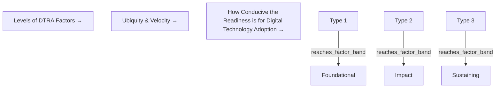

# G212/fig5-4 · 因素递进

类型：`architecture-concept-or-system-model`。配合第 5.4 节“步骤 4：解决短板并启动数字技术采用”，说明评估后企业所处的三种类型，并强调因素必须由内向外逐层满足：基础因素不满足时评估外层因素是徒劳的，所以应采取渐进（分步）且敏捷的方式补齐短板，即“因素递进”。

英文 PDF 物理页：[43]。本页为架构语义分析，原文与原图分别保留。

## 原图与可编辑图


[完整 JSON](fig5-4.json) · [可编辑 Mermaid](fig5-4.mmd) · [仅关系图](fig5-4.relations.mmd) · [层级分解图](fig5-4.hierarchy.mmd)

图形重建表达语义，不复制源图布局。虚线表示解释、矩阵映射或分组关系，不自动表示不确定性的概率。



## 架构分析

从左下角原点读起。纵轴“DTRA 因素层级”自下而上分为基础、影响、持续三段，分别对应由内到外的绿色、蓝色、橙色同心色带（纵轴左侧的分段箭头标出每段范围）。从原点射出的 3 条黑色细箭头代表三类企业，箭头止于哪一层色带，就表示该类企业的就绪度达到哪一层（并包含其内侧各层）。斜向的灰色虚线箭头指向就绪度对数字技术采用越来越有利的方向。横轴为“普及度与采用速度”。

- 本图有 9 个具名或隐含元素、3 条关系和 0 条包含/分组记录。
- 本图没有可直接确认为人员直属汇报的关系；视觉上下位置、能力分解和治理职责分别读取。
- 包含分组后有 6 个连通分量；分离可能源于图例、并列分类或独立示例，未自动补边。
- 核对3层扇区、Type1/2/3射线、竖向DTRA因素轴、横向Ubiquity&Velocity以及灰色对角就绪有利程度箭头。
- 正文定义三类型逐层满足因素，并说明实际采用可混合；图无数值刻度，不量化成熟度。

### 如何用于项目

- 围绕作者目的读取本图实体、分组与连线，并用对应原文限定其含义。
- 把参考模型与项目事实分开，实际范围、约束、值和责任须有项目证据。

### 结构所表达的逻辑

- 三类企业：类型 1 只满足基础因素（箭头止于绿色层）；类型 2 满足基础与影响因素（止于蓝色层）；类型 3 满足基础、影响与持续因素（止于橙色层）。
- 色带同心嵌套：外层以内层为前提。原文指出，组织未满足基础因素时，评估影响因素和持续因素是徒劳的。
- 类型 3 在三层因素上都具备足够就绪度，比类型 2、类型 1 更有利于启动数字技术采用；虚线箭头沿“由内向外”的方向表达这种递增。
- “因素递进”指建议的渐进且敏捷的路径：先基础因素、再影响因素、最后持续因素。原文也允许出于实际原因采用混合方式，此时可借助图 5-3（缺失因素的后果）做有依据的决策。
- 因素递进可与步骤 1 选定的采用方法组合使用，例如先选先锋式（avant-garde）方法，再对选定的业务线运用因素递进（原文 p44）。
- 横轴“普及度与采用速度”沿用了图 5-2 ABCD 框架的两个维度（普及度、速度）；原文没有单独解释本图横轴，从版式看，越外层的色带在横轴方向延伸得越远。

## 上下级与包含

三层因素由内到外同心嵌套：基础因素（最内，绿）→ 影响因素（中，蓝）→ 持续因素（最外，橙）；外层以内层为前提。三类企业不是上下级关系，而是按“满足到第几层”划分的类别，类型 3 包含类型 2 的全部层级，类型 2 包含类型 1 的全部层级。

|父项|子项|层级类型|依据与解释|
|---|---|---|---|
|—|—|无视觉包含|关系中明确的组成/特化见 JSON semantic_hierarchy。|

## 全部元素与角色

|元素ID|原文名称|类型|含义|直接父项|深度|
|---|---|---|---|---|---|
|axis_levels|Levels of DTRA Factors →|concept|纵轴，自下而上依次为基础、影响、持续三层。|—||
|lvl_foundational|Foundational|concept|组织建立最低可接受就绪度必须具备的因素（第 4.1 节，共 7 个）。|—||
|lvl_impact|Impact|concept|增强或放大主要因素有效性的因素（第 4.2 节，共 5 个）。|—||
|lvl_sustaining|Sustaining|concept|使数字技术采用制度化、获得长期收益的因素（第 4.3 节，共 3 个）。|—||
|axis_ubiquity_velocity|Ubiquity & Velocity →|concept|横轴；两个维度与图 5-2 ABCD 框架的坐标轴相同。|—||
|conduciveness|How Conducive the Readiness is for Digital Technology Adoption →|metric|沿虚线箭头方向递增。|—||
|type_1|Type 1|concept|只满足基础因素的企业。|—||
|type_2|Type 2|concept|满足基础与影响因素的企业。|—||
|type_3|Type 3|concept|满足基础、影响与持续因素的企业，最有利于启动数字技术采用。|—||

## 全部关系

三条黑色射线箭头各止于相应因素色层，记录三种类型的到达层级。穿越内层的含义由正文/表格说明，不另造射线之间或各类型与内层的原图连接。虚线粗箭头及两坐标轴是方向标记，左侧分段双箭头是范围标记。

|主体|语义关系|客体|显式线/隐式|原文标签|依据|
|---|---|---|---|---|---|
|类型 1|reaches_factor_band|基础因素|显式连线||从共同原点发出的Type射线终点分别位于绿/蓝/橙层；只是类型所达层次，无数值刻度。|
|类型 2|reaches_factor_band|影响因素|显式连线||从共同原点发出的Type射线终点分别位于绿/蓝/橙层；只是类型所达层次，无数值刻度。|
|类型 3|reaches_factor_band|持续因素|显式连线||从共同原点发出的Type射线终点分别位于绿/蓝/橙层；只是类型所达层次，无数值刻度。|

## 本轮否定的历史关系

以下旧解释保留用于追溯，不进入当前关系图、层级或知识图谱的有效边。

|旧记录|主体|旧关系|客体|否定依据|
|---|---|---|---|---|
|1|类型 2|maps_to|基础因素|原图没有该实体对之间独立连接；满足哪些层见正文与表格，层次推进见区域，不能按相邻位置补连线。|
|3|类型 3|maps_to|基础因素|原图没有该实体对之间独立连接；满足哪些层见正文与表格，层次推进见区域，不能按相邻位置补连线。|
|4|类型 3|maps_to|影响因素|原图没有该实体对之间独立连接；满足哪些层见正文与表格，层次推进见区域，不能按相邻位置补连线。|
|6|基础因素|sequence|影响因素|原图没有该实体对之间独立连接；满足哪些层见正文与表格，层次推进见区域，不能按相邻位置补连线。|
|7|影响因素|sequence|持续因素|原图没有该实体对之间独立连接；满足哪些层见正文与表格，层次推进见区域，不能按相邻位置补连线。|
|8|类型 1|sequence|类型 2|原图没有该实体对之间独立连接；满足哪些层见正文与表格，层次推进见区域，不能按相邻位置补连线。|
|9|类型 2|sequence|类型 3|原图没有该实体对之间独立连接；满足哪些层见正文与表格，层次推进见区域，不能按相邻位置补连线。|
|10|就绪度对数字技术采用的有利程度|association|类型 3|原图没有该实体对之间独立连接；满足哪些层见正文与表格，层次推进见区域，不能按相邻位置补连线。|

## 三类企业满足的因素层级（据原图箭头止点与正文）

```json
{
  "id": "t_types",
  "title_zh": "三类企业满足的因素层级（据原图箭头止点与正文）",
  "columns": [
    "企业类型",
    "基础因素",
    "影响因素",
    "持续因素",
    "箭头止于"
  ],
  "rows": [
    [
      "类型 1 Type 1",
      "✓",
      "—",
      "—",
      "绿色层（基础）"
    ],
    [
      "类型 2 Type 2",
      "✓",
      "✓",
      "—",
      "蓝色层（影响）"
    ],
    [
      "类型 3 Type 3",
      "✓",
      "✓",
      "✓",
      "橙色层（持续）"
    ]
  ],
  "cell_legend": [
    "✓ = 满足该层因素",
    "— = 未满足"
  ],
  "notes_zh": "由原图箭头的止点与第 5.4 节正文的三类定义整理，原图本身不是表格。"
}
```

## 本轮语义修正

- 从共同原点发出的Type射线终点分别位于绿/蓝/橙层；只是类型所达层次，无数值刻度。
- 原图没有该实体对之间独立连接；满足哪些层见正文与表格，层次推进见区域，不能按相邻位置补连线。
- 从共同原点发出的Type射线终点分别位于绿/蓝/橙层；只是类型所达层次，无数值刻度。
- 原图没有该实体对之间独立连接；满足哪些层见正文与表格，层次推进见区域，不能按相邻位置补连线。
- 原图没有该实体对之间独立连接；满足哪些层见正文与表格，层次推进见区域，不能按相邻位置补连线。
- 从共同原点发出的Type射线终点分别位于绿/蓝/橙层；只是类型所达层次，无数值刻度。
- 原图没有该实体对之间独立连接；满足哪些层见正文与表格，层次推进见区域，不能按相邻位置补连线。
- 原图没有该实体对之间独立连接；满足哪些层见正文与表格，层次推进见区域，不能按相邻位置补连线。
- 原图没有该实体对之间独立连接；满足哪些层见正文与表格，层次推进见区域，不能按相邻位置补连线。
- 原图没有该实体对之间独立连接；满足哪些层见正文与表格，层次推进见区域，不能按相邻位置补连线。
- 原图没有该实体对之间独立连接；满足哪些层见正文与表格，层次推进见区域，不能按相邻位置补连线。

## 误读检查

- 箭头的长度和角度不是量化数据：三条箭头张开不同角度只是为了放下标签，图中没有刻度。
- 三类企业不是三个先后执行的步骤，而是评估结果的三种情形；“递进”指企业应由内向外逐层补齐因素。
- 外层不能跳过内层：没有满足基础因素，就谈不上影响因素与持续因素。
- 中文稿引用的 figs/zh/g212e_fig5-4_zh.png 被白块遮掉了三层色带、三条类型箭头及其标签，读者无法从中看出类型 1/2/3 与因素层级的对应，应以英文原图为准。

## 原文证据

### [PDF 第 43 页](../../../documents/G212.md#page-43)

> As shown in Figure 5-4, there are three categories of organizations based on the assessment:
### [PDF 第 44 页](../../../documents/G212.md#page-44)

> The adoption approach (Step 3) and factor progression (Step 4) are not mutually-exclusive. An organization can choose the avant-garde approach and then, for the selected LOB, the factor progression can be leveraged.
> In this step, during the adoption of digital technology, the ADM cycle could be leveraged considering the right adoption approach (Step 1), DTRA conducted across factors (Step 2), and strategy to mitigate the consequences of missing factor(s) (Step 3). The as-is state and target state is to be analyzed corresponding to the factors marked in various phases of the ADM cycle in the next chapter.

## 来源与分析状态

所有元素/关系均有来源定位；未把历史解释重命名为本轮逐线视觉确认。源图与语义图是两种视图，布局不证明汇报或因果。

源 PDF SHA-256：`1c6871264e1ca327066eec5783ec273014ce1615b13e0ef236e79b017ad4ac7b`。

源图记录：[原始解释与转录](../../../figures/G212/fig5-4.json)。

```json
{
  "quality": {
    "graph_integrity": "checked",
    "semantic_analysis": "typed-graph-and-context-analysis",
    "visual_review": "source-content-audited",
    "notice_zh": "所有元素/关系均有来源定位；未把历史解释重命名为本轮逐线视觉确认。源图与语义图是两种视图，布局不证明汇报或因果。"
  },
  "source_uncertainty": {
    "confidence": "high",
    "uncertainties_zh": [
      "原文没有解释横轴“普及度与采用速度”在本图中的具体含义，key_points 中对横轴的说明仅依据版式和图 5-2 的同名维度。",
      "类型与层级的“穿过”关系（如类型 3 同时满足基础与影响因素）来自正文定义，图上只用箭头穿过色带表示。"
    ],
    "analyzed_from": [
      "英文 PDF 第 43 页原图截图（220 dpi）",
      "英文 PDF 第 43–44 页正文",
      "中文稿 G212e_数字技术采用就绪度评估.md 第 250–256、570–606 行（含图内标签对照表 L586–L599）",
      "figs/zh/g212e_fig5-4_zh.png",
      "figs/g212e_fig5-4_en.png（自动相似度 0.991）"
    ],
    "date": "2026-10-31"
  },
  "source_conflicts": []
}
```
