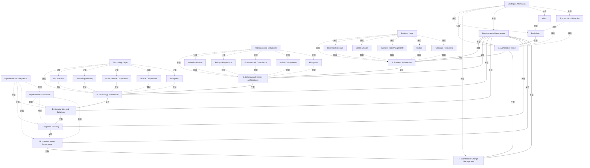

# G212/fig6-1 · 将因素映射到 TOGAF ADM

类型：`mapping-or-assessment-matrix`。第 6 章说明 DTRA 如何与 TOGAF ADM 对齐：评估应在架构愿景阶段启动，以了解组织现状；此后 ADM 每个阶段分析现状与目标态时都要考虑相关因素。本图给出“哪些因素与哪个阶段相关”的总览，表 6-1 再逐阶段说明架构含义。

英文 PDF 物理页：[45]。本页为架构语义分析，原文与原图分别保留。

## 原图与可编辑图


[完整 JSON](fig6-1.json) · [可编辑 Mermaid](fig6-1.mmd) · [仅关系图](fig6-1.relations.mmd) · [层级分解图](fig6-1.hierarchy.mmd)

图形重建表达语义，不复制源图布局。虚线表示解释、矩阵映射或分组关系，不自动表示不确定性的概率。



## 架构分析

先看 ADM 轮：顶部的预备阶段连到 A，A–H 八个阶段围成一圈，中心的需求管理用辐条连到每个阶段。再看背景色区：左上浅紫色竖条“战略与动机”覆盖预备阶段、A、中心的需求管理和 H 的大部分；左下浅粉色扇环“实施与迁移”覆盖 E、F、G；右侧三条横带自上而下为业务层、应用与数据层、技术层，分别与 B、C、D 对齐。每块色区内的彩色方框就是该区阶段要考虑的因素；框色表示因素类别（绿=基础、蓝=影响、橙=持续，图上没有图例，与表 4-1 的分类一致）。

- 本图有 33 个具名或隐含元素、39 条关系和 28 条包含/分组记录。
- 包含/分组树最大深度为 1；根节点为 战略与动机、实施与迁移、业务层、应用与数据层、技术层。
- 本图没有可直接确认为人员直属汇报的关系；视觉上下位置、能力分解和治理职责分别读取。
- 核对5区域标题、10ADM元素、18因素框（15种因素，三种各出现两次）、17条轮盘线。
- 18因素框颜色与基础/影响/持续分类一致；全部22个因素映射为版面/正文支持的隐式映射，不产生图中没有的箭头。
- H与Requirements Management穿越/贴近区域边界，不据位置将战略因素硬映射到H或需求管理。

### 如何用于项目

- 先固定行、列所代表的维度及单元格含义，再登记有证据的映射或评分。
- 空白、无关系、未测量和不适用分别处理；颜色不自动等于优先级。

### 结构所表达的逻辑

- 预备阶段与阶段 A 所在的“战略与动机”区只放了两个基础因素：愿景、赞助与方向。原文强调 DTRA 应在架构愿景阶段启动，阶段 A 包括识别利益相关者并开展就绪度评估。
- 阶段 B（业务层）有 5 个因素，与 C、D 两层并列最多，三类都有：业务理由、范围与规模、文化（基础），业务模式适应性（影响），资金与资源（持续）。
- 阶段 C（应用与数据层）放了价值实现、政策与法规（持续）和治理与合规、技能与胜任力、生态系统（影响）；阶段 D（技术层）放了 IT 能力（基础）、技术成熟度（影响），并再次出现治理与合规、技能与胜任力、生态系统。表 6-1 的脚注说明 C 侧重组织在数据与应用方面的能力，D 侧重技术能力。
- 阶段 E、F、G 所在的“实施与迁移”区只放了一个基础因素：实施方法。表 6-1 特别提醒，阶段 G 的“治理”指实施方法是否恰当，不要与 C、D 两层的“治理与合规”因素混淆。
- 15 个因素全部出现（基础 7、影响 5、持续 3）：治理与合规、技能与胜任力、生态系统各出现两次（C、D 两层），其余各出现一次，共 18 个框。
- 需求管理在中心，用辐条连到所有阶段，但旁边没有因素框；表 6-1 说需求管理要贯穿全部 ADM 阶段持续运行，需求变更经影响评估后在下一周期的相关阶段实施。
- 阶段 H 位于两块左侧区域的交界处，图中没有专门对应 H 的因素；原文另外建议在 ADM 周期结束时或下一周期的愿景阶段重新评估，了解组织所处位置与下一步行动。

## 上下级与包含

两层叠放：上层是 ADM 轮（预备阶段 + A–H + 中心需求管理）；下层是背景色区：左侧“战略与动机”“实施与迁移”两块区域，右侧业务层、应用与数据层、技术层三条横带。因素框嵌在各色区内（elements 的 parent 即所在色区），同一色区内的因素是并列关系，排列次序没有含义。

|父项|子项|层级类型|依据与解释|
|---|---|---|---|
|战略与动机|预备阶段|visual_grouping|框、泳道、域或分类组的成员归属；没有额外证据不提升为业务组合或管理关系。|
|战略与动机|A. 架构愿景|visual_grouping|框、泳道、域或分类组的成员归属；没有额外证据不提升为业务组合或管理关系。|
|业务层|B. 业务架构|visual_grouping|框、泳道、域或分类组的成员归属；没有额外证据不提升为业务组合或管理关系。|
|应用与数据层|C. 信息系统架构|visual_grouping|框、泳道、域或分类组的成员归属；没有额外证据不提升为业务组合或管理关系。|
|技术层|D. 技术架构|visual_grouping|框、泳道、域或分类组的成员归属；没有额外证据不提升为业务组合或管理关系。|
|实施与迁移|E. 机会与解决方案|visual_grouping|框、泳道、域或分类组的成员归属；没有额外证据不提升为业务组合或管理关系。|
|实施与迁移|F. 迁移规划|visual_grouping|框、泳道、域或分类组的成员归属；没有额外证据不提升为业务组合或管理关系。|
|实施与迁移|G. 实施治理|visual_grouping|框、泳道、域或分类组的成员归属；没有额外证据不提升为业务组合或管理关系。|
|战略与动机|H. 架构变更管理|visual_grouping|框、泳道、域或分类组的成员归属；没有额外证据不提升为业务组合或管理关系。|
|战略与动机|需求管理|visual_grouping|框、泳道、域或分类组的成员归属；没有额外证据不提升为业务组合或管理关系。|
|战略与动机|愿景|visual_grouping|框、泳道、域或分类组的成员归属；没有额外证据不提升为业务组合或管理关系。|
|战略与动机|赞助与方向|visual_grouping|框、泳道、域或分类组的成员归属；没有额外证据不提升为业务组合或管理关系。|
|实施与迁移|实施方法|visual_grouping|框、泳道、域或分类组的成员归属；没有额外证据不提升为业务组合或管理关系。|
|业务层|业务理由|visual_grouping|框、泳道、域或分类组的成员归属；没有额外证据不提升为业务组合或管理关系。|
|业务层|范围与规模|visual_grouping|框、泳道、域或分类组的成员归属；没有额外证据不提升为业务组合或管理关系。|
|业务层|业务模式适应性|visual_grouping|框、泳道、域或分类组的成员归属；没有额外证据不提升为业务组合或管理关系。|
|业务层|文化|visual_grouping|框、泳道、域或分类组的成员归属；没有额外证据不提升为业务组合或管理关系。|
|业务层|资金与资源|visual_grouping|框、泳道、域或分类组的成员归属；没有额外证据不提升为业务组合或管理关系。|
|应用与数据层|价值实现|visual_grouping|框、泳道、域或分类组的成员归属；没有额外证据不提升为业务组合或管理关系。|
|应用与数据层|政策与法规|visual_grouping|框、泳道、域或分类组的成员归属；没有额外证据不提升为业务组合或管理关系。|
|应用与数据层|治理与合规|visual_grouping|框、泳道、域或分类组的成员归属；没有额外证据不提升为业务组合或管理关系。|
|应用与数据层|技能与胜任力|visual_grouping|框、泳道、域或分类组的成员归属；没有额外证据不提升为业务组合或管理关系。|
|应用与数据层|生态系统|visual_grouping|框、泳道、域或分类组的成员归属；没有额外证据不提升为业务组合或管理关系。|
|技术层|IT 能力|visual_grouping|框、泳道、域或分类组的成员归属；没有额外证据不提升为业务组合或管理关系。|
|技术层|技术成熟度|visual_grouping|框、泳道、域或分类组的成员归属；没有额外证据不提升为业务组合或管理关系。|
|技术层|治理与合规|visual_grouping|框、泳道、域或分类组的成员归属；没有额外证据不提升为业务组合或管理关系。|
|技术层|技能与胜任力|visual_grouping|框、泳道、域或分类组的成员归属；没有额外证据不提升为业务组合或管理关系。|
|技术层|生态系统|visual_grouping|框、泳道、域或分类组的成员归属；没有额外证据不提升为业务组合或管理关系。|

## 全部元素与角色

|元素ID|原文名称|类型|含义|直接父项|深度|
|---|---|---|---|---|---|
|reg_strategy|Strategy & Motivation|group|分组：战略与动机|—||
|reg_impl|Implementation & Migration|group|分组：实施与迁移|—||
|lay_business|Business Layer|group|分组：业务层|—||
|lay_appdata|Application and Data Layer|group|分组：应用与数据层|—||
|lay_tech|Technology Layer|group|分组：技术层|—||
|ph_prelim|Preliminary|phase|阶段：预备阶段|战略与动机|1|
|ph_a|A. Architecture Vision|phase|阶段：A. 架构愿景|战略与动机|1|
|ph_b|B. Business Architecture|phase|阶段：B. 业务架构|业务层|1|
|ph_c|C. Information Systems Architectures|phase|阶段：C. 信息系统架构|应用与数据层|1|
|ph_d|D. Technology Architecture|phase|阶段：D. 技术架构|技术层|1|
|ph_e|E. Opportunities and Solutions|phase|阶段：E. 机会与解决方案|实施与迁移|1|
|ph_f|F. Migration Planning|phase|阶段：F. 迁移规划|实施与迁移|1|
|ph_g|G. Implementation Governance|phase|阶段：G. 实施治理|实施与迁移|1|
|ph_h|H. Architecture Change Management|phase|圆的大部分在浅紫区内，左下缘伸入浅粉区，位于两区交界。|战略与动机|1|
|ph_rm|Requirements Management|phase|中心枢纽，辐条连到 A–H；旁边没有因素框。|战略与动机|1|
|f_vision|Vision|concept|概念：愿景|战略与动机|1|
|f_sponsorship|Sponsorship & Direction|concept|概念：赞助与方向|战略与动机|1|
|f_impl_approach|Implementation Approach|concept|概念：实施方法|实施与迁移|1|
|f_rationale|Business Rationale|concept|概念：业务理由|业务层|1|
|f_scope|Scope & Scale|concept|概念：范围与规模|业务层|1|
|f_bm_adapt|Business Model Adaptability|concept|概念：业务模式适应性|业务层|1|
|f_culture|Culture|concept|概念：文化|业务层|1|
|f_funding|Funding & Resources|concept|概念：资金与资源|业务层|1|
|f_value|Value Realization|concept|概念：价值实现|应用与数据层|1|
|f_policy|Policy & Regulations|concept|概念：政策与法规|应用与数据层|1|
|f_gov_ad|Governance & Compliance|concept|与技术层的 f_gov_t 是同一个因素。|应用与数据层|1|
|f_skills_ad|Skills & Competence|concept|与技术层的 f_skills_t 是同一个因素。|应用与数据层|1|
|f_eco_ad|Ecosystem|concept|与技术层的 f_eco_t 是同一个因素。|应用与数据层|1|
|f_itcap|IT Capability|concept|概念：IT 能力|技术层|1|
|f_techmat|Technology Maturity|concept|概念：技术成熟度|技术层|1|
|f_gov_t|Governance & Compliance|concept|概念：治理与合规|技术层|1|
|f_skills_t|Skills & Competence|concept|概念：技能与胜任力|技术层|1|
|f_eco_t|Ecosystem|concept|概念：生态系统|技术层|1|

### 愿景：属性

```json
{
  "factor_category": "基础因素"
}
```

### 赞助与方向：属性

```json
{
  "factor_category": "基础因素"
}
```

### 实施方法：属性

```json
{
  "factor_category": "基础因素"
}
```

### 业务理由：属性

```json
{
  "factor_category": "基础因素"
}
```

### 范围与规模：属性

```json
{
  "factor_category": "基础因素"
}
```

### 业务模式适应性：属性

```json
{
  "factor_category": "影响因素"
}
```

### 文化：属性

```json
{
  "factor_category": "基础因素"
}
```

### 资金与资源：属性

```json
{
  "factor_category": "持续因素"
}
```

### 价值实现：属性

```json
{
  "factor_category": "持续因素"
}
```

### 政策与法规：属性

```json
{
  "factor_category": "持续因素"
}
```

### 治理与合规：属性

```json
{
  "factor_category": "影响因素"
}
```

### 技能与胜任力：属性

```json
{
  "factor_category": "影响因素"
}
```

### 生态系统：属性

```json
{
  "factor_category": "影响因素"
}
```

### IT 能力：属性

```json
{
  "factor_category": "基础因素"
}
```

### 技术成熟度：属性

```json
{
  "factor_category": "影响因素"
}
```

### 治理与合规：属性

```json
{
  "factor_category": "影响因素"
}
```

### 技能与胜任力：属性

```json
{
  "factor_category": "影响因素"
}
```

### 生态系统：属性

```json
{
  "factor_category": "影响因素"
}
```

## 全部关系

17条ADM轮盘实线均无箭头，只表达相邻/中心联系。因素到阶段没有线；映射按背景色区并对照p46–47表6-1记录为隐式对应，不冒充显式连线或强制阶段顺序。

|主体|语义关系|客体|显式线/隐式|原文标签|依据|
|---|---|---|---|---|---|
|预备阶段|关联|A. 架构愿景|显式连线||ADM圆周为阶段相邻，中心为需求管理交互；没有方向箭头，不强制执行顺序。|
|A. 架构愿景|关联|B. 业务架构|显式连线||ADM圆周为阶段相邻，中心为需求管理交互；没有方向箭头，不强制执行顺序。|
|B. 业务架构|关联|C. 信息系统架构|显式连线||ADM圆周为阶段相邻，中心为需求管理交互；没有方向箭头，不强制执行顺序。|
|C. 信息系统架构|关联|D. 技术架构|显式连线||ADM圆周为阶段相邻，中心为需求管理交互；没有方向箭头，不强制执行顺序。|
|D. 技术架构|关联|E. 机会与解决方案|显式连线||ADM圆周为阶段相邻，中心为需求管理交互；没有方向箭头，不强制执行顺序。|
|E. 机会与解决方案|关联|F. 迁移规划|显式连线||ADM圆周为阶段相邻，中心为需求管理交互；没有方向箭头，不强制执行顺序。|
|F. 迁移规划|关联|G. 实施治理|显式连线||ADM圆周为阶段相邻，中心为需求管理交互；没有方向箭头，不强制执行顺序。|
|G. 实施治理|关联|H. 架构变更管理|显式连线||ADM圆周为阶段相邻，中心为需求管理交互；没有方向箭头，不强制执行顺序。|
|H. 架构变更管理|关联|A. 架构愿景|显式连线||ADM圆周为阶段相邻，中心为需求管理交互；没有方向箭头，不强制执行顺序。|
|需求管理|关联|A. 架构愿景|显式连线||ADM圆周为阶段相邻，中心为需求管理交互；没有方向箭头，不强制执行顺序。|
|需求管理|关联|B. 业务架构|显式连线||ADM圆周为阶段相邻，中心为需求管理交互；没有方向箭头，不强制执行顺序。|
|需求管理|关联|C. 信息系统架构|显式连线||ADM圆周为阶段相邻，中心为需求管理交互；没有方向箭头，不强制执行顺序。|
|需求管理|关联|D. 技术架构|显式连线||ADM圆周为阶段相邻，中心为需求管理交互；没有方向箭头，不强制执行顺序。|
|需求管理|关联|E. 机会与解决方案|显式连线||ADM圆周为阶段相邻，中心为需求管理交互；没有方向箭头，不强制执行顺序。|
|需求管理|关联|F. 迁移规划|显式连线||ADM圆周为阶段相邻，中心为需求管理交互；没有方向箭头，不强制执行顺序。|
|需求管理|关联|G. 实施治理|显式连线||ADM圆周为阶段相邻，中心为需求管理交互；没有方向箭头，不强制执行顺序。|
|需求管理|关联|H. 架构变更管理|显式连线||ADM圆周为阶段相邻，中心为需求管理交互；没有方向箭头，不强制执行顺序。|
|愿景|映射|预备阶段|implicit||因素与ADM对应由色区/对齐及正文表6-1解释，无因素→阶段显式连接箭头。|
|愿景|映射|A. 架构愿景|implicit||因素与ADM对应由色区/对齐及正文表6-1解释，无因素→阶段显式连接箭头。|
|赞助与方向|映射|预备阶段|implicit||因素与ADM对应由色区/对齐及正文表6-1解释，无因素→阶段显式连接箭头。|
|赞助与方向|映射|A. 架构愿景|implicit||因素与ADM对应由色区/对齐及正文表6-1解释，无因素→阶段显式连接箭头。|
|实施方法|映射|E. 机会与解决方案|implicit||因素与ADM对应由色区/对齐及正文表6-1解释，无因素→阶段显式连接箭头。|
|实施方法|映射|F. 迁移规划|implicit||因素与ADM对应由色区/对齐及正文表6-1解释，无因素→阶段显式连接箭头。|
|实施方法|映射|G. 实施治理|implicit||因素与ADM对应由色区/对齐及正文表6-1解释，无因素→阶段显式连接箭头。|
|业务理由|映射|B. 业务架构|implicit||因素与ADM对应由色区/对齐及正文表6-1解释，无因素→阶段显式连接箭头。|
|范围与规模|映射|B. 业务架构|implicit||因素与ADM对应由色区/对齐及正文表6-1解释，无因素→阶段显式连接箭头。|
|业务模式适应性|映射|B. 业务架构|implicit||因素与ADM对应由色区/对齐及正文表6-1解释，无因素→阶段显式连接箭头。|
|文化|映射|B. 业务架构|implicit||因素与ADM对应由色区/对齐及正文表6-1解释，无因素→阶段显式连接箭头。|
|资金与资源|映射|B. 业务架构|implicit||因素与ADM对应由色区/对齐及正文表6-1解释，无因素→阶段显式连接箭头。|
|价值实现|映射|C. 信息系统架构|implicit||因素与ADM对应由色区/对齐及正文表6-1解释，无因素→阶段显式连接箭头。|
|政策与法规|映射|C. 信息系统架构|implicit||因素与ADM对应由色区/对齐及正文表6-1解释，无因素→阶段显式连接箭头。|
|治理与合规|映射|C. 信息系统架构|implicit||因素与ADM对应由色区/对齐及正文表6-1解释，无因素→阶段显式连接箭头。|
|技能与胜任力|映射|C. 信息系统架构|implicit||因素与ADM对应由色区/对齐及正文表6-1解释，无因素→阶段显式连接箭头。|
|生态系统|映射|C. 信息系统架构|implicit||因素与ADM对应由色区/对齐及正文表6-1解释，无因素→阶段显式连接箭头。|
|IT 能力|映射|D. 技术架构|implicit||因素与ADM对应由色区/对齐及正文表6-1解释，无因素→阶段显式连接箭头。|
|技术成熟度|映射|D. 技术架构|implicit||因素与ADM对应由色区/对齐及正文表6-1解释，无因素→阶段显式连接箭头。|
|治理与合规|映射|D. 技术架构|implicit||因素与ADM对应由色区/对齐及正文表6-1解释，无因素→阶段显式连接箭头。|
|技能与胜任力|映射|D. 技术架构|implicit||因素与ADM对应由色区/对齐及正文表6-1解释，无因素→阶段显式连接箭头。|
|生态系统|映射|D. 技术架构|implicit||因素与ADM对应由色区/对齐及正文表6-1解释，无因素→阶段显式连接箭头。|

## 因素 → ADM 阶段（按原图逐框转录，15 个因素 / 18 个框）

```json
{
  "id": "t_factor_to_phase",
  "title_zh": "因素 → ADM 阶段（按原图逐框转录，15 个因素 / 18 个框）",
  "columns": [
    "因素",
    "类别（框色）",
    "所在色区",
    "对应 ADM 阶段"
  ],
  "rows": [
    [
      "愿景 Vision",
      "基础（绿）",
      "战略与动机",
      "预备阶段、A. 架构愿景"
    ],
    [
      "赞助与方向 Sponsorship & Direction",
      "基础（绿）",
      "战略与动机",
      "预备阶段、A. 架构愿景"
    ],
    [
      "实施方法 Implementation Approach",
      "基础（绿）",
      "实施与迁移",
      "E. 机会与解决方案、F. 迁移规划、G. 实施治理"
    ],
    [
      "业务理由 Business Rationale",
      "基础（绿）",
      "业务层",
      "B. 业务架构"
    ],
    [
      "范围与规模 Scope & Scale",
      "基础（绿）",
      "业务层",
      "B. 业务架构"
    ],
    [
      "文化 Culture",
      "基础（绿）",
      "业务层",
      "B. 业务架构"
    ],
    [
      "IT 能力 IT Capability",
      "基础（绿）",
      "技术层",
      "D. 技术架构"
    ],
    [
      "业务模式适应性 Business Model Adaptability",
      "影响（蓝）",
      "业务层",
      "B. 业务架构"
    ],
    [
      "治理与合规 Governance & Compliance",
      "影响（蓝）",
      "应用与数据层；技术层",
      "C. 信息系统架构；D. 技术架构"
    ],
    [
      "技能与胜任力 Skills & Competence",
      "影响（蓝）",
      "应用与数据层；技术层",
      "C. 信息系统架构；D. 技术架构"
    ],
    [
      "生态系统 Ecosystem",
      "影响（蓝）",
      "应用与数据层；技术层",
      "C. 信息系统架构；D. 技术架构"
    ],
    [
      "技术成熟度 Technology Maturity",
      "影响（蓝）",
      "技术层",
      "D. 技术架构"
    ],
    [
      "资金与资源 Funding & Resources",
      "持续（橙）",
      "业务层",
      "B. 业务架构"
    ],
    [
      "价值实现 Value Realization",
      "持续（橙）",
      "应用与数据层",
      "C. 信息系统架构"
    ],
    [
      "政策与法规 Policy & Regulations",
      "持续（橙）",
      "应用与数据层",
      "C. 信息系统架构"
    ]
  ],
  "cell_legend": [
    "绿 = 基础因素",
    "蓝 = 影响因素",
    "橙 = 持续因素"
  ],
  "notes_zh": "“对应 ADM 阶段”由因素框与阶段圆处在同一色区推断：业务层、应用与数据层、技术层三条横带分别与 B、C、D 对齐；战略与动机区内的阶段圆是预备阶段和 A（另有中心的需求管理和 H 的大部分）；实施与迁移区内是 E、F、G。H 与需求管理旁没有因素框，表中未把战略与动机区的因素映射给它们。"
}
```

## ADM 阶段 → 因素（按阶段汇总，附表 6-1 要点）

```json
{
  "id": "t_phase_to_factor",
  "title_zh": "ADM 阶段 → 因素（按阶段汇总，附表 6-1 要点）",
  "columns": [
    "ADM 阶段",
    "所在色区",
    "图中对应的因素",
    "表 6-1 要点（转述）"
  ],
  "rows": [
    [
      "预备阶段 Preliminary",
      "战略与动机",
      "愿景；赞助与方向",
      "理解企业能力、架构框架与治理框架，定义架构原则，确定聚焦数字技术的架构能力"
    ],
    [
      "A. 架构愿景",
      "战略与动机",
      "愿景；赞助与方向",
      "捕获高层愿景，识别利益相关者，开展就绪度评估，据此选择架构路径"
    ],
    [
      "B. 业务架构",
      "业务层",
      "业务理由；范围与规模；文化；业务模式适应性；资金与资源",
      "开发目标业务架构，做详细能力评估与业务驱动/目标分析"
    ],
    [
      "C. 信息系统架构",
      "应用与数据层",
      "价值实现；政策与法规；治理与合规；技能与胜任力；生态系统",
      "开发目标数据与应用架构；因素侧重组织在数据与应用方面的能力"
    ],
    [
      "D. 技术架构",
      "技术层",
      "IT 能力；技术成熟度；治理与合规；技能与胜任力；生态系统",
      "分析技术架构差距并与数字采用对齐；因素侧重组织的技术能力"
    ],
    [
      "E. 机会与解决方案",
      "实施与迁移",
      "实施方法",
      "从整体上判断数字技术采用现状，用关键因素上的差距推导中间态与目标态"
    ],
    [
      "F. 迁移规划",
      "实施与迁移",
      "实施方法",
      "实施与迁移规划要与企业的方法和数字转型愿景一致"
    ],
    [
      "G. 实施治理",
      "实施与迁移",
      "实施方法",
      "通过合规与评审确保遵循实施计划；此处治理指实施方法是否恰当"
    ],
    [
      "H. 架构变更管理",
      "两区交界（大部分在战略与动机区）",
      "（无专门因素框）",
      "随成熟度与全景演进维护架构变更周期"
    ],
    [
      "需求管理 Requirements Management",
      "中心（战略与动机区内）",
      "（无因素框；辐条连到 A–H）",
      "贯穿所有阶段；需求变更经影响评估后在下一周期的相关阶段实施"
    ]
  ]
}
```

## 本轮语义修正

- ADM圆周为阶段相邻，中心为需求管理交互；没有方向箭头，不强制执行顺序。
- ADM圆周为阶段相邻，中心为需求管理交互；没有方向箭头，不强制执行顺序。
- ADM圆周为阶段相邻，中心为需求管理交互；没有方向箭头，不强制执行顺序。
- ADM圆周为阶段相邻，中心为需求管理交互；没有方向箭头，不强制执行顺序。
- ADM圆周为阶段相邻，中心为需求管理交互；没有方向箭头，不强制执行顺序。
- ADM圆周为阶段相邻，中心为需求管理交互；没有方向箭头，不强制执行顺序。
- ADM圆周为阶段相邻，中心为需求管理交互；没有方向箭头，不强制执行顺序。
- ADM圆周为阶段相邻，中心为需求管理交互；没有方向箭头，不强制执行顺序。
- ADM圆周为阶段相邻，中心为需求管理交互；没有方向箭头，不强制执行顺序。
- ADM圆周为阶段相邻，中心为需求管理交互；没有方向箭头，不强制执行顺序。
- ADM圆周为阶段相邻，中心为需求管理交互；没有方向箭头，不强制执行顺序。
- ADM圆周为阶段相邻，中心为需求管理交互；没有方向箭头，不强制执行顺序。
- ADM圆周为阶段相邻，中心为需求管理交互；没有方向箭头，不强制执行顺序。
- ADM圆周为阶段相邻，中心为需求管理交互；没有方向箭头，不强制执行顺序。
- ADM圆周为阶段相邻，中心为需求管理交互；没有方向箭头，不强制执行顺序。
- ADM圆周为阶段相邻，中心为需求管理交互；没有方向箭头，不强制执行顺序。
- ADM圆周为阶段相邻，中心为需求管理交互；没有方向箭头，不强制执行顺序。
- 因素与ADM对应由色区/对齐及正文表6-1解释，无因素→阶段显式连接箭头。
- 因素与ADM对应由色区/对齐及正文表6-1解释，无因素→阶段显式连接箭头。
- 因素与ADM对应由色区/对齐及正文表6-1解释，无因素→阶段显式连接箭头。
- 因素与ADM对应由色区/对齐及正文表6-1解释，无因素→阶段显式连接箭头。
- 因素与ADM对应由色区/对齐及正文表6-1解释，无因素→阶段显式连接箭头。
- 因素与ADM对应由色区/对齐及正文表6-1解释，无因素→阶段显式连接箭头。
- 因素与ADM对应由色区/对齐及正文表6-1解释，无因素→阶段显式连接箭头。
- 因素与ADM对应由色区/对齐及正文表6-1解释，无因素→阶段显式连接箭头。
- 因素与ADM对应由色区/对齐及正文表6-1解释，无因素→阶段显式连接箭头。
- 因素与ADM对应由色区/对齐及正文表6-1解释，无因素→阶段显式连接箭头。
- 因素与ADM对应由色区/对齐及正文表6-1解释，无因素→阶段显式连接箭头。
- 因素与ADM对应由色区/对齐及正文表6-1解释，无因素→阶段显式连接箭头。
- 因素与ADM对应由色区/对齐及正文表6-1解释，无因素→阶段显式连接箭头。
- 因素与ADM对应由色区/对齐及正文表6-1解释，无因素→阶段显式连接箭头。
- 因素与ADM对应由色区/对齐及正文表6-1解释，无因素→阶段显式连接箭头。
- 因素与ADM对应由色区/对齐及正文表6-1解释，无因素→阶段显式连接箭头。
- 因素与ADM对应由色区/对齐及正文表6-1解释，无因素→阶段显式连接箭头。
- 因素与ADM对应由色区/对齐及正文表6-1解释，无因素→阶段显式连接箭头。
- 因素与ADM对应由色区/对齐及正文表6-1解释，无因素→阶段显式连接箭头。
- 因素与ADM对应由色区/对齐及正文表6-1解释，无因素→阶段显式连接箭头。
- 因素与ADM对应由色区/对齐及正文表6-1解释，无因素→阶段显式连接箭头。
- 因素与ADM对应由色区/对齐及正文表6-1解释，无因素→阶段显式连接箭头。

## 误读检查

- 阶段 G“实施治理”与因素“治理与合规”是两回事：前者指实施方法是否恰当（表 6-1 的注），后者是放在 C、D 两层的影响因素。
- 因素框的上下左右次序不表示优先级；在 C、D 两层各出现一次的同名因素是同一个因素。
- 环上没有箭头；阶段顺序按 TOGAF ADM 惯例读出，本图本身只表达阶段与因素的对应。
- 中文稿第 6.1 节（译者归纳）把“实施方法”列在阶段 B，把“资金与资源”“价值实现”列在阶段 F，与本图不符：图中实施方法在“实施与迁移”区（E/F/G），资金与资源在业务层（B），价值实现在应用与数据层（C）。
- 中文稿引用的中文化 PNG 中，两块左侧区域的标题几乎不可读，多个橙色/蓝色因素框的底色被白色或青绿补丁盖住，容易误判因素类别；标签对照表也漏了“实施方法”。

## 原文证据

### [PDF 第 45 页](../../../documents/G212.md#page-45)

> Whenever the aspirational (target) state is related to digital technologies, the factors identified need to be analyzed and captured.
> For maximizing the impact of DTRA, it should initiate the Architecture Vision phase of the ADM cycle to understand where the organization currently stands. Based on the outcome of the assessment, and in each phase of the ADM cycle, the as-is state and the to-be (target) state of business is analyzed, keeping relevant factors in consideration. Assessment can be a handy tool to use to re-evaluate, either at the end of the ADM cycle or vision of the next cycle to understand where the organization stands and the next steps to be undertaken.
### [PDF 第 46 页](../../../documents/G212.md#page-46)

### [PDF 第 47 页](../../../documents/G212.md#page-47)


## 来源与分析状态

所有元素/关系均有来源定位；未把历史解释重命名为本轮逐线视觉确认。源图与语义图是两种视图，布局不证明汇报或因果。

源 PDF SHA-256：`1c6871264e1ca327066eec5783ec273014ce1615b13e0ef236e79b017ad4ac7b`。

源图记录：[原始解释与转录](../../../figures/G212/fig6-1.json)。

```json
{
  "quality": {
    "graph_integrity": "checked",
    "semantic_analysis": "typed-graph-and-context-analysis",
    "visual_review": "source-content-audited",
    "notice_zh": "所有元素/关系均有来源定位；未把历史解释重命名为本轮逐线视觉确认。源图与语义图是两种视图，布局不证明汇报或因果。"
  },
  "source_uncertainty": {
    "confidence": "high",
    "uncertainties_zh": [
      "因素框与 B/C/D 三条横带的归属由框所在色带明确表达（已用 600 dpi 复核）；唯一推断是战略与动机区的范围覆盖预备阶段、A、需求管理和 H，而图中因素框只排在预备阶段/A 附近，表中据此只映射到预备阶段和 A。",
      "因素框颜色与类别的对应来自表 4-1 的分类（逐一吻合），图上没有图例。"
    ],
    "analyzed_from": [
      "英文 PDF 第 45 页原图截图（220 dpi）及左下放大分块",
      "英文 PDF 第 45 页 600 dpi 放大分块（复核因素框与色带位置）",
      "对原图截图做像素采样，判断各阶段圆所在的背景色区",
      "英文 PDF 第 45–47 页正文与表 6-1",
      "中文稿 G212e_数字技术采用就绪度评估.md 第 252–268 行（表 4-1）、610–684 行（含图内标签对照表 L618–L650、表 6-1、第 6.1 节）",
      "figs/zh/g212e_fig6-1_zh.png",
      "figs/g212e_fig6-1_en.png（自动相似度 0.992）"
    ],
    "date": "2026-10-31"
  },
  "source_conflicts": []
}
```
