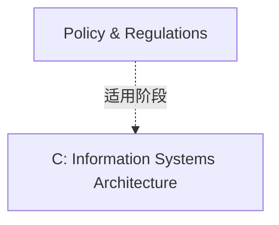

# G212/image-p0046-10 · 表6-1（架构影响）内的采用因素标签：Policy & Regulations。该标签与同一表格行的ADM阶段相关；上标1指数据与应用能力，上标2指技术能力。 原图所在表格行明确对应 Phase C: Information Systems Architecture。

类型：`architecture-phase-mapping`。表6-1（架构影响）内的采用因素标签：Policy & Regulations。该标签与同一表格行的ADM阶段相关；上标1指数据与应用能力，上标2指技术能力。 原图所在表格行明确对应 Phase C: Information Systems Architecture。

英文 PDF 物理页：[46]。本页为架构语义分析，原文与原图分别保留。

## 原图与可编辑图


[完整 JSON](image-p0046-10.json) · [可编辑 Mermaid](image-p0046-10.mmd) · [仅关系图](image-p0046-10.relations.mmd) · [层级分解图](image-p0046-10.hierarchy.mmd)

图形重建表达语义，不复制源图布局。虚线表示解释、矩阵映射或分组关系，不自动表示不确定性的概率。



## 架构分析

- 本图有 2 个具名或隐含元素、1 条关系和 0 条包含/分组记录。
- 本图没有可直接确认为人员直属汇报的关系；视觉上下位置、能力分解和治理职责分别读取。

### 如何用于项目

- 把因素与所在ADM阶段绑定，读取同一表格行中的活动说明。
- 单个标签来自表格上下文，不是完整阶段输入/输出合同。

## 上下级与包含

本图没有另行明确的层级说明。

|父项|子项|层级类型|依据与解释|
|---|---|---|---|
|—|—|无视觉包含|关系中明确的组成/特化见 JSON semantic_hierarchy。|

## 全部元素与角色

|元素ID|原文名称|类型|含义|直接父项|深度|
|---|---|---|---|---|---|
|factor|Policy & Regulations|concept|概念：Policy & Regulations|—||
|phase|C: Information Systems Architecture|phase|阶段：C: Information Systems Architecture|—||

## 全部关系


|主体|语义关系|客体|显式线/隐式|原文标签|依据|
|---|---|---|---|---|---|
|Policy & Regulations|适用阶段|C: Information Systems Architecture|matrix-cell||依据表6-1实际所在行建立因素与阶段映射，不是流程箭头。|

## 原文证据

### [PDF 第 46 页](../../../documents/G212.md#page-46)


## 来源与分析状态

所有元素/关系均有来源定位；未把历史解释重命名为本轮逐线视觉确认。源图与语义图是两种视图，布局不证明汇报或因果。

源 PDF SHA-256：`1c6871264e1ca327066eec5783ec273014ce1615b13e0ef236e79b017ad4ac7b`。

源图记录：[原始解释与转录](../../../figures/G212/image-p0046-10.json)。

```json
{
  "quality": {
    "graph_integrity": "checked",
    "semantic_analysis": "typed-graph-and-context-analysis",
    "visual_review": "source-symbol-or-table-transcribed",
    "notice_zh": "所有元素/关系均有来源定位；未把历史解释重命名为本轮逐线视觉确认。源图与语义图是两种视图，布局不证明汇报或因果。"
  },
  "source_uncertainty": null,
  "source_conflicts": []
}
```
