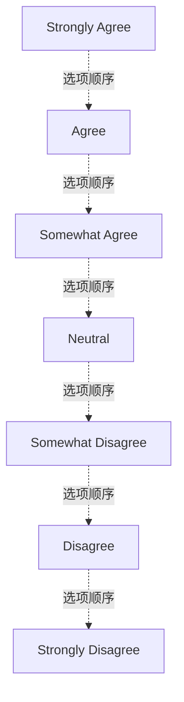

# G212/image-p0054-02 · 问卷的七点同意程度选项，从左到右由完全同意到完全不同意。七个空心圆表示待填写选项；不能当作已选答案或调查数据。对应题干请读同页紧邻上方文字。

类型：`assessment-response-form`。问卷的七点同意程度选项，从左到右由完全同意到完全不同意。七个空心圆表示待填写选项；不能当作已选答案或调查数据。对应题干请读同页紧邻上方文字。

英文 PDF 物理页：[54]。本页为架构语义分析，原文与原图分别保留。

## 原图与可编辑图


[完整 JSON](image-p0054-02.json) · [可编辑 Mermaid](image-p0054-02.mmd) · [仅关系图](image-p0054-02.relations.mmd) · [层级分解图](image-p0054-02.hierarchy.mmd)

图形重建表达语义，不复制源图布局。虚线表示解释、矩阵映射或分组关系，不自动表示不确定性的概率。



## 架构分析

- 本图有 7 个具名或隐含元素、6 条关系和 0 条包含/分组记录。
- 本图没有可直接确认为人员直属汇报的关系；视觉上下位置、能力分解和治理职责分别读取。

### 如何用于项目

- 保留问题、等级顺序及用户真实选择，当前空白表单没有问卷结果。
- 不把图中选项顺序当成架构上下级，也不自造聚合阈值。

## 上下级与包含

本图没有另行明确的层级说明。

|父项|子项|层级类型|依据与解释|
|---|---|---|---|
|—|—|无视觉包含|关系中明确的组成/特化见 JSON semantic_hierarchy。|

## 全部元素与角色

|元素ID|原文名称|类型|含义|直接父项|深度|
|---|---|---|---|---|---|
|option-1|Strongly Agree|option|选项：Strongly Agree|—||
|option-2|Agree|option|选项：Agree|—||
|option-3|Somewhat Agree|option|选项：Somewhat Agree|—||
|option-4|Neutral|option|选项：Neutral|—||
|option-5|Somewhat Disagree|option|选项：Somewhat Disagree|—||
|option-6|Disagree|option|选项：Disagree|—||
|option-7|Strongly Disagree|option|选项：Strongly Disagree|—||

## 全部关系


|主体|语义关系|客体|显式线/隐式|原文标签|依据|
|---|---|---|---|---|---|
|Strongly Agree|选项顺序|Agree|implicit||问卷选项从左到右；没有受访者选择。|
|Agree|选项顺序|Somewhat Agree|implicit||问卷选项从左到右；没有受访者选择。|
|Somewhat Agree|选项顺序|Neutral|implicit||问卷选项从左到右；没有受访者选择。|
|Neutral|选项顺序|Somewhat Disagree|implicit||问卷选项从左到右；没有受访者选择。|
|Somewhat Disagree|选项顺序|Disagree|implicit||问卷选项从左到右；没有受访者选择。|
|Disagree|选项顺序|Strongly Disagree|implicit||问卷选项从左到右；没有受访者选择。|

## 原文证据

### [PDF 第 54 页](../../../documents/G212.md#page-54)


## 来源与分析状态

所有元素/关系均有来源定位；未把历史解释重命名为本轮逐线视觉确认。源图与语义图是两种视图，布局不证明汇报或因果。

源 PDF SHA-256：`1c6871264e1ca327066eec5783ec273014ce1615b13e0ef236e79b017ad4ac7b`。

源图记录：[原始解释与转录](../../../figures/G212/image-p0054-02.json)。

```json
{
  "quality": {
    "graph_integrity": "checked",
    "semantic_analysis": "typed-graph-and-context-analysis",
    "visual_review": "source-symbol-or-table-transcribed",
    "notice_zh": "所有元素/关系均有来源定位；未把历史解释重命名为本轮逐线视觉确认。源图与语义图是两种视图，布局不证明汇报或因果。"
  },
  "source_uncertainty": null,
  "source_conflicts": []
}
```
