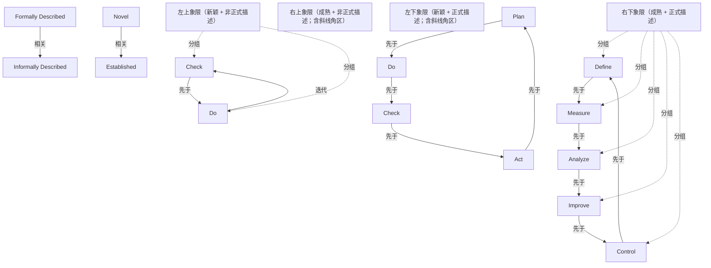

# G217/fig2-1 · 文档化矩阵示例（系统成熟度 × 架构描述正式度）

类型：`process-or-method-model`。说明架构师要按对象成熟度调节文档正式度：既不要对尚未验证的想法强求完整架构，也不要让复杂的老系统停留在口头/非正式描述；为 2.4 节“敏捷交付也需要架构”的论点提供一张可定位每份架构描述的坐标图。

英文 PDF 物理页：[26]。本页为架构语义分析，原文与原图分别保留。

## 原图与可编辑图


[完整 JSON](fig2-1.json) · [可编辑 Mermaid](fig2-1.mmd) · [仅关系图](fig2-1.relations.mmd) · [层级分解图](fig2-1.hierarchy.mmd)

图形重建表达语义，不复制源图布局。虚线表示解释、矩阵映射或分组关系，不自动表示不确定性的概率。



## 架构分析

先读纵轴：下端是 Formally Described（正式描述），上端是 Informally Described（非正式描述），箭头朝上表示越往上越不正式；再读横轴：左端 Novel（新颖），右端 Established（成熟/既定），箭头向右。细十字线把画布分成四象限，两块斜线三角标出应避免的极端角。最后看三组弧形箭头：左上是 Check 与 Do 的往返小循环，中心是 Plan→Do→Check→Act 的完整 PDCA，右下是 Define→Measure→Analyze→Improve→Control 的受控改进循环。

- 本图有 19 个具名或隐含元素、13 条关系和 7 条包含/分组记录。
- 包含/分组树最大深度为 1；根节点为 非正式描述、正式描述、新颖、既定/成熟、左上象限（新颖 + 非正式描述）、右上象限（成熟 + 非正式描述；含斜线角区）、左下象限（新颖 + 正式描述；含斜线角区）、右下象限（成熟 + 正式描述）、计划、执行、检查、处理/改进。
- 本图没有可直接确认为人员直属汇报的关系；视觉上下位置、能力分解和治理职责分别读取。
- 包含分组后有 7 个连通分量；分离可能源于图例、并列分类或独立示例，未自动补边。
- 逐一核对19个标签/区域和13条线：2条坐标轴、2条左上往返箭头、4条中心PDCA箭头、5条右下改进循环箭头。
- 三组循环独立；灰斜线只覆盖左下和右上的三角角区，没有跨象限业务连接。
- 纠正Measure→Analyze绿色箭头的几何方向为左下；图中没有因果正负极性，取消reinforcing因果分类。

### 如何用于项目

- 按阶段/事件/行为关系读取入口、出口、责任和产物；检查循环与例外路径。
- 工作流先后不表示组织管理权；在项目中显式记录条件和完成标准。

### 结构所表达的逻辑

- 两个维度是“架构描述有多正式/完整”（纵轴）与“系统/产品有多成熟、多既定”（横轴）；正文强调正式度是独立于架构演进状态、用来衡量完整性/健全性/稳健性的量。
- 左下斜线角：对象还很新颖，却要求正式而完整的架构描述 → 对应正文的“对每个潜在系统、产品或想法都提出架构强制要求”，即架构过度。
- 右上斜线角：系统已经成熟，却只有非正式描述 → 对应正文的“系统（及其架构）复杂却没有文档”，即架构不足。
- 未加斜线的左上→右下对角带表示随成熟度提高逐步增加正式度，也就是正文的“做刚好的架构，在刚好的时间”。
- 左上象限只有 Check 与 Do 两个方向相反的箭头，表示新颖/非正式阶段的高频小步循环；中心恰好落在四象限交点上的完整 PDCA，表示从探索走向既定时的闭环；右下象限是 Define→Measure→Analyze→Improve→Control 的受控改进循环（循环含义为读图推断，正文未解释这些箭头）。
- 图内没有象限文字、图例或刻度，四象限的含义完全由两条轴、细十字线和斜线阴影的位置表达。
- 三组循环彼此独立，不构成一条跨象限的大流程；“Check/Do”在图中出现两次，分属左上小循环与中心 PDCA。

## 上下级与包含

两层：外层是纵轴（描述正式度）与横轴（系统成熟度）构成的四象限画布；象限内放置循环步骤标签。斜线三角形是象限内的应避免角区，不是独立层级，也不代表第四个维度。

|父项|子项|层级类型|依据与解释|
|---|---|---|---|
|左上象限（新颖 + 非正式描述）|检查|visual_grouping|框、泳道、域或分类组的成员归属；没有额外证据不提升为业务组合或管理关系。|
|左上象限（新颖 + 非正式描述）|执行|visual_grouping|框、泳道、域或分类组的成员归属；没有额外证据不提升为业务组合或管理关系。|
|右下象限（成熟 + 正式描述）|定义|visual_grouping|框、泳道、域或分类组的成员归属；没有额外证据不提升为业务组合或管理关系。|
|右下象限（成熟 + 正式描述）|测量|visual_grouping|框、泳道、域或分类组的成员归属；没有额外证据不提升为业务组合或管理关系。|
|右下象限（成熟 + 正式描述）|分析|visual_grouping|框、泳道、域或分类组的成员归属；没有额外证据不提升为业务组合或管理关系。|
|右下象限（成熟 + 正式描述）|改进|visual_grouping|框、泳道、域或分类组的成员归属；没有额外证据不提升为业务组合或管理关系。|
|右下象限（成熟 + 正式描述）|控制|visual_grouping|框、泳道、域或分类组的成员归属；没有额外证据不提升为业务组合或管理关系。|

## 全部元素与角色

|元素ID|原文名称|类型|含义|直接父项|深度|
|---|---|---|---|---|---|
|ax_informal|Informally Described|concept|纵轴的上端标签。|—||
|ax_formal|Formally Described|concept|纵轴的下端标签；与上端共同构成描述正式度维度。|—||
|ax_novel|Novel|concept|系统成熟度维度的低端。|—||
|ax_established|Established|concept|系统成熟度维度的高端。|—||
|q_tl|左上象限（新颖 + 非正式描述）|group|没有斜线；内含 Check 与 Do 两个反向箭头。|—||
|q_tr|右上象限（成熟 + 非正式描述；含斜线角区）|group|右上角被斜线三角覆盖，对应“复杂却无文档/架构不足”。|—||
|q_bl|左下象限（新颖 + 正式描述；含斜线角区）|group|左下角被斜线三角覆盖，对应“对每个想法都要求架构/架构过度”。|—||
|q_br|右下象限（成熟 + 正式描述）|group|没有斜线；内含 Define→Measure→Analyze→Improve→Control 循环。|—||
|tl_check|Check|phase|与 Do 构成往返小循环的起点标签。|左上象限（新颖 + 非正式描述）|1|
|tl_do|Do|phase|阶段：执行|左上象限（新颖 + 非正式描述）|1|
|pdca_plan|Plan|phase|中心 PDCA 循环的顶部步骤。|—||
|pdca_do|Do|phase|阶段：执行|—||
|pdca_check|Check|phase|阶段：检查|—||
|pdca_act|Act|phase|阶段：处理/改进|—||
|ci_define|Define|phase|阶段：定义|右下象限（成熟 + 正式描述）|1|
|ci_measure|Measure|phase|阶段：测量|右下象限（成熟 + 正式描述）|1|
|ci_analyze|Analyze|phase|阶段：分析|右下象限（成熟 + 正式描述）|1|
|ci_improve|Improve|phase|阶段：改进|右下象限（成熟 + 正式描述）|1|
|ci_control|Control|phase|阶段：控制|右下象限（成熟 + 正式描述）|1|

## 全部关系

两条轴各带一个箭头，只表示“更非正式”和“更成熟”的方向；细实线十字仅分隔象限，没有语义方向；彩色弧形箭头表示各自循环的顺时针顺序；斜线填充不是连线，表示应避免的区域。

|主体|语义关系|客体|显式线/隐式|原文标签|依据|
|---|---|---|---|---|---|
|正式描述|相关|非正式描述|显式连线||纵轴箭头自下而上。|
|新颖|相关|既定/成熟|显式连线||横轴箭头自左向右。|
|检查|先于|执行|显式连线||左上绿色箭头向右，从 Check 指向 Do。|
|执行|迭代|检查|显式连线||左上橙色箭头向左，从 Do 返回 Check。|
|处理/改进|先于|计划|显式连线||顶部蓝色箭头向右，由 Act 指向 Plan。|
|计划|先于|执行|显式连线||右侧橙色箭头向下，由 Plan 指向 Do。|
|执行|先于|检查|显式连线||底部绿色箭头向左，由 Do 指向 Check。|
|检查|先于|处理/改进|显式连线||左侧紫色箭头向上，由 Check 指向 Act。|
|控制|先于|定义|显式连线||深青色箭头向右，由 Control 指向 Define。|
|定义|先于|测量|显式连线||橙色箭头向下，由 Define 指向 Measure。|
|测量|先于|分析|显式连线||原始PDF中Measure右侧标签的箭头顺时针弯向底部Analyze。|
|分析|先于|改进|显式连线||紫色箭头向左上，由 Analyze 指向 Improve。|
|改进|先于|控制|显式连线||蓝色箭头向上，由 Improve 指向 Control。|

## 本轮语义修正

- 原始PDF中Measure右侧标签的箭头顺时针弯向底部Analyze。

## 误读检查

- 两轴不是“充分性 × 正式度”：中文稿重绘 SVG 把横轴写成“正式度/完整性”、纵轴写成“充分性”，与原图的 Novel/Established、Informally/Formally Described 不符。
- 斜线区不是重点区或目标区，而是两个应避免的极端；目标是未加阴影的对角带。
- 纵轴方向反常：越往上越不正式，不能按习惯把上方当作更正式。
- 三组箭头不是一条从左上到右下的流程，它们各自闭环，且没有跨象限连接。
- 把 Check/Do 当成重复标注是误读：一处属于左上小循环，一处属于中心 PDCA。
- 中文稿标题“架构描述的‘充分性 × 正式度’矩阵”沿用了重绘资产的错误轴名，不能据此理解原图。

## 原文证据

### [PDF 第 25 页](../../../documents/G217.md#page-25)

> Although there can be a feeling amongst agilists that there is no need for architecture, the authors of this document assert that there is. It may be that the architecture is not understood, or written down, or it may be a poorly designed architecture; but as long as there is a system, there is an architecture. Without suggesting a best practice for architecture documentation, each architecture description can be plotted on the matrix described in Figure 2-1.
### [PDF 第 26 页](../../../documents/G217.md#page-26)

> A system, whether large, small, simple, complex, just invented yesterday, or as old as the punch card mainframes, has an architecture. And that architecture has a description; we can describe it visually, verbally, or in a written form.
> The job of the architect is to do just enough architecture, just in time. The TOGAF Standard describes what the architecture description should contain, such as information about stakeholders, concerns, views (for example, the views of stakeholders – to address their concerns), and viewpoints. Separate and apart from the evolutionary state of the architecture is the form of architecture measured by its formality, which is a separate measurement of its completeness, soundness, and robustness. Obvious problem areas are the extremes, when:

## 来源与分析状态

所有元素/关系均有来源定位；未把历史解释重命名为本轮逐线视觉确认。源图与语义图是两种视图，布局不证明汇报或因果。

源 PDF SHA-256：`ad38b0c9563a3558532e7ffd7f4e84e0ab82d29fc86f53bc08d583b604738488`。

源图记录：[原始解释与转录](../../../figures/G217/fig2-1.json)。

```json
{
  "quality": {
    "graph_integrity": "checked",
    "semantic_analysis": "typed-graph-and-context-analysis",
    "visual_review": "source-content-audited",
    "notice_zh": "所有元素/关系均有来源定位；未把历史解释重命名为本轮逐线视觉确认。源图与语义图是两种视图，布局不证明汇报或因果。"
  },
  "source_uncertainty": {
    "confidence": "medium",
    "uncertainties_zh": [
      "正文只解释了两个极端和“刚好足够、恰好及时”，没有解释三组循环箭头；它们的含义（不同成熟度下的迭代节律）是按位置和箭头方向推断的。",
      "斜线三角只覆盖两个象限的极端角，不覆盖整个象限；图内没有文字说明具体边界。",
      "四象限没有任何文字标签，象限名称由轴标签组合而来。",
      "纵轴方向（下方为正式、上方为非正式）依据轴端文字，与常见画法相反，容易误读。"
    ],
    "analyzed_from": [
      "英文 PDF 第 26 页 500 dpi 渲染与 figctx 220 dpi 截图",
      "fig2-1_p26_1.png 及 2×2 放大分块 z11/z12/z21/z22",
      "英文 PDF 第 26 页正文与图题（Figure 2-1）",
      "中文稿 G217e_在数字企业中使用TOGAF标准.md 第 205–216 行",
      "figs/g217_fig2-1.svg 源码"
    ],
    "date": "2026-10-31"
  },
  "source_conflicts": []
}
```
