# G217/fig4-1 · TOGAF 原则与 DPBoK 标准语境的映射

类型：`mapping-or-assessment-matrix`。在 4.3 节开头给出原则与 DPBoK 四个涌现语境的对照总表，随后按语境逐条展开原则说明；同时用“适用于较早语境即适用于之后所有语境”的规则，让读者能把一张稀疏矩阵读成累积的服务/原则集合。

英文 PDF 物理页：[39]。本页为架构语义分析，原文与原图分别保留。

## 原图与可编辑图


[完整 JSON](fig4-1.json) · [可编辑 Mermaid](fig4-1.mmd) · [仅关系图](fig4-1.relations.mmd) · [层级分解图](fig4-1.hierarchy.mmd)

图形重建表达语义，不复制源图布局。虚线表示解释、矩阵映射或分组关系，不自动表示不确定性的概率。

```mermaid
flowchart TB
  %% Semantic reconstruction; see original source image for exact layout.
  n0["DPBoK Contexts"]
  n1["Principles from the TOGAF Standard"]
  n2["Context I: Individual/Founder"]
  n3["Context II: Team"]
  n4["Context III: Team of Teams"]
  n5["Context IV: Enduring Enterprise"]
  n6["Principle 2: Maximize Benefit to the Enterprise"]
  n7["Principle 3: Information Management is Everybody’s Business"]
  n8["Principle 4: Business Continuity"]
  n9["Principle 5: Common Use Applications"]
  n10["Principle 6: Service Orientation"]
  n11["Principle 10: Data is an Asset"]
  n12["Principle 11: Data is Shared"]
  n13["Principle 12: Data is Accessible"]
  n14["Principle 15: Data Security"]
  n15["Principle 16: Technology Independence"]
  n16["Principle 17: Ease-of-Use"]
  n17["Principle 18: Requirements-Based Change"]
  n18["Principle 19: Responsive Change Management"]
  n19["Principle 20: Control Technical Diversity"]
  n20["Principle 21: Interoperability"]
  n0 -.->|"分组"| n2
  n0 -.->|"分组"| n3
  n0 -.->|"分组"| n4
  n0 -.->|"分组"| n5
  n1 -.->|"分组"| n6
  n1 -.->|"分组"| n7
  n1 -.->|"分组"| n8
  n1 -.->|"分组"| n9
  n1 -.->|"分组"| n10
  n1 -.->|"分组"| n11
  n1 -.->|"分组"| n12
  n1 -.->|"分组"| n13
  n1 -.->|"分组"| n14
  n1 -.->|"分组"| n15
  n1 -.->|"分组"| n16
  n1 -.->|"分组"| n17
  n1 -.->|"分组"| n18
  n1 -.->|"分组"| n19
  n1 -.->|"分组"| n20
```



## 架构分析

先读列标题：Context I 个人/创始人 → II 团队 → III 团队之团队 → IV 持久企业，组织规模与治理复杂度递增。再逐行看 × 从哪一列开始出现；由于累积规则，一行的 × 应从某一列起连续到最右列。左上角对角线只是把行标题区与列标题区分开，不是数据。

- 本图有 21 个具名或隐含元素、0 条关系和 19 条包含/分组记录。
- 包含/分组树最大深度为 1；根节点为 DPBoK 语境、TOGAF 标准中的原则。
- 本图没有可直接确认为人员直属汇报的关系；视觉上下位置、能力分解和治理职责分别读取。
- 原图靠嵌套表达结构，没有连线；新语义图将包含单独显式化，不补造流程、数据流或依赖。
- 包含分组后有 2 个连通分量；分离可能源于图例、并列分类或独立示例，未自动补边。
- 按原图逐格核验15条原则×4种数字组织语境（60格），原图x与转录×含义一致。
- 保留原则非连续编号；行列交界斜线仅用于表头排版，无实体连线。
- 正文说明该映射是一般参考，需要结合组织背景选择原则；空白只表示图中未映射。

### 如何用于项目

- 先固定行、列所代表的维度及单元格含义，再登记有证据的映射或评分。
- 空白、无关系、未测量和不适用分别处理；颜色不自动等于优先级。

### 结构所表达的逻辑

- 只评估并列出 15 项 TOGAF 原则：2、3、4、5、6、10、11、12、15、16、17、18、19、20、21；编号不连续是原图如此（只列适用项），不是漏抄。
- 四项原则在四个语境全部适用：P2 最大化企业收益、P15 数据安全、P17 易用性、P19 响应式变更管理。
- P3 信息管理是每个人的事、P4 业务连续性只在语境 IV 出现；P5 通用应用、P10–P12 三项数据原则、P16 技术独立性、P20 控制技术多样性、P21 互操作性从语境 III 开始适用。
- 语境 II 只新增 P6 服务导向，并延续 P2、P15、P17、P18、P19；语境 I 只有 P2、P15、P17、P19 四项。
- 每一行的 × 都从某一列开始连续到 IV，体现正文规则“若原则适用于较早语境，则也适用于之后所有语境”；因此最左侧的 × 就是该原则的引入语境。
- 语境 IV 覆盖全部 15 项，语境 I 只覆盖 4 项：原则组合随组织规模、治理和合规需求增加而扩展。
- 图前的 NOTE 明确该映射只作参考和一般性指导，最终选择哪些原则取决于具体情境。

## 上下级与包含

列方向是 DPBoK 的四个涌现层级（I→IV，组织规模/复杂度递增，不是互斥类型）；行方向是 TOGAF 原则清单（按原则编号升序）；没有更深的层级。

|父项|子项|层级类型|依据与解释|
|---|---|---|---|
|DPBoK 语境|语境 I：个人/创始人|visual_grouping|框、泳道、域或分类组的成员归属；没有额外证据不提升为业务组合或管理关系。|
|DPBoK 语境|语境 II：团队|visual_grouping|框、泳道、域或分类组的成员归属；没有额外证据不提升为业务组合或管理关系。|
|DPBoK 语境|语境 III：团队之团队|visual_grouping|框、泳道、域或分类组的成员归属；没有额外证据不提升为业务组合或管理关系。|
|DPBoK 语境|语境 IV：持久企业|visual_grouping|框、泳道、域或分类组的成员归属；没有额外证据不提升为业务组合或管理关系。|
|TOGAF 标准中的原则|原则 2：最大化企业收益|visual_grouping|框、泳道、域或分类组的成员归属；没有额外证据不提升为业务组合或管理关系。|
|TOGAF 标准中的原则|原则 3：信息管理是每个人的事|visual_grouping|框、泳道、域或分类组的成员归属；没有额外证据不提升为业务组合或管理关系。|
|TOGAF 标准中的原则|原则 4：业务连续性|visual_grouping|框、泳道、域或分类组的成员归属；没有额外证据不提升为业务组合或管理关系。|
|TOGAF 标准中的原则|原则 5：通用应用|visual_grouping|框、泳道、域或分类组的成员归属；没有额外证据不提升为业务组合或管理关系。|
|TOGAF 标准中的原则|原则 6：服务导向|visual_grouping|框、泳道、域或分类组的成员归属；没有额外证据不提升为业务组合或管理关系。|
|TOGAF 标准中的原则|原则 10：数据是资产|visual_grouping|框、泳道、域或分类组的成员归属；没有额外证据不提升为业务组合或管理关系。|
|TOGAF 标准中的原则|原则 11：数据是共享的|visual_grouping|框、泳道、域或分类组的成员归属；没有额外证据不提升为业务组合或管理关系。|
|TOGAF 标准中的原则|原则 12：数据可访问|visual_grouping|框、泳道、域或分类组的成员归属；没有额外证据不提升为业务组合或管理关系。|
|TOGAF 标准中的原则|原则 15：数据安全|visual_grouping|框、泳道、域或分类组的成员归属；没有额外证据不提升为业务组合或管理关系。|
|TOGAF 标准中的原则|原则 16：技术独立性|visual_grouping|框、泳道、域或分类组的成员归属；没有额外证据不提升为业务组合或管理关系。|
|TOGAF 标准中的原则|原则 17：易用性|visual_grouping|框、泳道、域或分类组的成员归属；没有额外证据不提升为业务组合或管理关系。|
|TOGAF 标准中的原则|原则 18：基于需求的变化|visual_grouping|框、泳道、域或分类组的成员归属；没有额外证据不提升为业务组合或管理关系。|
|TOGAF 标准中的原则|原则 19：响应式变更管理|visual_grouping|框、泳道、域或分类组的成员归属；没有额外证据不提升为业务组合或管理关系。|
|TOGAF 标准中的原则|原则 20：控制（管理）技术多样性|visual_grouping|框、泳道、域或分类组的成员归属；没有额外证据不提升为业务组合或管理关系。|
|TOGAF 标准中的原则|原则 21：互操作性|visual_grouping|框、泳道、域或分类组的成员归属；没有额外证据不提升为业务组合或管理关系。|

## 全部元素与角色

|元素ID|原文名称|类型|含义|直接父项|深度|
|---|---|---|---|---|---|
|axis_contexts|DPBoK Contexts|group|四个语境列的总标题。|—||
|axis_principles|Principles from the TOGAF Standard|group|15 行原则的总标题。|—||
|ctx_i|Context I: Individual/Founder|phase|阶段：语境 I：个人/创始人|DPBoK 语境|1|
|ctx_ii|Context II: Team|phase|阶段：语境 II：团队|DPBoK 语境|1|
|ctx_iii|Context III: Team of Teams|phase|阶段：语境 III：团队之团队|DPBoK 语境|1|
|ctx_iv|Context IV: Enduring Enterprise|phase|阶段：语境 IV：持久企业|DPBoK 语境|1|
|p2|Principle 2: Maximize Benefit to the Enterprise|principle|原则：原则 2：最大化企业收益|TOGAF 标准中的原则|1|
|p3|Principle 3: Information Management is Everybody’s Business|principle|原则：原则 3：信息管理是每个人的事|TOGAF 标准中的原则|1|
|p4|Principle 4: Business Continuity|principle|原则：原则 4：业务连续性|TOGAF 标准中的原则|1|
|p5|Principle 5: Common Use Applications|principle|原则：原则 5：通用应用|TOGAF 标准中的原则|1|
|p6|Principle 6: Service Orientation|principle|原则：原则 6：服务导向|TOGAF 标准中的原则|1|
|p10|Principle 10: Data is an Asset|principle|原则：原则 10：数据是资产|TOGAF 标准中的原则|1|
|p11|Principle 11: Data is Shared|principle|原则：原则 11：数据是共享的|TOGAF 标准中的原则|1|
|p12|Principle 12: Data is Accessible|principle|原则：原则 12：数据可访问|TOGAF 标准中的原则|1|
|p15|Principle 15: Data Security|principle|原则：原则 15：数据安全|TOGAF 标准中的原则|1|
|p16|Principle 16: Technology Independence|principle|原则：原则 16：技术独立性|TOGAF 标准中的原则|1|
|p17|Principle 17: Ease-of-Use|principle|原则：原则 17：易用性|TOGAF 标准中的原则|1|
|p18|Principle 18: Requirements-Based Change|principle|原则：原则 18：基于需求的变化|TOGAF 标准中的原则|1|
|p19|Principle 19: Responsive Change Management|principle|原则：原则 19：响应式变更管理|TOGAF 标准中的原则|1|
|p20|Principle 20: Control Technical Diversity|principle|原则：原则 20：控制（管理）技术多样性|TOGAF 标准中的原则|1|
|p21|Principle 21: Interoperability|principle|原则：原则 21：互操作性|TOGAF 标准中的原则|1|

## 全部关系

图中唯一的线是左上角单元格的对角线，只用于分隔“原则”行标题与“语境”列标题。× 不是连线，表示该原则在该语境适用；空白表示未评估为适用。

|主体|语义关系|客体|显式线/隐式|原文标签|依据|
|---|---|---|---|---|---|

## TOGAF 原则 × DPBoK 语境适用性矩阵（按原图逐行转录）

```json
{
  "id": "t_principles",
  "title_zh": "TOGAF 原则 × DPBoK 语境适用性矩阵（按原图逐行转录）",
  "columns": [
    "TOGAF 原则",
    "Context I: Individual/Founder",
    "Context II: Team",
    "Context III: Team of Teams",
    "Context IV: Enduring Enterprise"
  ],
  "rows": [
    [
      "Principle 2: Maximize Benefit to the Enterprise",
      "×",
      "×",
      "×",
      "×"
    ],
    [
      "Principle 3: Information Management is Everybody’s Business",
      "",
      "",
      "",
      "×"
    ],
    [
      "Principle 4: Business Continuity",
      "",
      "",
      "",
      "×"
    ],
    [
      "Principle 5: Common Use Applications",
      "",
      "",
      "×",
      "×"
    ],
    [
      "Principle 6: Service Orientation",
      "",
      "×",
      "×",
      "×"
    ],
    [
      "Principle 10: Data is an Asset",
      "",
      "",
      "×",
      "×"
    ],
    [
      "Principle 11: Data is Shared",
      "",
      "",
      "×",
      "×"
    ],
    [
      "Principle 12: Data is Accessible",
      "",
      "",
      "×",
      "×"
    ],
    [
      "Principle 15: Data Security",
      "×",
      "×",
      "×",
      "×"
    ],
    [
      "Principle 16: Technology Independence",
      "",
      "",
      "×",
      "×"
    ],
    [
      "Principle 17: Ease-of-Use",
      "×",
      "×",
      "×",
      "×"
    ],
    [
      "Principle 18: Requirements-Based Change",
      "",
      "×",
      "×",
      "×"
    ],
    [
      "Principle 19: Responsive Change Management",
      "×",
      "×",
      "×",
      "×"
    ],
    [
      "Principle 20: Control Technical Diversity",
      "",
      "",
      "×",
      "×"
    ],
    [
      "Principle 21: Interoperability",
      "",
      "",
      "×",
      "×"
    ]
  ],
  "cell_legend": [
    "× = 该原则适用于该 DPBoK 语境；空白 = 未评估为适用"
  ],
  "notes_zh": "原图 15 行 × 4 列，× 均从某列起连续到第 IV 列，符合“较早语境适用则之后都适用”的累积规则。"
}
```

## 误读检查

- × 表示“适用/可参考”，不是“强制实施”或“已经实施”。
- 空白不表示禁止，只表示该语境未把该原则评估为适用；结合累积规则，较晚语境仍可能适用。
- 四列不是互斥的组织类型，而是涌现层级；一个组织可能同时处于多个语境。
- 原则编号跳号（缺 1、7、8、9、13、14）是原图只列适用项，不是排版缺行。
- 左上角斜线不是趋势线或分界线，只是表头分隔符。
- 中文稿引用的 g217e_fig4-1_zh.png 表头被截断、原则 2–5 的 × 丢失，不能据它判断列对应关系或“哪些原则全适用”。

## 原文证据

### [PDF 第 23 页](../../../documents/G217.md#page-23)

> be one that looks at the enterprise, particularly in the Team of Teams and Enduring Enterprise contexts of the DPBoK Standard. In other words, the TOGAF Core Concepts and ADM. For more information on Enterprise Architecture supporting Agile delivery using the TOGAF Standard; see the TOGAF® Series Guide: Enabling Enterprise Agility [G20F]. Often the quickest delivery involves solutions that are not easily adaptable with other features and difficult to connect to other components in the ecosystem that would add value to the product.
> It is important to consider that for organizations to become digital they must improve their digital offerings with products and services that offer additional value not considered by competitors. To achieve this, experimentation is important, using iterative test-and-learn approaches to identify new digital products. Enterprise Architecture is well-suited to support this experimentation, providing the alignment of business objectives to the digital vision; for example, by applying techniques like design thinking. The use of architecture alternatives to select different potential implementation roadmaps is also a plus. More details on how to handle architecture alternatives can be found in the TOGAF Standard — ADM Techniques [C220], Chapter 9, “Architecture Alternatives and Trade-Off”.
### [PDF 第 38 页](../../../documents/G217.md#page-38)

> Figure 4-1 identifies which of the TOGAF principles are most applicable to each of the contexts of the DPBoK Standard. Descriptions of the principles and how they apply to the DPBoK contexts follow the matrix. If a principle is assessed as applicable to an earlier context it applies to all other later contexts.
### [PDF 第 39 页](../../../documents/G217.md#page-39)

> This mapping should be used as a reference and for general guidance. What principles
> The following principles from the TOGAF Standard that support the DPBoK Standard are presented per digital enterprise context.
### [PDF 第 40 页](../../../documents/G217.md#page-40)

> Decisions are made to provide maximum benefit to the enterprise as a whole.
> This principle embodies “service above self”. Decisions made from an enterprise-wide perspective have greater long-term value than decisions made from any particular organizational perspective.

## 来源与分析状态

所有元素/关系均有来源定位；未把历史解释重命名为本轮逐线视觉确认。源图与语义图是两种视图，布局不证明汇报或因果。

源 PDF SHA-256：`ad38b0c9563a3558532e7ffd7f4e84e0ab82d29fc86f53bc08d583b604738488`。

源图记录：[原始解释与转录](../../../figures/G217/fig4-1.json)。

```json
{
  "quality": {
    "graph_integrity": "checked",
    "semantic_analysis": "typed-graph-and-context-analysis",
    "visual_review": "source-content-audited",
    "notice_zh": "所有元素/关系均有来源定位；未把历史解释重命名为本轮逐线视觉确认。源图与语义图是两种视图，布局不证明汇报或因果。"
  },
  "source_uncertainty": {
    "confidence": "high",
    "uncertainties_zh": [
      "× 的具体含义按正文“applicable”理解为适用/可参考；原图没有图例说明。",
      "中文稿引用的中文化 PNG 严重损坏，列标题与原则 2–5 的 × 无法核对，只能以英文原图为准。",
      "中文稿未给出图 4-1 的中文图题，本文件按英文标题与正文术语拟译。"
    ],
    "analyzed_from": [
      "英文 PDF 第 39 页 450 dpi 渲染与 figctx 220 dpi 截图",
      "fig4-1_p39_1.png 及放大分块 z11/z22",
      "英文 PDF 第 38–39 页正文与图题（Figure 4-1）",
      "中文稿 G217e_在数字企业中使用TOGAF标准.md 第 434–465 行",
      "figs/g217_fig4-1.svg 文本、figs/zh/g217e_fig4-1_zh.png"
    ],
    "date": "2026-10-31"
  },
  "source_conflicts": []
}
```
