# G217/fig4-2 · 企业架构服务到 DPBoK 标准涌现模型的映射

类型：`mapping-or-assessment-matrix`。汇总每个语境中应考虑的企业架构服务，以交付企业架构能力；它是 4.4 节各语境服务说明的总览，也支撑“EA 以服务方式按需交付、并按语境运营节奏及时提供”的论点。

英文 PDF 物理页：[50]。本页为架构语义分析，原文与原图分别保留。

## 原图与可编辑图


[完整 JSON](fig4-2.json) · [可编辑 Mermaid](fig4-2.mmd) · [仅关系图](fig4-2.relations.mmd) · [层级分解图](fig4-2.hierarchy.mmd)

图形重建表达语义，不复制源图布局。虚线表示解释、矩阵映射或分组关系，不自动表示不确定性的概率。

```mermaid
flowchart TB
  %% Semantic reconstruction; see original source image for exact layout.
  n0["Context I: Individual/Founder"]
  n1["Context II: Team"]
  n2["Context III: Team of Teams"]
  n3["Context IV: Enduring Enterprise"]
  n4["Requirements Elicitation and Understanding Services"]
  n5["Stakeholders Management Services"]
  n6["Business Value Assessment and Analysis Service"]
  n7["Architecture Planning Services"]
  n8["Architecture Project Planning Services"]
  n9["Architecting Tailoring Services"]
  n10["Design Support Services"]
  n11["Architecture Vision and Strategy Definition Services"]
  n12["Architecture Modeling and Documentation Services (MVA)"]
  n13["Architecture Integration Services"]
  n14["Architecture Compliance Dev. Services (Bus, Info, Appl, Infra, Systs, ...)"]
  n15["Development Support Services"]
  n16["Architecture and Standards Guidance Service"]
  n17["Compliance Assessment and Analysis Service"]
  n18["Change Management Services"]
  n19["Release Support Services"]
  n20["Enterprise Support Services"]
  n21["Portfolio Management Support Services (inc. Asset Mgmt, Acquisitions)"]
  n22["Risk Management Services"]
  n23["Sustainability Management Support Services"]
  n24["Enterprise Analysis and Assessment Services"]
  n25["Capability Planning Support Service"]
  n26["Enterprise Architecture Practice Development Support Services"]
  n27["Enterprise Architecture Development Process Improvement Service"]
  n4 -.->|"分组"| n5
  n4 -.->|"分组"| n6
  n7 -.->|"分组"| n8
  n7 -.->|"分组"| n9
  n10 -.->|"分组"| n11
  n10 -.->|"分组"| n12
  n10 -.->|"分组"| n13
  n10 -.->|"分组"| n14
  n15 -.->|"分组"| n16
  n15 -.->|"分组"| n17
  n15 -.->|"分组"| n18
  n15 -.->|"分组"| n19
  n20 -.->|"分组"| n21
  n20 -.->|"分组"| n22
  n20 -.->|"分组"| n23
  n20 -.->|"分组"| n24
  n20 -.->|"分组"| n25
  n26 -.->|"分组"| n27
```



## 架构分析

按行读：Context I 个人/创始人 → II 团队 → III 团队之团队 → IV 持久企业，组织规模递增。按列读：24 列中 6 个加粗竖排标题是服务分类带（本身不带 ×），其右侧的普通列才是具体服务；绿色格中的 × 表示该服务在该语境应被考虑。

- 本图有 28 个具名或隐含元素、0 条关系和 18 条包含/分组记录。
- 包含/分组树最大深度为 1；根节点为 语境 I：个人/创始人、语境 II：团队、语境 III：团队之团队、语境 IV：持久企业、需求获取与理解服务、架构规划服务、设计支持服务、开发支持服务、企业支持服务、企业架构实践发展支持服务。
- 本图没有可直接确认为人员直属汇报的关系；视觉上下位置、能力分解和治理职责分别读取。
- 原图靠嵌套表达结构，没有连线；新语义图将包含单独显式化，不补造流程、数据流或依赖。
- 包含分组后有 10 个连通分量；分离可能源于图例、并列分类或独立示例，未自动补边。
- 按原图核验18项服务×4种语境（72格）与6个分类带：I/II/III/IV分别出现5/6/14/18项服务。
- 6个分类带不单独构成服务；图无实体连线，空白是未映射。

### 如何用于项目

- 先固定行、列所代表的维度及单元格含义，再登记有证据的映射或评分。
- 空白、无关系、未测量和不适用分别处理；颜色不自动等于优先级。

### 结构所表达的逻辑

- 24 列由 6 个加粗分类带（需求获取与理解、架构规划、设计支持、开发支持、企业支持、EA 实践发展支持）和 18 项具体服务组成；分类带列不带 ×。
- 语境 I 只考虑 5 项服务：利益相关者管理、业务价值评估与分析、架构与标准指导、风险管理、可持续性管理支持。
- 语境 II 增加到 6 项，唯一新增的是变更管理。
- 语境 III 跃升到 14 项，新增架构项目规划、架构裁剪、愿景与战略、建模与文档、集成、发布支持、组合管理、企业分析与评估。
- 语境 IV 覆盖全部 18 项，新增架构合规开发、合规评估与分析、能力规划、EA 开发过程改进。
- 每项服务的 × 都是从某一语境起连续到语境 IV，说明服务组合是累积的：一旦引入，后续语境继续保留。
- “EA 实践发展支持服务”分类下的“企业架构开发过程改进服务”只在语境 IV 出现；分类本身没有 ×，不能把分类列当作服务。
- 正文提醒：这些是“应考虑”的服务，提供方需按语境和运营节奏裁剪交付，并不意味着每个语境都要全量服务。

## 上下级与包含

列方向两层：6 个服务分类（加粗带）> 18 项具体服务；行方向一层：4 个 DPBoK 语境。分类带只做视觉分组，不是可映射的服务。

|父项|子项|层级类型|依据与解释|
|---|---|---|---|
|需求获取与理解服务|利益相关者管理服务|visual_grouping|框、泳道、域或分类组的成员归属；没有额外证据不提升为业务组合或管理关系。|
|需求获取与理解服务|业务价值评估与分析服务|visual_grouping|框、泳道、域或分类组的成员归属；没有额外证据不提升为业务组合或管理关系。|
|架构规划服务|架构项目规划服务|visual_grouping|框、泳道、域或分类组的成员归属；没有额外证据不提升为业务组合或管理关系。|
|架构规划服务|架构裁剪服务|visual_grouping|框、泳道、域或分类组的成员归属；没有额外证据不提升为业务组合或管理关系。|
|设计支持服务|架构愿景与战略服务|visual_grouping|框、泳道、域或分类组的成员归属；没有额外证据不提升为业务组合或管理关系。|
|设计支持服务|架构建模与文档服务（MVA）|visual_grouping|框、泳道、域或分类组的成员归属；没有额外证据不提升为业务组合或管理关系。|
|设计支持服务|架构集成服务|visual_grouping|框、泳道、域或分类组的成员归属；没有额外证据不提升为业务组合或管理关系。|
|设计支持服务|架构合规开发服务（业务、信息、应用、基础设施、系统等）|visual_grouping|框、泳道、域或分类组的成员归属；没有额外证据不提升为业务组合或管理关系。|
|开发支持服务|架构与标准指导服务|visual_grouping|框、泳道、域或分类组的成员归属；没有额外证据不提升为业务组合或管理关系。|
|开发支持服务|合规评估与分析服务|visual_grouping|框、泳道、域或分类组的成员归属；没有额外证据不提升为业务组合或管理关系。|
|开发支持服务|变更管理|visual_grouping|框、泳道、域或分类组的成员归属；没有额外证据不提升为业务组合或管理关系。|
|开发支持服务|发布支持服务|visual_grouping|框、泳道、域或分类组的成员归属；没有额外证据不提升为业务组合或管理关系。|
|企业支持服务|组合管理支持服务（含资产管理、收购）|visual_grouping|框、泳道、域或分类组的成员归属；没有额外证据不提升为业务组合或管理关系。|
|企业支持服务|风险管理服务|visual_grouping|框、泳道、域或分类组的成员归属；没有额外证据不提升为业务组合或管理关系。|
|企业支持服务|可持续性管理支持服务|visual_grouping|框、泳道、域或分类组的成员归属；没有额外证据不提升为业务组合或管理关系。|
|企业支持服务|企业分析与评估服务|visual_grouping|框、泳道、域或分类组的成员归属；没有额外证据不提升为业务组合或管理关系。|
|企业支持服务|能力规划支持服务|visual_grouping|框、泳道、域或分类组的成员归属；没有额外证据不提升为业务组合或管理关系。|
|企业架构实践发展支持服务|企业架构开发过程改进服务|visual_grouping|框、泳道、域或分类组的成员归属；没有额外证据不提升为业务组合或管理关系。|

## 全部元素与角色

|元素ID|原文名称|类型|含义|直接父项|深度|
|---|---|---|---|---|---|
|ctx_i|Context I: Individual/Founder|phase|阶段：语境 I：个人/创始人|—||
|ctx_ii|Context II: Team|phase|阶段：语境 II：团队|—||
|ctx_iii|Context III: Team of Teams|phase|阶段：语境 III：团队之团队|—||
|ctx_iv|Context IV: Enduring Enterprise|phase|阶段：语境 IV：持久企业|—||
|cat_req|Requirements Elicitation and Understanding Services|group|分组：需求获取与理解服务|—||
|svc_stakeholders|Stakeholders Management Services|service|四个语境全部适用。|需求获取与理解服务|1|
|svc_business_value|Business Value Assessment and Analysis Service|service|四个语境全部适用。|需求获取与理解服务|1|
|cat_arch_plan|Architecture Planning Services|group|分组：架构规划服务|—||
|svc_arch_project_planning|Architecture Project Planning Services|service|服务：架构项目规划服务|架构规划服务|1|
|svc_arch_tailoring|Architecting Tailoring Services|service|服务：架构裁剪服务|架构规划服务|1|
|cat_design|Design Support Services|group|分组：设计支持服务|—||
|svc_vision|Architecture Vision and Strategy Definition Services|service|服务：架构愿景与战略服务|设计支持服务|1|
|svc_modeling|Architecture Modeling and Documentation Services (MVA)|service|服务：架构建模与文档服务（MVA）|设计支持服务|1|
|svc_integration|Architecture Integration Services|service|服务：架构集成服务|设计支持服务|1|
|svc_compliance_dev|Architecture Compliance Dev. Services (Bus, Info, Appl, Infra, Systs, ...)|service|只在语境 IV 出现。|设计支持服务|1|
|cat_dev|Development Support Services|group|分组：开发支持服务|—||
|svc_standards|Architecture and Standards Guidance Service|service|四个语境全部适用，是语境 I/II 中唯一的开发支持类服务。|开发支持服务|1|
|svc_compliance_assessment|Compliance Assessment and Analysis Service|service|只在语境 IV 出现。|开发支持服务|1|
|svc_change|Change Management Services|service|从语境 II 开始适用。|开发支持服务|1|
|svc_release|Release Support Services|service|服务：发布支持服务|开发支持服务|1|
|cat_enterprise|Enterprise Support Services|group|分组：企业支持服务|—||
|svc_portfolio|Portfolio Management Support Services (inc. Asset Mgmt, Acquisitions)|service|服务：组合管理支持服务（含资产管理、收购）|企业支持服务|1|
|svc_risk|Risk Management Services|service|四个语境全部适用。|企业支持服务|1|
|svc_sustainability|Sustainability Management Support Services|service|四个语境全部适用。|企业支持服务|1|
|svc_enterprise_analysis|Enterprise Analysis and Assessment Services|service|服务：企业分析与评估服务|企业支持服务|1|
|svc_capability|Capability Planning Support Service|service|只在语境 IV 出现。|企业支持服务|1|
|cat_practice|Enterprise Architecture Practice Development Support Services|group|分组：企业架构实践发展支持服务|—||
|svc_process_improvement|Enterprise Architecture Development Process Improvement Service|service|只在语境 IV 出现；其所属分类带本身没有 ×。|企业架构实践发展支持服务|1|

## 全部关系

图中没有连线。绿色底 + × 是唯一的数据编码；竖线与加粗列边界只是表格网格和分类带分隔，不表示流程或依赖。

|主体|语义关系|客体|显式线/隐式|原文标签|依据|
|---|---|---|---|---|---|

## 企业架构服务 × DPBoK 语境映射（按原图逐列转录）

```json
{
  "id": "t_services",
  "title_zh": "企业架构服务 × DPBoK 语境映射（按原图逐列转录）",
  "columns": [
    "服务分类（加粗带）",
    "企业架构服务",
    "Context I: Individual/Founder",
    "Context II: Team",
    "Context III: Team of Teams",
    "Context IV: Enduring Enterprise"
  ],
  "rows": [
    [
      "Requirements Elicitation and Understanding Services",
      "Stakeholders Management Services",
      "×",
      "×",
      "×",
      "×"
    ],
    [
      "Requirements Elicitation and Understanding Services",
      "Business Value Assessment and Analysis Service",
      "×",
      "×",
      "×",
      "×"
    ],
    [
      "Architecture Planning Services",
      "Architecture Project Planning Services",
      "",
      "",
      "×",
      "×"
    ],
    [
      "Architecture Planning Services",
      "Architecting Tailoring Services",
      "",
      "",
      "×",
      "×"
    ],
    [
      "Design Support Services",
      "Architecture Vision and Strategy Definition Services",
      "",
      "",
      "×",
      "×"
    ],
    [
      "Design Support Services",
      "Architecture Modeling and Documentation Services (MVA)",
      "",
      "",
      "×",
      "×"
    ],
    [
      "Design Support Services",
      "Architecture Integration Services",
      "",
      "",
      "×",
      "×"
    ],
    [
      "Design Support Services",
      "Architecture Compliance Dev. Services (Bus, Info, Appl, Infra, Systs, ...)",
      "",
      "",
      "",
      "×"
    ],
    [
      "Development Support Services",
      "Architecture and Standards Guidance Service",
      "×",
      "×",
      "×",
      "×"
    ],
    [
      "Development Support Services",
      "Compliance Assessment and Analysis Service",
      "",
      "",
      "",
      "×"
    ],
    [
      "Development Support Services",
      "Change Management Services",
      "",
      "×",
      "×",
      "×"
    ],
    [
      "Development Support Services",
      "Release Support Services",
      "",
      "",
      "×",
      "×"
    ],
    [
      "Enterprise Support Services",
      "Portfolio Management Support Services (inc. Asset Mgmt, Acquisitions)",
      "",
      "",
      "×",
      "×"
    ],
    [
      "Enterprise Support Services",
      "Risk Management Services",
      "×",
      "×",
      "×",
      "×"
    ],
    [
      "Enterprise Support Services",
      "Sustainability Management Support Services",
      "×",
      "×",
      "×",
      "×"
    ],
    [
      "Enterprise Support Services",
      "Enterprise Analysis and Assessment Services",
      "",
      "",
      "×",
      "×"
    ],
    [
      "Enterprise Support Services",
      "Capability Planning Support Service",
      "",
      "",
      "",
      "×"
    ],
    [
      "Enterprise Architecture Practice Development Support Services",
      "Enterprise Architecture Development Process Improvement Service",
      "",
      "",
      "",
      "×"
    ]
  ],
  "cell_legend": [
    "× = 该服务在该语境中应考虑；空白 = 该语境未列入"
  ],
  "notes_zh": "原图另有 6 个加粗分类列（需求获取、架构规划、设计支持、开发支持、企业支持、EA 实践发展）穿插在服务列之间，本身不带 ×；本表把它们并入“服务分类”列。各语境服务数：I=5、II=6、III=14、IV=18。"
}
```

## 误读检查

- 6 个加粗列是分类标题，不是“整个分类都适用”的服务列，分类列内没有 ×。
- × 表示“应考虑/建议使用”，不是强制实施；空白不表示禁止。
- 四个语境不是互斥的组织类型，而是涌现层级；服务在语境间累积，不是在语境间迁移。
- 行序是 I→IV（自上而下变大），与图 4-3 的 IV→I 相反，不能把两张图的行序混用。
- 中文稿引用的 g217e_fig4-2_zh.png 表头被截断、绿色格错位，不能据它读出服务名、分类或映射。

## 原文证据

### [PDF 第 34 页](../../../documents/G217.md#page-34)

> The collaboration level represents the critical Team-level experience. Establishing team collaboration as a fundamental guiding value is essential to successful digital product development. The insights of the Agile movement and related themes such as Lean are primary in this context.
> The DPBoK Standard highlights the following areas of interest within the Team context:
### [PDF 第 50 页](../../../documents/G217.md#page-50)

> Figure 4-2. Enterprise Architecture Services to DPBoK Standard Emergence Model
> Figure 4-2 summarizes the Enterprise Architecture services that should be considered per context to deliver Enterprise Architecture capabilities. The following sections elaborate on the Enterprise Architecture services and Enterprise Architecture capabilities most pertinent for each context. The Digital Practitioner would be wise to consider using the Enterprise Architecture services listed per context. The Enterprise Architecture service provider must consider the context and deliver in a timely manner, in line with the operation tempo of the given context.
### [PDF 第 51 页](../../../documents/G217.md#page-51)

> To support the Individual/Founder context, the following Enterprise Architecture services should be considered:
> ◦Provides on-demand assessment and analysis of business value based on the current state of

## 来源与分析状态

所有元素/关系均有来源定位；未把历史解释重命名为本轮逐线视觉确认。源图与语义图是两种视图，布局不证明汇报或因果。

源 PDF SHA-256：`ad38b0c9563a3558532e7ffd7f4e84e0ab82d29fc86f53bc08d583b604738488`。

源图记录：[原始解释与转录](../../../figures/G217/fig4-2.json)。

```json
{
  "quality": {
    "graph_integrity": "checked",
    "semantic_analysis": "typed-graph-and-context-analysis",
    "visual_review": "source-content-audited",
    "notice_zh": "所有元素/关系均有来源定位；未把历史解释重命名为本轮逐线视觉确认。源图与语义图是两种视图，布局不证明汇报或因果。"
  },
  "source_uncertainty": {
    "confidence": "high",
    "uncertainties_zh": [
      "× 的含义按正文“should be considered”理解为应考虑/建议使用；原图无图例。",
      "6 个分类带的列宽与数据列相同，容易被误当成服务列；已按加粗与粗竖线区分。",
      "中文稿引用的中文化 PNG 严重损坏，无法用它复核任何映射；本分析完全以英文 PDF 原图为准。",
      "图题中的 “to ... Emergence Model” 表示“映射到涌现模型”，中文图题按此拟译。"
    ],
    "analyzed_from": [
      "英文 PDF 第 50 页 500 dpi 渲染与 figctx 220 dpi 截图",
      "fig4-2_p50_1.png 及放大分块 z11/z12/z21/z22",
      "绿色单元格像素统计（24 列 × 4 行）与列线检测",
      "英文 PDF 第 50 页正文与图题（Figure 4-2）",
      "中文稿 G217e_在数字企业中使用TOGAF标准.md 第 641–679 行",
      "figs/zh/g217e_fig4-2_zh.png、标签对照表"
    ],
    "date": "2026-10-31"
  },
  "source_conflicts": []
}
```
