# G217/fig4-3 · 企业架构服务涌现模型

类型：`mapping-or-assessment-matrix`。把图 4-2 的服务清单转成“涌现模型”：在每个语境中标出哪些服务是新引入（N）、哪些延续（P）、哪些延续但执行更深（D），从而说明企业架构服务组合如何随企业从个人/创始人走向持久企业而扩展、加深。

英文 PDF 物理页：[60]。本页为架构语义分析，原文与原图分别保留。

## 原图与可编辑图


[完整 JSON](fig4-3.json) · [可编辑 Mermaid](fig4-3.mmd) · [仅关系图](fig4-3.relations.mmd) · [层级分解图](fig4-3.hierarchy.mmd)

图形重建表达语义，不复制源图布局。虚线表示解释、矩阵映射或分组关系，不自动表示不确定性的概率。

```mermaid
flowchart TB
  %% Semantic reconstruction; see original source image for exact layout.
  n0["Legend:"]
  n1["Context IV: Enduring Enterprise"]
  n2["Context III: Team of Teams"]
  n3["Context II: Team"]
  n4["Context I: Individual/Founder"]
  n5["Stakeholders Management Services"]
  n6["Business Value Assessment and Analysis Service"]
  n7["Architecture Project Planning Services"]
  n8["Architecting Tailoring Services"]
  n9["Architecture Vision and Strategy Services"]
  n10["Architecture Modeling and Documentation Services (MVA)"]
  n11["Architecture Integration Services"]
  n12["Architecture Compliance Development Services"]
  n13["Architecture and Standards Guidance Service"]
  n14["Change Management"]
  n15["Compliance Assessment and Analysis Service"]
  n16["Release Support Services"]
  n17["Portfolio Management Support Services"]
  n18["Risk Management Services"]
  n19["Sustainability Management Support Services"]
  n20["Enterprise Analysis and Assessment Services"]
  n21["Capability Planning Support Service"]
  n22["Enterprise Architecture Dev Process Improvement Service"]
```



## 架构分析

按涌现顺序从下往上读：Context I → II → III → IV（图中把最高的 IV 放在最上面，是倒序）。每一行看该语境的服务构成：N 为新引入，P 为延续，D 为延续且更深，空白为未列入。颜色与字母一一对应，见左下角 Legend。

- 本图有 23 个具名或隐含元素、0 条关系和 0 条包含/分组记录。
- 本图没有可直接确认为人员直属汇报的关系；视觉上下位置、能力分解和治理职责分别读取。
- 包含分组后有 23 个连通分量；分离可能源于图例、并列分类或独立示例，未自动补边。
- 按原图IV→I的行顺序与转置表I→IV的列顺序逐格对照18项服务的72个N/P/D或空白单元。
- 核验N灰色=新引入、P蓝灰色=继续、D绿色=更深入；六分类带没有N/P/D。
- 例如Stakeholders为N/D/P/D，Risk为N/D/D/D，Sustainability为N/D/P/P；未把空白解释为能力不存在。

### 如何用于项目

- 先固定行、列所代表的维度及单元格含义，再登记有证据的映射或评分。
- 空白、无关系、未测量和不适用分别处理；颜色不自动等于优先级。

### 结构所表达的逻辑

- N = 新引入的 EA 服务（灰底），P = 此前已引入的 EA 服务（蓝灰底），D = 此前已引入但在本语境执行更深（绿底）；空白表示该语境未列入该服务。
- 语境 I 只有 5 项服务，且全部为 N：利益相关者管理、业务价值评估与分析、架构与标准指导、风险管理、可持续性管理支持。
- 语境 II 新增变更管理（N）；同时把利益相关者管理、架构与标准指导、风险管理、可持续性管理标为 D（更深），业务价值评估为 P。
- 语境 III 新增 8 项：架构项目规划、架构裁剪、愿景与战略、建模与文档、集成、发布支持、组合管理、企业分析与评估；标准指导与风险管理标为 D。
- 语境 IV 覆盖全部 18 项：新增架构合规开发、合规评估与分析、能力规划、EA 开发过程改进 4 项（N）；5 项标为 D（利益相关者、业务价值、集成、风险、企业分析），与中文稿列出的“将更深入”的服务完全对应。
- 服务集合逐语境累积：任何服务一旦以 N 出现，后续语境必为 P 或 D，不会消失；因此四行的非空数量依次为 5、6、14、18。
- P/D 不是单向等级：例如“架构与标准指导”走 N(I)→D(II)→D(III)→P(IV)，说明 D 只表示“相对上一语境更深”，不是永久等级。
- 图中没有箭头，涌现方向由行序（自下而上）和 N→P/D 的标记表达，不要把它读成流程链。

## 上下级与包含

行方向：4 个 DPBoK 语境，按成熟度 I→IV，但视觉上从下往上递增（最上面是 IV）；列方向：18 项企业架构服务，无分类带；左下角是独立图例。

|父项|子项|层级类型|依据与解释|
|---|---|---|---|
|—|—|无视觉包含|关系中明确的组成/特化见 JSON semantic_hierarchy。|

## 全部元素与角色

|元素ID|原文名称|类型|含义|直接父项|深度|
|---|---|---|---|---|---|
|legend_label|Legend:|note|说明：图例：|—||
|ctx_iv|Context IV: Enduring Enterprise|phase|阶段：语境 IV：持久企业|—||
|ctx_iii|Context III: Team of Teams|phase|阶段：语境 III：团队之团队|—||
|ctx_ii|Context II: Team|phase|阶段：语境 II：团队|—||
|ctx_i|Context I: Individual/Founder|phase|阶段：语境 I：个人/创始人|—||
|svc_stakeholders|Stakeholders Management Services|service|N(I)→D(II)→P(III)→D(IV)。|—||
|svc_business_value|Business Value Assessment and Analysis Service|service|N(I)→P(II)→P(III)→D(IV)。|—||
|svc_arch_project_planning|Architecture Project Planning Services|service|N(III)→P(IV)。|—||
|svc_arch_tailoring|Architecting Tailoring Services|service|N(III)→P(IV)。|—||
|svc_vision|Architecture Vision and Strategy Services|service|N(III)→P(IV)。|—||
|svc_modeling|Architecture Modeling and Documentation Services (MVA)|service|N(III)→P(IV)。|—||
|svc_integration|Architecture Integration Services|service|N(III)→D(IV)。|—||
|svc_compliance_dev|Architecture Compliance Development Services|service|仅 N(IV)。|—||
|svc_standards|Architecture and Standards Guidance Service|service|N(I)→D(II)→D(III)→P(IV)，是唯一出现 P 晚于 D 的服务。|—||
|svc_change|Change Management|service|N(II)→P(III)→P(IV)。|—||
|svc_compliance_assessment|Compliance Assessment and Analysis Service|service|仅 N(IV)。|—||
|svc_release|Release Support Services|service|N(III)→P(IV)。|—||
|svc_portfolio|Portfolio Management Support Services|service|N(III)→P(IV)。|—||
|svc_risk|Risk Management Services|service|N(I)→D(II)→D(III)→D(IV)。|—||
|svc_sustainability|Sustainability Management Support Services|service|N(I)→D(II)→P(III)→P(IV)。|—||
|svc_enterprise_analysis|Enterprise Analysis and Assessment Services|service|N(III)→D(IV)。|—||
|svc_capability|Capability Planning Support Service|service|仅 N(IV)。|—||
|svc_process_improvement|Enterprise Architecture Dev Process Improvement Service|service|仅 N(IV)。|—||

## 全部关系

全图没有连线。状态由“字母 + 底色”编码；竖线、横线只是表格网格；行序本身（自下而上）表达涌现方向。

|主体|语义关系|客体|显式线/隐式|原文标签|依据|
|---|---|---|---|---|---|

## 企业架构服务涌现矩阵（原图行=语境、列=服务；本表按服务行转录）

```json
{
  "id": "t_emergence",
  "title_zh": "企业架构服务涌现矩阵（原图行=语境、列=服务；本表按服务行转录）",
  "columns": [
    "企业架构服务",
    "Context I: Individual/Founder",
    "Context II: Team",
    "Context III: Team of Teams",
    "Context IV: Enduring Enterprise"
  ],
  "rows": [
    [
      "Stakeholders Management Services",
      "N",
      "D",
      "P",
      "D"
    ],
    [
      "Business Value Assessment and Analysis Service",
      "N",
      "P",
      "P",
      "D"
    ],
    [
      "Architecture Project Planning Services",
      "",
      "",
      "N",
      "P"
    ],
    [
      "Architecting Tailoring Services",
      "",
      "",
      "N",
      "P"
    ],
    [
      "Architecture Vision and Strategy Services",
      "",
      "",
      "N",
      "P"
    ],
    [
      "Architecture Modeling and Documentation Services (MVA)",
      "",
      "",
      "N",
      "P"
    ],
    [
      "Architecture Integration Services",
      "",
      "",
      "N",
      "D"
    ],
    [
      "Architecture Compliance Development Services",
      "",
      "",
      "",
      "N"
    ],
    [
      "Architecture and Standards Guidance Service",
      "N",
      "D",
      "D",
      "P"
    ],
    [
      "Change Management",
      "",
      "N",
      "P",
      "P"
    ],
    [
      "Compliance Assessment and Analysis Service",
      "",
      "",
      "",
      "N"
    ],
    [
      "Release Support Services",
      "",
      "",
      "N",
      "P"
    ],
    [
      "Portfolio Management Support Services",
      "",
      "",
      "N",
      "P"
    ],
    [
      "Risk Management Services",
      "N",
      "D",
      "D",
      "D"
    ],
    [
      "Sustainability Management Support Services",
      "N",
      "D",
      "P",
      "P"
    ],
    [
      "Enterprise Analysis and Assessment Services",
      "",
      "",
      "N",
      "D"
    ],
    [
      "Capability Planning Support Service",
      "",
      "",
      "",
      "N"
    ],
    [
      "Enterprise Architecture Dev Process Improvement Service",
      "",
      "",
      "",
      "N"
    ]
  ],
  "cell_legend": [
    "N（灰底）= 新引入；P（蓝灰底）= 此前已引入；D（绿底）= 此前已引入但执行更深；空白 = 该语境未列入"
  ],
  "notes_zh": "各语境非空服务数：I=5、II=6、III=14、IV=18。原图把语境 IV 放在最上面、I 在最下面，本表按 I→IV 排列以便与图 4-2 对照。"
}
```

## 误读检查

- 行序是倒的：最上面是最高语境 IV，不是 I；按从上到下会把涌现方向读反。
- D 不是“删除/退役”，而是“此前已有、在本语境执行更深”。
- P 不是“部分适用”，而是“此前已引入、本语境延续”。
- 空白不是“禁止”，只是该语境尚未列入该服务。
- 字母与颜色一一对应，不能只看颜色不看字母；灰/蓝灰/绿分别对应 N/P/D。
- 中文稿引用的 g217e_fig4-3_zh.png 表体严重损坏，只有图例可读，不能据它判断各语境的服务构成。

## 原文证据

### [PDF 第 59 页](../../../documents/G217.md#page-59)

> The matrix in Figure 4-3 summarizes the Enterprise Architecture services per context. It constitutes the Enterprise Architecture Service Emergence Model.
### [PDF 第 60 页](../../../documents/G217.md#page-60)

> For modeling, the TOGAF viewpoints can also be delivered using the ArchiMate
### [PDF 第 61 页](../../../documents/G217.md#page-61)


## 来源与分析状态

所有元素/关系均有来源定位；未把历史解释重命名为本轮逐线视觉确认。源图与语义图是两种视图，布局不证明汇报或因果。

源 PDF SHA-256：`ad38b0c9563a3558532e7ffd7f4e84e0ab82d29fc86f53bc08d583b604738488`。

源图记录：[原始解释与转录](../../../figures/G217/fig4-3.json)。

```json
{
  "quality": {
    "graph_integrity": "checked",
    "semantic_analysis": "typed-graph-and-context-analysis",
    "visual_review": "source-content-audited",
    "notice_zh": "所有元素/关系均有来源定位；未把历史解释重命名为本轮逐线视觉确认。源图与语义图是两种视图，布局不证明汇报或因果。"
  },
  "source_uncertainty": {
    "confidence": "high",
    "uncertainties_zh": [
      "N/P/D 的准确语义依据图例与中文稿 4.4.4 的“更深入”清单；原图没有逐格说明。",
      "P 出现在 D 之后（架构与标准指导）是按原图记录，说明 P/D 不是严格的成熟度阶梯，但原文未解释该现象。",
      "'Change Management' 在原图中不带 'Services' 后缀；'Architecture Vision and Strategy Services' 与图 4-2 的 '... Definition Services' 写法略有不同，均按原图记录。",
      "中文稿引用的中文化 PNG 表体损坏，只有图例可读，本分析以英文原图为准。"
    ],
    "analyzed_from": [
      "英文 PDF 第 60 页 500 dpi 渲染与 figctx 220 dpi 截图",
      "fig4-3_p60_1.png 及放大分块 z11/z12/z21/z22",
      "单元格底色像素统计（18 列 × 4 行）与列线检测",
      "英文 PDF 第 59–60 页正文与图题（Figure 4-3）",
      "中文稿 G217e_在数字企业中使用TOGAF标准.md 第 800–873 行",
      "figs/zh/g217e_fig4-3_zh.png、标签对照表"
    ],
    "date": "2026-10-31"
  },
  "source_conflicts": []
}
```
