# G217/figC-1 · 企业架构服务到 ADM 阶段的映射

类型：`mapping-or-assessment-matrix`。在附录 C 末尾给出企业架构服务与 ADM 阶段的总览映射，帮助架构师在具体 ADM 阶段选取相应的 EA 服务；它把前面按服务类别逐条描述的服务目录，转成按阶段可查的适用性视图。

英文 PDF 物理页：[84]。本页为架构语义分析，原文与原图分别保留。

## 原图与可编辑图


[完整 JSON](figC-1.json) · [可编辑 Mermaid](figC-1.mmd) · [仅关系图](figC-1.relations.mmd) · [层级分解图](figC-1.hierarchy.mmd)

图形重建表达语义，不复制源图布局。虚线表示解释、矩阵映射或分组关系，不自动表示不确定性的概率。

```mermaid
flowchart TB
  %% Semantic reconstruction; see original source image for exact layout.
  n0["Preliminary Phase"]
  n1["Phase A: Architecture Vision"]
  n2["Phase B: Business Architecture"]
  n3["Phase C: Information Systems Architectures"]
  n4["Phase D: Technology Architecture"]
  n5["Phase E: Opportunities &amp; Solutions"]
  n6["Phase F: Migration Planning"]
  n7["Phase G: Implementation Governance"]
  n8["Phase H: Architecture Change Management"]
  n9["ADM Architecture Requirements Management"]
  n10["Requirements Elicitation and Understanding Services"]
  n11["Stakeholders Management Services"]
  n12["Business Value Assessment and Analysis Service"]
  n13["Architecture Planning Services"]
  n14["Architecture Project Planning Services"]
  n15["Architecting Tailoring Services"]
  n16["Design Support Services"]
  n17["Architecture Vision and Strategy Services"]
  n18["Architecture Modeling and Documentation Services (MVA)"]
  n19["Architecture Integration Services"]
  n20["Architecture Compliance Development Services (Business, Info, Appl, Infra, Systs, ...)"]
  n21["Development Support Services"]
  n22["Architecture and Standards Guidance Service"]
  n23["Change Management"]
  n24["Compliance Assessment and Analysis Service"]
  n25["Release Support Services"]
  n26["Enterprise Support Services"]
  n27["Portfolio Management Support Services (including Asset Mgmt, Acquisitions)"]
  n28["Risk Management Services"]
  n29["Sustainability Management Support Services"]
  n30["Enterprise Analysis and Assessment Services"]
  n31["Capability Planning Support Service"]
  n32["Enterprise Architecture Practice Development Support Services"]
  n33["Enterprise Architecture Dev Process Improvement Service"]
  n10 -.->|"分组"| n11
  n10 -.->|"分组"| n12
  n13 -.->|"分组"| n14
  n13 -.->|"分组"| n15
  n16 -.->|"分组"| n17
  n16 -.->|"分组"| n18
  n16 -.->|"分组"| n19
  n16 -.->|"分组"| n20
  n21 -.->|"分组"| n22
  n21 -.->|"分组"| n23
  n21 -.->|"分组"| n24
  n21 -.->|"分组"| n25
  n26 -.->|"分组"| n27
  n26 -.->|"分组"| n28
  n26 -.->|"分组"| n29
  n26 -.->|"分组"| n30
  n26 -.->|"分组"| n31
  n32 -.->|"分组"| n33
```



## 架构分析

按行读：预备阶段 → 阶段 A–H → ADM 架构需求管理；按列读：24 列中 6 个加粗竖排标题是服务分类带，右侧的普通列才是具体服务。绿色格中的 × 表示该服务在该阶段适用。想查“某阶段可用哪些服务”就横向读一行；想查“某服务贯穿哪些阶段”就纵向读一列。

- 本图有 34 个具名或隐含元素、0 条关系和 18 条包含/分组记录。
- 包含/分组树最大深度为 1；根节点为 预备阶段、阶段 A：架构愿景、阶段 B：业务架构、阶段 C：信息系统架构、阶段 D：技术架构、阶段 E：机会与解决方案、阶段 F：迁移规划、阶段 G：实施治理、阶段 H：架构变更管理、ADM 架构需求管理、需求获取与理解服务、架构规划服务、设计支持服务、开发支持服务、企业支持服务、企业架构实践发展支持服务。
- 本图没有可直接确认为人员直属汇报的关系；视觉上下位置、能力分解和治理职责分别读取。
- 原图靠嵌套表达结构，没有连线；新语义图将包含单独显式化，不补造流程、数据流或依赖。
- 包含分组后有 16 个连通分量；分离可能源于图例、并列分类或独立示例，未自动补边。
- 以5倍PDF原图逐格核对240格，修正旧转录误映射。
- Business Value的G补×；Compliance Assessment仅G有×，删除B/C/D/E四格；Change Management没有×，删除G。
- Portfolio仅E/F/G有×，删除H；Risk仅A/H有×，删除E/G；Sustainability在B/C/D/E有×，删除G。
- 保留原图异常：Development Support Services分类带在G有绿色×；不擅自推定其业务语义。

### 如何用于项目

- 先固定行、列所代表的维度及单元格含义，再登记有证据的映射或评分。
- 空白、无关系、未测量和不适用分别处理；颜色不自动等于优先级。

### 结构所表达的逻辑

- 10阶段×24列含18服务和6分类列；逐格核验共240格。
- 预备阶段四项为利益相关者管理、业务价值、项目规划、裁剪；需求管理两项为利益相关者管理与业务价值。
- B有8项服务，C/D各7项。
- G有8个绿色×，其中1个在Development Support Services分类列，另7个为Business Value、Compliance Development、Standards Guidance、Compliance Assessment、Release Support、Portfolio Management、Enterprise Analysis。
- Change Management列全空；Compliance Assessment仅G标×；Risk仅A/H标×；Sustainability在B/C/D/E标×。
- H有10项服务。绿色×表示源图可适用映射；空白不是禁止，也不表示服务执行顺序。

## 上下级与包含

列方向两层：6 个服务分类（加粗带）> 18 项具体服务；行方向一层：10 个 ADM 阶段/需求管理。分类带只做视觉分组，通常不参与映射。

|父项|子项|层级类型|依据与解释|
|---|---|---|---|
|需求获取与理解服务|利益相关者管理服务|visual_grouping|框、泳道、域或分类组的成员归属；没有额外证据不提升为业务组合或管理关系。|
|需求获取与理解服务|业务价值评估与分析服务|visual_grouping|框、泳道、域或分类组的成员归属；没有额外证据不提升为业务组合或管理关系。|
|架构规划服务|架构项目规划服务|visual_grouping|框、泳道、域或分类组的成员归属；没有额外证据不提升为业务组合或管理关系。|
|架构规划服务|架构裁剪服务|visual_grouping|框、泳道、域或分类组的成员归属；没有额外证据不提升为业务组合或管理关系。|
|设计支持服务|架构愿景与战略服务|visual_grouping|框、泳道、域或分类组的成员归属；没有额外证据不提升为业务组合或管理关系。|
|设计支持服务|架构建模与文档服务（MVA）|visual_grouping|框、泳道、域或分类组的成员归属；没有额外证据不提升为业务组合或管理关系。|
|设计支持服务|架构集成服务|visual_grouping|框、泳道、域或分类组的成员归属；没有额外证据不提升为业务组合或管理关系。|
|设计支持服务|架构合规开发服务（业务、信息、应用、基础设施、系统等）|visual_grouping|框、泳道、域或分类组的成员归属；没有额外证据不提升为业务组合或管理关系。|
|开发支持服务|架构与标准指导服务|visual_grouping|框、泳道、域或分类组的成员归属；没有额外证据不提升为业务组合或管理关系。|
|开发支持服务|变更管理|visual_grouping|框、泳道、域或分类组的成员归属；没有额外证据不提升为业务组合或管理关系。|
|开发支持服务|合规评估与分析服务|visual_grouping|框、泳道、域或分类组的成员归属；没有额外证据不提升为业务组合或管理关系。|
|开发支持服务|发布支持服务|visual_grouping|框、泳道、域或分类组的成员归属；没有额外证据不提升为业务组合或管理关系。|
|企业支持服务|组合管理支持服务（含资产管理、收购）|visual_grouping|框、泳道、域或分类组的成员归属；没有额外证据不提升为业务组合或管理关系。|
|企业支持服务|风险管理服务|visual_grouping|框、泳道、域或分类组的成员归属；没有额外证据不提升为业务组合或管理关系。|
|企业支持服务|可持续性管理支持服务|visual_grouping|框、泳道、域或分类组的成员归属；没有额外证据不提升为业务组合或管理关系。|
|企业支持服务|企业分析与评估服务|visual_grouping|框、泳道、域或分类组的成员归属；没有额外证据不提升为业务组合或管理关系。|
|企业支持服务|能力规划支持服务|visual_grouping|框、泳道、域或分类组的成员归属；没有额外证据不提升为业务组合或管理关系。|
|企业架构实践发展支持服务|企业架构开发过程改进服务|visual_grouping|框、泳道、域或分类组的成员归属；没有额外证据不提升为业务组合或管理关系。|

## 全部元素与角色

|元素ID|原文名称|类型|含义|直接父项|深度|
|---|---|---|---|---|---|
|ph_preliminary|Preliminary Phase|phase|阶段：预备阶段|—||
|ph_a|Phase A: Architecture Vision|phase|阶段：阶段 A：架构愿景|—||
|ph_b|Phase B: Business Architecture|phase|阶段：阶段 B：业务架构|—||
|ph_c|Phase C: Information Systems Architectures|phase|阶段：阶段 C：信息系统架构|—||
|ph_d|Phase D: Technology Architecture|phase|阶段：阶段 D：技术架构|—||
|ph_e|Phase E: Opportunities & Solutions|phase|阶段：阶段 E：机会与解决方案|—||
|ph_f|Phase F: Migration Planning|phase|阶段：阶段 F：迁移规划|—||
|ph_g|Phase G: Implementation Governance|phase|阶段：阶段 G：实施治理|—||
|ph_h|Phase H: Architecture Change Management|phase|阶段：阶段 H：架构变更管理|—||
|req_mgmt|ADM Architecture Requirements Management|process|流程：ADM 架构需求管理|—||
|cat_req|Requirements Elicitation and Understanding Services|group|分组：需求获取与理解服务|—||
|svc_stakeholders|Stakeholders Management Services|service|覆盖预备、A、E、H、需求管理。|需求获取与理解服务|1|
|svc_business_value|Business Value Assessment and Analysis Service|service|覆盖预备、A、E、F、需求管理。|需求获取与理解服务|1|
|cat_arch_plan|Architecture Planning Services|group|分组：架构规划服务|—||
|svc_arch_project_planning|Architecture Project Planning Services|service|覆盖预备、A、B、C、D、F、H，共 7 个阶段。|架构规划服务|1|
|svc_arch_tailoring|Architecting Tailoring Services|service|覆盖预备、A、H。|架构规划服务|1|
|cat_design|Design Support Services|group|分组：设计支持服务|—||
|svc_vision|Architecture Vision and Strategy Services|service|覆盖 A、B、C、D、H。|设计支持服务|1|
|svc_modeling|Architecture Modeling and Documentation Services (MVA)|service|覆盖 B、C、D、H。|设计支持服务|1|
|svc_integration|Architecture Integration Services|service|覆盖 B、C、D、E、F。|设计支持服务|1|
|svc_compliance_dev|Architecture Compliance Development Services (Business, Info, Appl, Infra, Systs, ...)|service|覆盖 G、H。|设计支持服务|1|
|cat_dev|Development Support Services|group|唯一在分类带上也出现 × 的分类：阶段 G 一行。|—||
|svc_standards|Architecture and Standards Guidance Service|service|覆盖 B–H，共 7 个阶段，是覆盖面最广的服务。|开发支持服务|1|
|svc_change|Change Management|service|只覆盖阶段 G。|开发支持服务|1|
|svc_compliance_assessment|Compliance Assessment and Analysis Service|service|覆盖 B、C、D、E、G。|开发支持服务|1|
|svc_release|Release Support Services|service|只覆盖阶段 G。|开发支持服务|1|
|cat_enterprise|Enterprise Support Services|group|分组：企业支持服务|—||
|svc_portfolio|Portfolio Management Support Services (including Asset Mgmt, Acquisitions)|service|覆盖 E、F、G、H。|企业支持服务|1|
|svc_risk|Risk Management Services|service|覆盖 A、E、G、H。|企业支持服务|1|
|svc_sustainability|Sustainability Management Support Services|service|覆盖 B、C、D、E、G。|企业支持服务|1|
|svc_enterprise_analysis|Enterprise Analysis and Assessment Services|service|覆盖 B、C、D、F、G、H。|企业支持服务|1|
|svc_capability|Capability Planning Support Service|service|只覆盖阶段 B。|企业支持服务|1|
|cat_practice|Enterprise Architecture Practice Development Support Services|group|分组：企业架构实践发展支持服务|—||
|svc_process_improvement|Enterprise Architecture Dev Process Improvement Service|service|只覆盖阶段 H。|企业架构实践发展支持服务|1|

## 全部关系

图中没有连线。绿色底 + × 是唯一的数据编码；竖线与加粗列边界只是表格网格和分类带分隔，不表示流程、依赖或阶段顺序。

|主体|语义关系|客体|显式线/隐式|原文标签|依据|
|---|---|---|---|---|---|

## 企业架构服务 × ADM 阶段映射（按原图列序转录；原图行=阶段、列=服务，本表转置为服务行）

```json
{
  "id": "t_adm",
  "title_zh": "企业架构服务 × ADM 阶段映射（按原图列序转录；原图行=阶段、列=服务，本表转置为服务行）",
  "columns": [
    "服务 / 分类（按原图从左到右）",
    "Preliminary Phase",
    "Phase A",
    "Phase B",
    "Phase C",
    "Phase D",
    "Phase E",
    "Phase F",
    "Phase G",
    "Phase H",
    "ADM Architecture Requirements Management"
  ],
  "rows": [
    [
      "Requirements Elicitation and Understanding Services（分类带）",
      "",
      "",
      "",
      "",
      "",
      "",
      "",
      "",
      "",
      ""
    ],
    [
      "Stakeholders Management Services",
      "×",
      "×",
      "",
      "",
      "",
      "×",
      "",
      "",
      "×",
      "×"
    ],
    [
      "Business Value Assessment and Analysis Service",
      "×",
      "×",
      "",
      "",
      "",
      "×",
      "×",
      "×",
      "",
      "×"
    ],
    [
      "Architecture Planning Services（分类带）",
      "",
      "",
      "",
      "",
      "",
      "",
      "",
      "",
      "",
      ""
    ],
    [
      "Architecture Project Planning Services",
      "×",
      "×",
      "×",
      "×",
      "×",
      "",
      "×",
      "",
      "×",
      ""
    ],
    [
      "Architecting Tailoring Services",
      "×",
      "×",
      "",
      "",
      "",
      "",
      "",
      "",
      "×",
      ""
    ],
    [
      "Design Support Services（分类带）",
      "",
      "",
      "",
      "",
      "",
      "",
      "",
      "",
      "",
      ""
    ],
    [
      "Architecture Vision and Strategy Services",
      "",
      "×",
      "×",
      "×",
      "×",
      "",
      "",
      "",
      "×",
      ""
    ],
    [
      "Architecture Modeling and Documentation Services (MVA)",
      "",
      "",
      "×",
      "×",
      "×",
      "",
      "",
      "",
      "×",
      ""
    ],
    [
      "Architecture Integration Services",
      "",
      "",
      "×",
      "×",
      "×",
      "×",
      "×",
      "",
      "",
      ""
    ],
    [
      "Architecture Compliance Development Services (Business, Info, Appl, Infra, Systs, ...)",
      "",
      "",
      "",
      "",
      "",
      "",
      "",
      "×",
      "×",
      ""
    ],
    [
      "Development Support Services（分类带）",
      "",
      "",
      "",
      "",
      "",
      "",
      "",
      "×",
      "",
      ""
    ],
    [
      "Architecture and Standards Guidance Service",
      "",
      "",
      "×",
      "×",
      "×",
      "×",
      "×",
      "×",
      "×",
      ""
    ],
    [
      "Change Management",
      "",
      "",
      "",
      "",
      "",
      "",
      "",
      "",
      "",
      ""
    ],
    [
      "Compliance Assessment and Analysis Service",
      "",
      "",
      "",
      "",
      "",
      "",
      "",
      "×",
      "",
      ""
    ],
    [
      "Release Support Services",
      "",
      "",
      "",
      "",
      "",
      "",
      "",
      "×",
      "",
      ""
    ],
    [
      "Enterprise Support Services（分类带）",
      "",
      "",
      "",
      "",
      "",
      "",
      "",
      "",
      "",
      ""
    ],
    [
      "Portfolio Management Support Services (including Asset Mgmt, Acquisitions)",
      "",
      "",
      "",
      "",
      "",
      "×",
      "×",
      "×",
      "",
      ""
    ],
    [
      "Risk Management Services",
      "",
      "×",
      "",
      "",
      "",
      "",
      "",
      "",
      "×",
      ""
    ],
    [
      "Sustainability Management Support Services",
      "",
      "",
      "×",
      "×",
      "×",
      "×",
      "",
      "",
      "",
      ""
    ],
    [
      "Enterprise Analysis and Assessment Services",
      "",
      "",
      "×",
      "×",
      "×",
      "",
      "×",
      "×",
      "×",
      ""
    ],
    [
      "Capability Planning Support Service",
      "",
      "",
      "×",
      "",
      "",
      "",
      "",
      "",
      "",
      ""
    ],
    [
      "Enterprise Architecture Practice Development Support Services（分类带）",
      "",
      "",
      "",
      "",
      "",
      "",
      "",
      "",
      "",
      ""
    ],
    [
      "Enterprise Architecture Dev Process Improvement Service",
      "",
      "",
      "",
      "",
      "",
      "",
      "",
      "",
      "×",
      ""
    ]
  ],
  "cell_legend": [
    "× = 该服务在该 ADM 阶段适用；空白 = 未映射"
  ],
  "notes_zh": "按原图逐格核验10阶段×24列（18服务+6分类）共240格后转置。源图Development Support Services分类列在G有绿色×，按原图保留；这不是新增服务。空白表示原图未映射。"
}
```

## 误读检查

- 不是 ADM 流程图：行序只是阶段编号，没有箭头，也不表示从一个阶段流向另一个阶段。
- 6 个加粗列是分类标题，通常不是服务；唯一例外是阶段 G 在“开发支持服务”分类带上的 ×，不能据此认为所有分类列都参与映射。
- × 表示“可适用/可考虑使用”，不是每个阶段必须交付这些服务。
- 空白不表示禁止，只表示该服务未映射到该阶段。
- 同一行多个 × 没有先后顺序，它们只是并列的可用服务。
- 中文稿实际引用的重绘 SVG（骨架未列出该资产）把矩阵转置且多处映射错误；中文 PNG 也损坏，均不能作为映射依据。

## 原文证据

### [PDF 第 83 页](../../../documents/G217.md#page-83)

> This service category contains candidate services that enable the development and management of an Enterprise Architecture practice. These services are focused on improving the Enterprise Architecture capability.
### [PDF 第 84 页](../../../documents/G217.md#page-84)

> Table C-7. Enterprise Architecture Practice Development Support Services

## 来源与分析状态

所有元素/关系均有来源定位；未把历史解释重命名为本轮逐线视觉确认。源图与语义图是两种视图，布局不证明汇报或因果。

源 PDF SHA-256：`ad38b0c9563a3558532e7ffd7f4e84e0ab82d29fc86f53bc08d583b604738488`。

源图记录：[原始解释与转录](../../../figures/G217/figC-1.json)。

```json
{
  "quality": {
    "graph_integrity": "checked",
    "semantic_analysis": "typed-graph-and-context-analysis",
    "visual_review": "source-content-audited",
    "notice_zh": "所有元素/关系均有来源定位；未把历史解释重命名为本轮逐线视觉确认。源图与语义图是两种视图，布局不证明汇报或因果。"
  },
  "source_uncertainty": {
    "confidence": "high",
    "uncertainties_zh": [
      "阶段 G 在“Development Support Services”分类带列上有 ×，而其余分类带没有任何 ×；该格按原图像素照录，但其语义（分类整体适用）原文未说明。",
      "骨架 assets 只列了 g217e_figC-1_en.png 与 g217e_figC-1_zh.png，但中文稿 L1157 实际引用的是 figs/zh/g217e_figC-1_zh.svg；本文件按实际引用核对了 SVG，并同时核对未引用的 PNG。",
      "× 的含义按表格惯例理解为适用；原图没有图例。",
      "重绘 SVG 转置了矩阵并存在多处映射错误，不能代替原图。"
    ],
    "analyzed_from": [
      "英文 PDF 第 84 页 500 dpi 渲染与 figctx 220 dpi 截图",
      "figC-1_p84_1.png 及放大分块 z11/z12/z21/z22",
      "单元格绿色底像素统计（24 列 × 10 行）与列线检测",
      "英文 PDF 第 84 页 C.7 标题与图题（Figure C-1）",
      "中文稿 G217e_在数字企业中使用TOGAF标准.md 第 1155–1157 行",
      "figs/zh/g217e_figC-1_zh.svg 源码与 figs/zh/g217e_figC-1_zh.png"
    ],
    "date": "2026-10-31"
  },
  "source_conflicts": []
}
```
