# G21B/fig1-1 · 组织能力的通用描述

类型：`decomposition-or-organization-model`。为第 1.2 节“数据管理能力”建立全景：先说明企业价值链上的主活动与支撑活动如何被信息系统能力覆盖，再把“数据管理支撑”（元数据、BI 与分析、主数据管理、集成与互操作）定位为跨业务共享的能力底座，从而引出 C-MDM 所属的主数据管理。

英文 PDF 物理页：[12]。本页为架构语义分析，原文与原图分别保留。

## 原图与可编辑图


[完整 JSON](fig1-1.json) · [可编辑 Mermaid](fig1-1.mmd) · [仅关系图](fig1-1.relations.mmd) · [层级分解图](fig1-1.hierarchy.mmd)

图形重建表达语义，不复制源图布局。虚线表示解释、矩阵映射或分组关系，不自动表示不确定性的概率。

```mermaid
flowchart TB
  %% Semantic reconstruction; see original source image for exact layout.
  n0["External Data Provider Capabilities"]
  n1["External Partner Capabilities"]
  n2["Engagement"]
  n3["Prospect &amp; Customer Digital Access"]
  n4["Partner Digital Access"]
  n5["Customer Relationship Management"]
  n6["Marketing"]
  n7["Core Business Primary Activities Supporting the Value Chain"]
  n8["Inbound Logistics"]
  n9["Operations"]
  n10["Outbound Logistics"]
  n11["Data Management Support"]
  n12["Metadata Management"]
  n13["BI &amp; Analytics"]
  n14["Master Data Management"]
  n15["Integration &amp; Interoperability"]
  n16["Business Support"]
  n17["Human Resources"]
  n18["Finance &amp; Procurement"]
  n19["Communication &amp; Content Management"]
  n20["Security"]
  n21["Workplace"]
  n22["IT Management"]
  n23["Infrastructure"]
  n24["Internal Capability"]
  n25["External Capability"]
  n2 -.->|"capability_decomposition"| n3
  n2 -.->|"capability_decomposition"| n4
  n2 -.->|"capability_decomposition"| n5
  n2 -.->|"capability_decomposition"| n6
  n7 -.->|"capability_decomposition"| n8
  n7 -.->|"capability_decomposition"| n9
  n7 -.->|"capability_decomposition"| n10
  n11 -.->|"capability_decomposition"| n12
  n11 -.->|"capability_decomposition"| n13
  n11 -.->|"capability_decomposition"| n14
  n11 -.->|"capability_decomposition"| n15
  n16 -.->|"capability_decomposition"| n17
  n16 -.->|"capability_decomposition"| n18
  n16 -.->|"capability_decomposition"| n19
  n16 -.->|"capability_decomposition"| n20
  n16 -.->|"capability_decomposition"| n21
  n16 -.->|"capability_decomposition"| n22
  n16 -.->|"capability_decomposition"| n23
```



## 架构分析

从上到下读：最上方两个灰色框是组织要对接的外部能力；其下是蓝色“互动”区（面向客户/伙伴的数字接触点）；再下是“核心业务主活动”区（价值链主活动，收入在此产生）；最下方并列“数据管理支撑”和“业务支撑”两个内部支撑区。大框内的小框是该能力区包含的具体能力，框的大小和位置不表示优先级。阅读时把“数据管理支撑”当作与业务支撑并列、但横向服务于所有业务线的能力层。

- 本图有 26 个具名或隐含元素、0 条关系和 18 条包含/分组记录。
- 包含/分组树最大深度为 1；根节点为 外部数据提供方能力、外部伙伴能力、互动、支撑价值链的核心业务主活动、数据管理支撑、业务支撑、内部能力（图例）、外部能力（图例）。
- 本图没有可直接确认为人员直属汇报的关系；视觉上下位置、能力分解和治理职责分别读取。
- 原图靠嵌套表达结构，没有连线；新语义图将包含单独显式化，不补造流程、数据流或依赖。
- 包含分组后有 8 个连通分量；分离可能源于图例、并列分类或独立示例，未自动补边。
- 完整核对26个能力/分组/图例标签：两个外部能力、Engagement四项、核心业务三项、数据管理四项、业务支持七项。
- 原图只有嵌套，没有连线；左右/上下排列不表示执行或管理顺序。Internal/External两项图例描述分别是组织IT提供的能力及需与组织互动的外部数字能力。

### 如何用于项目

- 按父项展开所有直接子项，检查同层粒度、重叠和缺项。
- 保留组成、分类、能力分解与组织汇报的区别；将示例名称替换为已确认的项目对象。

### 结构所表达的逻辑

- 图把能力分为六类：4 个内部能力区（核心业务主活动、互动、数据管理支撑、业务支撑）+ 2 个外部能力（外部数据提供方、外部伙伴）。
- 核心业务主活动沿价值链展开：入站物流（如接单）—运营（如处理订单）—出站物流（如交付订单），是企业收入产生的地方。
- 互动区承载与客户、业务用户、伙伴的数字交互，包含潜在客户与客户的数字访问、伙伴数字访问、CRM 与营销。
- 数据管理支撑只有四项：元数据管理、BI 与分析、主数据管理、集成与互操作；正文强调它们是各业务共享的常见数据管理能力，是“无边界信息流”的基础。
- 业务支撑包含人力资源、财务与采购、沟通与内容管理、安全、工作场所、IT 管理与基础设施；基础设施横贯业务支撑区底部。
- C-MDM 位于“数据管理支撑”的主数据管理之内，聚焦客户数据；图本身不画 C-MDM，只给出它的能力归属。
- 外部数据提供方与外部伙伴是组织必须交互的外部数字能力，不属于组织内部能力（图例用灰色区分）。

## 上下级与包含

两层：第 1 层是 6 个能力区域（4 个内部 + 2 个外部）；第 2 层是区域内的具体能力（互动 4 项、核心业务 3 项、数据管理支撑 4 项、业务支撑 6 项 + 基础设施）。第 1 层与第 2 层为包含关系，不是上下级汇报关系。

|父项|子项|层级类型|依据与解释|
|---|---|---|---|
|互动|潜在客户与客户数字访问|capability_decomposition|同类能力的包含分解；能力实例与能力类型另以实例化关系记录。|
|互动|伙伴数字访问|capability_decomposition|同类能力的包含分解；能力实例与能力类型另以实例化关系记录。|
|互动|客户关系管理|capability_decomposition|同类能力的包含分解；能力实例与能力类型另以实例化关系记录。|
|互动|营销|capability_decomposition|同类能力的包含分解；能力实例与能力类型另以实例化关系记录。|
|支撑价值链的核心业务主活动|入站物流|capability_decomposition|同类能力的包含分解；能力实例与能力类型另以实例化关系记录。|
|支撑价值链的核心业务主活动|运营|capability_decomposition|同类能力的包含分解；能力实例与能力类型另以实例化关系记录。|
|支撑价值链的核心业务主活动|出站物流|capability_decomposition|同类能力的包含分解；能力实例与能力类型另以实例化关系记录。|
|数据管理支撑|元数据管理|capability_decomposition|同类能力的包含分解；能力实例与能力类型另以实例化关系记录。|
|数据管理支撑|BI 与分析|capability_decomposition|同类能力的包含分解；能力实例与能力类型另以实例化关系记录。|
|数据管理支撑|主数据管理|capability_decomposition|同类能力的包含分解；能力实例与能力类型另以实例化关系记录。|
|数据管理支撑|集成与互操作|capability_decomposition|同类能力的包含分解；能力实例与能力类型另以实例化关系记录。|
|业务支撑|人力资源|capability_decomposition|同类能力的包含分解；能力实例与能力类型另以实例化关系记录。|
|业务支撑|财务与采购|capability_decomposition|同类能力的包含分解；能力实例与能力类型另以实例化关系记录。|
|业务支撑|沟通与内容管理|capability_decomposition|同类能力的包含分解；能力实例与能力类型另以实例化关系记录。|
|业务支撑|安全|capability_decomposition|同类能力的包含分解；能力实例与能力类型另以实例化关系记录。|
|业务支撑|工作场所|capability_decomposition|同类能力的包含分解；能力实例与能力类型另以实例化关系记录。|
|业务支撑|IT 管理|capability_decomposition|同类能力的包含分解；能力实例与能力类型另以实例化关系记录。|
|业务支撑|基础设施|capability_decomposition|同类能力的包含分解；能力实例与能力类型另以实例化关系记录。|

## 全部元素与角色

|元素ID|原文名称|类型|含义|直接父项|深度|
|---|---|---|---|---|---|
|ext_data_provider|External Data Provider Capabilities|capability|能力：外部数据提供方能力|—||
|ext_partner|External Partner Capabilities|capability|能力：外部伙伴能力|—||
|g_engagement|Engagement|capability|蓝色大框，内含 4 个能力。|—||
|eng_prospect_access|Prospect & Customer Digital Access|capability|能力：潜在客户与客户数字访问|互动|1|
|eng_partner_access|Partner Digital Access|capability|能力：伙伴数字访问|互动|1|
|eng_crm|Customer Relationship Management|capability|能力：客户关系管理|互动|1|
|eng_marketing|Marketing|capability|能力：营销|互动|1|
|g_core|Core Business Primary Activities Supporting the Value Chain|capability|能力：支撑价值链的核心业务主活动|—||
|core_inbound|Inbound Logistics|capability|能力：入站物流|支撑价值链的核心业务主活动|1|
|core_operations|Operations|capability|能力：运营|支撑价值链的核心业务主活动|1|
|core_outbound|Outbound Logistics|capability|能力：出站物流|支撑价值链的核心业务主活动|1|
|g_data_support|Data Management Support|capability|能力：数据管理支撑|—||
|dm_metadata|Metadata Management|capability|能力：元数据管理|数据管理支撑|1|
|dm_bi|BI & Analytics|capability|能力：BI 与分析|数据管理支撑|1|
|dm_mdm|Master Data Management|capability|C-MDM 所属的能力。|数据管理支撑|1|
|dm_integration|Integration & Interoperability|capability|能力：集成与互操作|数据管理支撑|1|
|g_business_support|Business Support|capability|能力：业务支撑|—||
|bs_hr|Human Resources|capability|能力：人力资源|业务支撑|1|
|bs_finance|Finance & Procurement|capability|能力：财务与采购|业务支撑|1|
|bs_comms|Communication & Content Management|capability|能力：沟通与内容管理|业务支撑|1|
|bs_security|Security|capability|能力：安全|业务支撑|1|
|bs_workplace|Workplace|capability|能力：工作场所|业务支撑|1|
|bs_it|IT Management|capability|能力：IT 管理|业务支撑|1|
|bs_infrastructure|Infrastructure|capability|横贯业务支撑区底部的宽框。|业务支撑|1|
|legend_internal|Internal Capability|note|说明：内部能力（图例）|—||
|legend_external|External Capability|note|说明：外部能力（图例）|—||

## 全部关系

图中没有任何连接线或箭头。能力之间的从属关系完全由“小框是否位于大框内”表达；外部能力与内部能力只用颜色和图例区分，二者之间没有画交互线。

|主体|语义关系|客体|显式线/隐式|原文标签|依据|
|---|---|---|---|---|---|

## 误读检查

- 不要把“数据管理支撑”理解为与核心业务无关的 IT 后台：正文把它定位为跨业务共享、支撑无边界信息流的能力底座。
- 图中没有“治理”能力区，也没有把“技术支撑”单列；基础设施在“业务支撑”内。
- 六个能力区不是一条流程链，区域之间没有先后顺序；只有核心业务区内部沿价值链有入站—运营—出站的顺序含义。
- 中文稿当前引用的 figs/g21b_fig1-1.svg 是自拟的六框链条图，漏掉外部能力和全部子能力，不能据此理解原图。

## 原文证据

### [PDF 第 12 页](../../../documents/G21B.md#page-12)

> For most organizations of a given size, major components of the value chain have been digitalized and are supported by human processes and information systems. Figure 1-1[1] describes the set of capabilities supported by the information system departments for business operations divided into six areas and organized like a value chain, splitting support activities and primary activities.
> Figure 1-1: Generic Description of the Capabilities of the Organization

## 来源与分析状态

所有元素/关系均有来源定位；未把历史解释重命名为本轮逐线视觉确认。源图与语义图是两种视图，布局不证明汇报或因果。

源 PDF SHA-256：`8e64887f7a080d3d882f38078297bd7873a9072b71a12c39b9e77349890f37a2`。

源图记录：[原始解释与转录](../../../figures/G21B/fig1-1.json)。

```json
{
  "quality": {
    "graph_integrity": "checked",
    "semantic_analysis": "typed-graph-and-context-analysis",
    "visual_review": "source-content-audited",
    "notice_zh": "所有元素/关系均有来源定位；未把历史解释重命名为本轮逐线视觉确认。源图与语义图是两种视图，布局不证明汇报或因果。"
  },
  "source_uncertainty": {
    "confidence": "high",
    "uncertainties_zh": [
      "原图没有写出“能力区域/子能力”的层级文字，层级由框的嵌套推断。",
      "图例只说明内部/外部颜色，未说明每个框右上角图标含义；该图标判为 ArchiMate Capability 图标（依据图 2-1，背景知识）。"
    ],
    "analyzed_from": [
      "英文 PDF 第 12 页原图截图（含图例）",
      "英文 PDF 第 12 页正文",
      "中文稿 G21Be_信息架构_客户主数据管理.md 第 92–108 行",
      "figs/g21b_fig1-1.svg 源码与渲染图"
    ],
    "date": "2026-10-31"
  },
  "source_conflicts": []
}
```
