# G21B/fig1-2 · 数据管理支撑能力与 DMBoK DAMA 轮盘的对应关系

类型：`architecture-concept-or-system-model`。说明本指南所说的“数据管理支撑”只覆盖 DAMA 轮盘的部分知识领域：元数据与数据质量、BI 与分析、数据集成与互操作、参考数据与主数据（本指南关注点）；其余领域（数据安全、文档与内容管理、数据存储与运营、数据建模与设计）在本指南的能力模型中归入业务支撑或基础设施。

英文 PDF 物理页：[14]。本页为架构语义分析，原文与原图分别保留。

## 原图与可编辑图


[完整 JSON](fig1-2.json) · [可编辑 Mermaid](fig1-2.mmd) · [仅关系图](fig1-2.relations.mmd) · [层级分解图](fig1-2.hierarchy.mmd)

图形重建表达语义，不复制源图布局。虚线表示解释、矩阵映射或分组关系，不自动表示不确定性的概率。

```mermaid
flowchart TB
  %% Semantic reconstruction; see original source image for exact layout.
  n0["DAMA 轮盘"]
  n1["Data Governance"]
  n2["Data Architecture"]
  n3["Data Modeling &amp; Design"]
  n4["Data Storage &amp; Operations"]
  n5["Data Security"]
  n6["Data Integration &amp; Interoperability"]
  n7["Document &amp; Content Management"]
  n8["Reference &amp; Master Data"]
  n9["Data Warehousing &amp; Business Intelligence"]
  n10["Metadata"]
  n11["Data Quality"]
  n12["Metadata &amp; data quality management"]
  n13["BI&amp;Analytics capability"]
  n14["Data integration &amp; interoperability capability"]
  n15["Focus of this Guide"]
  n16["Copyright® 2017 DAMA International"]
  n12 -->|"映射"| n10
  n12 -->|"映射"| n11
  n13 -->|"映射"| n9
  n14 -->|"映射"| n6
  n15 -->|"映射"| n8
  n0 -.->|"分组"| n1
  n0 -.->|"分组"| n2
  n0 -.->|"分组"| n3
  n0 -.->|"分组"| n4
  n0 -.->|"分组"| n5
  n0 -.->|"分组"| n6
  n0 -.->|"分组"| n7
  n0 -.->|"分组"| n8
  n0 -.->|"分组"| n9
  n0 -.->|"分组"| n10
  n0 -.->|"分组"| n11
```



## 架构分析

先看中心“Data Governance（数据治理）”，它是轮盘的核心；再顺时针看 10 个扇区，它们地位相同、没有先后顺序。然后看左右两侧的 4 条引线：每条引线从能力名称指向被高亮的扇区——淡黄色块表示由其他 Open Group 指南覆盖的能力，淡紫色块（Reference & Master Data）才是本指南的聚焦范围。图下方版权行说明轮盘取自 DAMA International。

- 本图有 17 个具名或隐含元素、5 条关系和 11 条包含/分组记录。
- 包含/分组树最大深度为 1；根节点为 DAMA 轮盘、元数据与数据质量管理、BI 与分析能力、数据集成与互操作性能力、本指南关注点、版权：DAMA International 2017。
- 本图没有可直接确认为人员直属汇报的关系；视觉上下位置、能力分解和治理职责分别读取。
- 包含分组后有 2 个连通分量；分离可能源于图例、并列分类或独立示例，未自动补边。
- 逐项核对DAMA轮中心Data Governance、十个外围知识域和四个外部注记；五条映射终点均与高亮域一致。
- Data Architecture、Modeling、Storage、Security、Document&Content没有本图的四项能力映射线；正文第14页说明它们另归其他支持能力，不能全部纳入C-MDM。

### 如何用于项目

- 围绕作者目的读取本图实体、分组与连线，并用对应原文限定其含义。
- 把参考模型与项目事实分开，实际范围、约束、值和责任须有项目证据。

### 结构所表达的逻辑

- 轮盘有 10 个知识领域：数据架构、数据建模与设计、数据存储与运营、数据安全、数据集成与互操作、文档与内容管理、参考数据与主数据、数据仓库与商业智能、元数据、数据质量；中心是数据治理。
- “元数据与数据质量管理”用一条引线指向 Metadata 与 Data Quality 两个相邻扇区共同的淡黄高亮区，代表这两项由元数据管理能力覆盖。
- “BI 与分析能力”对应 Data Warehousing & Business Intelligence 扇区；“数据集成与互操作能力”对应 Data Integration & Interoperability 扇区。
- “本指南关注点”对应 Reference & Master Data 扇区，用淡紫色（不同于其他三处淡黄）标出，C-MDM 就落在这一领域。
- 正文明确其余领域如何被覆盖：数据安全属于业务支撑中的“安全”；文档与内容管理属于“工作场所”；数据存储与运营属于“基础设施”（技术横向能力）；数据建模与设计是“IT 管理”的子集。
- 因此“数据管理支撑”的四项能力不是 DAMA 轮盘的全部，而是经过剪裁、与本指南范围对齐的子集。

## 上下级与包含

轮盘为单层结构：中心的数据治理 + 周围 10 个并列知识领域；10 个领域之间没有上下级。4 个能力标注是轮盘外的注释标签，不属于层级中的节点。

|父项|子项|层级类型|依据与解释|
|---|---|---|---|
|DAMA 轮盘|数据治理|visual_grouping|框、泳道、域或分类组的成员归属；没有额外证据不提升为业务组合或管理关系。|
|DAMA 轮盘|数据架构|visual_grouping|框、泳道、域或分类组的成员归属；没有额外证据不提升为业务组合或管理关系。|
|DAMA 轮盘|数据建模与设计|visual_grouping|框、泳道、域或分类组的成员归属；没有额外证据不提升为业务组合或管理关系。|
|DAMA 轮盘|数据存储与运营|visual_grouping|框、泳道、域或分类组的成员归属；没有额外证据不提升为业务组合或管理关系。|
|DAMA 轮盘|数据安全|visual_grouping|框、泳道、域或分类组的成员归属；没有额外证据不提升为业务组合或管理关系。|
|DAMA 轮盘|数据集成与互操作|visual_grouping|框、泳道、域或分类组的成员归属；没有额外证据不提升为业务组合或管理关系。|
|DAMA 轮盘|文档与内容管理|visual_grouping|框、泳道、域或分类组的成员归属；没有额外证据不提升为业务组合或管理关系。|
|DAMA 轮盘|参考数据与主数据|visual_grouping|框、泳道、域或分类组的成员归属；没有额外证据不提升为业务组合或管理关系。|
|DAMA 轮盘|数据仓库与商业智能|visual_grouping|框、泳道、域或分类组的成员归属；没有额外证据不提升为业务组合或管理关系。|
|DAMA 轮盘|元数据|visual_grouping|框、泳道、域或分类组的成员归属；没有额外证据不提升为业务组合或管理关系。|
|DAMA 轮盘|数据质量|visual_grouping|框、泳道、域或分类组的成员归属；没有额外证据不提升为业务组合或管理关系。|

## 全部元素与角色

|元素ID|原文名称|类型|含义|直接父项|深度|
|---|---|---|---|---|---|
|dama_wheel|DAMA 轮盘|group|分组：DAMA 轮盘|—||
|dama_center|Data Governance|concept|概念：数据治理|DAMA 轮盘|1|
|da|Data Architecture|data|信息/数据：数据架构|DAMA 轮盘|1|
|dmd|Data Modeling & Design|data|信息/数据：数据建模与设计|DAMA 轮盘|1|
|dso|Data Storage & Operations|data|信息/数据：数据存储与运营|DAMA 轮盘|1|
|dsec|Data Security|data|信息/数据：数据安全|DAMA 轮盘|1|
|dii|Data Integration & Interoperability|data|扇区外叠淡黄高亮。|DAMA 轮盘|1|
|dcm|Document & Content Management|data|信息/数据：文档与内容管理|DAMA 轮盘|1|
|rmd|Reference & Master Data|data|扇区外叠淡紫色高亮，为本指南关注点。|DAMA 轮盘|1|
|dwbi|Data Warehousing & Business Intelligence|data|信息/数据：数据仓库与商业智能|DAMA 轮盘|1|
|meta|Metadata|data|信息/数据：元数据|DAMA 轮盘|1|
|dq|Data Quality|data|信息/数据：数据质量|DAMA 轮盘|1|
|cl_meta|Metadata & data quality management|note|说明：元数据与数据质量管理|—||
|cl_bi|BI&Analytics capability|note|说明：BI 与分析能力|—||
|cl_dii|Data integration & interoperability capability|note|说明：数据集成与互操作性能力|—||
|cl_focus|Focus of this Guide|note|说明：本指南关注点|—||
|copyright|Copyright® 2017 DAMA International|note|说明：版权：DAMA International 2017|—||

## 全部关系

4 条细实线是无箭头的引线，只表示“该能力名称指的就是这个扇区”，不表示流向或依赖；扇区之间的黑色轮辐线只起分隔作用，不表示关系。中心圆与扇区相接表示数据治理是轮盘的核心主题（背景知识）。

|主体|语义关系|客体|显式线/隐式|原文标签|依据|
|---|---|---|---|---|---|
|元数据与数据质量管理|映射|元数据|显式连线|Metadata & data quality management|引线指向 Metadata 与 Data Quality 两个扇区共同的淡黄高亮区。|
|元数据与数据质量管理|映射|数据质量|显式连线|Metadata & data quality management|同一条引线覆盖相邻的 Data Quality 扇区。|
|BI 与分析能力|映射|数据仓库与商业智能|显式连线|BI&Analytics capability|映射|
|数据集成与互操作性能力|映射|数据集成与互操作|显式连线|Data integration & interoperability capability|映射|
|本指南关注点|映射|参考数据与主数据|显式连线|Focus of this Guide|引线指向淡紫色高亮的 Reference & Master Data 扇区。|

## 误读检查

- 不要把 10 个扇区读成流程步骤或成熟度等级，它们只是并列的知识领域。
- 淡黄色与淡紫色高亮含义不同：淡黄是“由其他指南/能力覆盖”，淡紫是“本指南关注点”，不能都当作重点。
- “元数据与数据质量管理”不是两个独立能力标注，而是一个能力名同时覆盖 Metadata 与 Data Quality 两个扇区。
- 中文稿的本地化图把“参考数据与主数据”标签缩得很小、轮辐线有断裂，不要据此认为该领域不重要。

## 原文证据

### [PDF 第 14 页](../../../documents/G21B.md#page-14)

> Figure 1-2: Mapping of the Data Management Support Capabilities to the DMBoK DAMA Wheel

## 来源与分析状态

所有元素/关系均有来源定位；未把历史解释重命名为本轮逐线视觉确认。源图与语义图是两种视图，布局不证明汇报或因果。

源 PDF SHA-256：`8e64887f7a080d3d882f38078297bd7873a9072b71a12c39b9e77349890f37a2`。

源图记录：[原始解释与转录](../../../figures/G21B/fig1-2.json)。

```json
{
  "quality": {
    "graph_integrity": "checked",
    "semantic_analysis": "typed-graph-and-context-analysis",
    "visual_review": "source-content-audited",
    "notice_zh": "所有元素/关系均有来源定位；未把历史解释重命名为本轮逐线视觉确认。源图与语义图是两种视图，布局不证明汇报或因果。"
  },
  "source_uncertainty": {
    "confidence": "high",
    "uncertainties_zh": [
      "轮盘外的高亮块是用矩形叠色而非精确扇区着色，Metadata 与 Data Quality 共用一块淡黄区域；无法从像素判断是否刻意将两者合并为一个能力。",
      "轮盘中心 Data Governance 与 10 个扇区的关系（治理覆盖全部领域）依据 DAMA 框架常识推断，图中只有几何相邻，没有文字说明。"
    ],
    "analyzed_from": [
      "英文 PDF 第 14 页原图截图（1522×841）",
      "英文 PDF 第 14 页正文、第 13 页相关段落",
      "中文稿 G21Be_信息架构_客户主数据管理.md 第 110、112、136–141 行",
      "figs/zh/g21be_fig1-2_zh.png 中文化图"
    ],
    "date": "2026-10-31"
  },
  "source_conflicts": []
}
```
