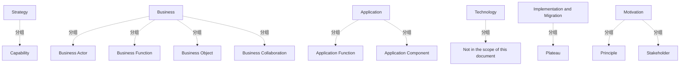

# G21B/fig2-1 · 本文档使用的 ArchiMate 建模记法元素

类型：`notation-or-legend`。在第 2.1 节交代 C-MDM 参考模型所用的建模语言：本文档不覆盖全部 ArchiMate，只选取描述 C-MDM 所需的元素（能力、业务/应用功能与组件、业务对象、干系人、原则、plateau 等），为第 3、5 章的模型图提供统一记法。

英文 PDF 物理页：[18]。本页为架构语义分析，原文与原图分别保留。

## 原图与可编辑图


[完整 JSON](fig2-1.json) · [可编辑 Mermaid](fig2-1.mmd) · [仅关系图](fig2-1.relations.mmd) · [层级分解图](fig2-1.hierarchy.mmd)

图形重建表达语义，不复制源图布局。虚线表示解释、矩阵映射或分组关系，不自动表示不确定性的概率。



## 架构分析

从上到下按层读：Strategy（战略层）只有 Capability；Business（业务层）有 Business Actor、Business Function、Business Object、Business Collaboration；Application（应用层）有 Application Function、Application Component；Technology（技术层）只写“不在本文档范围内”；Implementation and Migration（实施与迁移层）只有 Plateau。右侧竖栏是 Motivation（动机）方面，含 Principle 与 Stakeholder，贯穿所有层。每个元素框右上角的小图标就是该元素在后续图中的记号。

- 本图有 17 个具名或隐含元素、0 条关系和 11 条包含/分组记录。
- 包含/分组树最大深度为 1；根节点为 战略层、业务层、应用层、技术层、实施与迁移层、动机方面。
- 本图没有可直接确认为人员直属汇报的关系；视觉上下位置、能力分解和治理职责分别读取。
- 原图靠嵌套表达结构，没有连线；新语义图将包含单独显式化，不补造流程、数据流或依赖。
- 包含分组后有 6 个连通分量；分离可能源于图例、并列分类或独立示例，未自动补边。
- 完整核对Strategy、Business、Application、Technology、Implementation and Migration、Motivation六组和所列记法。
- Technology组明确Not in the scope of this document；图中无连线，层分组不是实例间依赖。

### 如何用于项目

- 先用图例解释记法与颜色，再读取使用该符号的图。
- 记法符号是类型说明，不是实际项目实体。

### 结构所表达的逻辑

- 本文档只用 ArchiMate 的一个子集；图 2-1 是该子集的完整清单，后文图（如图 3-1、图 5-3、图 5-4）中的图标都能在这里找到对应。
- 战略层只用了 Capability：表示组织、人或系统拥有的能力，通常由组织、人员、流程、信息与技术组合实现。
- 业务层有 4 个元素：Business Actor（执行行为的主体）、Business Function（一组业务行为）、Business Object（业务领域中的概念，对应 TOGAF 的“业务信息”）、Business Collaboration（两个及以上业务主体为完成集体行为而组成的集合）。
- 应用层有 2 个元素：Application Function（由应用组件执行的自动化行为）与 Application Component（可模块化替换的应用功能封装）。
- 技术层明确“Not in the scope of this document”，即本文档不建技术架构模型。
- 实施与迁移层只用了 Plateau，表示架构在有限时间内相对稳定的状态，对应第 4 章的路线图阶段（如图 4-2 与表 4-6 的 plateau）。
- 动机方面只用了 Principle（原则）与 Stakeholder（利益相关者），分别对应 4.3 节的架构原则与图 4-1 的干系人。
- 正文另说明：本文档用“嵌套”（nesting）这一视觉手法表示层级或组成关系，例如一个业务对象可包含一个或多个从属业务对象。

## 上下级与包含

两层：第 1 层是 6 个分区（5 个 ArchiMate 层 + Motivation 方面）；第 2 层是各分区内的元素符号（Strategy 1 个、Business 4 个、Application 2 个、Technology 0 个、Implementation and Migration 1 个、Motivation 2 个）。分区是并列的层，不是上下级；Motivation 竖栏在右侧，跨全部层。

|父项|子项|层级类型|依据与解释|
|---|---|---|---|
|战略层|能力|visual_grouping|框、泳道、域或分类组的成员归属；没有额外证据不提升为业务组合或管理关系。|
|业务层|业务参与者|visual_grouping|框、泳道、域或分类组的成员归属；没有额外证据不提升为业务组合或管理关系。|
|业务层|业务功能|visual_grouping|框、泳道、域或分类组的成员归属；没有额外证据不提升为业务组合或管理关系。|
|业务层|业务对象|visual_grouping|框、泳道、域或分类组的成员归属；没有额外证据不提升为业务组合或管理关系。|
|业务层|业务协作|visual_grouping|框、泳道、域或分类组的成员归属；没有额外证据不提升为业务组合或管理关系。|
|应用层|应用功能|visual_grouping|框、泳道、域或分类组的成员归属；没有额外证据不提升为业务组合或管理关系。|
|应用层|应用组件|visual_grouping|框、泳道、域或分类组的成员归属；没有额外证据不提升为业务组合或管理关系。|
|技术层|不在本文档范围内|visual_grouping|框、泳道、域或分类组的成员归属；没有额外证据不提升为业务组合或管理关系。|
|实施与迁移层|平台期（plateau）|visual_grouping|框、泳道、域或分类组的成员归属；没有额外证据不提升为业务组合或管理关系。|
|动机方面|原则|visual_grouping|框、泳道、域或分类组的成员归属；没有额外证据不提升为业务组合或管理关系。|
|动机方面|利益相关者|visual_grouping|框、泳道、域或分类组的成员归属；没有额外证据不提升为业务组合或管理关系。|

## 全部元素与角色

|元素ID|原文名称|类型|含义|直接父项|深度|
|---|---|---|---|---|---|
|g_strategy|Strategy|group|分组：战略层|—||
|capability|Capability|capability|能力：能力|战略层|1|
|g_business|Business|group|分组：业务层|—||
|business_actor|Business Actor|actor|参与者：业务参与者|业务层|1|
|business_function|Business Function|function|功能：业务功能|业务层|1|
|business_object|Business Object|data|信息/数据：业务对象|业务层|1|
|business_collaboration|Business Collaboration|actor|两个及以上业务主体为完成集体行为而组成的（可能临时的）集合。|业务层|1|
|g_application|Application|group|分组：应用层|—||
|application_function|Application Function|function|功能：应用功能|应用层|1|
|application_component|Application Component|application|应用：应用组件|应用层|1|
|g_technology|Technology|group|分组：技术层|—||
|tech_out_of_scope|Not in the scope of this document|note|说明：不在本文档范围内|技术层|1|
|g_impl|Implementation and Migration|group|分组：实施与迁移层|—||
|plateau|Plateau|architecture|架构在有限时间内相对稳定的状态，不是 ADM 阶段。|实施与迁移层|1|
|g_motivation|Motivation|group|分组：动机方面|—||
|principle|Principle|principle|原则：原则|动机方面|1|
|stakeholder|Stakeholder|stakeholder|利益相关者：利益相关者|动机方面|1|

## 全部关系

图中没有任何连接线或箭头，只有分区边框。分区之间的上下排列表示 ArchiMate 的层叠关系（战略在上、实施与迁移在下），右侧动机栏表示它可作用于各层；这些都不构成元素之间的连线关系。

|主体|语义关系|客体|显式线/隐式|原文标签|依据|
|---|---|---|---|---|---|

## 误读检查

- 不要把“Technology: Not in the scope of this document”理解为技术层没有元素，它表示本文档不写技术层模型，所以图中不列技术元素。
- 图中没有画 ArchiMate 关系（serving、realization 等）的记法，只列元素；关系要靠后文模型图中的连线表达。
- Plateau 不是 ADM 阶段，而是路线图上的一个稳定状态（阶段/平台期），对应表 4-6 的 Step 1–4。
- Business Object 是业务概念（对应 TOGAF 业务信息），不是数据库表或应用数据结构。

## 原文证据

### [PDF 第 18 页](../../../documents/G21B.md#page-18)

> To cater for the specific modeling needs in this document, a subset of ArchiMate elements is chosen. This subset is given in Figure 2-1, followed by the definition of each concept.
### [PDF 第 19 页](../../../documents/G21B.md#page-19)

> • Principle: A principle represents a statement of intent defining a general property that applies to any system in a certain context in the architecture
> Principles are general rules or guidelines, intended to be enduring and seldom amended, that inform and support the way in which an organization sets about fulfilling its mission. They are a qualitative statement of intent that should be met by the architecture.
### [PDF 第 20 页](../../../documents/G21B.md#page-20)

> • Application Component: An application component represents an encapsulation of application functionality aligned to implementation structure, which is modular and replaceable.
> • Plateau: A plateau represents a relatively stable state of the architecture that exists during a limited period of time.

## 来源与分析状态

所有元素/关系均有来源定位；未把历史解释重命名为本轮逐线视觉确认。源图与语义图是两种视图，布局不证明汇报或因果。

源 PDF SHA-256：`8e64887f7a080d3d882f38078297bd7873a9072b71a12c39b9e77349890f37a2`。

源图记录：[原始解释与转录](../../../figures/G21B/fig2-1.json)。

```json
{
  "quality": {
    "graph_integrity": "checked",
    "semantic_analysis": "typed-graph-and-context-analysis",
    "visual_review": "source-content-audited",
    "notice_zh": "所有元素/关系均有来源定位；未把历史解释重命名为本轮逐线视觉确认。源图与语义图是两种视图，布局不证明汇报或因果。"
  },
  "source_uncertainty": {
    "confidence": "high",
    "uncertainties_zh": [
      "原图只给出元素符号与名称，没有给出关系记法；本分析不推断未画出的关系。",
      "Motivation 竖栏是否覆盖全部层仅由版式（贯穿全高）推断。"
    ],
    "analyzed_from": [
      "英文 PDF 第 18 页原图截图（含层带与元素框）",
      "英文 PDF 第 18–20 页正文中的 ArchiMate 定义",
      "中文稿无此图引用"
    ],
    "date": "2026-10-31"
  },
  "source_conflicts": []
}
```
