# G21B/fig3-1 · C-MDM 能力的功能构成

类型：`architecture-model`。第 3 章开头用一张 ArchiMate 图界定 C-MDM 能力的边界：左边是负责客户数据的组织（C-MDM Team，业务架构），右边是支撑它的信息系统（C-MDM System，信息系统架构），四周是必须交互的业务伙伴、数据提供方、互动/核心运营团队及其系统、BI 平台等，说明 C-MDM 不是单个应用而是“人员 + 流程 + 系统”的组合能力。

英文 PDF 物理页：[22]。本页为架构语义分析，原文与原图分别保留。

## 原图与可编辑图


[完整 JSON](fig3-1.json) · [可编辑 Mermaid](fig3-1.mmd) · [仅关系图](fig3-1.relations.mmd) · [层级分解图](fig3-1.hierarchy.mmd)

图形重建表达语义，不复制源图布局。虚线表示解释、矩阵映射或分组关系，不自动表示不确定性的概率。

```mermaid
flowchart TB
  %% Semantic reconstruction; see original source image for exact layout.
  n0["C-MDM Capability"]
  n1["C-MDM Team"]
  n2["C-MDM System"]
  n3["C-MDM Capabilities Management and Governance"]
  n4["C-MDM Design"]
  n5["C-MDM Operation"]
  n6["Extension of C-MDM Scope and Usages"]
  n7["External Customer Data Acquisition"]
  n8["Data Quality and Business Value Measure"]
  n9["Communication"]
  n10["Reference Data Management"]
  n11["Data Acquisition"]
  n12["Data Quality Management"]
  n13["Data Privacy Management"]
  n14["Data Access"]
  n15["Quality &amp; Technical Dashboard, Reports, and Audit"]
  n16["Customer Master Data Administration"]
  n17["Business Partners"]
  n18["Data Providers"]
  n19["Engagement Teams"]
  n20["Core Operations Teams"]
  n21["Engagement Systems"]
  n22["Core Operations Systems"]
  n23["Business Partner Systems"]
  n24["Business Intelligence &amp; Analytics Platforms"]
  n25["Data Provider Systems"]
  n17 ---|"关联"| n19
  n17 ---|"关联"| n20
  n17 ---|"关联"| n1
  n18 ---|"关联"| n1
  n19 ---|"关联"| n1
  n20 ---|"关联"| n1
  n21 ---|"关联"| n23
  n22 ---|"关联"| n23
  n23 ---|"关联"| n2
  n24 ---|"关联"| n2
  n25 ---|"关联"| n2
  n21 ---|"关联"| n2
  n22 ---|"关联"| n2
  n0 -.->|"visual_containment_only"| n1
  n0 -.->|"visual_containment_only"| n2
  n1 -.->|"visual_containment_only"| n3
  n1 -.->|"visual_containment_only"| n4
  n1 -.->|"visual_containment_only"| n5
  n1 -.->|"visual_containment_only"| n6
  n1 -.->|"visual_containment_only"| n7
  n1 -.->|"visual_containment_only"| n8
  n1 -.->|"visual_containment_only"| n9
  n2 -.->|"visual_containment_only"| n10
  n2 -.->|"visual_containment_only"| n11
  n2 -.->|"visual_containment_only"| n12
  n2 -.->|"visual_containment_only"| n13
  n2 -.->|"visual_containment_only"| n14
  n2 -.->|"visual_containment_only"| n15
  n2 -.->|"visual_containment_only"| n16
```



## 架构分析

先看外圈：左上是业务伙伴，左下是数据提供方，上方是互动团队/核心运营团队及其系统，右侧是伙伴系统、BI 与分析平台、数据提供方系统——它们都在 C-MDM Capability 之外。再看中间的大框：左半黄色 C-MDM Team 是业务侧，7 个浅黄小框是它承担的业务功能；右半蓝色 C-MDM System 是系统侧，7 个蓝色小框是应用功能，其中 Reference Data Management、Quality & Technical Dashboard 与 Customer Master Data Administration 是跨功能的支撑块。最后顺着橙色线（业务层）与青色线（应用层）看外部元素如何接入团队或系统。

- 本图有 26 个具名或隐含元素、13 条关系和 16 条包含/分组记录。
- 包含/分组树最大深度为 2；根节点为 C-MDM 能力、业务伙伴、数据提供方、互动团队、核心业务运营团队、互动系统、核心业务运营系统、业务伙伴系统、商业智能与分析平台、数据提供方系统。
- 本图没有可直接确认为人员直属汇报的关系；视觉上下位置、能力分解和治理职责分别读取。
- 核对C-MDM Team七项业务功能、C-MDM System七项应用功能、九个外部参与者/系统及C-MDM Capability外框。
- 13条无箭头关系端点已按橙色业务侧和蓝绿色应用侧核对；Engagement到C-MDM用虚线、Core Operations到C-MDM用实线，均不赋数据流方向。
- 正文将治理、设计、运行和扩展列为业务功能，图中包含并不代表所有功能均由单一岗位独占。

### 如何用于项目

- 按节点类型建立业务、应用、数据、技术对象，并保留跨层服务、访问和实现关系。
- 交叉线不是连接点；角色分工、数据使用和组织汇报不得混用。

### 结构所表达的逻辑

- C-MDM 能力 = C-MDM Team（人/组织）+ C-MDM System（系统），外层再用一个 Capability 框把它们包住，表示能力是二者组合的结果。
- C-MDM Team 的 7 项业务功能：能力管理与治理、设计、运营、范围与用途扩展、外部客户数据获取、数据质量与业务价值度量、沟通。
- C-MDM System 的 7 项应用功能：参考数据管理、数据采集、数据质量管理、数据隐私管理、数据访问、质量与技术仪表盘/报表/审计、客户主数据管理。
- Reference Data Management、Quality & Technical Dashboard, Reports, and Audit 与 Customer Master Data Administration 在版式上纵贯或横贯其他功能块，表示它们是支撑其他功能的基础能力。
- 外部有 4 类业务参与者（业务伙伴、数据提供方、互动团队、核心运营团队）和 5 类系统（互动系统、核心运营系统、业务伙伴系统、BI 与分析平台、数据提供方系统）。
- 业务伙伴同时接入互动团队、核心运营团队与 C-MDM Team；数据提供方接入 C-MDM Team；互动团队以虚线接入 C-MDM Team，核心运营团队以实线接入。
- 应用侧：互动系统、核心运营系统、业务伙伴系统、BI 平台、数据提供方系统都接入 C-MDM System；互动系统用虚线，其余用实线。
- 该图只表达“谁与谁相连”，不表达数据流向；数据流/交换模式在第 6 章（图 6-1 至 6-5）才展开。

## 上下级与包含

三层：第 1 层 C-MDM Capability（最外层大框）；第 2 层 C-MDM Team 与 C-MDM System（能力的两大组成部分）；第 3 层各自内部的功能（Team 7 项业务功能、System 7 项应用功能）。外部 9 个参与者/系统不属于该能力，画在框外。

|父项|子项|层级类型|依据与解释|
|---|---|---|---|
|C-MDM 能力|C-MDM 团队|visual_containment_only|保存原图解释中的包含；业务关系类型需要图例或正文进一步限定。|
|C-MDM 能力|C-MDM 系统|visual_containment_only|保存原图解释中的包含；业务关系类型需要图例或正文进一步限定。|
|C-MDM 团队|C-MDM 能力管理与治理|visual_containment_only|保存原图解释中的包含；业务关系类型需要图例或正文进一步限定。|
|C-MDM 团队|C-MDM 设计|visual_containment_only|保存原图解释中的包含；业务关系类型需要图例或正文进一步限定。|
|C-MDM 团队|C-MDM 运营|visual_containment_only|保存原图解释中的包含；业务关系类型需要图例或正文进一步限定。|
|C-MDM 团队|C-MDM 范围与用途扩展|visual_containment_only|保存原图解释中的包含；业务关系类型需要图例或正文进一步限定。|
|C-MDM 团队|外部客户数据获取|visual_containment_only|保存原图解释中的包含；业务关系类型需要图例或正文进一步限定。|
|C-MDM 团队|数据质量与业务价值度量|visual_containment_only|保存原图解释中的包含；业务关系类型需要图例或正文进一步限定。|
|C-MDM 团队|沟通|visual_containment_only|保存原图解释中的包含；业务关系类型需要图例或正文进一步限定。|
|C-MDM 系统|参考数据管理|visual_containment_only|保存原图解释中的包含；业务关系类型需要图例或正文进一步限定。|
|C-MDM 系统|数据采集|visual_containment_only|保存原图解释中的包含；业务关系类型需要图例或正文进一步限定。|
|C-MDM 系统|数据质量管理|visual_containment_only|保存原图解释中的包含；业务关系类型需要图例或正文进一步限定。|
|C-MDM 系统|数据隐私管理|visual_containment_only|保存原图解释中的包含；业务关系类型需要图例或正文进一步限定。|
|C-MDM 系统|数据访问|visual_containment_only|保存原图解释中的包含；业务关系类型需要图例或正文进一步限定。|
|C-MDM 系统|质量与技术仪表盘、报表与审计|visual_containment_only|保存原图解释中的包含；业务关系类型需要图例或正文进一步限定。|
|C-MDM 系统|客户主数据管理（系统管理功能）|visual_containment_only|保存原图解释中的包含；业务关系类型需要图例或正文进一步限定。|

## 全部元素与角色

|元素ID|原文名称|类型|含义|直接父项|深度|
|---|---|---|---|---|---|
|c_mdm_capability|C-MDM Capability|capability|最外层大框，包含团队与系统两部分。|—||
|c_mdm_team|C-MDM Team|organization_unit|组织单元：C-MDM 团队|C-MDM 能力|1|
|c_mdm_system|C-MDM System|application|应用：C-MDM 系统|C-MDM 能力|1|
|bf_governance|C-MDM Capabilities Management and Governance|function|功能：C-MDM 能力管理与治理|C-MDM 团队|2|
|bf_design|C-MDM Design|function|功能：C-MDM 设计|C-MDM 团队|2|
|bf_operation|C-MDM Operation|function|功能：C-MDM 运营|C-MDM 团队|2|
|bf_extension|Extension of C-MDM Scope and Usages|function|功能：C-MDM 范围与用途扩展|C-MDM 团队|2|
|bf_external_acq|External Customer Data Acquisition|function|功能：外部客户数据获取|C-MDM 团队|2|
|bf_dq_value|Data Quality and Business Value Measure|function|功能：数据质量与业务价值度量|C-MDM 团队|2|
|bf_communication|Communication|function|功能：沟通|C-MDM 团队|2|
|af_reference_data|Reference Data Management|function|功能：参考数据管理|C-MDM 系统|2|
|af_acquisition|Data Acquisition|function|功能：数据采集|C-MDM 系统|2|
|af_dq|Data Quality Management|function|功能：数据质量管理|C-MDM 系统|2|
|af_privacy|Data Privacy Management|function|功能：数据隐私管理|C-MDM 系统|2|
|af_access|Data Access|function|功能：数据访问|C-MDM 系统|2|
|af_dashboard|Quality & Technical Dashboard, Reports, and Audit|function|功能：质量与技术仪表盘、报表与审计|C-MDM 系统|2|
|af_admin|Customer Master Data Administration|function|功能：客户主数据管理（系统管理功能）|C-MDM 系统|2|
|x_business_partners|Business Partners|actor|参与者：业务伙伴|—||
|x_data_providers|Data Providers|actor|参与者：数据提供方|—||
|x_engagement_teams|Engagement Teams|actor|参与者：互动团队|—||
|x_core_ops_teams|Core Operations Teams|actor|参与者：核心业务运营团队|—||
|x_engagement_systems|Engagement Systems|application|应用：互动系统|—||
|x_core_ops_systems|Core Operations Systems|application|应用：核心业务运营系统|—||
|x_bp_systems|Business Partner Systems|application|应用：业务伙伴系统|—||
|x_bi_platforms|Business Intelligence & Analytics Platforms|application|应用：商业智能与分析平台|—||
|x_dp_systems|Data Provider Systems|application|应用：数据提供方系统|—||

## 全部关系

橙色线表示业务层连接，青色线表示应用层连接；实线表示直接相连，虚线（Engagement Teams→C-MDM Team、Engagement Systems→C-MDM System）表示较间接/非直接的交互。所有线都没有箭头，因此图只表达关联，不表达方向或数据流。外部业务伙伴同时连到两个内部团队，说明它是共同的交互对象。

|主体|语义关系|客体|显式线/隐式|原文标签|依据|
|---|---|---|---|---|---|
|业务伙伴|关联|互动团队|显式连线||橙色业务层连线，横向。|
|业务伙伴|关联|核心业务运营团队|显式连线||橙色业务层连线。|
|业务伙伴|关联|C-MDM 团队|显式连线||橙色线从 Business Partners 右缘下行接入 C-MDM Team 左缘中部。|
|数据提供方|关联|C-MDM 团队|显式连线||橙色线从 Data Providers 右缘接入 C-MDM Team 左下角。|
|互动团队|关联|C-MDM 团队|显式连线||橙色虚线，从 Engagement Teams 下缘垂直接入 C-MDM Team 上缘。|
|核心业务运营团队|关联|C-MDM 团队|显式连线||橙色实线短连接，从 Core Operations Teams 下缘接入 C-MDM Team 上缘。|
|互动系统|关联|业务伙伴系统|显式连线||青色应用层连线，Engagement Systems 右缘 → Business Partner Systems 左缘。|
|核心业务运营系统|关联|业务伙伴系统|显式连线||青色应用层连线，Core Operations Systems 右缘 → Business Partner Systems 左缘。|
|业务伙伴系统|关联|C-MDM 系统|显式连线||青色连线接入 C-MDM System 右缘上部。|
|商业智能与分析平台|关联|C-MDM 系统|显式连线||青色连线接入 C-MDM System 右缘中部。|
|数据提供方系统|关联|C-MDM 系统|显式连线||青色连线接入 C-MDM System 右缘下部（Customer Master Data Administration 一侧）。|
|互动系统|关联|C-MDM 系统|显式连线||青色虚线，从 Engagement Systems 下缘垂直接入 C-MDM System 上缘。|
|核心业务运营系统|关联|C-MDM 系统|显式连线||青色实线短连接，从 Core Operations Systems 下缘接入 C-MDM System 上缘。|

## 误读检查

- 不要把 C-MDM Team 与 C-MDM System 读成上下级：二者是同一能力的业务侧与系统侧，并列组成能力。
- C-MDM System 内的 Reference Data Management 等不是“子流程”，而是与其他应用功能并列、但被画成跨块以表示其支撑范围较广的功能。
- 图没有箭头，不能据此判断数据从外部系统流向 C-MDM；数据流向与同步/异步方式见图 4-2 与图 6-2 至 6-5。
- 中文稿引用的 figs/g21b_fig3-1.svg 是自拟的功能树，功能名与外部元素都与原图不符，不能作为理解本图的依据。

## 原文证据

### [PDF 第 21 页](../../../documents/G21B.md#page-21)

> The C-MDM capability is under the responsibility of the customer data owner executive, who will ensure the contribution of concerned actors, as detailed in Figure 3-1.
### [PDF 第 22 页](../../../documents/G21B.md#page-22)

> Table 3-1 provides the description of high-level business functions to leverage the capability. A complete detailed reference model is available in Chapter 5.

## 来源与分析状态

所有元素/关系均有来源定位；未把历史解释重命名为本轮逐线视觉确认。源图与语义图是两种视图，布局不证明汇报或因果。

源 PDF SHA-256：`8e64887f7a080d3d882f38078297bd7873a9072b71a12c39b9e77349890f37a2`。

源图记录：[原始解释与转录](../../../figures/G21B/fig3-1.json)。

```json
{
  "quality": {
    "graph_integrity": "checked",
    "semantic_analysis": "typed-graph-and-context-analysis",
    "visual_review": "source-content-audited",
    "notice_zh": "所有元素/关系均有来源定位；未把历史解释重命名为本轮逐线视觉确认。源图与语义图是两种视图，布局不证明汇报或因果。"
  },
  "source_uncertainty": {
    "confidence": "high",
    "uncertainties_zh": [
      "原图无图例，虚线（Engagement Teams/Systems 到 C-MDM）的确切语义未说明，本分析只按“较间接交互”描述。",
      "C-MDM System 内三个跨块功能（Reference Data Management、Quality & Technical Dashboard、Customer Master Data Administration）的边界在纵向上覆盖多个功能，无法确定它们是否是其他功能的父级；本分析按并列处理。"
    ],
    "analyzed_from": [
      "英文 PDF 第 22 页原图截图及 2×2 放大分块",
      "英文 PDF 第 21–23 页正文与表 3-1",
      "中文稿 G21Be_信息架构_客户主数据管理.md 第 242–258、266–272 行",
      "figs/g21b_fig3-1.svg 源码"
    ],
    "date": "2026-10-31"
  },
  "source_conflicts": []
}
```
