# G21B/fig4-1 · 架构愿景的利益相关者

类型：`decomposition-or-organization-model`。支撑第 4.2 节 ADM 阶段 A（架构愿景）：C-MDM 项目影响整个组织、参与者众多，必须先建立愿景并在高层达成共识；本图给出必须纳入愿景沟通与认可的干系人清单，并暗示越往下越贴近日常运营、越往上越承担赞助与决策。

英文 PDF 物理页：[30]。本页为架构语义分析，原文与原图分别保留。

## 原图与可编辑图


[完整 JSON](fig4-1.json) · [可编辑 Mermaid](fig4-1.mmd) · [仅关系图](fig4-1.relations.mmd) · [层级分解图](fig4-1.hierarchy.mmd)

图形重建表达语义，不复制源图布局。虚线表示解释、矩阵映射或分组关系，不自动表示不确定性的概率。

```mermaid
flowchart TB
  %% Semantic reconstruction; see original source image for exact layout.
  n0["External"]
  n1["Customer"]
  n2["Regulator"]
  n3["External Data Provider"]
  n4["Business Partners"]
  n5["Operational Management and Team"]
  n6["Distributors / Agent (Customer-Facing Employees Capturing Customer Data / Requests)"]
  n7["C-MDM Operational Team (including IT, Architects, Data and Business Actors)"]
  n8["Customer Data Owner"]
  n9["C-MDM Product Owner"]
  n10["High-Level Management and Sponsorship"]
  n11["Chief Data Officer (CDO)"]
  n12["Chief Technology Officer (CTO)"]
  n13["Human Resources/Change Leader"]
  n14["Business Process Owners"]
  n15["Chief Executive Officer (CEO)"]
  n0 -.->|"分组"| n1
  n0 -.->|"分组"| n2
  n0 -.->|"分组"| n3
  n0 -.->|"分组"| n4
  n5 -.->|"分组"| n6
  n5 -.->|"分组"| n7
  n5 -.->|"分组"| n8
  n5 -.->|"分组"| n9
  n10 -.->|"分组"| n11
  n10 -.->|"分组"| n12
  n10 -.->|"分组"| n13
  n10 -.->|"分组"| n14
  n10 -.->|"分组"| n15
```



## 架构分析

从上到下读三条带：最上方“External”是组织外部、只能影响不能指挥的干系人；中间“Operational Management and Team”是日常操作客户数据的人与团队；最下方“High-Level Management and Sponsorship”是提供赞助与跨部门决策的高层。每带左侧的三角形指向右侧，表示该层干系人位于组织边界之内/之外的位置。带内方框并列，从左到右没有顺序或优先级。

- 本图有 16 个具名或隐含元素、0 条关系和 13 条包含/分组记录。
- 包含/分组树最大深度为 1；根节点为 外部、运营管理与团队、高层管理与赞助。
- 本图没有可直接确认为人员直属汇报的关系；视觉上下位置、能力分解和治理职责分别读取。
- 原图靠嵌套表达结构，没有连线；新语义图将包含单独显式化，不补造流程、数据流或依赖。
- 包含分组后有 3 个连通分量；分离可能源于图例、并列分类或独立示例，未自动补边。
- 完整核对三层分类共13位/类利益相关者及3个带标题的带状区域；CEO位于高层组下排，不表示向上排四个角色汇报。
- 分隔线和左侧箭头形只是分类标记，没有角色之间的连线。正文说明CEO是可打破组织孤岛的最佳赞助人，不给出通用人事组织图。

### 如何用于项目

- 按父项展开所有直接子项，检查同层粒度、重叠和缺项。
- 保留组成、分类、能力分解与组织汇报的区别；将示例名称替换为已确认的项目对象。

### 结构所表达的逻辑

- 外部干系人 4 个：客户、监管机构、外部数据提供方、业务伙伴；他们决定 C-MDM 必须满足的体验、合规与数据来源约束。
- 运营层 4 个：分销商/代理（面向客户、采集客户数据/请求的员工）、C-MDM 运营团队（含 IT、架构师、数据与业务参与者）、客户数据所有者、C-MDM 产品负责人。
- 高层 5 个：CDO、CTO、人力资源/变革负责人、业务流程所有者，以及横跨整行的 CEO。
- CEO 单独占一整行，位于最底部，呼应正文“最佳执行发起人是能打破组织/业务线孤岛的 CEO”。
- 客户数据所有者与 C-MDM 产品负责人在运营层并列，说明数据问责（owner）与产品交付（product owner）是两条不同的职责线。
- CDO 与 CTO 在高层并列：C-MDM 同时是数据治理议题与技术架构议题；HR/变革负责人负责组织变革与采纳。
- 图只给干系人分层，不画影响力方向或沟通关系；具体愿景维度（FROM/TO/关键举措）见表 4-2。

## 上下级与包含

三层：外部（组织外）→ 运营管理与团队（执行层）→ 高层管理与赞助（决策/赞助层）。每层内的方框并列，无上下级；CEO 虽在最底层带内，但横贯整行，视觉上表示其对全部利益相关者的最终发起作用。

|父项|子项|层级类型|依据与解释|
|---|---|---|---|
|外部|客户|visual_grouping|框、泳道、域或分类组的成员归属；没有额外证据不提升为业务组合或管理关系。|
|外部|监管机构|visual_grouping|框、泳道、域或分类组的成员归属；没有额外证据不提升为业务组合或管理关系。|
|外部|外部数据提供方|visual_grouping|框、泳道、域或分类组的成员归属；没有额外证据不提升为业务组合或管理关系。|
|外部|业务伙伴|visual_grouping|框、泳道、域或分类组的成员归属；没有额外证据不提升为业务组合或管理关系。|
|运营管理与团队|分销商/代理（面向客户、负责采集客户数据/请求的员工）|visual_grouping|框、泳道、域或分类组的成员归属；没有额外证据不提升为业务组合或管理关系。|
|运营管理与团队|C-MDM 运营团队（含 IT、架构师、数据与业务参与者）|visual_grouping|框、泳道、域或分类组的成员归属；没有额外证据不提升为业务组合或管理关系。|
|运营管理与团队|客户数据所有者|visual_grouping|框、泳道、域或分类组的成员归属；没有额外证据不提升为业务组合或管理关系。|
|运营管理与团队|C-MDM 产品负责人|visual_grouping|框、泳道、域或分类组的成员归属；没有额外证据不提升为业务组合或管理关系。|
|高层管理与赞助|首席数据官（CDO）|visual_grouping|框、泳道、域或分类组的成员归属；没有额外证据不提升为业务组合或管理关系。|
|高层管理与赞助|首席技术官（CTO）|visual_grouping|框、泳道、域或分类组的成员归属；没有额外证据不提升为业务组合或管理关系。|
|高层管理与赞助|人力资源/变革负责人|visual_grouping|框、泳道、域或分类组的成员归属；没有额外证据不提升为业务组合或管理关系。|
|高层管理与赞助|业务流程所有者|visual_grouping|框、泳道、域或分类组的成员归属；没有额外证据不提升为业务组合或管理关系。|
|高层管理与赞助|首席执行官（CEO）|visual_grouping|框、泳道、域或分类组的成员归属；没有额外证据不提升为业务组合或管理关系。|

## 全部元素与角色

|元素ID|原文名称|类型|含义|直接父项|深度|
|---|---|---|---|---|---|
|band_external|External|group|分组：外部|—||
|st_customer|Customer|stakeholder|利益相关者：客户|外部|1|
|st_regulator|Regulator|stakeholder|利益相关者：监管机构|外部|1|
|st_ext_data_provider|External Data Provider|stakeholder|利益相关者：外部数据提供方|外部|1|
|st_business_partners|Business Partners|stakeholder|利益相关者：业务伙伴|外部|1|
|band_operational|Operational Management and Team|group|分组：运营管理与团队|—||
|st_distributors|Distributors / Agent (Customer-Facing Employees Capturing Customer Data / Requests)|role|角色：分销商/代理（面向客户、负责采集客户数据/请求的员工）|运营管理与团队|1|
|st_cmdm_ops_team|C-MDM Operational Team (including IT, Architects, Data and Business Actors)|organization_unit|组织单元：C-MDM 运营团队（含 IT、架构师、数据与业务参与者）|运营管理与团队|1|
|st_data_owner|Customer Data Owner|role|角色：客户数据所有者|运营管理与团队|1|
|st_product_owner|C-MDM Product Owner|role|角色：C-MDM 产品负责人|运营管理与团队|1|
|band_high_level|High-Level Management and Sponsorship|group|分组：高层管理与赞助|—||
|st_cdo|Chief Data Officer (CDO)|role|角色：首席数据官（CDO）|高层管理与赞助|1|
|st_cto|Chief Technology Officer (CTO)|role|角色：首席技术官（CTO）|高层管理与赞助|1|
|st_hr_change|Human Resources/Change Leader|role|角色：人力资源/变革负责人|高层管理与赞助|1|
|st_process_owners|Business Process Owners|role|角色：业务流程所有者|高层管理与赞助|1|
|st_ceo|Chief Executive Officer (CEO)|role|角色：首席执行官（CEO）|高层管理与赞助|1|

## 全部关系

图中没有连接线。三条水平虚线只分隔层级；左侧的向右三角形是层级标记（不是箭头关系），不表示数据或影响力流向。干系人之间的关系完全由“在哪一带”表达（关系清单中标为隐含）。

|主体|语义关系|客体|显式线/隐式|原文标签|依据|
|---|---|---|---|---|---|

## 误读检查

- 不要把三条带读成汇报层级：外部干系人不在组织内，运营层与高层也不是严格的上下级，只是按“离日常运营的远近”分组。
- CEO 画在最底部不代表其层级最低；它横跨整行，表示对全部干系人的最终赞助与破孤岛作用。
- 图中没有画出干系人之间的沟通线，不能据此判断谁向谁汇报。
- 中文稿本地化图有两个运营框边框断裂、一个标签字号过小，容易让人以为该框不属于本层；原图中它们都是完整框。

## 原文证据

### [PDF 第 29 页](../../../documents/G21B.md#page-29)

> The vision should imply key C‑MDM stakeholders, as shown in Figure 4-1.
### [PDF 第 30 页](../../../documents/G21B.md#page-30)

> Finally, a transversal vision of the C‑MDM approach is a must-have. The best executive sponsor is the CEO, able to break organizational/line of business silos for the benefit of the customer.
> This section lists commonly observed architecture principles to set up a C‑MDM capability in an organization. The principles are presented using the TOGAF ADM structure, starting with business principles, data principles, and application principles.

## 来源与分析状态

所有元素/关系均有来源定位；未把历史解释重命名为本轮逐线视觉确认。源图与语义图是两种视图，布局不证明汇报或因果。

源 PDF SHA-256：`8e64887f7a080d3d882f38078297bd7873a9072b71a12c39b9e77349890f37a2`。

源图记录：[原始解释与转录](../../../figures/G21B/fig4-1.json)。

```json
{
  "quality": {
    "graph_integrity": "checked",
    "semantic_analysis": "typed-graph-and-context-analysis",
    "visual_review": "source-content-audited",
    "notice_zh": "所有元素/关系均有来源定位；未把历史解释重命名为本轮逐线视觉确认。源图与语义图是两种视图，布局不证明汇报或因果。"
  },
  "source_uncertainty": {
    "confidence": "high",
    "uncertainties_zh": [
      "左侧三角形标记的确切含义原图未说明，本分析按“层级/位置标记”理解。",
      "外部干系人（客户、监管机构）与组织的关系未画线，具体互动方式需结合正文与图 3-1。"
    ],
    "analyzed_from": [
      "英文 PDF 第 30 页原图截图",
      "英文 PDF 第 29–30 页正文",
      "中文稿 G21Be_信息架构_客户主数据管理.md 第 317、328、334–353 行",
      "figs/zh/g21be_fig4-1_zh.png 中文化图"
    ],
    "date": "2026-10-31"
  },
  "source_conflicts": []
}
```
