# G21B/fig4-2 · 参考 C-MDM 路线图步骤

类型：`architecture-evolution-or-plan`。为 ADM 阶段 F（迁移规划）提供参考路线：不是一步建成 C-MDM，而是按数据主控权与集成程度分四步演进；每一步用绿色标出相对上一步新增的能力，帮助规划者理解“先整合分析、再非侵入式真相点、再主数据真相点、最后覆盖全范围”的迁移逻辑。

英文 PDF 物理页：[33]。本页为架构语义分析，原文与原图分别保留。

## 原图与可编辑图


[完整 JSON](fig4-2.json) · [可编辑 Mermaid](fig4-2.mmd) · [仅关系图](fig4-2.relations.mmd) · [层级分解图](fig4-2.hierarchy.mmd)

图形重建表达语义，不复制源图布局。虚线表示解释、矩阵映射或分组关系，不自动表示不确定性的概率。

```mermaid
flowchart TB
  %% Semantic reconstruction; see original source image for exact layout.
  n0["1 Consolidated Customer Database"]
  n1["2 Non-Intrusive Customer Data Point of Truth"]
  n2["3 Master Point of Truth"]
  n3["Full Scope Master Point of Truth"]
  n4["Operational teams"]
  n5["Engagement Operational Data"]
  n6["Core Business Operational Data"]
  n7["Kernel Customer Data"]
  n8["Customer ID"]
  n9["Analytics Customer Data"]
  n10["C-MDM central team (data owners, stewards, etc.)"]
  n11["Operational teams"]
  n12["Operational teams"]
  n13["Engagement Operational Data"]
  n14["Core Business Operational Data"]
  n15["Kernel Customer Data"]
  n16["Analytics Customer Data"]
  n17["C-MDM central team (data owners, stewards, etc.)"]
  n18["Operational teams"]
  n19["Operational teams"]
  n20["Engagement Operational Data"]
  n21["Core Business Operational Data"]
  n22["Kernel Customer Data"]
  n23["Analytics Customer Data"]
  n24["C-MDM central team (data owners, stewards, etc.)"]
  n25["Customer ID"]
  n26["Operational teams"]
  n27["Operational teams"]
  n28["Engagement Operational Data"]
  n29["Core Business Operational Data"]
  n30["Kernel Customer Data"]
  n31["Analytics Customer Data"]
  n32["C-MDM central team (data owners, stewards, etc.)"]
  n33["Customer ID"]
  n34["Operational teams"]
  n35["Operational teams"]
  n36["Engagement Operational Data"]
  n37["Core Business Operational Data"]
  n38["Kernel Customer Data"]
  n39["Analytics Customer Data"]
  n40["C-MDM central team (data owners, stewards, etc.)"]
  n41["Customer ID"]
  n11 -->|"流动"| n13
  n11 -->|"流动"| n14
  n13 -->|"流动"| n15
  n14 -->|"流动"| n15
  n15 -->|"流动"| n16
  n15 -->|"流动"| n17
  n16 -->|"流动"| n17
  n16 -->|"流动"| n12
  n18 -->|"流动"| n20
  n18 -->|"流动"| n21
  n20 -->|"流动"| n22
  n21 -->|"流动"| n22
  n22 -->|"流动"| n20
  n22 -->|"流动"| n21
  n22 -->|"流动"| n24
  n24 -->|"流动"| n22
  n24 <-->|"流动"| n18
  n23 -->|"流动"| n24
  n22 -->|"流动"| n23
  n23 -->|"流动"| n19
  n26 -->|"流动"| n28
  n26 -->|"流动"| n29
  n28 <-->|"流动"| n30
  n29 <-->|"流动"| n30
  n26 -->|"流动"| n30
  n32 <-->|"流动"| n26
  n30 -->|"流动"| n32
  n32 -->|"流动"| n30
  n31 -->|"流动"| n32
  n30 -->|"流动"| n31
  n31 -->|"流动"| n27
  n34 -->|"流动"| n36
  n34 -->|"流动"| n37
  n34 -->|"流动"| n38
  n36 <-->|"流动"| n38
  n37 <-->|"流动"| n38
  n38 -->|"流动"| n40
  n40 -->|"流动"| n38
  n40 <-->|"流动"| n34
  n39 -->|"流动"| n40
  n38 -->|"流动"| n39
  n39 -->|"流动"| n35
  n0 -.->|"分组"| n11
  n0 -.->|"分组"| n12
  n0 -.->|"分组"| n13
  n0 -.->|"分组"| n14
  n0 -.->|"分组"| n15
  n0 -.->|"分组"| n16
  n0 -.->|"分组"| n17
  n1 -.->|"分组"| n18
  n1 -.->|"分组"| n19
  n1 -.->|"分组"| n20
  n1 -.->|"分组"| n21
  n1 -.->|"分组"| n22
  n1 -.->|"分组"| n23
  n1 -.->|"分组"| n24
  n22 -.->|"visual_containment_only"| n25
  n2 -.->|"分组"| n26
  n2 -.->|"分组"| n27
  n2 -.->|"分组"| n28
  n2 -.->|"分组"| n29
  n2 -.->|"分组"| n30
  n2 -.->|"分组"| n31
  n2 -.->|"分组"| n32
  n30 -.->|"visual_containment_only"| n33
  n3 -.->|"分组"| n34
  n3 -.->|"分组"| n35
  n3 -.->|"分组"| n36
  n3 -.->|"分组"| n37
  n3 -.->|"分组"| n38
  n3 -.->|"分组"| n39
  n3 -.->|"分组"| n40
  n38 -.->|"visual_containment_only"| n41
```



## 架构分析

按左到右四个独立plateau阅读，先看CRUD字母和绿色变化，再读各面板内部的同步、自动数据流及人工交互。相同标签表示各阶段同类参与者或数据角色，不意味着四个状态同时运行。

- 本图有 42 个具名或隐含元素、42 条关系和 31 条包含/分组记录。
- 包含/分组树最大深度为 2；根节点为 步骤 1：整合客户数据库、步骤 2：非侵入式客户数据真相点、步骤 3：主数据真相点、步骤 4：全范围主数据真相点、运营团队、互动运营数据、核心业务运营数据、内核客户数据、客户 ID、分析客户数据、C-MDM 中央团队（数据所有者、数据管家等）。
- 本图没有可直接确认为人员直属汇报的关系；视觉上下位置、能力分解和治理职责分别读取。
- 包含分组后有 11 个连通分量；分离可能源于图例、并列分类或独立示例，未自动补边。
- 逐面板及放大图核对全部状态、CRUD和连线；补31个图形实例避免四个架构状态错误合并。
- 第4阶段运营库只有R，而不是CRUD；第3阶段C/U/D变绿但R仍灰。
- 第2–4阶段中央团队与顶部运营团队的绕行线两端有箭头；第4阶段运营库与内核的灰色线也是双向。
- 图例区分同步双箭头、自动单箭头与人工虚线，绿色表示该阶段变化；底部运营人员与顶部人员分别保留图形实例。

### 如何用于项目

- 为每个演进状态/工作包登记前置条件、交付物、依赖和实际决策人。
- 时间轴表达计划顺序；架构范围、已批准计划和资源承诺须另有项目证据。

### 结构所表达的逻辑

- 第1阶段整合只读客户内核和分析数据。
- 第2阶段内核新增C/U/D、Customer ID以及对运营系统的回传和人工修正。
- 第3阶段运营CRUD与内核同步，增加运营人员直接录入内核的路径。
- 第4阶段运营存储只保留R，内核承担CRUD；运营库与内核仍画双向同步符号。
- 外部虚线环在第2至4面板表示双向人工交互，不能只读取一个箭头。

## 上下级与包含

时间上四层（Step 1→4 的 plateau），每层内部是同一套元素：运营团队、两个运营数据库、内核客户数据（内含 Customer ID 行）、分析客户数据、C-MDM 中央团队。四层之间不是包含关系，而是同一架构在四个成熟度阶段的快照。

|父项|子项|层级类型|依据与解释|
|---|---|---|---|
|步骤 1：整合客户数据库|运营团队|visual_grouping|框、泳道、域或分类组的成员归属；没有额外证据不提升为业务组合或管理关系。|
|步骤 1：整合客户数据库|运营团队|visual_grouping|框、泳道、域或分类组的成员归属；没有额外证据不提升为业务组合或管理关系。|
|步骤 1：整合客户数据库|互动运营数据|visual_grouping|框、泳道、域或分类组的成员归属；没有额外证据不提升为业务组合或管理关系。|
|步骤 1：整合客户数据库|核心业务运营数据|visual_grouping|框、泳道、域或分类组的成员归属；没有额外证据不提升为业务组合或管理关系。|
|步骤 1：整合客户数据库|内核客户数据|visual_grouping|框、泳道、域或分类组的成员归属；没有额外证据不提升为业务组合或管理关系。|
|步骤 1：整合客户数据库|分析客户数据|visual_grouping|框、泳道、域或分类组的成员归属；没有额外证据不提升为业务组合或管理关系。|
|步骤 1：整合客户数据库|C-MDM 中央团队（数据所有者、数据管家等）|visual_grouping|框、泳道、域或分类组的成员归属；没有额外证据不提升为业务组合或管理关系。|
|步骤 2：非侵入式客户数据真相点|运营团队|visual_grouping|框、泳道、域或分类组的成员归属；没有额外证据不提升为业务组合或管理关系。|
|步骤 2：非侵入式客户数据真相点|运营团队|visual_grouping|框、泳道、域或分类组的成员归属；没有额外证据不提升为业务组合或管理关系。|
|步骤 2：非侵入式客户数据真相点|互动运营数据|visual_grouping|框、泳道、域或分类组的成员归属；没有额外证据不提升为业务组合或管理关系。|
|步骤 2：非侵入式客户数据真相点|核心业务运营数据|visual_grouping|框、泳道、域或分类组的成员归属；没有额外证据不提升为业务组合或管理关系。|
|步骤 2：非侵入式客户数据真相点|内核客户数据|visual_grouping|框、泳道、域或分类组的成员归属；没有额外证据不提升为业务组合或管理关系。|
|步骤 2：非侵入式客户数据真相点|分析客户数据|visual_grouping|框、泳道、域或分类组的成员归属；没有额外证据不提升为业务组合或管理关系。|
|步骤 2：非侵入式客户数据真相点|C-MDM 中央团队（数据所有者、数据管家等）|visual_grouping|框、泳道、域或分类组的成员归属；没有额外证据不提升为业务组合或管理关系。|
|内核客户数据|客户 ID|visual_containment_only|保存原图解释中的包含；业务关系类型需要图例或正文进一步限定。|
|步骤 3：主数据真相点|运营团队|visual_grouping|框、泳道、域或分类组的成员归属；没有额外证据不提升为业务组合或管理关系。|
|步骤 3：主数据真相点|运营团队|visual_grouping|框、泳道、域或分类组的成员归属；没有额外证据不提升为业务组合或管理关系。|
|步骤 3：主数据真相点|互动运营数据|visual_grouping|框、泳道、域或分类组的成员归属；没有额外证据不提升为业务组合或管理关系。|
|步骤 3：主数据真相点|核心业务运营数据|visual_grouping|框、泳道、域或分类组的成员归属；没有额外证据不提升为业务组合或管理关系。|
|步骤 3：主数据真相点|内核客户数据|visual_grouping|框、泳道、域或分类组的成员归属；没有额外证据不提升为业务组合或管理关系。|
|步骤 3：主数据真相点|分析客户数据|visual_grouping|框、泳道、域或分类组的成员归属；没有额外证据不提升为业务组合或管理关系。|
|步骤 3：主数据真相点|C-MDM 中央团队（数据所有者、数据管家等）|visual_grouping|框、泳道、域或分类组的成员归属；没有额外证据不提升为业务组合或管理关系。|
|内核客户数据|客户 ID|visual_containment_only|保存原图解释中的包含；业务关系类型需要图例或正文进一步限定。|
|步骤 4：全范围主数据真相点|运营团队|visual_grouping|框、泳道、域或分类组的成员归属；没有额外证据不提升为业务组合或管理关系。|
|步骤 4：全范围主数据真相点|运营团队|visual_grouping|框、泳道、域或分类组的成员归属；没有额外证据不提升为业务组合或管理关系。|
|步骤 4：全范围主数据真相点|互动运营数据|visual_grouping|框、泳道、域或分类组的成员归属；没有额外证据不提升为业务组合或管理关系。|
|步骤 4：全范围主数据真相点|核心业务运营数据|visual_grouping|框、泳道、域或分类组的成员归属；没有额外证据不提升为业务组合或管理关系。|
|步骤 4：全范围主数据真相点|内核客户数据|visual_grouping|框、泳道、域或分类组的成员归属；没有额外证据不提升为业务组合或管理关系。|
|步骤 4：全范围主数据真相点|分析客户数据|visual_grouping|框、泳道、域或分类组的成员归属；没有额外证据不提升为业务组合或管理关系。|
|步骤 4：全范围主数据真相点|C-MDM 中央团队（数据所有者、数据管家等）|visual_grouping|框、泳道、域或分类组的成员归属；没有额外证据不提升为业务组合或管理关系。|
|内核客户数据|客户 ID|visual_containment_only|保存原图解释中的包含；业务关系类型需要图例或正文进一步限定。|

## 全部元素与角色

|元素ID|原文名称|类型|含义|直接父项|深度|
|---|---|---|---|---|---|
|step1|1 Consolidated Customer Database|group|独立plateau面板的分类分组，分隔线分开各状态；不是实体包含或管理层级。|—||
|step2|2 Non-Intrusive Customer Data Point of Truth|group|独立plateau面板的分类分组，分隔线分开各状态；不是实体包含或管理层级。|—||
|step3|3 Master Point of Truth|group|独立plateau面板的分类分组，分隔线分开各状态；不是实体包含或管理层级。|—||
|step4|Full Scope Master Point of Truth|group|独立plateau面板的分类分组，分隔线分开各状态；不是实体包含或管理层级。|—||
|op_team|Operational teams|concept|四个面板共用图例/类别，当前具体实例分别以p1至p4前缀建模；不是跨阶段共享实例。|—||
|eng_data|Engagement Operational Data|concept|四个面板共用图例/类别，当前具体实例分别以p1至p4前缀建模；不是跨阶段共享实例。|—||
|core_data|Core Business Operational Data|concept|四个面板共用图例/类别，当前具体实例分别以p1至p4前缀建模；不是跨阶段共享实例。|—||
|kernel|Kernel Customer Data|concept|四个面板共用图例/类别，当前具体实例分别以p1至p4前缀建模；不是跨阶段共享实例。|—||
|customer_id|Customer ID|concept|四个面板共用图例/类别，当前具体实例分别以p1至p4前缀建模；不是跨阶段共享实例。|—||
|analytics|Analytics Customer Data|concept|四个面板共用图例/类别，当前具体实例分别以p1至p4前缀建模；不是跨阶段共享实例。|—||
|central_team|C-MDM central team (data owners, stewards, etc.)|concept|四个面板共用图例/类别，当前具体实例分别以p1至p4前缀建模；不是跨阶段共享实例。|—||
|p1_op_team|Operational teams|actor|第1个plateau中的独立图形实例；同名跨阶段不自动合并。|步骤 1：整合客户数据库|1|
|p1_bottom_op_team|Operational teams|actor|第1个plateau中的独立图形实例；同名跨阶段不自动合并。|步骤 1：整合客户数据库|1|
|p1_eng_data|Engagement Operational Data|data|第1个plateau中的独立图形实例；同名跨阶段不自动合并。|步骤 1：整合客户数据库|1|
|p1_core_data|Core Business Operational Data|data|第1个plateau中的独立图形实例；同名跨阶段不自动合并。|步骤 1：整合客户数据库|1|
|p1_kernel|Kernel Customer Data|data|第1个plateau中的独立图形实例；同名跨阶段不自动合并。|步骤 1：整合客户数据库|1|
|p1_analytics|Analytics Customer Data|data|第1个plateau中的独立图形实例；同名跨阶段不自动合并。|步骤 1：整合客户数据库|1|
|p1_central_team|C-MDM central team (data owners, stewards, etc.)|organization_unit|第1个plateau中的独立图形实例；同名跨阶段不自动合并。|步骤 1：整合客户数据库|1|
|p2_op_team|Operational teams|actor|第2个plateau中的独立图形实例；同名跨阶段不自动合并。|步骤 2：非侵入式客户数据真相点|1|
|p2_bottom_op_team|Operational teams|actor|第2个plateau中的独立图形实例；同名跨阶段不自动合并。|步骤 2：非侵入式客户数据真相点|1|
|p2_eng_data|Engagement Operational Data|data|第2个plateau中的独立图形实例；同名跨阶段不自动合并。|步骤 2：非侵入式客户数据真相点|1|
|p2_core_data|Core Business Operational Data|data|第2个plateau中的独立图形实例；同名跨阶段不自动合并。|步骤 2：非侵入式客户数据真相点|1|
|p2_kernel|Kernel Customer Data|data|第2个plateau中的独立图形实例；同名跨阶段不自动合并。|步骤 2：非侵入式客户数据真相点|1|
|p2_analytics|Analytics Customer Data|data|第2个plateau中的独立图形实例；同名跨阶段不自动合并。|步骤 2：非侵入式客户数据真相点|1|
|p2_central_team|C-MDM central team (data owners, stewards, etc.)|organization_unit|第2个plateau中的独立图形实例；同名跨阶段不自动合并。|步骤 2：非侵入式客户数据真相点|1|
|p2_customer_id|Customer ID|data|第2个plateau中的独立图形实例；同名跨阶段不自动合并。|内核客户数据|2|
|p3_op_team|Operational teams|actor|第3个plateau中的独立图形实例；同名跨阶段不自动合并。|步骤 3：主数据真相点|1|
|p3_bottom_op_team|Operational teams|actor|第3个plateau中的独立图形实例；同名跨阶段不自动合并。|步骤 3：主数据真相点|1|
|p3_eng_data|Engagement Operational Data|data|第3个plateau中的独立图形实例；同名跨阶段不自动合并。|步骤 3：主数据真相点|1|
|p3_core_data|Core Business Operational Data|data|第3个plateau中的独立图形实例；同名跨阶段不自动合并。|步骤 3：主数据真相点|1|
|p3_kernel|Kernel Customer Data|data|第3个plateau中的独立图形实例；同名跨阶段不自动合并。|步骤 3：主数据真相点|1|
|p3_analytics|Analytics Customer Data|data|第3个plateau中的独立图形实例；同名跨阶段不自动合并。|步骤 3：主数据真相点|1|
|p3_central_team|C-MDM central team (data owners, stewards, etc.)|organization_unit|第3个plateau中的独立图形实例；同名跨阶段不自动合并。|步骤 3：主数据真相点|1|
|p3_customer_id|Customer ID|data|第3个plateau中的独立图形实例；同名跨阶段不自动合并。|内核客户数据|2|
|p4_op_team|Operational teams|actor|第4个plateau中的独立图形实例；同名跨阶段不自动合并。|步骤 4：全范围主数据真相点|1|
|p4_bottom_op_team|Operational teams|actor|第4个plateau中的独立图形实例；同名跨阶段不自动合并。|步骤 4：全范围主数据真相点|1|
|p4_eng_data|Engagement Operational Data|data|第4个plateau中的独立图形实例；同名跨阶段不自动合并。|步骤 4：全范围主数据真相点|1|
|p4_core_data|Core Business Operational Data|data|第4个plateau中的独立图形实例；同名跨阶段不自动合并。|步骤 4：全范围主数据真相点|1|
|p4_kernel|Kernel Customer Data|data|第4个plateau中的独立图形实例；同名跨阶段不自动合并。|步骤 4：全范围主数据真相点|1|
|p4_analytics|Analytics Customer Data|data|第4个plateau中的独立图形实例；同名跨阶段不自动合并。|步骤 4：全范围主数据真相点|1|
|p4_central_team|C-MDM central team (data owners, stewards, etc.)|organization_unit|第4个plateau中的独立图形实例；同名跨阶段不自动合并。|步骤 4：全范围主数据真相点|1|
|p4_customer_id|Customer ID|data|第4个plateau中的独立图形实例；同名跨阶段不自动合并。|内核客户数据|2|

## 全部关系

实线箭头=自动化数据流（同步或异步）；虚线箭头=通过用户界面的人工交互；双向箭头=同步事务（Synchronous transaction Synchronization）；绿色=该步骤新增或变化。C/R/U/D 是存储层支持的基本操作（Create/Read/Update/Delete），不是流程步骤。

|主体|语义关系|客体|显式线/隐式|原文标签|依据|
|---|---|---|---|---|---|
|运营团队|流动|互动运营数据|显式连线|Manual human interaction through a user interface|第1个plateau内的独立连线；不跨面板连接同名数据和角色。|
|运营团队|流动|核心业务运营数据|显式连线|Manual human interaction through a user interface|第1个plateau内的独立连线；不跨面板连接同名数据和角色。|
|互动运营数据|流动|内核客户数据|显式连线|Automated data flow|第1个plateau内的独立连线；不跨面板连接同名数据和角色。|
|核心业务运营数据|流动|内核客户数据|显式连线|Automated data flow|第1个plateau内的独立连线；不跨面板连接同名数据和角色。|
|内核客户数据|流动|分析客户数据|显式连线|Automated data flow|第1个plateau内的独立连线；不跨面板连接同名数据和角色。|
|内核客户数据|流动|C-MDM 中央团队（数据所有者、数据管家等）|显式连线|Automated data flow|第1个plateau内的独立连线；不跨面板连接同名数据和角色。|
|分析客户数据|流动|C-MDM 中央团队（数据所有者、数据管家等）|显式连线|Manual human interaction through a user interface|第1个plateau内的独立连线；不跨面板连接同名数据和角色。|
|分析客户数据|流动|运营团队|显式连线|Manual human interaction through a user interface|第1个plateau内的独立连线；不跨面板连接同名数据和角色。|
|运营团队|流动|互动运营数据|显式连线||第2个plateau内的独立连线；不跨面板连接同名数据和角色。|
|运营团队|流动|核心业务运营数据|显式连线||第2个plateau内的独立连线；不跨面板连接同名数据和角色。|
|互动运营数据|流动|内核客户数据|显式连线|Automated data flow|第2个plateau内的独立连线；不跨面板连接同名数据和角色。|
|核心业务运营数据|流动|内核客户数据|显式连线|Automated data flow|第2个plateau内的独立连线；不跨面板连接同名数据和角色。|
|内核客户数据|流动|互动运营数据|显式连线||第2个plateau内的独立连线；不跨面板连接同名数据和角色。|
|内核客户数据|流动|核心业务运营数据|显式连线||第2个plateau内的独立连线；不跨面板连接同名数据和角色。|
|内核客户数据|流动|C-MDM 中央团队（数据所有者、数据管家等）|显式连线||第2个plateau内的独立连线；不跨面板连接同名数据和角色。|
|C-MDM 中央团队（数据所有者、数据管家等）|流动|内核客户数据|显式连线||第2个plateau内的独立连线；不跨面板连接同名数据和角色。|
|C-MDM 中央团队（数据所有者、数据管家等）|流动|运营团队|显式连线||第2个plateau内的独立连线；不跨面板连接同名数据和角色。 原图此线两端均有箭头。|
|分析客户数据|流动|C-MDM 中央团队（数据所有者、数据管家等）|显式连线||第2个plateau内的独立连线；不跨面板连接同名数据和角色。|
|内核客户数据|流动|分析客户数据|显式连线|Automated data flow|第2个plateau内的独立连线；不跨面板连接同名数据和角色。|
|分析客户数据|流动|运营团队|显式连线||第2个plateau内的独立连线；不跨面板连接同名数据和角色。|
|运营团队|流动|互动运营数据|显式连线||第3个plateau内的独立连线；不跨面板连接同名数据和角色。|
|运营团队|流动|核心业务运营数据|显式连线||第3个plateau内的独立连线；不跨面板连接同名数据和角色。|
|互动运营数据|流动|内核客户数据|显式连线|Synchronous transaction Synchronization|第3个plateau内的独立连线；不跨面板连接同名数据和角色。|
|核心业务运营数据|流动|内核客户数据|显式连线|Synchronous transaction Synchronization|第3个plateau内的独立连线；不跨面板连接同名数据和角色。|
|运营团队|流动|内核客户数据|显式连线||第3个plateau内的独立连线；不跨面板连接同名数据和角色。|
|C-MDM 中央团队（数据所有者、数据管家等）|流动|运营团队|显式连线||第3个plateau内的独立连线；不跨面板连接同名数据和角色。 原图此线两端均有箭头。|
|内核客户数据|流动|C-MDM 中央团队（数据所有者、数据管家等）|显式连线||第3个plateau内的独立连线；不跨面板连接同名数据和角色。|
|C-MDM 中央团队（数据所有者、数据管家等）|流动|内核客户数据|显式连线||第3个plateau内的独立连线；不跨面板连接同名数据和角色。|
|分析客户数据|流动|C-MDM 中央团队（数据所有者、数据管家等）|显式连线||第3个plateau内的独立连线；不跨面板连接同名数据和角色。|
|内核客户数据|流动|分析客户数据|显式连线|Automated data flow|第3个plateau内的独立连线；不跨面板连接同名数据和角色。|
|分析客户数据|流动|运营团队|显式连线||第3个plateau内的独立连线；不跨面板连接同名数据和角色。|
|运营团队|流动|互动运营数据|显式连线||第4个plateau内的独立连线；不跨面板连接同名数据和角色。|
|运营团队|流动|核心业务运营数据|显式连线||第4个plateau内的独立连线；不跨面板连接同名数据和角色。|
|运营团队|流动|内核客户数据|显式连线||第4个plateau内的独立连线；不跨面板连接同名数据和角色。|
|互动运营数据|流动|内核客户数据|显式连线|Automated data flow|第4个plateau内的独立连线；不跨面板连接同名数据和角色。 原图此线两端均有箭头。|
|核心业务运营数据|流动|内核客户数据|显式连线|Automated data flow|第4个plateau内的独立连线；不跨面板连接同名数据和角色。 原图此线两端均有箭头。|
|内核客户数据|流动|C-MDM 中央团队（数据所有者、数据管家等）|显式连线||第4个plateau内的独立连线；不跨面板连接同名数据和角色。|
|C-MDM 中央团队（数据所有者、数据管家等）|流动|内核客户数据|显式连线||第4个plateau内的独立连线；不跨面板连接同名数据和角色。|
|C-MDM 中央团队（数据所有者、数据管家等）|流动|运营团队|显式连线||第4个plateau内的独立连线；不跨面板连接同名数据和角色。 原图此线两端均有箭头。|
|分析客户数据|流动|C-MDM 中央团队（数据所有者、数据管家等）|显式连线||第4个plateau内的独立连线；不跨面板连接同名数据和角色。|
|内核客户数据|流动|分析客户数据|显式连线|Automated data flow|第4个plateau内的独立连线；不跨面板连接同名数据和角色。|
|分析客户数据|流动|运营团队|显式连线||第4个plateau内的独立连线；不跨面板连接同名数据和角色。|

## 四个 plateau 的 CRUD 能力与绿色强调点（按原图逐面板转录）

```json
{
  "id": "t_crud_by_panel",
  "title_zh": "四个 plateau 的 CRUD 能力与绿色强调点（按原图逐面板转录）",
  "columns": [
    "步骤（plateau）",
    "内核客户数据 CRUD",
    "互动运营数据 CRUD",
    "核心业务运营数据 CRUD",
    "分析客户数据 CRUD",
    "本步骤绿色标注的变化"
  ],
  "rows": [
    [
      "1 Consolidated Customer Database 整合客户数据库",
      "R（仅读）",
      "C R U D",
      "C R U D",
      "R（仅读）",
      "内核圆柱整体为绿色；两个运营库→内核、内核→分析库、内核→中央团队、分析库→中央团队为绿色（首次建立整合链路）"
    ],
    [
      "2 Non-Intrusive Customer Data Point of Truth 非侵入式客户数据真相点",
      "C R U D（C/U/D 绿、R 灰）",
      "C R U D",
      "C R U D",
      "R（仅读）",
      "Customer ID 横条为绿色；内核→两个运营库的反向传播为绿色；中央团队→内核的回写、中央团队绕顶部→运营团队的人工路径为绿色"
    ],
    [
      "3 Master Point of Truth 主数据真相点",
      "C R U D",
      "C R U D（C/U/D绿、R灰）",
      "C R U D（C/U/D绿、R灰）",
      "R（仅读）",
      "两个运营库C/U/D标记为绿色、R仍灰；运营库↔内核双向同步为绿色；运营团队→内核的直接录入为绿色"
    ],
    [
      "4 Full Scope Master Point of Truth 全范围主数据真相点",
      "C R U D",
      "R（仅读；C/U/D为空灰圆）",
      "R（仅读；C/U/D为空灰圆）",
      "R（仅读）",
      "两个运营库顶部绿环、只读R；与内核的同步线为灰色双向，其他线灰色。"
    ]
  ],
  "cell_legend": [
    "CRUD = Create/Read/Update/Delete（图例：主数据版本持久存储的基本操作）",
    "绿字=该步骤新增或变化",
    "绿环=运营库顶部只读快照标记"
  ],
  "notes_zh": "“步骤 4”在原图顶部没有编号，只用名称 Full Scope Master Point of Truth；表 4-6 把该行称为 C-MDM Target。"
}
```

## 本轮语义修正

- 第1个plateau内的独立连线；不跨面板连接同名数据和角色。
- 第1个plateau内的独立连线；不跨面板连接同名数据和角色。
- 第1个plateau内的独立连线；不跨面板连接同名数据和角色。
- 第1个plateau内的独立连线；不跨面板连接同名数据和角色。
- 第1个plateau内的独立连线；不跨面板连接同名数据和角色。
- 第1个plateau内的独立连线；不跨面板连接同名数据和角色。
- 第1个plateau内的独立连线；不跨面板连接同名数据和角色。
- 第1个plateau内的独立连线；不跨面板连接同名数据和角色。
- 第2个plateau内的独立连线；不跨面板连接同名数据和角色。
- 第2个plateau内的独立连线；不跨面板连接同名数据和角色。
- 第2个plateau内的独立连线；不跨面板连接同名数据和角色。
- 第2个plateau内的独立连线；不跨面板连接同名数据和角色。
- 第2个plateau内的独立连线；不跨面板连接同名数据和角色。
- 第2个plateau内的独立连线；不跨面板连接同名数据和角色。
- 第2个plateau内的独立连线；不跨面板连接同名数据和角色。
- 第2个plateau内的独立连线；不跨面板连接同名数据和角色。
- 第2个plateau内的独立连线；不跨面板连接同名数据和角色。 原图此线两端均有箭头。
- 第2个plateau内的独立连线；不跨面板连接同名数据和角色。
- 第2个plateau内的独立连线；不跨面板连接同名数据和角色。
- 第2个plateau内的独立连线；不跨面板连接同名数据和角色。
- 第3个plateau内的独立连线；不跨面板连接同名数据和角色。
- 第3个plateau内的独立连线；不跨面板连接同名数据和角色。
- 第3个plateau内的独立连线；不跨面板连接同名数据和角色。
- 第3个plateau内的独立连线；不跨面板连接同名数据和角色。
- 第3个plateau内的独立连线；不跨面板连接同名数据和角色。
- 第3个plateau内的独立连线；不跨面板连接同名数据和角色。 原图此线两端均有箭头。
- 第3个plateau内的独立连线；不跨面板连接同名数据和角色。
- 第3个plateau内的独立连线；不跨面板连接同名数据和角色。
- 第3个plateau内的独立连线；不跨面板连接同名数据和角色。
- 第3个plateau内的独立连线；不跨面板连接同名数据和角色。
- 第3个plateau内的独立连线；不跨面板连接同名数据和角色。
- 第4个plateau内的独立连线；不跨面板连接同名数据和角色。
- 第4个plateau内的独立连线；不跨面板连接同名数据和角色。
- 第4个plateau内的独立连线；不跨面板连接同名数据和角色。
- 第4个plateau内的独立连线；不跨面板连接同名数据和角色。 原图此线两端均有箭头。
- 第4个plateau内的独立连线；不跨面板连接同名数据和角色。 原图此线两端均有箭头。
- 第4个plateau内的独立连线；不跨面板连接同名数据和角色。
- 第4个plateau内的独立连线；不跨面板连接同名数据和角色。
- 第4个plateau内的独立连线；不跨面板连接同名数据和角色。 原图此线两端均有箭头。
- 第4个plateau内的独立连线；不跨面板连接同名数据和角色。
- 第4个plateau内的独立连线；不跨面板连接同名数据和角色。
- 第4个plateau内的独立连线；不跨面板连接同名数据和角色。

## 误读检查

- 不要把四个面板当成四张彼此独立的架构图：它们是同一架构在四个 plateau 的快照，元素位置固定，便于比较变化。
- 绿色不是“好/通过”的状态色，只表示“本步骤相比上一步有变化”。
- 步骤 1 的内核只标 R 不代表它不能写入：它是由批量整合写入、对消费方只读的初始版本；CRUD 徽标描述的是该存储对外提供的基本操作。
- 中文重绘图把 Customer ID 在步骤 3、4 也标成绿色，并漏掉“同步事务”图例项，容易误读为这两步仍有 Customer ID 变更或双向同步；应以英文原图为准。
- 步骤 4 的绿色顶环表示运营库只保留只读副本，不是“数据库被替换”。

## 原文证据

### [PDF 第 33 页](../../../documents/G21B.md#page-33)

> The steps (plateaus) illustrated in Figure 4-2 are described in Table 4-6.

## 来源与分析状态

所有元素/关系均有来源定位；未把历史解释重命名为本轮逐线视觉确认。源图与语义图是两种视图，布局不证明汇报或因果。

源 PDF SHA-256：`8e64887f7a080d3d882f38078297bd7873a9072b71a12c39b9e77349890f37a2`。

源图记录：[原始解释与转录](../../../figures/G21B/fig4-2.json)。

```json
{
  "quality": {
    "graph_integrity": "checked",
    "semantic_analysis": "typed-graph-and-context-analysis",
    "visual_review": "source-content-audited",
    "notice_zh": "所有元素/关系均有来源定位；未把历史解释重命名为本轮逐线视觉确认。源图与语义图是两种视图，布局不证明汇报或因果。"
  },
  "source_uncertainty": {
    "confidence": "high",
    "uncertainties_zh": [
      "原图未说明面板 1 内核与分析库只标 R 的准确含义；本分析按“该存储对外只读”描述。",
      "中央团队与内核之间在面板 2–4 各画了两条方向相反的虚线，其中一条始终是灰色、另一条在面板 2 为绿色；原图无箭头图例说明其业务含义，本分析只按“人工交互”记录。",
      "步骤 4 顶部无编号，本分析按顺序记为步骤 4（与表 4-6 的 C-MDM Target 对应）。"
    ],
    "analyzed_from": [
      "英文 PDF 第 33 页原图截图及 3×3 放大分块、四个面板 2 倍放大图",
      "英文 PDF 第 33 页正文",
      "中文稿 G21Be_信息架构_客户主数据管理.md 第 406–419 行（含表 4-6 全文）",
      "figs/zh/g21be_fig4-2_zh.svg 源码与渲染图"
    ],
    "date": "2026-10-31"
  },
  "source_conflicts": []
}
```
