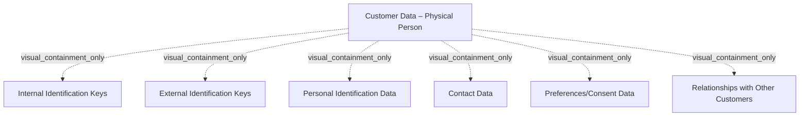

# G21B/fig5-1 · 自然人内核数据

类型：`decomposition-or-organization-model`。界定 C-MDM 对“自然人”客户应管理的核心数据范围（内核客户数据），为第 5.1 节确定主数据模型边界；每个分类的具体信息项在表 5-1 中展开。

英文 PDF 物理页：[38]。本页为架构语义分析，原文与原图分别保留。

## 原图与可编辑图


[完整 JSON](fig5-1.json) · [可编辑 Mermaid](fig5-1.mmd) · [仅关系图](fig5-1.relations.mmd) · [层级分解图](fig5-1.hierarchy.mmd)

图形重建表达语义，不复制源图布局。虚线表示解释、矩阵映射或分组关系，不自动表示不确定性的概率。



## 架构分析

先读顶部标题“Customer Data – Physical Person”，确认范围是自然人而非组织；再按从左到右、从上到下读六个分类框——上排是三类“识别/描述”数据（内部键、外部键、个人标识），下排是“联系/偏好/关系”数据。六个框是并列的分类，没有先后或主次；框内不再细分，细项见表 5-1。

- 本图有 7 个具名或隐含元素、0 条关系和 6 条包含/分组记录。
- 包含/分组树最大深度为 1；根节点为 客户数据——自然人。
- 本图没有可直接确认为人员直属汇报的关系；视觉上下位置、能力分解和治理职责分别读取。
- 原图靠嵌套表达结构，没有连线；新语义图将包含单独显式化，不补造流程、数据流或依赖。
- 完整核对自然人客户数据外框及六种内核数据；只有包含，无连线或实体基数。
- 第38–39页表5-1解释身份键、联系人、同意与关系属性；外部身份键能否存储需要检查授权，图不表示必须采集全部字段。

### 如何用于项目

- 按父项展开所有直接子项，检查同层粒度、重叠和缺项。
- 保留组成、分类、能力分解与组织汇报的区别；将示例名称替换为已确认的项目对象。

### 结构所表达的逻辑

- 自然人内核数据分六类：内部标识键、外部标识键、个人标识数据、联系方式数据、偏好/同意数据、与其他客户的关系。
- 标识键分内部与外部两套：内部键包括业务客户编码与 C-MDM 管理的唯一技术键；外部键如身份证号、外部数据提供方参考号，可用于确保唯一性并支持与外部数据提供方协作提升质量。
- 个人标识数据（名、姓、出生日期、出生地、家庭/婚姻状况、官方职业类别）是描述“这个人是谁”的属性。
- 偏好/同意数据记录客户是否授权组织为特定目的使用某范围数据；正文指出很多组织是在 2018 年因 GDPR 才把它引入 C-MDM。
- 关系数据描述客户与其他自然人的关系（父、母、子女、员工等），可指向 C-MDM 中的另一个自然人。
- 六个分类共同构成“内核”客户数据；组织/法人客户使用图 5-2 的另一套分类（法人描述替代个人标识数据）。

## 上下级与包含

两层：第 1 层是“自然人内核数据”（淡黄色底板 + 标题）；第 2 层是六个并列的分类框。分类之间没有上下级，也没有画出的关系。

|父项|子项|层级类型|依据与解释|
|---|---|---|---|
|客户数据——自然人|内部标识键|visual_containment_only|保存原图解释中的包含；业务关系类型需要图例或正文进一步限定。|
|客户数据——自然人|外部标识键|visual_containment_only|保存原图解释中的包含；业务关系类型需要图例或正文进一步限定。|
|客户数据——自然人|个人标识数据|visual_containment_only|保存原图解释中的包含；业务关系类型需要图例或正文进一步限定。|
|客户数据——自然人|联系方式数据|visual_containment_only|保存原图解释中的包含；业务关系类型需要图例或正文进一步限定。|
|客户数据——自然人|偏好/同意数据|visual_containment_only|保存原图解释中的包含；业务关系类型需要图例或正文进一步限定。|
|客户数据——自然人|与其他客户的关系|visual_containment_only|保存原图解释中的包含；业务关系类型需要图例或正文进一步限定。|

## 全部元素与角色

|元素ID|原文名称|类型|含义|直接父项|深度|
|---|---|---|---|---|---|
|pp_kernel|Customer Data – Physical Person|data|信息/数据：客户数据——自然人|—||
|pp_internal_keys|Internal Identification Keys|data|信息/数据：内部标识键|客户数据——自然人|1|
|pp_external_keys|External Identification Keys|data|信息/数据：外部标识键|客户数据——自然人|1|
|pp_personal_id|Personal Identification Data|data|信息/数据：个人标识数据|客户数据——自然人|1|
|pp_contact|Contact Data|data|信息/数据：联系方式数据|客户数据——自然人|1|
|pp_prefs|Preferences/Consent Data|data|信息/数据：偏好/同意数据|客户数据——自然人|1|
|pp_relations|Relationships with Other Customers|data|信息/数据：与其他客户的关系|客户数据——自然人|1|

## 全部关系

图中没有任何连线或箭头。六个框的并列与分组只由版式（2×3 网格 + 淡黄底板）表达；底板表示它们同属“自然人内核数据”这一范围。

|主体|语义关系|客体|显式线/隐式|原文标签|依据|
|---|---|---|---|---|---|

## 误读检查

- 六个分类不是流程步骤，也不表示数据从标识键流向关系数据。
- “内部标识键”与“外部标识键”不是同一事物的两种写法：前者由组织/C-MDM 管理，后者来自外部（身份证号、外部数据提供方等）。
- 偏好/同意数据不是可选项：正文把它列为核心范围，且与 GDPR 合规直接相关。
- 本图只给分类，不给字段清单；字段清单见表 5-1，不能只看图就设计数据模型。

## 原文证据

### [PDF 第 38 页](../../../documents/G21B.md#page-38)

### [PDF 第 39 页](../../../documents/G21B.md#page-39)

> Most of the time, organizations are legal entities registered with competent authorities, depending on the country. They can be companies, administrations, Non-Governmental Organizations (NGOs), etc.

## 来源与分析状态

所有元素/关系均有来源定位；未把历史解释重命名为本轮逐线视觉确认。源图与语义图是两种视图，布局不证明汇报或因果。

源 PDF SHA-256：`8e64887f7a080d3d882f38078297bd7873a9072b71a12c39b9e77349890f37a2`。

源图记录：[原始解释与转录](../../../figures/G21B/fig5-1.json)。

```json
{
  "quality": {
    "graph_integrity": "checked",
    "semantic_analysis": "typed-graph-and-context-analysis",
    "visual_review": "source-content-audited",
    "notice_zh": "所有元素/关系均有来源定位；未把历史解释重命名为本轮逐线视觉确认。源图与语义图是两种视图，布局不证明汇报或因果。"
  },
  "source_uncertainty": {
    "confidence": "high",
    "uncertainties_zh": [
      "图中只给分类名，未给字段；字段级内容依据表 5-1，未在图中出现。",
      "“与其他客户的关系”是否包含组织客户之间的关系，图中未限定；正文表 5-1 举例为父、母、子女、员工等人际关系。"
    ],
    "analyzed_from": [
      "英文 PDF 第 38 页原图截图",
      "英文 PDF 第 38–39 页表 5-1",
      "中文稿 G21Be_信息架构_客户主数据管理.md 第 444–474 行",
      "figs/zh/g21be_fig5-1_zh.png 中文化图"
    ],
    "date": "2026-10-31"
  },
  "source_conflicts": []
}
```
