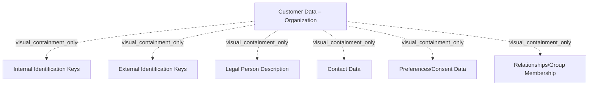

# G21B/fig5-2 · 组织/法人内核数据

类型：`decomposition-or-organization-model`。界定 C-MDM 对“组织”（法人实体）客户应管理的核心数据范围，与图 5-1 的自然人范围并列；说明同一套 C-MDM 要同时容纳 B2C 与 B2B 两类客户，且法人数据需要额外的官方注册标识与规模/业务领域描述。

英文 PDF 物理页：[39]。本页为架构语义分析，原文与原图分别保留。

## 原图与可编辑图


[完整 JSON](fig5-2.json) · [可编辑 Mermaid](fig5-2.mmd) · [仅关系图](fig5-2.relations.mmd) · [层级分解图](fig5-2.hierarchy.mmd)

图形重建表达语义，不复制源图布局。虚线表示解释、矩阵映射或分组关系，不自动表示不确定性的概率。



## 架构分析

先确认标题是“Customer Data – Organization”，再与图 5-1 对照读：上排仍是内部标识键、外部标识键，但第三格换成“法人描述”；下排是联系方式、偏好/同意、关系/集团成员。六个框并列，无先后；字段级内容见表 5-2。

- 本图有 7 个具名或隐含元素、0 条关系和 6 条包含/分组记录。
- 包含/分组树最大深度为 1；根节点为 客户数据——组织。
- 本图没有可直接确认为人员直属汇报的关系；视觉上下位置、能力分解和治理职责分别读取。
- 原图靠嵌套表达结构，没有连线；新语义图将包含单独显式化，不补造流程、数据流或依赖。
- 完整核对组织客户数据外框及六种内核数据；Legal Person Description与Relationships/Group Membership区别于自然人版本。
- 第39–40页表5-2进一步解释组织标识与法律实体，图不定义组织层级或人员汇报。

### 如何用于项目

- 按父项展开所有直接子项，检查同层粒度、重叠和缺项。
- 保留组成、分类、能力分解与组织汇报的区别；将示例名称替换为已确认的项目对象。

### 结构所表达的逻辑

- 组织客户同样有内部标识键（业务客户编码、唯一技术键）与外部标识键（组织官方编号、数据提供方参考号、国家登记 ID 等）。
- 法人描述包含组织名称、替代名称（经营名称）、成立日期、规模参数（dimensioning data，如官方权重类别）与组织业务领域；中文稿表 5-2 特别标注英文原文仍沿用“First name”“Date of birth”等自然人字段名。
- 联系方式数据包括相关自然人及其联系方式（可链接到 C-MDM 中的另一自然人）、相关地址与相关电子邮箱。
- 偏好/同意数据与自然人相同，记录组织授权/不授权使用某范围数据。
- 关系/集团成员描述组织与其他实体的关系（如母公司、子公司、集团成员），对应自然人图中的“与其他客户的关系”。
- 图 5-2 与图 5-1 结构完全同构，差别只在第三格（法人描述 vs 个人标识数据）与第六格（关系/集团成员 vs 与其他客户的关系）。

## 上下级与包含

两层：第 1 层是“组织客户内核数据”；第 2 层是六个并列分类。分类之间无上下级、无连线。

|父项|子项|层级类型|依据与解释|
|---|---|---|---|
|客户数据——组织|内部标识键|visual_containment_only|保存原图解释中的包含；业务关系类型需要图例或正文进一步限定。|
|客户数据——组织|外部标识键|visual_containment_only|保存原图解释中的包含；业务关系类型需要图例或正文进一步限定。|
|客户数据——组织|法人描述|visual_containment_only|保存原图解释中的包含；业务关系类型需要图例或正文进一步限定。|
|客户数据——组织|联系方式数据|visual_containment_only|保存原图解释中的包含；业务关系类型需要图例或正文进一步限定。|
|客户数据——组织|偏好/同意数据|visual_containment_only|保存原图解释中的包含；业务关系类型需要图例或正文进一步限定。|
|客户数据——组织|关系/集团成员|visual_containment_only|保存原图解释中的包含；业务关系类型需要图例或正文进一步限定。|

## 全部元素与角色

|元素ID|原文名称|类型|含义|直接父项|深度|
|---|---|---|---|---|---|
|org_kernel|Customer Data – Organization|data|信息/数据：客户数据——组织|—||
|org_internal_keys|Internal Identification Keys|data|信息/数据：内部标识键|客户数据——组织|1|
|org_external_keys|External Identification Keys|data|信息/数据：外部标识键|客户数据——组织|1|
|org_legal_desc|Legal Person Description|data|信息/数据：法人描述|客户数据——组织|1|
|org_contact|Contact Data|data|信息/数据：联系方式数据|客户数据——组织|1|
|org_prefs|Preferences/Consent Data|data|信息/数据：偏好/同意数据|客户数据——组织|1|
|org_group|Relationships/Group Membership|data|信息/数据：关系/集团成员|客户数据——组织|1|

## 全部关系

图中没有连线或箭头；六个分类的并列与同属关系只由 2×3 网格与淡黄底板表达。

|主体|语义关系|客体|显式线/隐式|原文标签|依据|
|---|---|---|---|---|---|

## 误读检查

- 不要把“法人描述”当作一个字段：它是名称、替代名称、成立日期、规模参数、业务领域等一组属性的分类。
- 英文原图表 5-2 中仍出现“First name”“Date of birth”字样，是原文沿用自然人模板的措辞，实际含义是组织名称与成立日期（中文稿已注明）。
- 组织客户的“关系/集团成员”不是人际父子关系，而是法人之间的集团/股权/成员关系。
- 图只给分类，不给字段；设计数据模型须结合表 5-2。

## 原文证据

### [PDF 第 39 页](../../../documents/G21B.md#page-39)

> Most of the time, organizations are legal entities registered with competent authorities, depending on the country. They can be companies, administrations, Non-Governmental Organizations (NGOs), etc.
### [PDF 第 40 页](../../../documents/G21B.md#page-40)

> In this section, the reference model presented in Chapter 3 is completed with more detailed business and application functions. It can be used to deep-dive on specific questions during the architecture study, assess maturity of an existing capability, or provide a first framework for C-MDM projects to be customized.

## 来源与分析状态

所有元素/关系均有来源定位；未把历史解释重命名为本轮逐线视觉确认。源图与语义图是两种视图，布局不证明汇报或因果。

源 PDF SHA-256：`8e64887f7a080d3d882f38078297bd7873a9072b71a12c39b9e77349890f37a2`。

源图记录：[原始解释与转录](../../../figures/G21B/fig5-2.json)。

```json
{
  "quality": {
    "graph_integrity": "checked",
    "semantic_analysis": "typed-graph-and-context-analysis",
    "visual_review": "source-content-audited",
    "notice_zh": "所有元素/关系均有来源定位；未把历史解释重命名为本轮逐线视觉确认。源图与语义图是两种视图，布局不证明汇报或因果。"
  },
  "source_uncertainty": {
    "confidence": "high",
    "uncertainties_zh": [
      "图中只给分类名，字段级内容依据表 5-2；表 5-2 中“First name/Date of birth”沿用了自然人字段名，本分析按中文稿注释理解为组织名称/成立日期。",
      "“关系/集团成员”的具体关系类型（母子公司、集团成员等）图中未列出。"
    ],
    "analyzed_from": [
      "英文 PDF 第 39 页原图截图",
      "英文 PDF 第 39 页正文与表 5-2 开头",
      "中文稿 G21Be_信息架构_客户主数据管理.md 第 483–515 行",
      "figs/zh/g21be_fig5-2_zh.png 中文化图"
    ],
    "date": "2026-10-31"
  },
  "source_conflicts": []
}
```
