# G21B/fig5-3 · C-MDM 详细业务功能参考模型

类型：`architecture-model`。第 5.2 节给出可复用的详细参考模型：组织可以用它对照自己的 C-MDM 业务功能覆盖度、设计目标组织与职责，或作为供应商/方案评估的清单。图 5-3 是业务侧的全景分解，逐项说明见表 5-3。

英文 PDF 物理页：[41]。本页为架构语义分析，原文与原图分别保留。

## 原图与可编辑图


[完整 JSON](fig5-3.json) · [可编辑 Mermaid](fig5-3.mmd) · [仅关系图](fig5-3.relations.mmd) · [层级分解图](fig5-3.hierarchy.mmd)

图形重建表达语义，不复制源图布局。虚线表示解释、矩阵映射或分组关系，不自动表示不确定性的概率。

```mermaid
flowchart TB
  %% Semantic reconstruction; see original source image for exact layout.
  n0["Customer-MDM Team"]
  n1["Data Manager"]
  n2["Business Data Owner"]
  n3["Data Steward"]
  n4["Architect"]
  n5["C-MDM Capabilities Management and Governance"]
  n6["External Data Acquisition"]
  n7["C-MDM Design"]
  n8["C-MDM Operation"]
  n9["Extension of C-MDM Scope and Usages"]
  n10["Data Quality and Business Value Measurement"]
  n11["Communication"]
  n12["Define C-MDM Objectives and Roadmaps"]
  n13["Define and Onboard Data Owners and Data Stewards"]
  n14["Define and Operate Data Governance Principles"]
  n15["Coordinate Decision-Making and Prioritization"]
  n16["Define Team Services and Operate SLAs"]
  n17["Analyze the Data Market and Identify Opportunities"]
  n18["Set Up a Date Partnership"]
  n19["Purchase External Customer Data"]
  n20["Design Customer Data Models"]
  n21["Design C-MDM Architecture Principles and Ensure Consistency of Data Solutions"]
  n22["Support Customer Data Management Implementations"]
  n23["Formalize Customer Master Data Validation Workflows, Quality, and Business Rules"]
  n24["Help Businesses to Adapt their Processes to Ensure Data Quality"]
  n25["Define and Operate Data Access Model"]
  n26["Define, Maintain, and Share Customer Data Documentations (Data Dictionaries, Glossaries, Models)"]
  n27["Define, Follow, and Monitor Data Retention Rules"]
  n28["Receive and Manage Requests about Customer Data (GDPR, etc.)"]
  n29["Assess and Manage Master Customer Data Quality Issues"]
  n30["Correct Data Issues"]
  n31["Validate Customer Merges"]
  n32["Leverage C-MDM Services in Operational Business Processes"]
  n33["Support New Integration of Data Produce Application"]
  n34["Support New Integration of a Data Consumer Application"]
  n35["Support New External Data Source Integration"]
  n36["Build &amp; Deliver Reports on Customer Data Quality and Evolutions"]
  n37["Report C-MDM Business Value"]
  n38["Communicate about C-MDM Value and Current Usage"]
  n39["Communicate the Customer Data Team Services Catalog"]
  n40["Communicate about Customer Data Quality"]
  n0 -.->|"visual_containment_only"| n1
  n0 -.->|"visual_containment_only"| n2
  n0 -.->|"visual_containment_only"| n3
  n0 -.->|"visual_containment_only"| n4
  n5 -.->|"分组"| n12
  n5 -.->|"分组"| n13
  n5 -.->|"分组"| n14
  n5 -.->|"分组"| n15
  n5 -.->|"分组"| n16
  n6 -.->|"分组"| n17
  n6 -.->|"分组"| n18
  n6 -.->|"分组"| n19
  n7 -.->|"分组"| n20
  n7 -.->|"分组"| n21
  n7 -.->|"分组"| n22
  n7 -.->|"分组"| n23
  n7 -.->|"分组"| n24
  n7 -.->|"分组"| n25
  n7 -.->|"分组"| n26
  n7 -.->|"分组"| n27
  n8 -.->|"分组"| n28
  n8 -.->|"分组"| n29
  n8 -.->|"分组"| n30
  n8 -.->|"分组"| n31
  n8 -.->|"分组"| n32
  n9 -.->|"分组"| n33
  n9 -.->|"分组"| n34
  n9 -.->|"分组"| n35
  n10 -.->|"分组"| n36
  n10 -.->|"分组"| n37
  n11 -.->|"分组"| n38
  n11 -.->|"分组"| n39
  n11 -.->|"分组"| n40
```



## 架构分析

先看顶部：Customer-MDM Team 是一个业务参与者容器，里面并排 4 个角色——数据经理、业务数据所有者、数据管家、架构师，他们共同承担下面的功能。再看 7 个浅黄分组：能力管理与治理（横向横跨顶部）、外部客户数据获取（左列）、C-MDM 设计（中部最大）、C-MDM 运营、范围与用途扩展、数据质量与业务价值度量（右列）、沟通（底部横贯）。每组内的圆角框是具体业务功能，组框只表示归类，不表示流程顺序。

- 本图有 41 个具名或隐含元素、0 条关系和 33 条包含/分组记录。
- 包含/分组树最大深度为 1；根节点为 客户主数据管理团队、C-MDM 能力管理与治理、外部客户数据获取、C-MDM 设计、C-MDM 运营、C-MDM 范围与用途扩展、数据质量与业务价值度量、沟通。
- 本图没有可直接确认为人员直属汇报的关系；视觉上下位置、能力分解和治理职责分别读取。
- 原图靠嵌套表达结构，没有连线；新语义图将包含单独显式化，不补造流程、数据流或依赖。
- 包含分组后有 8 个连通分量；分离可能源于图例、并列分类或独立示例，未自动补边。
- 逐框核对41个角色、功能与分组；Communication确有三个子项，最右为Communicate about Customer Data Quality。
- 七个业务功能分组与顶端四角色团队之间无逐项分配连线，不能把所有功能自动全分配给每个角色；正文表5-3另提供功能说明。
- 原图Set Up a Date Partnership及Data Produce Application措辞按原样保留，不能悄悄替换为新的源文标签。

### 如何用于项目

- 按节点类型建立业务、应用、数据、技术对象，并保留跨层服务、访问和实现关系。
- 交叉线不是连接点；角色分工、数据使用和组织汇报不得混用。

### 结构所表达的逻辑

- 7 个功能组：C-MDM 能力管理与治理（5 项）、外部客户数据获取（3 项）、C-MDM 设计（8 项）、C-MDM 运营（5 项）、C-MDM 范围与用途扩展（3 项）、数据质量与业务价值度量（2 项）、沟通（3 项），合计 29 项。
- 能力管理与治理组负责定目标与路线图、吸纳数据所有者/数据管家、定义并运行数据治理原则、协调决策与优先级、定义团队服务并运营 SLA——是唯一直接面向治理与赞助的组。
- C-MDM 设计组最大（8 项），覆盖数据模型、架构原则与数据方案一致性、实施支持、校验工作流/质量/业务规则、帮助业务调整流程、数据访问模型、文档（数据字典/术语表/模型）与数据保留规则。
- C-MDM 运营组负责接收并管理客户数据请求（GDPR 等）、评估与处理质量问题、纠正数据、校验合并，并在运营业务流程中利用 C-MDM 服务。
- 外部客户数据获取组是独立的左列，说明“买数据/建伙伴关系/分析数据市场”被当作 C-MDM 团队的常设业务功能，而不是一次性项目。
- 范围与用途扩展组只处理“新集成”：数据生产方应用、数据消费方应用、外部数据源；与运营组的“日常服务”区分开。
- 数据质量与业务价值度量组只有两项：构建并交付客户数据质量/演进报告、报告 C-MDM 业务价值；与沟通组（3 项）一起构成“向组织证明价值”的功能。
- 4 个角色不是按功能组一对一分配的：同一角色会参与多个组（如数据管家参与治理、设计、运营），图中不做角色—功能映射。

## 上下级与包含

三层：第 1 层 Customer-MDM Team（业务参与者容器）；第 2 层 7 个业务功能分组 + 4 个角色；第 3 层各组内的具体业务功能（29 项）。角色与功能组并列位于第 2 层，图中不表示谁负责哪项功能。

|父项|子项|层级类型|依据与解释|
|---|---|---|---|
|客户主数据管理团队|数据经理|visual_containment_only|保存原图解释中的包含；业务关系类型需要图例或正文进一步限定。|
|客户主数据管理团队|业务数据所有者|visual_containment_only|保存原图解释中的包含；业务关系类型需要图例或正文进一步限定。|
|客户主数据管理团队|数据管家|visual_containment_only|保存原图解释中的包含；业务关系类型需要图例或正文进一步限定。|
|客户主数据管理团队|架构师|visual_containment_only|保存原图解释中的包含；业务关系类型需要图例或正文进一步限定。|
|C-MDM 能力管理与治理|定义 C-MDM 目标与路线图|visual_grouping|框、泳道、域或分类组的成员归属；没有额外证据不提升为业务组合或管理关系。|
|C-MDM 能力管理与治理|定义并吸纳数据所有者与数据管家|visual_grouping|框、泳道、域或分类组的成员归属；没有额外证据不提升为业务组合或管理关系。|
|C-MDM 能力管理与治理|定义并运行数据治理原则|visual_grouping|框、泳道、域或分类组的成员归属；没有额外证据不提升为业务组合或管理关系。|
|C-MDM 能力管理与治理|协调决策与优先级|visual_grouping|框、泳道、域或分类组的成员归属；没有额外证据不提升为业务组合或管理关系。|
|C-MDM 能力管理与治理|定义团队服务并运营 SLA|visual_grouping|框、泳道、域或分类组的成员归属；没有额外证据不提升为业务组合或管理关系。|
|外部客户数据获取|分析数据市场并识别机会|visual_grouping|框、泳道、域或分类组的成员归属；没有额外证据不提升为业务组合或管理关系。|
|外部客户数据获取|建立数据伙伴关系|visual_grouping|框、泳道、域或分类组的成员归属；没有额外证据不提升为业务组合或管理关系。|
|外部客户数据获取|采购外部客户数据|visual_grouping|框、泳道、域或分类组的成员归属；没有额外证据不提升为业务组合或管理关系。|
|C-MDM 设计|设计客户数据模型|visual_grouping|框、泳道、域或分类组的成员归属；没有额外证据不提升为业务组合或管理关系。|
|C-MDM 设计|设计 C-MDM 架构原则并确保数据方案一致性|visual_grouping|框、泳道、域或分类组的成员归属；没有额外证据不提升为业务组合或管理关系。|
|C-MDM 设计|支持客户数据管理实施|visual_grouping|框、泳道、域或分类组的成员归属；没有额外证据不提升为业务组合或管理关系。|
|C-MDM 设计|形式化客户主数据校验工作流、质量与业务规则|visual_grouping|框、泳道、域或分类组的成员归属；没有额外证据不提升为业务组合或管理关系。|
|C-MDM 设计|帮助业务调整其流程以确保数据质量|visual_grouping|框、泳道、域或分类组的成员归属；没有额外证据不提升为业务组合或管理关系。|
|C-MDM 设计|定义并运行数据访问模型|visual_grouping|框、泳道、域或分类组的成员归属；没有额外证据不提升为业务组合或管理关系。|
|C-MDM 设计|定义、维护并共享客户数据文档（数据字典、术语表、模型）|visual_grouping|框、泳道、域或分类组的成员归属；没有额外证据不提升为业务组合或管理关系。|
|C-MDM 设计|定义、遵循并监控数据保留规则|visual_grouping|框、泳道、域或分类组的成员归属；没有额外证据不提升为业务组合或管理关系。|
|C-MDM 运营|接收并管理客户数据相关请求（GDPR 等）|visual_grouping|框、泳道、域或分类组的成员归属；没有额外证据不提升为业务组合或管理关系。|
|C-MDM 运营|评估并管理客户主数据质量问题|visual_grouping|框、泳道、域或分类组的成员归属；没有额外证据不提升为业务组合或管理关系。|
|C-MDM 运营|纠正数据问题|visual_grouping|框、泳道、域或分类组的成员归属；没有额外证据不提升为业务组合或管理关系。|
|C-MDM 运营|校验客户合并|visual_grouping|框、泳道、域或分类组的成员归属；没有额外证据不提升为业务组合或管理关系。|
|C-MDM 运营|运营流程中利用 C-MDM 服务|visual_grouping|框、泳道、域或分类组的成员归属；没有额外证据不提升为业务组合或管理关系。|
|C-MDM 范围与用途扩展|支持新集成：数据生产方应用|visual_grouping|框、泳道、域或分类组的成员归属；没有额外证据不提升为业务组合或管理关系。|
|C-MDM 范围与用途扩展|支持新集成：数据消费方应用|visual_grouping|框、泳道、域或分类组的成员归属；没有额外证据不提升为业务组合或管理关系。|
|C-MDM 范围与用途扩展|支持新的外部数据源集成|visual_grouping|框、泳道、域或分类组的成员归属；没有额外证据不提升为业务组合或管理关系。|
|数据质量与业务价值度量|构建并交付报告：客户数据质量与演进|visual_grouping|框、泳道、域或分类组的成员归属；没有额外证据不提升为业务组合或管理关系。|
|数据质量与业务价值度量|报告 C-MDM 业务价值|visual_grouping|框、泳道、域或分类组的成员归属；没有额外证据不提升为业务组合或管理关系。|
|沟通|沟通 C-MDM 价值与当前用途|visual_grouping|框、泳道、域或分类组的成员归属；没有额外证据不提升为业务组合或管理关系。|
|沟通|沟通客户数据团队服务目录|visual_grouping|框、泳道、域或分类组的成员归属；没有额外证据不提升为业务组合或管理关系。|
|沟通|沟通客户数据质量|visual_grouping|框、泳道、域或分类组的成员归属；没有额外证据不提升为业务组合或管理关系。|

## 全部元素与角色

|元素ID|原文名称|类型|含义|直接父项|深度|
|---|---|---|---|---|---|
|team|Customer-MDM Team|organization_unit|组织单元：客户主数据管理团队|—||
|role_data_manager|Data Manager|role|角色：数据经理|客户主数据管理团队|1|
|role_data_owner|Business Data Owner|role|角色：业务数据所有者|客户主数据管理团队|1|
|role_steward|Data Steward|role|角色：数据管家|客户主数据管理团队|1|
|role_architect|Architect|role|角色：架构师|客户主数据管理团队|1|
|g_gov|C-MDM Capabilities Management and Governance|group|分组：C-MDM 能力管理与治理|—||
|g_ext|External Data Acquisition|group|分组：外部客户数据获取|—||
|g_design|C-MDM Design|group|分组：C-MDM 设计|—||
|g_operation|C-MDM Operation|group|分组：C-MDM 运营|—||
|g_extension|Extension of C-MDM Scope and Usages|group|分组：C-MDM 范围与用途扩展|—||
|g_dq|Data Quality and Business Value Measurement|group|分组：数据质量与业务价值度量|—||
|g_comm|Communication|group|分组：沟通|—||
|f_objectives|Define C-MDM Objectives and Roadmaps|function|功能：定义 C-MDM 目标与路线图|C-MDM 能力管理与治理|1|
|f_onboard_owners|Define and Onboard Data Owners and Data Stewards|function|功能：定义并吸纳数据所有者与数据管家|C-MDM 能力管理与治理|1|
|f_governance_principles|Define and Operate Data Governance Principles|function|功能：定义并运行数据治理原则|C-MDM 能力管理与治理|1|
|f_decisions|Coordinate Decision-Making and Prioritization|function|功能：协调决策与优先级|C-MDM 能力管理与治理|1|
|f_team_services|Define Team Services and Operate SLAs|function|功能：定义团队服务并运营 SLA|C-MDM 能力管理与治理|1|
|f_market|Analyze the Data Market and Identify Opportunities|function|功能：分析数据市场并识别机会|外部客户数据获取|1|
|f_partnership|Set Up a Date Partnership|function|英文原图写作 Date（应为 Data），中文稿标签表沿用原拼写。|外部客户数据获取|1|
|f_purchase|Purchase External Customer Data|function|功能：采购外部客户数据|外部客户数据获取|1|
|f_data_models|Design Customer Data Models|function|功能：设计客户数据模型|C-MDM 设计|1|
|f_arch_principles|Design C-MDM Architecture Principles and Ensure Consistency of Data Solutions|function|功能：设计 C-MDM 架构原则并确保数据方案一致性|C-MDM 设计|1|
|f_support_impl|Support Customer Data Management Implementations|function|功能：支持客户数据管理实施|C-MDM 设计|1|
|f_validation|Formalize Customer Master Data Validation Workflows, Quality, and Business Rules|function|功能：形式化客户主数据校验工作流、质量与业务规则|C-MDM 设计|1|
|f_adapt_processes|Help Businesses to Adapt their Processes to Ensure Data Quality|function|功能：帮助业务调整其流程以确保数据质量|C-MDM 设计|1|
|f_access_model|Define and Operate Data Access Model|function|功能：定义并运行数据访问模型|C-MDM 设计|1|
|f_documentation|Define, Maintain, and Share Customer Data Documentations (Data Dictionaries, Glossaries, Models)|function|功能：定义、维护并共享客户数据文档（数据字典、术语表、模型）|C-MDM 设计|1|
|f_retention|Define, Follow, and Monitor Data Retention Rules|function|功能：定义、遵循并监控数据保留规则|C-MDM 设计|1|
|f_requests|Receive and Manage Requests about Customer Data (GDPR, etc.)|function|功能：接收并管理客户数据相关请求（GDPR 等）|C-MDM 运营|1|
|f_quality_issues|Assess and Manage Master Customer Data Quality Issues|function|功能：评估并管理客户主数据质量问题|C-MDM 运营|1|
|f_correct|Correct Data Issues|function|功能：纠正数据问题|C-MDM 运营|1|
|f_merges|Validate Customer Merges|function|功能：校验客户合并|C-MDM 运营|1|
|f_leverage|Leverage C-MDM Services in Operational Business Processes|function|功能：运营流程中利用 C-MDM 服务|C-MDM 运营|1|
|f_new_producer|Support New Integration of Data Produce Application|function|原文 Produce 为 Producer 的笔误。|C-MDM 范围与用途扩展|1|
|f_new_consumer|Support New Integration of a Data Consumer Application|function|功能：支持新集成：数据消费方应用|C-MDM 范围与用途扩展|1|
|f_new_external|Support New External Data Source Integration|function|功能：支持新的外部数据源集成|C-MDM 范围与用途扩展|1|
|f_reports|Build & Deliver Reports on Customer Data Quality and Evolutions|function|功能：构建并交付报告：客户数据质量与演进|数据质量与业务价值度量|1|
|f_value|Report C-MDM Business Value|function|功能：报告 C-MDM 业务价值|数据质量与业务价值度量|1|
|f_comm_value|Communicate about C-MDM Value and Current Usage|function|功能：沟通 C-MDM 价值与当前用途|沟通|1|
|f_comm_catalog|Communicate the Customer Data Team Services Catalog|function|功能：沟通客户数据团队服务目录|沟通|1|
|f_comm_quality|Communicate about Customer Data Quality|function|功能：沟通客户数据质量|沟通|1|

## 全部关系

图中没有任何连线或箭头。分组关系由浅黄大框的包含表达；角色与功能的归属由“同处 Customer-MDM Team 容器内”表达；功能组之间的上下左右位置不表示流程顺序或依赖。

|主体|语义关系|客体|显式线/隐式|原文标签|依据|
|---|---|---|---|---|---|

## 误读检查

- 不要把 7 个功能组读成流程的 7 个步骤：它们是功能分类，可以并行存在。
- “外部客户数据获取”在左列独立成组，不代表它在时间上先于设计或运营。
- “C-MDM 设计”组里的“支持客户数据管理实施”“帮助业务调整其流程”仍是业务功能，不是项目管理或变革管理的完整方法。
- 角色（数据经理、业务数据所有者、数据管家、架构师）不是功能组的下级；他们与功能组并列，具体分工需结合表 5-3 与组织设计。
- 中文稿引用的中文化 PNG 有多个标签被缩小并加了灰底，不要据此判断这些功能次要；原图所有功能同级同字号。

## 原文证据

### [PDF 第 41 页](../../../documents/G21B.md#page-41)

> Detailed descriptions of these business functions are provided in Table 5-3.

## 来源与分析状态

所有元素/关系均有来源定位；未把历史解释重命名为本轮逐线视觉确认。源图与语义图是两种视图，布局不证明汇报或因果。

源 PDF SHA-256：`8e64887f7a080d3d882f38078297bd7873a9072b71a12c39b9e77349890f37a2`。

源图记录：[原始解释与转录](../../../figures/G21B/fig5-3.json)。

```json
{
  "quality": {
    "graph_integrity": "checked",
    "semantic_analysis": "typed-graph-and-context-analysis",
    "visual_review": "source-content-audited",
    "notice_zh": "所有元素/关系均有来源定位；未把历史解释重命名为本轮逐线视觉确认。源图与语义图是两种视图，布局不证明汇报或因果。"
  },
  "source_uncertainty": {
    "confidence": "high",
    "uncertainties_zh": [
      "原图英文标签“Set Up a Date Partnership”“Data Produce Application”存在拼写错误，本分析按原样记录并在 label_zh 中给出合理译名。",
      "角色与功能组之间没有画责任分配线，无法从图判断每项功能由哪个角色负责。",
      "中文稿标签对照表漏列 11 个功能，解读时应以图或英文表 5-3 为准。"
    ],
    "analyzed_from": [
      "英文 PDF 第 41 页原图截图及 3×3 放大分块",
      "英文 PDF 第 41 页表 5-3 开头",
      "中文稿 G21Be_信息架构_客户主数据管理.md 第 525–566 行",
      "figs/zh/g21be_fig5-3_zh.png 中文化图"
    ],
    "date": "2026-10-31"
  },
  "source_conflicts": []
}
```
