# G21B/fig5-4 · C-MDM 详细应用功能参考模型

类型：`architecture-model`。第 5.2.2 节给出应用侧的详细参考模型：用稳定的通用语言描述 C-MDM 平台应覆盖的功能，可用于比较供应商功能覆盖、评估组织基线/目标应用架构、设计过渡架构或评估能力成熟度。图 5-4 是这 40 项功能的分类全景，逐项说明见表 5-4。

英文 PDF 物理页：[45]。本页为架构语义分析，原文与原图分别保留。

## 原图与可编辑图


[完整 JSON](fig5-4.json) · [可编辑 Mermaid](fig5-4.mmd) · [仅关系图](fig5-4.relations.mmd) · [层级分解图](fig5-4.hierarchy.mmd)

图形重建表达语义，不复制源图布局。虚线表示解释、矩阵映射或分组关系，不自动表示不确定性的概率。

```mermaid
flowchart TB
  %% Semantic reconstruction; see original source image for exact layout.
  n0["C-MDM System Functions"]
  n1["Reference Data Management"]
  n2["Acquisition – User Interface or Services"]
  n3["Quality Management"]
  n4["Data Privacy Management"]
  n5["Distribution – User Interface or Service"]
  n6["Dashboards &amp; Reports"]
  n7["Administration"]
  n8["Input Attributes Transcodification"]
  n9["Manage Reference List"]
  n10["Manage Customer Key Mapping"]
  n11["Output Attributes Transcodification"]
  n12["Create Master Data"]
  n13["Update Master Data"]
  n14["Manage Links Between Master Entities and Other Business Objects"]
  n15["Manage Relationships"]
  n16["Manage Groups &amp; Hierarchies"]
  n17["Import Data Set, Mass Acquisition"]
  n18["Enhance Data with Technical and Business Metadata"]
  n19["Manage Business Validation &amp; Workflows"]
  n20["Manage &amp; Apply Attribute Value Quality Rules"]
  n21["Manage Syntax, Format, Normalization Rules"]
  n22["Manage Consistency and Business Rules"]
  n23["Manage Accuracy (Accuracy Score, External Data)"]
  n24["Manage Uniqueness Rules"]
  n25["De-duplicate with Determinist Process"]
  n26["De-duplicate with &#x27;obabilist/Statist Process"]
  n27["Recommend Merges to Arbitrate"]
  n28["Manual Merge Arbitrage"]
  n29["Unmerge"]
  n30["Generate Unique Master Technical Key"]
  n31["Manual Deletion"]
  n32["Automated Deletion with Rules"]
  n33["Masking"]
  n34["Search"]
  n35["Read Data"]
  n36["Extract Data"]
  n37["Push Events: Create, Update, Delete, Merge"]
  n38["Contextualize Data Visibility &amp; Provided Values Depending on Human or System Consumer Role"]
  n39["Generate Audit Data Evolution Reports"]
  n40["Generate Data Quality Dashboards"]
  n41["Generate Usages Dashboard"]
  n42["Design Master Data Model"]
  n43["Manage Data Historization and Versioning Rules"]
  n44["Full Database Versioning"]
  n45["Manage Roles"]
  n46["Manage Access Rights"]
  n47["Manage Logging"]
  n0 -.->|"visual_containment_only"| n1
  n0 -.->|"visual_containment_only"| n2
  n0 -.->|"visual_containment_only"| n3
  n0 -.->|"visual_containment_only"| n4
  n0 -.->|"visual_containment_only"| n5
  n0 -.->|"visual_containment_only"| n6
  n0 -.->|"visual_containment_only"| n7
  n1 -.->|"分组"| n8
  n1 -.->|"分组"| n9
  n1 -.->|"分组"| n10
  n1 -.->|"分组"| n11
  n2 -.->|"分组"| n12
  n2 -.->|"分组"| n13
  n2 -.->|"分组"| n14
  n14 -.->|"functional_decomposition"| n15
  n14 -.->|"functional_decomposition"| n16
  n2 -.->|"分组"| n17
  n2 -.->|"分组"| n18
  n3 -.->|"分组"| n19
  n3 -.->|"分组"| n20
  n20 -.->|"functional_decomposition"| n21
  n20 -.->|"functional_decomposition"| n22
  n20 -.->|"functional_decomposition"| n23
  n3 -.->|"分组"| n24
  n24 -.->|"functional_decomposition"| n25
  n24 -.->|"functional_decomposition"| n26
  n24 -.->|"functional_decomposition"| n27
  n24 -.->|"functional_decomposition"| n28
  n24 -.->|"functional_decomposition"| n29
  n24 -.->|"functional_decomposition"| n30
  n4 -.->|"分组"| n31
  n4 -.->|"分组"| n32
  n4 -.->|"分组"| n33
  n5 -.->|"分组"| n34
  n5 -.->|"分组"| n35
  n5 -.->|"分组"| n36
  n5 -.->|"分组"| n37
  n5 -.->|"分组"| n38
  n6 -.->|"分组"| n39
  n6 -.->|"分组"| n40
  n6 -.->|"分组"| n41
  n7 -.->|"分组"| n42
  n7 -.->|"分组"| n43
  n7 -.->|"分组"| n44
  n7 -.->|"分组"| n45
  n7 -.->|"分组"| n46
  n7 -.->|"分组"| n47
```



## 架构分析

先看外层 C-MDM System Functions，说明这些功能都属于同一个系统边界。再按组读：左列 Reference Data Management 单独一列（4 项）；中部自上而下是采集、质量管理、数据隐私管理、分发四个主流程组；右列是 Dashboards & Reports；底部横贯 Administration。组内框是应用功能；带嵌套的框（如 Manage Links、Manage & Apply Attribute Value Quality Rules、Manage Uniqueness Rules）先读父功能，再读其中的子功能。

- 本图有 48 个具名或隐含元素、0 条关系和 47 条包含/分组记录。
- 包含/分组树最大深度为 3；根节点为 C-MDM 系统功能。
- 本图没有可直接确认为人员直属汇报的关系；视觉上下位置、能力分解和治理职责分别读取。
- 原图靠嵌套表达结构，没有连线；新语义图将包含单独显式化，不补造流程、数据流或依赖。
- 逐框核对48项，实际唯一键生成位于Manage Uniqueness Rules蓝色容器内，纠正其直接父项。
- 所有子功能以嵌套表达；没有执行顺序连线。角色/权限管理属于Administration，不是Data Privacy三个操作的上级。

### 如何用于项目

- 按节点类型建立业务、应用、数据、技术对象，并保留跨层服务、访问和实现关系。
- 交叉线不是连接点；角色分工、数据使用和组织汇报不得混用。

### 结构所表达的逻辑

- 7 个功能组与 40 项功能：参考数据管理 4、采集 7、质量管理 12、数据隐私管理 3、分发 5、仪表盘与报表 3、管理 6。
- 采集组以 Create/Update Master Data 为入口，Manage Links Between Master Entities and Other Business Objects 下再分 Manage Relationships 与 Manage Groups & Hierarchies；Import Data Set, Mass Acquisition 与 Enhance Data with Technical and Business Metadata 是两条横贯的批量/元数据能力。
- 质量管理是最大的一组：先 Manage Business Validation & Workflows，再在 Manage & Apply Attribute Value Quality Rules 下分语法/格式/规范化、一致性/业务规则、准确性（准确性评分、外部数据），最后在 Manage Uniqueness Rules 下分确定性去重、概率/统计去重、推荐合并、人工合并仲裁、取消合并，并以 Generate Unique Master Technical Key 收口。
- 数据隐私管理只有三项：人工删除、按规则自动删除、掩码；对应保留/删除/脱敏三类隐私约束。
- 分发组包含 Search、Read Data、Extract Data、Push Events（创建/更新/删除/合并）四项取数方式，外加一条按人类或系统消费者角色呈现可见性与取值的横贯能力。
- 仪表盘与报表组三项：审计数据演进报表、数据质量仪表盘、用途（usage）仪表盘；与图 5-3 的“报告 C-MDM 业务价值”业务功能对应。
- 管理组六项：设计主数据模型、数据历史化与版本规则、全数据库版本管理、角色、访问权限、日志；这些是支撑上述所有功能的管理面。
- 原图的“De-duplicate with Probabilist/Statist Process”标签首字母 P 被左侧框线裁掉，显示为“obabilist/Statist”；中文重绘图已补全为“概率/统计流程去重”。

## 上下级与包含

三层（局部四层）：第 1 层 C-MDM System Functions；第 2 层 7 个功能组；第 3 层 40 项应用功能；Manage Links、Manage & Apply Attribute Value Quality Rules、Manage Uniqueness Rules 三项下还有第 4 层子功能。

|父项|子项|层级类型|依据与解释|
|---|---|---|---|
|C-MDM 系统功能|参考数据管理|visual_containment_only|保存原图解释中的包含；业务关系类型需要图例或正文进一步限定。|
|C-MDM 系统功能|采集——用户界面或服务|visual_containment_only|保存原图解释中的包含；业务关系类型需要图例或正文进一步限定。|
|C-MDM 系统功能|质量管理|visual_containment_only|保存原图解释中的包含；业务关系类型需要图例或正文进一步限定。|
|C-MDM 系统功能|数据隐私管理|visual_containment_only|保存原图解释中的包含；业务关系类型需要图例或正文进一步限定。|
|C-MDM 系统功能|分发——用户界面或服务|visual_containment_only|保存原图解释中的包含；业务关系类型需要图例或正文进一步限定。|
|C-MDM 系统功能|仪表盘与报表|visual_containment_only|保存原图解释中的包含；业务关系类型需要图例或正文进一步限定。|
|C-MDM 系统功能|管理|visual_containment_only|保存原图解释中的包含；业务关系类型需要图例或正文进一步限定。|
|参考数据管理|输入属性转码|visual_grouping|框、泳道、域或分类组的成员归属；没有额外证据不提升为业务组合或管理关系。|
|参考数据管理|管理参考列表|visual_grouping|框、泳道、域或分类组的成员归属；没有额外证据不提升为业务组合或管理关系。|
|参考数据管理|管理客户键映射|visual_grouping|框、泳道、域或分类组的成员归属；没有额外证据不提升为业务组合或管理关系。|
|参考数据管理|输出属性转码|visual_grouping|框、泳道、域或分类组的成员归属；没有额外证据不提升为业务组合或管理关系。|
|采集——用户界面或服务|创建主数据|visual_grouping|框、泳道、域或分类组的成员归属；没有额外证据不提升为业务组合或管理关系。|
|采集——用户界面或服务|更新主数据|visual_grouping|框、泳道、域或分类组的成员归属；没有额外证据不提升为业务组合或管理关系。|
|采集——用户界面或服务|管理主实体与其他业务对象之间的链接|visual_grouping|框、泳道、域或分类组的成员归属；没有额外证据不提升为业务组合或管理关系。|
|管理主实体与其他业务对象之间的链接|管理关系|functional_decomposition|同类功能/过程/服务的嵌套分解；不推断执行顺序。|
|管理主实体与其他业务对象之间的链接|管理群组与层级|functional_decomposition|同类功能/过程/服务的嵌套分解；不推断执行顺序。|
|采集——用户界面或服务|导入数据集/批量采集|visual_grouping|框、泳道、域或分类组的成员归属；没有额外证据不提升为业务组合或管理关系。|
|采集——用户界面或服务|以技术与业务元数据增强数据|visual_grouping|框、泳道、域或分类组的成员归属；没有额外证据不提升为业务组合或管理关系。|
|质量管理|管理业务校验与工作流|visual_grouping|框、泳道、域或分类组的成员归属；没有额外证据不提升为业务组合或管理关系。|
|质量管理|管理与应用属性值质量规则|visual_grouping|框、泳道、域或分类组的成员归属；没有额外证据不提升为业务组合或管理关系。|
|管理与应用属性值质量规则|管理语法、格式与规范化规则|functional_decomposition|同类功能/过程/服务的嵌套分解；不推断执行顺序。|
|管理与应用属性值质量规则|管理一致性与业务规则|functional_decomposition|同类功能/过程/服务的嵌套分解；不推断执行顺序。|
|管理与应用属性值质量规则|管理准确性（准确性评分、外部数据）|functional_decomposition|同类功能/过程/服务的嵌套分解；不推断执行顺序。|
|质量管理|管理唯一性规则|visual_grouping|框、泳道、域或分类组的成员归属；没有额外证据不提升为业务组合或管理关系。|
|管理唯一性规则|确定性流程去重|functional_decomposition|同类功能/过程/服务的嵌套分解；不推断执行顺序。|
|管理唯一性规则|概率/统计流程去重|functional_decomposition|同类功能/过程/服务的嵌套分解；不推断执行顺序。|
|管理唯一性规则|推荐合并以供仲裁|functional_decomposition|同类功能/过程/服务的嵌套分解；不推断执行顺序。|
|管理唯一性规则|人工合并仲裁|functional_decomposition|同类功能/过程/服务的嵌套分解；不推断执行顺序。|
|管理唯一性规则|取消合并|functional_decomposition|同类功能/过程/服务的嵌套分解；不推断执行顺序。|
|管理唯一性规则|生成唯一主数据技术键|functional_decomposition|同类功能/过程/服务的嵌套分解；不推断执行顺序。|
|数据隐私管理|人工删除|visual_grouping|框、泳道、域或分类组的成员归属；没有额外证据不提升为业务组合或管理关系。|
|数据隐私管理|按规则自动删除|visual_grouping|框、泳道、域或分类组的成员归属；没有额外证据不提升为业务组合或管理关系。|
|数据隐私管理|掩码|visual_grouping|框、泳道、域或分类组的成员归属；没有额外证据不提升为业务组合或管理关系。|
|分发——用户界面或服务|搜索|visual_grouping|框、泳道、域或分类组的成员归属；没有额外证据不提升为业务组合或管理关系。|
|分发——用户界面或服务|读取数据|visual_grouping|框、泳道、域或分类组的成员归属；没有额外证据不提升为业务组合或管理关系。|
|分发——用户界面或服务|抽取数据|visual_grouping|框、泳道、域或分类组的成员归属；没有额外证据不提升为业务组合或管理关系。|
|分发——用户界面或服务|推送事件：创建、更新、删除、合并|visual_grouping|框、泳道、域或分类组的成员归属；没有额外证据不提升为业务组合或管理关系。|
|分发——用户界面或服务|按人类或系统消费者角色呈现数据可见性与取值|visual_grouping|框、泳道、域或分类组的成员归属；没有额外证据不提升为业务组合或管理关系。|
|仪表盘与报表|生成审计数据演进报表|visual_grouping|框、泳道、域或分类组的成员归属；没有额外证据不提升为业务组合或管理关系。|
|仪表盘与报表|生成数据质量仪表盘|visual_grouping|框、泳道、域或分类组的成员归属；没有额外证据不提升为业务组合或管理关系。|
|仪表盘与报表|生成用途仪表盘|visual_grouping|框、泳道、域或分类组的成员归属；没有额外证据不提升为业务组合或管理关系。|
|管理|设计主数据模型|visual_grouping|框、泳道、域或分类组的成员归属；没有额外证据不提升为业务组合或管理关系。|
|管理|管理数据历史化与版本规则|visual_grouping|框、泳道、域或分类组的成员归属；没有额外证据不提升为业务组合或管理关系。|
|管理|全数据库版本管理|visual_grouping|框、泳道、域或分类组的成员归属；没有额外证据不提升为业务组合或管理关系。|
|管理|管理角色|visual_grouping|框、泳道、域或分类组的成员归属；没有额外证据不提升为业务组合或管理关系。|
|管理|管理访问权限|visual_grouping|框、泳道、域或分类组的成员归属；没有额外证据不提升为业务组合或管理关系。|
|管理|管理日志|visual_grouping|框、泳道、域或分类组的成员归属；没有额外证据不提升为业务组合或管理关系。|

## 全部元素与角色

|元素ID|原文名称|类型|含义|直接父项|深度|
|---|---|---|---|---|---|
|system_functions|C-MDM System Functions|application|应用：C-MDM 系统功能|—||
|g_ref|Reference Data Management|group|分组：参考数据管理|C-MDM 系统功能|1|
|g_acq|Acquisition – User Interface or Services|group|分组：采集——用户界面或服务|C-MDM 系统功能|1|
|g_quality|Quality Management|group|分组：质量管理|C-MDM 系统功能|1|
|g_privacy|Data Privacy Management|group|分组：数据隐私管理|C-MDM 系统功能|1|
|g_dist|Distribution – User Interface or Service|group|分组：分发——用户界面或服务|C-MDM 系统功能|1|
|g_dash|Dashboards & Reports|group|分组：仪表盘与报表|C-MDM 系统功能|1|
|g_admin|Administration|group|分组：管理|C-MDM 系统功能|1|
|f_input_transcode|Input Attributes Transcodification|function|功能：输入属性转码|参考数据管理|2|
|f_ref_list|Manage Reference List|function|功能：管理参考列表|参考数据管理|2|
|f_key_mapping|Manage Customer Key Mapping|function|功能：管理客户键映射|参考数据管理|2|
|f_output_transcode|Output Attributes Transcodification|function|功能：输出属性转码|参考数据管理|2|
|f_create|Create Master Data|function|功能：创建主数据|采集——用户界面或服务|2|
|f_update|Update Master Data|function|功能：更新主数据|采集——用户界面或服务|2|
|f_links|Manage Links Between Master Entities and Other Business Objects|function|功能：管理主实体与其他业务对象之间的链接|采集——用户界面或服务|2|
|f_relationships|Manage Relationships|function|功能：管理关系|管理主实体与其他业务对象之间的链接|3|
|f_groups|Manage Groups & Hierarchies|function|功能：管理群组与层级|管理主实体与其他业务对象之间的链接|3|
|f_import|Import Data Set, Mass Acquisition|function|功能：导入数据集/批量采集|采集——用户界面或服务|2|
|f_metadata|Enhance Data with Technical and Business Metadata|function|功能：以技术与业务元数据增强数据|采集——用户界面或服务|2|
|f_validation_flow|Manage Business Validation & Workflows|function|功能：管理业务校验与工作流|质量管理|2|
|f_attr_rules|Manage & Apply Attribute Value Quality Rules|function|功能：管理与应用属性值质量规则|质量管理|2|
|f_syntax|Manage Syntax, Format, Normalization Rules|function|功能：管理语法、格式与规范化规则|管理与应用属性值质量规则|3|
|f_consistency|Manage Consistency and Business Rules|function|功能：管理一致性与业务规则|管理与应用属性值质量规则|3|
|f_accuracy|Manage Accuracy (Accuracy Score, External Data)|function|功能：管理准确性（准确性评分、外部数据）|管理与应用属性值质量规则|3|
|f_uniqueness|Manage Uniqueness Rules|function|功能：管理唯一性规则|质量管理|2|
|f_dedup_det|De-duplicate with Determinist Process|function|功能：确定性流程去重|管理唯一性规则|3|
|f_dedup_prob|De-duplicate with 'obabilist/Statist Process|function|原图首字母 P 被框线裁掉，完整应为 Probabilist/Statist Process。|管理唯一性规则|3|
|f_recommend_merge|Recommend Merges to Arbitrate|function|功能：推荐合并以供仲裁|管理唯一性规则|3|
|f_manual_merge|Manual Merge Arbitrage|function|功能：人工合并仲裁|管理唯一性规则|3|
|f_unmerge|Unmerge|function|功能：取消合并|管理唯一性规则|3|
|f_unique_key|Generate Unique Master Technical Key|function|原图位于Manage Uniqueness Rules容器底部横条；不是该容器之外的Quality Management同级项。|管理唯一性规则|3|
|f_manual_delete|Manual Deletion|function|功能：人工删除|数据隐私管理|2|
|f_auto_delete|Automated Deletion with Rules|function|功能：按规则自动删除|数据隐私管理|2|
|f_masking|Masking|function|功能：掩码|数据隐私管理|2|
|f_search|Search|function|功能：搜索|分发——用户界面或服务|2|
|f_read|Read Data|function|功能：读取数据|分发——用户界面或服务|2|
|f_extract|Extract Data|function|功能：抽取数据|分发——用户界面或服务|2|
|f_push|Push Events: Create, Update, Delete, Merge|function|功能：推送事件：创建、更新、删除、合并|分发——用户界面或服务|2|
|f_context|Contextualize Data Visibility & Provided Values Depending on Human or System Consumer Role|function|功能：按人类或系统消费者角色呈现数据可见性与取值|分发——用户界面或服务|2|
|f_audit_reports|Generate Audit Data Evolution Reports|function|功能：生成审计数据演进报表|仪表盘与报表|2|
|f_dq_dashboard|Generate Data Quality Dashboards|function|功能：生成数据质量仪表盘|仪表盘与报表|2|
|f_usage_dashboard|Generate Usages Dashboard|function|功能：生成用途仪表盘|仪表盘与报表|2|
|f_design_model|Design Master Data Model|function|功能：设计主数据模型|管理|2|
|f_historization|Manage Data Historization and Versioning Rules|function|功能：管理数据历史化与版本规则|管理|2|
|f_db_versioning|Full Database Versioning|function|功能：全数据库版本管理|管理|2|
|f_roles|Manage Roles|function|功能：管理角色|管理|2|
|f_access_rights|Manage Access Rights|function|功能：管理访问权限|管理|2|
|f_logging|Manage Logging|function|功能：管理日志|管理|2|

## 全部关系

图中没有任何连线或箭头。分组由灰色大框包含表达；父子功能由框内嵌套表达（与第 2.1 节说明的 nesting 手法一致）；组与组之间的上下左右位置不表示调用顺序或数据流。

|主体|语义关系|客体|显式线/隐式|原文标签|依据|
|---|---|---|---|---|---|

## 误读检查

- 不要把 7 个功能组当成一条流水线：采集→质量→隐私→分发只是版式上的自上而下，功能之间没有画出的先后关系。
- 参考数据管理单独一列不代表它只在采集时使用；它同时是质量规则与界面控件的使能因素。
- 嵌套子功能不是可选的“高级功能”：如 Manage Uniqueness Rules 下的去重/合并子项共同构成唯一性管理。
- “Manage Links Between Master Entities and Other Business Objects”是父功能，Manage Relationships 与 Manage Groups & Hierarchies 是它的子项，不要读成三个并列功能。
- 中文稿的标签对照表缺了约 18 项，不能当作完整清单使用；完整清单以图或英文表 5-4 为准。

## 原文证据

### [PDF 第 45 页](../../../documents/G21B.md#page-45)

> Detailed descriptions of these application functions are provided in Table 5-4.

## 来源与分析状态

所有元素/关系均有来源定位；未把历史解释重命名为本轮逐线视觉确认。源图与语义图是两种视图，布局不证明汇报或因果。

源 PDF SHA-256：`8e64887f7a080d3d882f38078297bd7873a9072b71a12c39b9e77349890f37a2`。

源图记录：[原始解释与转录](../../../figures/G21B/fig5-4.json)。

```json
{
  "quality": {
    "graph_integrity": "checked",
    "semantic_analysis": "typed-graph-and-context-analysis",
    "visual_review": "source-content-audited",
    "notice_zh": "所有元素/关系均有来源定位；未把历史解释重命名为本轮逐线视觉确认。源图与语义图是两种视图，布局不证明汇报或因果。"
  },
  "source_uncertainty": {
    "confidence": "high",
    "uncertainties_zh": [
      "原图“De-duplicate with 'obabilist/Statist Process”首字母被裁切，本分析按上下文补为 Probabilist/Statist 并在 label_en 保留可见文本。",
      "中文稿标签对照表漏列约 18 项，解读应以原图或英文表 5-4 为准。"
    ],
    "analyzed_from": [
      "英文 PDF 第 45 页原图截图",
      "英文 PDF 第 45 页正文与表 5-4 开头",
      "中文稿 G21Be_信息架构_客户主数据管理.md 第 632–673 行",
      "figs/zh/g21be_fig5-4_zh.svg 源码与渲染图"
    ],
    "date": "2026-10-31"
  },
  "source_conflicts": []
}
```
