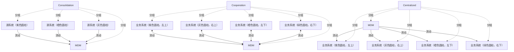

# G21B/fig6-1 · C-MDM 集成风格

类型：`system-or-data-reference-architecture`。在第 6.1.1 节用最简的图形区分三种集成风格，重点不在系统数量，而在“谁把数据推给谁、是否双向”：整合式只向上汇聚做分析；协作式双向同步、运营系统仍保留自己的数据；集中式由 MDM 单向分发，MDM 是唯一主数据存储。

英文 PDF 物理页：[49]。本页为架构语义分析，原文与原图分别保留。

## 原图与可编辑图


[完整 JSON](fig6-1.json) · [可编辑 Mermaid](fig6-1.mmd) · [仅关系图](fig6-1.relations.mmd) · [层级分解图](fig6-1.hierarchy.mmd)

图形重建表达语义，不复制源图布局。虚线表示解释、矩阵映射或分组关系，不自动表示不确定性的概率。



## 架构分析

从左到右读三栏，每栏是一种风格。先看栏名（Consolidation / Cooperation / Centralized），再看箭头：整合式的箭头全部指向 MDM；协作式的箭头是双向的；集中式的箭头全部从 MDM 指向外围系统。圆柱只代表数据存储/系统，颜色用于区分不同系统，没有业务含义（原图无图例）。

- 本图有 17 个具名或隐含元素、11 条关系和 14 条包含/分组记录。
- 包含/分组树最大深度为 1；根节点为 整合式、协作式、集中式。
- 本图没有可直接确认为人员直属汇报的关系；视觉上下位置、能力分解和治理职责分别读取。
- 包含分组后有 3 个连通分量；分离可能源于图例、并列分类或独立示例，未自动补边。
- 三种风格全部17个面板/圆柱核对：Consolidation三个来源→MDM，Cooperation四个来源↔MDM，Centralized MDM→四个外围系统。
- 圆柱无名称者只按颜色和位置标识；风格是概念型交换拓扑，不是项目部署资产表。

### 如何用于项目

- 先划定平台边界，登记应用、存储、数据来源及消费者，再逐条读取输入/输出流。
- 区分基线、过渡与目标架构，以及现有、保留与新增对象；范围包含不自动表示组件实现或组织管理。

### 结构所表达的逻辑

- 整合式（又称下游 MDM）：所有系统保留自己的数据，更新被推送到 MDM 中心整合；实现最简单、不影响运营系统，但没有单一事实来源，数据质量难以提升。
- 协作式：所有系统保留自己的数据，更新推送到 MDM 整合后，“新版本的真相”再同步回各系统（按客户 ID），因此画成双向箭头；可在孤岛式信息系统中实现较高质量与治理。
- 集中式：只有 MDM 存储主数据，所有系统从 MDM 获取；更新与创建都经 MDM 发起，因此箭头从 MDM 指向各系统。
- 三种风格不互斥，可以组合；若组织未以集中式起步，通常从整合式开始并向协作式演进。
- 图中整合式画 3 个源系统，协作式与集中式各画 4 个系统，说明后两者覆盖的系统范围更广（运营系统既生产也消费数据）。
- 三种风格的差别是“主数据主控权”的差别，不是集成技术（批量/实时/服务）的差别；技术模式见图 6-2 至 6-5。

## 上下级与包含

三栏并列，没有上下级。每栏内部是一个中心（MDM）与若干外围系统：整合式为 3 个源系统，协作式/集中式为 4 个系统。

|父项|子项|层级类型|依据与解释|
|---|---|---|---|
|整合式|源系统（紫色圆柱）|visual_grouping|框、泳道、域或分类组的成员归属；没有额外证据不提升为业务组合或管理关系。|
|整合式|源系统（橙色圆柱）|visual_grouping|框、泳道、域或分类组的成员归属；没有额外证据不提升为业务组合或管理关系。|
|整合式|源系统（灰色圆柱）|visual_grouping|框、泳道、域或分类组的成员归属；没有额外证据不提升为业务组合或管理关系。|
|整合式|MDM（主数据管理）|visual_grouping|框、泳道、域或分类组的成员归属；没有额外证据不提升为业务组合或管理关系。|
|协作式|MDM（主数据管理）|visual_grouping|框、泳道、域或分类组的成员归属；没有额外证据不提升为业务组合或管理关系。|
|协作式|业务系统（紫色圆柱，左上）|visual_grouping|框、泳道、域或分类组的成员归属；没有额外证据不提升为业务组合或管理关系。|
|协作式|业务系统（灰色圆柱，右上）|visual_grouping|框、泳道、域或分类组的成员归属；没有额外证据不提升为业务组合或管理关系。|
|协作式|业务系统（橙色圆柱，左下）|visual_grouping|框、泳道、域或分类组的成员归属；没有额外证据不提升为业务组合或管理关系。|
|协作式|业务系统（绿色圆柱，右下）|visual_grouping|框、泳道、域或分类组的成员归属；没有额外证据不提升为业务组合或管理关系。|
|集中式|MDM（主数据管理）|visual_grouping|框、泳道、域或分类组的成员归属；没有额外证据不提升为业务组合或管理关系。|
|集中式|业务系统（紫色圆柱，左上）|visual_grouping|框、泳道、域或分类组的成员归属；没有额外证据不提升为业务组合或管理关系。|
|集中式|业务系统（灰色圆柱，右上）|visual_grouping|框、泳道、域或分类组的成员归属；没有额外证据不提升为业务组合或管理关系。|
|集中式|业务系统（橙色圆柱，左下）|visual_grouping|框、泳道、域或分类组的成员归属；没有额外证据不提升为业务组合或管理关系。|
|集中式|业务系统（绿色圆柱，右下）|visual_grouping|框、泳道、域或分类组的成员归属；没有额外证据不提升为业务组合或管理关系。|

## 全部元素与角色

|元素ID|原文名称|类型|含义|直接父项|深度|
|---|---|---|---|---|---|
|style_consolidation|Consolidation|group|分组：整合式|—||
|cons_src_purple|源系统（紫色圆柱）|application|应用：源系统（紫色圆柱）|整合式|1|
|cons_src_orange|源系统（橙色圆柱）|application|应用：源系统（橙色圆柱）|整合式|1|
|cons_src_grey|源系统（灰色圆柱）|application|应用：源系统（灰色圆柱）|整合式|1|
|cons_mdm|MDM|application|应用：MDM（主数据管理）|整合式|1|
|style_cooperation|Cooperation|group|分组：协作式|—||
|coop_mdm|MDM|application|应用：MDM（主数据管理）|协作式|1|
|coop_sys_purple|业务系统（紫色圆柱，左上）|application|应用：业务系统（紫色圆柱，左上）|协作式|1|
|coop_sys_grey|业务系统（灰色圆柱，右上）|application|应用：业务系统（灰色圆柱，右上）|协作式|1|
|coop_sys_orange|业务系统（橙色圆柱，左下）|application|应用：业务系统（橙色圆柱，左下）|协作式|1|
|coop_sys_green|业务系统（绿色圆柱，右下）|application|应用：业务系统（绿色圆柱，右下）|协作式|1|
|style_centralized|Centralized|group|分组：集中式|—||
|cent_mdm|MDM|application|应用：MDM（主数据管理）|集中式|1|
|cent_sys_purple|业务系统（紫色圆柱，左上）|application|应用：业务系统（紫色圆柱，左上）|集中式|1|
|cent_sys_grey|业务系统（灰色圆柱，右上）|application|应用：业务系统（灰色圆柱，右上）|集中式|1|
|cent_sys_orange|业务系统（橙色圆柱，左下）|application|应用：业务系统（橙色圆柱，左下）|集中式|1|
|cent_sys_green|业务系统（绿色圆柱，右下）|application|应用：业务系统（绿色圆柱，右下）|集中式|1|

## 全部关系

箭头表示数据流向与主控关系：单箭头指向 MDM=源系统向 MDM 推送；双箭头=系统与 MDM 双向同步；单箭头从 MDM 指出=MDM 向系统分发。图中没有线型或颜色图例，箭头方向是唯一语义。

|主体|语义关系|客体|显式线/隐式|原文标签|依据|
|---|---|---|---|---|---|
|源系统（紫色圆柱）|流动|MDM（主数据管理）|显式连线||整合式：源系统向 MDM 汇聚。|
|源系统（橙色圆柱）|流动|MDM（主数据管理）|显式连线||整合式：源系统向 MDM 汇聚。|
|源系统（灰色圆柱）|流动|MDM（主数据管理）|显式连线||整合式：源系统向 MDM 汇聚。|
|业务系统（紫色圆柱，左上）|流动|MDM（主数据管理）|显式连线||协作式：系统与 MDM 双向同步。|
|业务系统（灰色圆柱，右上）|流动|MDM（主数据管理）|显式连线||协作式：系统与 MDM 双向同步。|
|业务系统（橙色圆柱，左下）|流动|MDM（主数据管理）|显式连线||协作式：系统与 MDM 双向同步。|
|业务系统（绿色圆柱，右下）|流动|MDM（主数据管理）|显式连线||协作式：系统与 MDM 双向同步。|
|MDM（主数据管理）|流动|业务系统（紫色圆柱，左上）|显式连线||集中式：MDM 向系统单向分发。|
|MDM（主数据管理）|流动|业务系统（灰色圆柱，右上）|显式连线||集中式：MDM 向系统单向分发。|
|MDM（主数据管理）|流动|业务系统（橙色圆柱，左下）|显式连线||集中式：MDM 向系统单向分发。|
|MDM（主数据管理）|流动|业务系统（绿色圆柱，右下）|显式连线||集中式：MDM 向系统单向分发。|

## 误读检查

- 不要把三种风格读成成熟度阶段：它们是可组合的集成风格，图不表示必须从整合式走到集中式。
- 协作式的双箭头不表示“两个主库”：运营系统保留自己的数据，但真相版本由 C-MDM 定义并同步回去。
- 集中式的箭头从 MDM 指向系统，不要反读为系统向 MDM 推送；集中式下创建/更新都通过 MDM 发起。
- 圆柱颜色没有业务含义，原图没有图例；不要按颜色推断系统类型。
- 中文稿引用的 SVG 只是三张文字卡，完全丢失箭头，不能据它理解三种风格的数据流向。

## 原文证据

### [PDF 第 49 页](../../../documents/G21B.md#page-49)

> To support these different integration styles, activation of different integration patterns is needed for each style.
> The relevant pattern to use depends on the usage or business process it needs to support and might be different from one operational application to another.

## 来源与分析状态

所有元素/关系均有来源定位；未把历史解释重命名为本轮逐线视觉确认。源图与语义图是两种视图，布局不证明汇报或因果。

源 PDF SHA-256：`8e64887f7a080d3d882f38078297bd7873a9072b71a12c39b9e77349890f37a2`。

源图记录：[原始解释与转录](../../../figures/G21B/fig6-1.json)。

```json
{
  "quality": {
    "graph_integrity": "checked",
    "semantic_analysis": "typed-graph-and-context-analysis",
    "visual_review": "source-content-audited",
    "notice_zh": "所有元素/关系均有来源定位；未把历史解释重命名为本轮逐线视觉确认。源图与语义图是两种视图，布局不证明汇报或因果。"
  },
  "source_uncertainty": {
    "confidence": "high",
    "uncertainties_zh": [
      "外围圆柱没有标签，无法判断它们具体代表哪些系统；只能按“业务/运营系统”描述。",
      "原图没有图例说明颜色，颜色可能只是区分不同系统，本分析不赋予业务含义。"
    ],
    "analyzed_from": [
      "英文 PDF 第 49 页原图截图",
      "英文 PDF 第 49–50 页正文",
      "中文稿 G21Be_信息架构_客户主数据管理.md 第 752–756 行",
      "figs/g21b_fig6-1.svg 源码与渲染图"
    ],
    "date": "2026-10-31"
  },
  "source_conflicts": []
}
```
