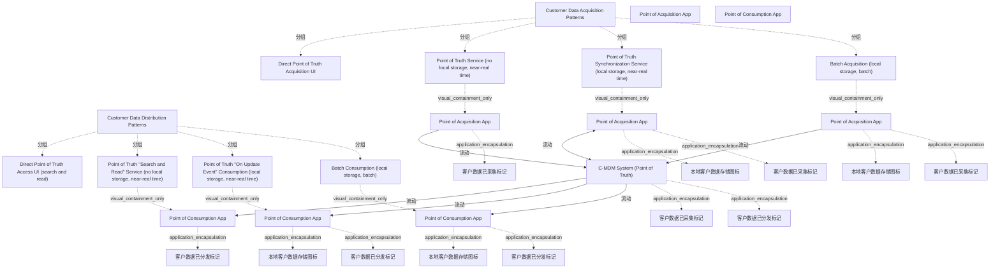

# G21B/fig6-2 · C-MDM 数据交换类型概览

类型：`mapping-or-assessment-matrix`。第 6.1.2 节说明：不同集成风格需要不同的交换模式。本图给出客户数据采集点（PoA）到 C-MDM、C-MDM 到消费点（PoC）的模式全集，并按“有无本地存储、实时性、批量/服务”三个维度排成矩阵，供架构师按用途选择。

英文 PDF 物理页：[50]。本页为架构语义分析，原文与原图分别保留。

## 原图与可编辑图


[完整 JSON](fig6-2.json) · [可编辑 Mermaid](fig6-2.mmd) · [仅关系图](fig6-2.relations.mmd) · [层级分解图](fig6-2.hierarchy.mmd)

图形重建表达语义，不复制源图布局。虚线表示解释、矩阵映射或分组关系，不自动表示不确定性的概率。



## 架构分析

先看中间蓝色横带 C-MDM System (Point of Truth)，它是所有模式的中心。上半部分（Customer Data Acquisition Patterns）读采集：从左到右四种方式——直接 UI（无 App、直接在 C-MDM 界面录入）、真相点服务（App 无本地存储、近实时）、真相点同步服务（App 有本地存储、近实时）、批量获取（App 有本地存储、批量）。下半部分（Distribution Patterns）同样四种：直接访问 UI、搜索与读取服务、更新事件消费、批量消费。每个格子顶部的小标题给出该模式的关键约束（no local storage / local storage, near-real time / local storage, batch），箭头方向表示数据流入或流出 C-MDM。

- 本图有 31 个具名或隐含元素、6 条关系和 26 条包含/分组记录。
- 包含/分组树最大深度为 3；根节点为 客户数据采集模式、客户数据分发模式、C-MDM 系统（真相点）、采集点应用、消费点应用。
- 本图没有可直接确认为人员直属汇报的关系；视觉上下位置、能力分解和治理职责分别读取。
- 包含分组后有 3 个连通分量；分离可能源于图例、并列分类或独立示例，未自动补边。
- 完整核对8种模式文字、六个应用框、四个本地存储圆柱、八个数据状态符号及六条传输连线。
- 为六个同名应用建立按模式分离的实例，避免把模式选择画成同一应用的并发重复流。
- Point of Truth Synchronization Service连线是双向，其余五条有应用的流为单向。Direct UI两列没有独立应用或箭头。

### 如何用于项目

- 先固定行、列所代表的维度及单元格含义，再登记有证据的映射或评分。
- 空白、无关系、未测量和不适用分别处理；颜色不自动等于优先级。

### 结构所表达的逻辑

- 采集 4 种：Direct Point of Truth Acquisition UI、Point of Truth Service、Point of Truth Synchronization Service、Batch Acquisition。
- 分发 4 种：Direct Point of Truth Access UI (search and read)、Point of Truth “Search and Read” Service、Point of Truth “On Update Event” Consumption、Batch Consumption。
- 三种“服务型”模式（第 2、3 列）的区别在本地存储与实时性：第 2 列无本地存储、近实时；第 3 列有本地存储、近实时（同步服务/更新事件消费）。
- 批量模式（第 4 列）有本地存储、按批处理，适合分析型整合，不适合与客户的运营交互。
- 直接 UI 模式（第 1 列）没有独立的采集/消费 App 框：用户直接在 C-MDM 界面上操作或查询，因此 C-MDM 带内只有一个青色/橙色数据球。
- 每个 App 框旁的圆柱表示本地存储；青色球=已采集客户数据，橙色球=已分发客户数据，箭头=客户数据流（见图例）。
- 本图只给模式全集，不指定哪种风格用哪些模式；具体映射见图 6-3（整合式）、图 6-4（协作式）、图 6-5（集中式）。

## 上下级与包含

两层：第 1 层是采集模式与分发模式两个大类（左侧紫色竖栏）；第 2 层是各自 4 种具体模式（4 列）。中央的 C-MDM System 是所有模式共同的中心，不属于某一列。

|父项|子项|层级类型|依据与解释|
|---|---|---|---|
|客户数据采集模式|直接真相点采集界面|visual_grouping|框、泳道、域或分类组的成员归属；没有额外证据不提升为业务组合或管理关系。|
|客户数据采集模式|真相点服务（无本地存储，近实时）|visual_grouping|框、泳道、域或分类组的成员归属；没有额外证据不提升为业务组合或管理关系。|
|客户数据采集模式|真相点同步服务（本地存储，近实时）|visual_grouping|框、泳道、域或分类组的成员归属；没有额外证据不提升为业务组合或管理关系。|
|客户数据采集模式|批量获取（本地存储，批处理）|visual_grouping|框、泳道、域或分类组的成员归属；没有额外证据不提升为业务组合或管理关系。|
|客户数据分发模式|直接真相点访问界面（搜索与读取）|visual_grouping|框、泳道、域或分类组的成员归属；没有额外证据不提升为业务组合或管理关系。|
|客户数据分发模式|真相点“搜索与读取”服务（无本地存储，近实时）|visual_grouping|框、泳道、域或分类组的成员归属；没有额外证据不提升为业务组合或管理关系。|
|客户数据分发模式|真相点“更新事件”消费（本地存储，近实时）|visual_grouping|框、泳道、域或分类组的成员归属；没有额外证据不提升为业务组合或管理关系。|
|客户数据分发模式|批量消费（本地存储，批处理）|visual_grouping|框、泳道、域或分类组的成员归属；没有额外证据不提升为业务组合或管理关系。|
|真相点服务（无本地存储，近实时）|采集点应用|visual_containment_only|保存原图解释中的包含；业务关系类型需要图例或正文进一步限定。|
|真相点同步服务（本地存储，近实时）|采集点应用|visual_containment_only|保存原图解释中的包含；业务关系类型需要图例或正文进一步限定。|
|采集点应用|本地客户数据存储图标|application_encapsulation|应用组件包含其数据、行为或子组件。|
|批量获取（本地存储，批处理）|采集点应用|visual_containment_only|保存原图解释中的包含；业务关系类型需要图例或正文进一步限定。|
|采集点应用|本地客户数据存储图标|application_encapsulation|应用组件包含其数据、行为或子组件。|
|真相点“搜索与读取”服务（无本地存储，近实时）|消费点应用|visual_containment_only|保存原图解释中的包含；业务关系类型需要图例或正文进一步限定。|
|真相点“更新事件”消费（本地存储，近实时）|消费点应用|visual_containment_only|保存原图解释中的包含；业务关系类型需要图例或正文进一步限定。|
|消费点应用|本地客户数据存储图标|application_encapsulation|应用组件包含其数据、行为或子组件。|
|批量消费（本地存储，批处理）|消费点应用|visual_containment_only|保存原图解释中的包含；业务关系类型需要图例或正文进一步限定。|
|消费点应用|本地客户数据存储图标|application_encapsulation|应用组件包含其数据、行为或子组件。|
|C-MDM 系统（真相点）|客户数据已采集标记|application_encapsulation|应用组件包含其数据、行为或子组件。|
|采集点应用|客户数据已采集标记|application_encapsulation|应用组件包含其数据、行为或子组件。|
|采集点应用|客户数据已采集标记|application_encapsulation|应用组件包含其数据、行为或子组件。|
|采集点应用|客户数据已采集标记|application_encapsulation|应用组件包含其数据、行为或子组件。|
|C-MDM 系统（真相点）|客户数据已分发标记|application_encapsulation|应用组件包含其数据、行为或子组件。|
|消费点应用|客户数据已分发标记|application_encapsulation|应用组件包含其数据、行为或子组件。|
|消费点应用|客户数据已分发标记|application_encapsulation|应用组件包含其数据、行为或子组件。|
|消费点应用|客户数据已分发标记|application_encapsulation|应用组件包含其数据、行为或子组件。|

## 全部元素与角色

|元素ID|原文名称|类型|含义|直接父项|深度|
|---|---|---|---|---|---|
|g_acq_patterns|Customer Data Acquisition Patterns|group|分组：客户数据采集模式|—||
|g_dist_patterns|Customer Data Distribution Patterns|group|分组：客户数据分发模式|—||
|c_mdm|C-MDM System (Point of Truth)|application|应用：C-MDM 系统（真相点）|—||
|a1|Direct Point of Truth Acquisition UI|service|服务：直接真相点采集界面|客户数据采集模式|1|
|a2|Point of Truth Service (no local storage, near-real time)|service|服务：真相点服务（无本地存储，近实时）|客户数据采集模式|1|
|a3|Point of Truth Synchronization Service (local storage, near-real time)|service|服务：真相点同步服务（本地存储，近实时）|客户数据采集模式|1|
|a4|Batch Acquisition (local storage, batch)|service|服务：批量获取（本地存储，批处理）|客户数据采集模式|1|
|d1|Direct Point of Truth Access UI (search and read)|service|服务：直接真相点访问界面（搜索与读取）|客户数据分发模式|1|
|d2|Point of Truth "Search and Read" Service (no local storage, near-real time)|service|服务：真相点“搜索与读取”服务（无本地存储，近实时）|客户数据分发模式|1|
|d3|Point of Truth "On Update Event" Consumption (local storage, near-real time)|service|服务：真相点“更新事件”消费（本地存储，近实时）|客户数据分发模式|1|
|d4|Batch Consumption (local storage, batch)|service|服务：批量消费（本地存储，批处理）|客户数据分发模式|1|
|poa_app|Point of Acquisition App|concept|采集应用图形类别，具体实例分别见a2_app/a3_app/a4_app。|—||
|poc_app|Point of Consumption App|concept|消费应用图形类别，具体实例分别见d2_app/d3_app/d4_app。|—||
|a2_app|Point of Acquisition App|application|该交换模式中的独立应用图形；不能与其他模式的同名应用合并。|真相点服务（无本地存储，近实时）|2|
|a3_app|Point of Acquisition App|application|该交换模式中的独立应用图形；不能与其他模式的同名应用合并。|真相点同步服务（本地存储，近实时）|2|
|a3_local_storage|本地客户数据存储图标|data|本模式应用内部蓝色圆柱；图例定义Customer Data Storage，不代表独立命名数据库。|采集点应用|3|
|a4_app|Point of Acquisition App|application|该交换模式中的独立应用图形；不能与其他模式的同名应用合并。|批量获取（本地存储，批处理）|2|
|a4_local_storage|本地客户数据存储图标|data|本模式应用内部蓝色圆柱；图例定义Customer Data Storage，不代表独立命名数据库。|采集点应用|3|
|d2_app|Point of Consumption App|application|该交换模式中的独立应用图形；不能与其他模式的同名应用合并。|真相点“搜索与读取”服务（无本地存储，近实时）|2|
|d3_app|Point of Consumption App|application|该交换模式中的独立应用图形；不能与其他模式的同名应用合并。|真相点“更新事件”消费（本地存储，近实时）|2|
|d3_local_storage|本地客户数据存储图标|data|本模式应用内部蓝色圆柱；图例定义Customer Data Storage，不代表独立命名数据库。|消费点应用|3|
|d4_app|Point of Consumption App|application|该交换模式中的独立应用图形；不能与其他模式的同名应用合并。|批量消费（本地存储，批处理）|2|
|d4_local_storage|本地客户数据存储图标|data|本模式应用内部蓝色圆柱；图例定义Customer Data Storage，不代表独立命名数据库。|消费点应用|3|
|a1_data_marker|客户数据已采集标记|data|源图图例Customer Data Acquired/Distributed的实例；不是独立命名业务实体。|C-MDM 系统（真相点）|1|
|a2_data_marker|客户数据已采集标记|data|源图图例Customer Data Acquired/Distributed的实例；不是独立命名业务实体。|采集点应用|3|
|a3_data_marker|客户数据已采集标记|data|源图图例Customer Data Acquired/Distributed的实例；不是独立命名业务实体。|采集点应用|3|
|a4_data_marker|客户数据已采集标记|data|源图图例Customer Data Acquired/Distributed的实例；不是独立命名业务实体。|采集点应用|3|
|d1_data_marker|客户数据已分发标记|data|源图图例Customer Data Acquired/Distributed的实例；不是独立命名业务实体。|C-MDM 系统（真相点）|1|
|d2_data_marker|客户数据已分发标记|data|源图图例Customer Data Acquired/Distributed的实例；不是独立命名业务实体。|消费点应用|3|
|d3_data_marker|客户数据已分发标记|data|源图图例Customer Data Acquired/Distributed的实例；不是独立命名业务实体。|消费点应用|3|
|d4_data_marker|客户数据已分发标记|data|源图图例Customer Data Acquired/Distributed的实例；不是独立命名业务实体。|消费点应用|3|

## 全部关系

矩阵采集第2、4列为应用→C-MDM，第3列同步服务为应用↔C-MDM；分发第2–4列为C-MDM→应用；Direct UI列没有单独应用或连线。红框仅表示选中的模式，虚线格界和图标不表示流向。

|主体|语义关系|客体|显式线/隐式|原文标签|依据|
|---|---|---|---|---|---|
|采集点应用|流动|C-MDM 系统（真相点）|显式连线|Customer Data Flow|按模式列分开三个同名应用实例，保留实际连线端点。|
|采集点应用|流动|C-MDM 系统（真相点）|显式连线|Customer Data Flow|按模式列分开三个同名应用实例，保留实际连线端点。 Synchronization Service连线双端有箭头。|
|采集点应用|流动|C-MDM 系统（真相点）|显式连线|Customer Data Flow|按模式列分开三个同名应用实例，保留实际连线端点。|
|C-MDM 系统（真相点）|流动|消费点应用|显式连线|Customer Data Flow|按模式列分开三个同名应用实例，保留实际连线端点。|
|C-MDM 系统（真相点）|流动|消费点应用|显式连线|Customer Data Flow|按模式列分开三个同名应用实例，保留实际连线端点。|
|C-MDM 系统（真相点）|流动|消费点应用|显式连线|Customer Data Flow|按模式列分开三个同名应用实例，保留实际连线端点。|

## 8 种数据交换模式及约束（按原图逐格转录）

```json
{
  "id": "t_patterns",
  "title_zh": "8 种数据交换模式及约束（按原图逐格转录）",
  "columns": [
    "方向",
    "模式",
    "本地存储",
    "实时性",
    "模式类型"
  ],
  "rows": [
    [
      "采集 Acquisition",
      "Direct Point of Truth Acquisition UI",
      "无独立 App 框",
      "直接操作",
      "直接 UI"
    ],
    [
      "采集 Acquisition",
      "Point of Truth Service",
      "无本地存储",
      "近实时",
      "服务"
    ],
    [
      "采集 Acquisition",
      "Point of Truth Synchronization Service",
      "本地存储",
      "近实时",
      "同步服务"
    ],
    [
      "采集 Acquisition",
      "Batch Acquisition",
      "本地存储",
      "批量",
      "批量"
    ],
    [
      "分发 Distribution",
      "Direct Point of Truth Access UI (search and read)",
      "无独立 App 框",
      "直接查询",
      "直接 UI"
    ],
    [
      "分发 Distribution",
      "Point of Truth \"Search and Read\" Service",
      "无本地存储",
      "近实时",
      "服务"
    ],
    [
      "分发 Distribution",
      "Point of Truth \"On Update Event\" Consumption",
      "本地存储",
      "近实时",
      "事件消费"
    ],
    [
      "分发 Distribution",
      "Batch Consumption",
      "本地存储",
      "批量",
      "批量"
    ]
  ],
  "cell_legend": [
    "无本地存储/本地存储：PoA/PoC 应用是否落地保存客户数据",
    "近实时/批量：交换的时间特性"
  ],
  "notes_zh": "第 1 列（Direct UI）没有 Point of Acquisition/Consumption App 框，因此“本地存储”列记为无独立 App 框。"
}
```

## 本轮语义修正

- 按模式列分开三个同名应用实例，保留实际连线端点。
- 按模式列分开三个同名应用实例，保留实际连线端点。 Synchronization Service连线双端有箭头。
- 按模式列分开三个同名应用实例，保留实际连线端点。
- 按模式列分开三个同名应用实例，保留实际连线端点。
- 按模式列分开三个同名应用实例，保留实际连线端点。
- 按模式列分开三个同名应用实例，保留实际连线端点。

## 误读检查

- 不要把 4 列读成四个步骤或成熟度等级：它们是可选的交换模式，按用途选用。
- “no local storage”指 PoA/PoC 应用不落地保存客户数据，不是 C-MDM 不存储。
- 第 1 列的 Direct UI 没有箭头，不代表没有数据流：用户直接在 C-MDM 界面读写，所以只画数据球。
- 青色球与橙色球不是状态好坏：青色=已采集，橙色=已分发。
- 中文稿引用的 SVG 把 8 种模式压缩成一条 PoA→MDM→PoC 链，不能据它选择集成模式。

## 原文证据

### [PDF 第 50 页](../../../documents/G21B.md#page-50)

> These different kinds of patterns can be put in place step-by-step in the different stages of the C-MDM architecture roadmap.
> Patterns to use for the consolidation style are the Batch Acquisition and Batch Consumption patterns (see Figure 6-3), which support customer data consolidation for analytical use cases but not operational interactions with customers.

## 来源与分析状态

所有元素/关系均有来源定位；未把历史解释重命名为本轮逐线视觉确认。源图与语义图是两种视图，布局不证明汇报或因果。

源 PDF SHA-256：`8e64887f7a080d3d882f38078297bd7873a9072b71a12c39b9e77349890f37a2`。

源图记录：[原始解释与转录](../../../figures/G21B/fig6-2.json)。

```json
{
  "quality": {
    "graph_integrity": "checked",
    "semantic_analysis": "typed-graph-and-context-analysis",
    "visual_review": "source-content-audited",
    "notice_zh": "所有元素/关系均有来源定位；未把历史解释重命名为本轮逐线视觉确认。源图与语义图是两种视图，布局不证明汇报或因果。"
  },
  "source_uncertainty": {
    "confidence": "high",
    "uncertainties_zh": [
      "第 1 列 Direct UI 的箭头在原图中不可见（只有 C-MDM 带内的数据球），本分析未为它编造箭头。",
      "原图未说明“Point of Truth Service”与“Synchronization Service”的实现差异（如 API 调用 vs 消息订阅），只能按“本地存储/近实时”两个维度描述。"
    ],
    "analyzed_from": [
      "英文 PDF 第 50 页原图截图",
      "英文 PDF 第 50 页正文",
      "中文稿 G21Be_信息架构_客户主数据管理.md 第 762–777 行",
      "figs/g21b_fig6-2.svg 源码与渲染图"
    ],
    "date": "2026-10-31"
  },
  "source_conflicts": []
}
```
