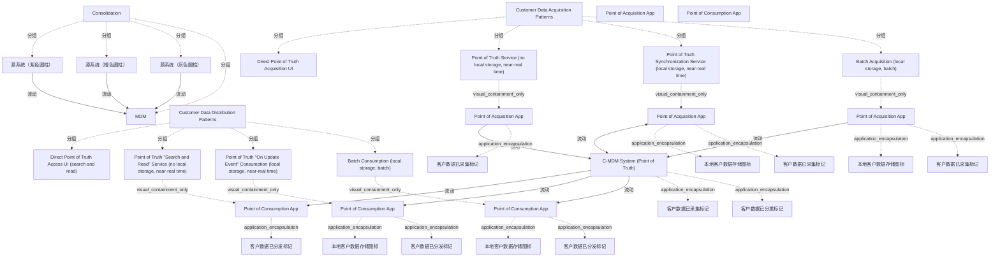

# G21B/fig6-3 · 整合式风格模式

类型：`mapping-or-assessment-matrix`。把“整合式”这一集成风格落到具体交换模式：它只用批量获取（Batch Acquisition）与批量消费（Batch Consumption），因此能支持分析型客户数据整合，但不能支持与客户的运营交互。左侧小图同时提醒整合式的数据方向是“多源→MDM”。

英文 PDF 物理页：[51]。本页为架构语义分析，原文与原图分别保留。

## 原图与可编辑图


[完整 JSON](fig6-3.json) · [可编辑 Mermaid](fig6-3.mmd) · [仅关系图](fig6-3.relations.mmd) · [层级分解图](fig6-3.hierarchy.mmd)

图形重建表达语义，不复制源图布局。虚线表示解释、矩阵映射或分组关系，不自动表示不确定性的概率。



## 架构分析

先看左侧小图 Consolidation：三个源系统都指向 MDM，表示数据单向汇聚。再看右侧矩阵：红框只围住第 4 列，上格是 Batch Acquisition（采集端批量），下格是 Batch Consumption（分发端批量）；其余 6 种模式不在红框内，表示整合式不用它们。

- 本图有 36 个具名或隐含元素、9 条关系和 30 条包含/分组记录。
- 包含/分组树最大深度为 3；根节点为 整合式小图、客户数据采集模式、客户数据分发模式、C-MDM 系统（真相点）、采集点应用、消费点应用。
- 本图没有可直接确认为人员直属汇报的关系；视觉上下位置、能力分解和治理职责分别读取。
- 包含分组后有 4 个连通分量；分离可能源于图例、并列分类或独立示例，未自动补边。
- 逐一核对左侧风格图、八种模式全部文字、六个独立应用、四个存储圆柱、八个数据标记、全部连线及红框范围。
- 将按列重复的同名应用拆为独立实例；修正同步服务的双向箭头。
- 选用模式与完整背景矩阵分开记录；相邻正文的未提及不解释为源图错误。

### 如何用于项目

- 先固定行、列所代表的维度及单元格含义，再登记有证据的映射或评分。
- 空白、无关系、未测量和不适用分别处理；颜色不自动等于优先级。

### 结构所表达的逻辑

- 整合式使用 Batch Acquisition + Batch Consumption 两种模式，均为“本地存储、批处理”。
- 批量模式适合分析型用例（细分、市场份额、C360 等），不适合与客户的实时/运营交互。
- 左侧小图显示整合式有 3 个源系统向 MDM 汇聚，MDM 不反向写回源系统。
- 红框是“本风格选用的模式”标注，不是警告或错误标记。
- 与图 6-2 相比，本图只增加了红框与左侧风格小图，矩阵内容完全相同。

## 上下级与包含

两层：上方矩阵的采集/分发两大类与 8 个模式；左侧小图是风格级示意（3 源系统 + MDM），不参与矩阵层级。

|父项|子项|层级类型|依据与解释|
|---|---|---|---|
|整合式小图|源系统（紫色圆柱）|visual_grouping|框、泳道、域或分类组的成员归属；没有额外证据不提升为业务组合或管理关系。|
|整合式小图|源系统（橙色圆柱）|visual_grouping|框、泳道、域或分类组的成员归属；没有额外证据不提升为业务组合或管理关系。|
|整合式小图|源系统（灰色圆柱）|visual_grouping|框、泳道、域或分类组的成员归属；没有额外证据不提升为业务组合或管理关系。|
|整合式小图|MDM|visual_grouping|框、泳道、域或分类组的成员归属；没有额外证据不提升为业务组合或管理关系。|
|客户数据采集模式|直接真相点采集界面|visual_grouping|框、泳道、域或分类组的成员归属；没有额外证据不提升为业务组合或管理关系。|
|客户数据采集模式|真相点服务（无本地存储，近实时）|visual_grouping|框、泳道、域或分类组的成员归属；没有额外证据不提升为业务组合或管理关系。|
|客户数据采集模式|真相点同步服务（本地存储，近实时）|visual_grouping|框、泳道、域或分类组的成员归属；没有额外证据不提升为业务组合或管理关系。|
|客户数据采集模式|批量获取（本地存储，批处理）|visual_grouping|框、泳道、域或分类组的成员归属；没有额外证据不提升为业务组合或管理关系。|
|客户数据分发模式|直接真相点访问界面（搜索与读取）|visual_grouping|框、泳道、域或分类组的成员归属；没有额外证据不提升为业务组合或管理关系。|
|客户数据分发模式|真相点“搜索与读取”服务（无本地存储，近实时）|visual_grouping|框、泳道、域或分类组的成员归属；没有额外证据不提升为业务组合或管理关系。|
|客户数据分发模式|真相点“更新事件”消费（本地存储，近实时）|visual_grouping|框、泳道、域或分类组的成员归属；没有额外证据不提升为业务组合或管理关系。|
|客户数据分发模式|批量消费（本地存储，批处理）|visual_grouping|框、泳道、域或分类组的成员归属；没有额外证据不提升为业务组合或管理关系。|
|真相点服务（无本地存储，近实时）|采集点应用|visual_containment_only|保存原图解释中的包含；业务关系类型需要图例或正文进一步限定。|
|真相点同步服务（本地存储，近实时）|采集点应用|visual_containment_only|保存原图解释中的包含；业务关系类型需要图例或正文进一步限定。|
|采集点应用|本地客户数据存储图标|application_encapsulation|应用组件包含其数据、行为或子组件。|
|批量获取（本地存储，批处理）|采集点应用|visual_containment_only|保存原图解释中的包含；业务关系类型需要图例或正文进一步限定。|
|采集点应用|本地客户数据存储图标|application_encapsulation|应用组件包含其数据、行为或子组件。|
|真相点“搜索与读取”服务（无本地存储，近实时）|消费点应用|visual_containment_only|保存原图解释中的包含；业务关系类型需要图例或正文进一步限定。|
|真相点“更新事件”消费（本地存储，近实时）|消费点应用|visual_containment_only|保存原图解释中的包含；业务关系类型需要图例或正文进一步限定。|
|消费点应用|本地客户数据存储图标|application_encapsulation|应用组件包含其数据、行为或子组件。|
|批量消费（本地存储，批处理）|消费点应用|visual_containment_only|保存原图解释中的包含；业务关系类型需要图例或正文进一步限定。|
|消费点应用|本地客户数据存储图标|application_encapsulation|应用组件包含其数据、行为或子组件。|
|C-MDM 系统（真相点）|客户数据已采集标记|application_encapsulation|应用组件包含其数据、行为或子组件。|
|采集点应用|客户数据已采集标记|application_encapsulation|应用组件包含其数据、行为或子组件。|
|采集点应用|客户数据已采集标记|application_encapsulation|应用组件包含其数据、行为或子组件。|
|采集点应用|客户数据已采集标记|application_encapsulation|应用组件包含其数据、行为或子组件。|
|C-MDM 系统（真相点）|客户数据已分发标记|application_encapsulation|应用组件包含其数据、行为或子组件。|
|消费点应用|客户数据已分发标记|application_encapsulation|应用组件包含其数据、行为或子组件。|
|消费点应用|客户数据已分发标记|application_encapsulation|应用组件包含其数据、行为或子组件。|
|消费点应用|客户数据已分发标记|application_encapsulation|应用组件包含其数据、行为或子组件。|

## 全部元素与角色

|元素ID|原文名称|类型|含义|直接父项|深度|
|---|---|---|---|---|---|
|style_mini|Consolidation|group|分组：整合式小图|—||
|mini_src_purple|源系统（紫色圆柱）|application|应用：源系统（紫色圆柱）|整合式小图|1|
|mini_src_orange|源系统（橙色圆柱）|application|应用：源系统（橙色圆柱）|整合式小图|1|
|mini_src_grey|源系统（灰色圆柱）|application|应用：源系统（灰色圆柱）|整合式小图|1|
|mini_mdm|MDM|application|应用：MDM|整合式小图|1|
|g_acq_patterns|Customer Data Acquisition Patterns|group|分组：客户数据采集模式|—||
|g_dist_patterns|Customer Data Distribution Patterns|group|分组：客户数据分发模式|—||
|c_mdm|C-MDM System (Point of Truth)|application|应用：C-MDM 系统（真相点）|—||
|a1|Direct Point of Truth Acquisition UI|service|服务：直接真相点采集界面|客户数据采集模式|1|
|a2|Point of Truth Service (no local storage, near-real time)|service|服务：真相点服务（无本地存储，近实时）|客户数据采集模式|1|
|a3|Point of Truth Synchronization Service (local storage, near-real time)|service|服务：真相点同步服务（本地存储，近实时）|客户数据采集模式|1|
|a4|Batch Acquisition (local storage, batch)|service|本图被红框圈住。|客户数据采集模式|1|
|d1|Direct Point of Truth Access UI (search and read)|service|服务：直接真相点访问界面（搜索与读取）|客户数据分发模式|1|
|d2|Point of Truth "Search and Read" Service (no local storage, near-real time)|service|服务：真相点“搜索与读取”服务（无本地存储，近实时）|客户数据分发模式|1|
|d3|Point of Truth "On Update Event" Consumption (local storage, near-real time)|service|服务：真相点“更新事件”消费（本地存储，近实时）|客户数据分发模式|1|
|d4|Batch Consumption (local storage, batch)|service|本图被红框圈住。|客户数据分发模式|1|
|poa_app|Point of Acquisition App|concept|采集应用图形类别，具体实例分别见a2_app/a3_app/a4_app。|—||
|poc_app|Point of Consumption App|concept|消费应用图形类别，具体实例分别见d2_app/d3_app/d4_app。|—||
|a2_app|Point of Acquisition App|application|该交换模式中的独立应用图形；不能与其他模式的同名应用合并。|真相点服务（无本地存储，近实时）|2|
|a3_app|Point of Acquisition App|application|该交换模式中的独立应用图形；不能与其他模式的同名应用合并。|真相点同步服务（本地存储，近实时）|2|
|a3_local_storage|本地客户数据存储图标|data|本模式应用内部蓝色圆柱；图例定义Customer Data Storage，不代表独立命名数据库。|采集点应用|3|
|a4_app|Point of Acquisition App|application|该交换模式中的独立应用图形；不能与其他模式的同名应用合并。|批量获取（本地存储，批处理）|2|
|a4_local_storage|本地客户数据存储图标|data|本模式应用内部蓝色圆柱；图例定义Customer Data Storage，不代表独立命名数据库。|采集点应用|3|
|d2_app|Point of Consumption App|application|该交换模式中的独立应用图形；不能与其他模式的同名应用合并。|真相点“搜索与读取”服务（无本地存储，近实时）|2|
|d3_app|Point of Consumption App|application|该交换模式中的独立应用图形；不能与其他模式的同名应用合并。|真相点“更新事件”消费（本地存储，近实时）|2|
|d3_local_storage|本地客户数据存储图标|data|本模式应用内部蓝色圆柱；图例定义Customer Data Storage，不代表独立命名数据库。|消费点应用|3|
|d4_app|Point of Consumption App|application|该交换模式中的独立应用图形；不能与其他模式的同名应用合并。|批量消费（本地存储，批处理）|2|
|d4_local_storage|本地客户数据存储图标|data|本模式应用内部蓝色圆柱；图例定义Customer Data Storage，不代表独立命名数据库。|消费点应用|3|
|a1_data_marker|客户数据已采集标记|data|源图图例Customer Data Acquired/Distributed的实例；不是独立命名业务实体。|C-MDM 系统（真相点）|1|
|a2_data_marker|客户数据已采集标记|data|源图图例Customer Data Acquired/Distributed的实例；不是独立命名业务实体。|采集点应用|3|
|a3_data_marker|客户数据已采集标记|data|源图图例Customer Data Acquired/Distributed的实例；不是独立命名业务实体。|采集点应用|3|
|a4_data_marker|客户数据已采集标记|data|源图图例Customer Data Acquired/Distributed的实例；不是独立命名业务实体。|采集点应用|3|
|d1_data_marker|客户数据已分发标记|data|源图图例Customer Data Acquired/Distributed的实例；不是独立命名业务实体。|C-MDM 系统（真相点）|1|
|d2_data_marker|客户数据已分发标记|data|源图图例Customer Data Acquired/Distributed的实例；不是独立命名业务实体。|消费点应用|3|
|d3_data_marker|客户数据已分发标记|data|源图图例Customer Data Acquired/Distributed的实例；不是独立命名业务实体。|消费点应用|3|
|d4_data_marker|客户数据已分发标记|data|源图图例Customer Data Acquired/Distributed的实例；不是独立命名业务实体。|消费点应用|3|

## 全部关系

矩阵采集第2、4列为应用→C-MDM，第3列同步服务为应用↔C-MDM；分发第2–4列为C-MDM→应用；Direct UI列没有单独应用或连线。红框仅表示选中的模式，虚线格界和图标不表示流向。

|主体|语义关系|客体|显式线/隐式|原文标签|依据|
|---|---|---|---|---|---|
|源系统（紫色圆柱）|流动|MDM|显式连线||左侧小图：源系统→MDM。|
|源系统（橙色圆柱）|流动|MDM|显式连线||左侧小图：源系统→MDM。|
|源系统（灰色圆柱）|流动|MDM|显式连线||左侧小图：源系统→MDM。|
|采集点应用|流动|C-MDM 系统（真相点）|显式连线||按模式列分开三个同名应用实例，保留实际连线端点。|
|采集点应用|流动|C-MDM 系统（真相点）|显式连线||按模式列分开三个同名应用实例，保留实际连线端点。 Synchronization Service连线双端有箭头。|
|采集点应用|流动|C-MDM 系统（真相点）|显式连线||按模式列分开三个同名应用实例，保留实际连线端点。|
|C-MDM 系统（真相点）|流动|消费点应用|显式连线||按模式列分开三个同名应用实例，保留实际连线端点。|
|C-MDM 系统（真相点）|流动|消费点应用|显式连线||按模式列分开三个同名应用实例，保留实际连线端点。|
|C-MDM 系统（真相点）|流动|消费点应用|显式连线||按模式列分开三个同名应用实例，保留实际连线端点。|

## 整合式选用的模式（红框范围）

```json
{
  "id": "t_selected_patterns",
  "title_zh": "整合式选用的模式（红框范围）",
  "columns": [
    "方向",
    "模式",
    "本地存储",
    "实时性"
  ],
  "rows": [
    [
      "采集 Acquisition",
      "Batch Acquisition (local storage, batch)",
      "本地存储",
      "批量"
    ],
    [
      "分发 Distribution",
      "Batch Consumption (local storage, batch)",
      "本地存储",
      "批量"
    ]
  ],
  "cell_legend": [
    "红框=本风格选用"
  ],
  "notes_zh": "红框在像素上覆盖第 4 列的上下两格（x 1197–1507，y 15–731）。"
}
```

## 本轮语义修正

- 按模式列分开三个同名应用实例，保留实际连线端点。
- 按模式列分开三个同名应用实例，保留实际连线端点。 Synchronization Service连线双端有箭头。
- 按模式列分开三个同名应用实例，保留实际连线端点。
- 按模式列分开三个同名应用实例，保留实际连线端点。
- 按模式列分开三个同名应用实例，保留实际连线端点。
- 按模式列分开三个同名应用实例，保留实际连线端点。

## 误读检查

- 红框不是“高风险”或“不推荐”，只是标出整合式选用的两种模式。
- 整合式并非“没有分发”：它用批量消费把整合结果发给分析用户，只是不写回运营系统。
- 不要因为红框只在第 4 列就认为其他模式不存在；它们仍可选，只是不属于整合式。
- 左侧小图与图 6-1 的整合式相同，但本图多了交换模式矩阵，二者应结合看。

## 原文证据

### [PDF 第 50 页](../../../documents/G21B.md#page-50)

> Patterns to use for the consolidation style are the Batch Acquisition and Batch Consumption patterns (see Figure 6-3), which support customer data consolidation for analytical use cases but not operational interactions with customers.
### [PDF 第 51 页](../../../documents/G21B.md#page-51)

> Patterns to use for the cooperation style are data “synchronization” management between primary source and replica sources (see Figure 6-4). The operational system should be aligned to the C-MDM truth, but potentially with some latency regarding exchange frequencies/architecture.

## 来源与分析状态

所有元素/关系均有来源定位；未把历史解释重命名为本轮逐线视觉确认。源图与语义图是两种视图，布局不证明汇报或因果。

源 PDF SHA-256：`8e64887f7a080d3d882f38078297bd7873a9072b71a12c39b9e77349890f37a2`。

源图记录：[原始解释与转录](../../../figures/G21B/fig6-3.json)。

```json
{
  "quality": {
    "graph_integrity": "checked",
    "semantic_analysis": "typed-graph-and-context-analysis",
    "visual_review": "source-content-audited",
    "notice_zh": "所有元素/关系均有来源定位；未把历史解释重命名为本轮逐线视觉确认。源图与语义图是两种视图，布局不证明汇报或因果。"
  },
  "source_uncertainty": {
    "confidence": "high",
    "uncertainties_zh": [
      "左侧小图的源系统圆柱无标签，颜色仅作区分。",
      "第 1 列 Direct UI 仍无箭头，与图 6-2 一致。"
    ],
    "analyzed_from": [
      "英文 PDF 第 51 页原图截图",
      "英文 PDF 第 50–51 页正文",
      "中文稿第 775 行（整合式说明）；图 6-3 本身未被中文稿引用"
    ],
    "date": "2026-10-31"
  },
  "source_conflicts": []
}
```
