# G21B/fig6-5 · 集中式风格模式

类型：`mapping-or-assessment-matrix`。把“集中式”落到交换模式：所有更新与创建都经 C-MDM 的真相点系统与服务发起（采集只保留直接 UI 与 Point of Truth Service），分发覆盖全部四种模式（直接访问、搜索读取、更新事件消费、批量消费）；左侧小图用 MDM 向外的单向箭头强调“唯一主数据存储”。

英文 PDF 物理页：[52]。本页为架构语义分析，原文与原图分别保留。

## 原图与可编辑图


[完整 JSON](fig6-5.json) · [可编辑 Mermaid](fig6-5.mmd) · [仅关系图](fig6-5.relations.mmd) · [层级分解图](fig6-5.hierarchy.mmd)

图形重建表达语义，不复制源图布局。虚线表示解释、矩阵映射或分组关系，不自动表示不确定性的概率。

```mermaid
flowchart TB
  %% Semantic reconstruction; see original source image for exact layout.
  n0["Centralized"]
  n1["MDM"]
  n2["业务系统（紫色圆柱，左上）"]
  n3["业务系统（灰色圆柱，右上）"]
  n4["业务系统（橙色圆柱，左下）"]
  n5["业务系统（绿色圆柱，右下）"]
  n6["Customer Data Acquisition Patterns"]
  n7["Customer Data Distribution Patterns"]
  n8["C-MDM System (Point of Truth)"]
  n9["Direct Point of Truth Acquisition UI"]
  n10["Point of Truth Service (no local storage, near-real time)"]
  n11["Point of Truth Synchronization Service (local storage, near-real time)"]
  n12["Batch Acquisition (local storage, batch)"]
  n13["Direct Point of Truth Access UI (search and read)"]
  n14["Point of Truth &quot;Search and Read&quot; Service (no local storage, near-real time)"]
  n15["Point of Truth &quot;On Update Event&quot; Consumption (local storage, near-real time)"]
  n16["Batch Consumption (local storage, batch)"]
  n17["Point of Acquisition App"]
  n18["Point of Consumption App"]
  n19["Point of Acquisition App"]
  n20["Point of Acquisition App"]
  n21["本地客户数据存储图标"]
  n22["Point of Acquisition App"]
  n23["本地客户数据存储图标"]
  n24["Point of Consumption App"]
  n25["Point of Consumption App"]
  n26["本地客户数据存储图标"]
  n27["Point of Consumption App"]
  n28["本地客户数据存储图标"]
  n29["客户数据已采集标记"]
  n30["客户数据已采集标记"]
  n31["客户数据已采集标记"]
  n32["客户数据已采集标记"]
  n33["客户数据已分发标记"]
  n34["客户数据已分发标记"]
  n35["客户数据已分发标记"]
  n36["客户数据已分发标记"]
  n1 -->|"流动"| n2
  n1 -->|"流动"| n3
  n1 -->|"流动"| n4
  n1 -->|"流动"| n5
  n19 -->|"流动"| n8
  n20 <-->|"流动"| n8
  n22 -->|"流动"| n8
  n8 -->|"流动"| n24
  n8 -->|"流动"| n25
  n8 -->|"流动"| n27
  n0 -.->|"分组"| n1
  n0 -.->|"分组"| n2
  n0 -.->|"分组"| n3
  n0 -.->|"分组"| n4
  n0 -.->|"分组"| n5
  n6 -.->|"分组"| n9
  n6 -.->|"分组"| n10
  n6 -.->|"分组"| n11
  n6 -.->|"分组"| n12
  n7 -.->|"分组"| n13
  n7 -.->|"分组"| n14
  n7 -.->|"分组"| n15
  n7 -.->|"分组"| n16
  n10 -.->|"visual_containment_only"| n19
  n11 -.->|"visual_containment_only"| n20
  n20 -.->|"application_encapsulation"| n21
  n12 -.->|"visual_containment_only"| n22
  n22 -.->|"application_encapsulation"| n23
  n14 -.->|"visual_containment_only"| n24
  n15 -.->|"visual_containment_only"| n25
  n25 -.->|"application_encapsulation"| n26
  n16 -.->|"visual_containment_only"| n27
  n27 -.->|"application_encapsulation"| n28
  n8 -.->|"application_encapsulation"| n29
  n19 -.->|"application_encapsulation"| n30
  n20 -.->|"application_encapsulation"| n31
  n22 -.->|"application_encapsulation"| n32
  n8 -.->|"application_encapsulation"| n33
  n24 -.->|"application_encapsulation"| n34
  n25 -.->|"application_encapsulation"| n35
  n27 -.->|"application_encapsulation"| n36
```



## 架构分析

先看左侧小图 Centralized：MDM 居中，4 个系统各有一条从 MDM 指向系统的箭头。再看右侧矩阵：上排红框覆盖第 1、2 列（Direct UI + PoT Service），下排红框横跨全部 4 列。含义是：写入口收窄到 C-MDM 服务，读取口保持全部模式。

- 本图有 37 个具名或隐含元素、10 条关系和 31 条包含/分组记录。
- 包含/分组树最大深度为 3；根节点为 集中式小图、客户数据采集模式、客户数据分发模式、C-MDM 系统（真相点）、采集点应用、消费点应用。
- 本图没有可直接确认为人员直属汇报的关系；视觉上下位置、能力分解和治理职责分别读取。
- 包含分组后有 4 个连通分量；分离可能源于图例、并列分类或独立示例，未自动补边。
- 逐一核对左侧风格图、八种模式全部文字、六个独立应用、四个存储圆柱、八个数据标记、全部连线及红框范围。
- 将按列重复的同名应用拆为独立实例；修正同步服务的双向箭头。
- 选用模式与完整背景矩阵分开记录；相邻正文的未提及不解释为源图错误。

### 如何用于项目

- 先固定行、列所代表的维度及单元格含义，再登记有证据的映射或评分。
- 空白、无关系、未测量和不适用分别处理；颜色不自动等于优先级。

### 结构所表达的逻辑

- 集中式的采集只用两种：Direct Point of Truth Acquisition UI（直接在 C-MDM 界面操作）与 Point of Truth Service（通过服务写入）；同步服务与批量获取不再作为写入路径。
- 分发不限制：直接访问、搜索读取、更新事件消费、批量消费四种都可用（下排整行红框）。
- 左侧小图的所有箭头都由 MDM 指向系统，表示系统只从 MDM 取数，不再拥有主数据。
- 正文说明集中式与协作式功能覆盖相同，但从架构与信息系统运营角度更简单、更高效。
- 新应用必须从一开始就依赖 C-MDM；对未按此原则设计的应用改变主数据主控权，代价很高甚至不可行。

## 上下级与包含

两层：矩阵的采集/分发两大类 + 8 个模式；左侧小图是风格级示意，不参与矩阵层级。

|父项|子项|层级类型|依据与解释|
|---|---|---|---|
|集中式小图|MDM|visual_grouping|框、泳道、域或分类组的成员归属；没有额外证据不提升为业务组合或管理关系。|
|集中式小图|业务系统（紫色圆柱，左上）|visual_grouping|框、泳道、域或分类组的成员归属；没有额外证据不提升为业务组合或管理关系。|
|集中式小图|业务系统（灰色圆柱，右上）|visual_grouping|框、泳道、域或分类组的成员归属；没有额外证据不提升为业务组合或管理关系。|
|集中式小图|业务系统（橙色圆柱，左下）|visual_grouping|框、泳道、域或分类组的成员归属；没有额外证据不提升为业务组合或管理关系。|
|集中式小图|业务系统（绿色圆柱，右下）|visual_grouping|框、泳道、域或分类组的成员归属；没有额外证据不提升为业务组合或管理关系。|
|客户数据采集模式|直接真相点采集界面|visual_grouping|框、泳道、域或分类组的成员归属；没有额外证据不提升为业务组合或管理关系。|
|客户数据采集模式|真相点服务（无本地存储，近实时）|visual_grouping|框、泳道、域或分类组的成员归属；没有额外证据不提升为业务组合或管理关系。|
|客户数据采集模式|真相点同步服务（本地存储，近实时）|visual_grouping|框、泳道、域或分类组的成员归属；没有额外证据不提升为业务组合或管理关系。|
|客户数据采集模式|批量获取（本地存储，批处理）|visual_grouping|框、泳道、域或分类组的成员归属；没有额外证据不提升为业务组合或管理关系。|
|客户数据分发模式|直接真相点访问界面（搜索与读取）|visual_grouping|框、泳道、域或分类组的成员归属；没有额外证据不提升为业务组合或管理关系。|
|客户数据分发模式|真相点“搜索与读取”服务（无本地存储，近实时）|visual_grouping|框、泳道、域或分类组的成员归属；没有额外证据不提升为业务组合或管理关系。|
|客户数据分发模式|真相点“更新事件”消费（本地存储，近实时）|visual_grouping|框、泳道、域或分类组的成员归属；没有额外证据不提升为业务组合或管理关系。|
|客户数据分发模式|批量消费（本地存储，批处理）|visual_grouping|框、泳道、域或分类组的成员归属；没有额外证据不提升为业务组合或管理关系。|
|真相点服务（无本地存储，近实时）|采集点应用|visual_containment_only|保存原图解释中的包含；业务关系类型需要图例或正文进一步限定。|
|真相点同步服务（本地存储，近实时）|采集点应用|visual_containment_only|保存原图解释中的包含；业务关系类型需要图例或正文进一步限定。|
|采集点应用|本地客户数据存储图标|application_encapsulation|应用组件包含其数据、行为或子组件。|
|批量获取（本地存储，批处理）|采集点应用|visual_containment_only|保存原图解释中的包含；业务关系类型需要图例或正文进一步限定。|
|采集点应用|本地客户数据存储图标|application_encapsulation|应用组件包含其数据、行为或子组件。|
|真相点“搜索与读取”服务（无本地存储，近实时）|消费点应用|visual_containment_only|保存原图解释中的包含；业务关系类型需要图例或正文进一步限定。|
|真相点“更新事件”消费（本地存储，近实时）|消费点应用|visual_containment_only|保存原图解释中的包含；业务关系类型需要图例或正文进一步限定。|
|消费点应用|本地客户数据存储图标|application_encapsulation|应用组件包含其数据、行为或子组件。|
|批量消费（本地存储，批处理）|消费点应用|visual_containment_only|保存原图解释中的包含；业务关系类型需要图例或正文进一步限定。|
|消费点应用|本地客户数据存储图标|application_encapsulation|应用组件包含其数据、行为或子组件。|
|C-MDM 系统（真相点）|客户数据已采集标记|application_encapsulation|应用组件包含其数据、行为或子组件。|
|采集点应用|客户数据已采集标记|application_encapsulation|应用组件包含其数据、行为或子组件。|
|采集点应用|客户数据已采集标记|application_encapsulation|应用组件包含其数据、行为或子组件。|
|采集点应用|客户数据已采集标记|application_encapsulation|应用组件包含其数据、行为或子组件。|
|C-MDM 系统（真相点）|客户数据已分发标记|application_encapsulation|应用组件包含其数据、行为或子组件。|
|消费点应用|客户数据已分发标记|application_encapsulation|应用组件包含其数据、行为或子组件。|
|消费点应用|客户数据已分发标记|application_encapsulation|应用组件包含其数据、行为或子组件。|
|消费点应用|客户数据已分发标记|application_encapsulation|应用组件包含其数据、行为或子组件。|

## 全部元素与角色

|元素ID|原文名称|类型|含义|直接父项|深度|
|---|---|---|---|---|---|
|style_mini|Centralized|group|分组：集中式小图|—||
|mini_mdm|MDM|application|应用：MDM|集中式小图|1|
|mini_sys_purple|业务系统（紫色圆柱，左上）|application|应用：业务系统（紫色圆柱，左上）|集中式小图|1|
|mini_sys_grey|业务系统（灰色圆柱，右上）|application|应用：业务系统（灰色圆柱，右上）|集中式小图|1|
|mini_sys_orange|业务系统（橙色圆柱，左下）|application|应用：业务系统（橙色圆柱，左下）|集中式小图|1|
|mini_sys_green|业务系统（绿色圆柱，右下）|application|应用：业务系统（绿色圆柱，右下）|集中式小图|1|
|g_acq_patterns|Customer Data Acquisition Patterns|group|分组：客户数据采集模式|—||
|g_dist_patterns|Customer Data Distribution Patterns|group|分组：客户数据分发模式|—||
|c_mdm|C-MDM System (Point of Truth)|application|应用：C-MDM 系统（真相点）|—||
|a1|Direct Point of Truth Acquisition UI|service|本图被红框圈住。|客户数据采集模式|1|
|a2|Point of Truth Service (no local storage, near-real time)|service|本图被红框圈住。|客户数据采集模式|1|
|a3|Point of Truth Synchronization Service (local storage, near-real time)|service|本图未被红框圈住。|客户数据采集模式|1|
|a4|Batch Acquisition (local storage, batch)|service|本图未被红框圈住。|客户数据采集模式|1|
|d1|Direct Point of Truth Access UI (search and read)|service|本图被红框圈住。|客户数据分发模式|1|
|d2|Point of Truth "Search and Read" Service (no local storage, near-real time)|service|本图被红框圈住。|客户数据分发模式|1|
|d3|Point of Truth "On Update Event" Consumption (local storage, near-real time)|service|本图被红框圈住。|客户数据分发模式|1|
|d4|Batch Consumption (local storage, batch)|service|本图被红框圈住。|客户数据分发模式|1|
|poa_app|Point of Acquisition App|concept|采集应用图形类别，具体实例分别见a2_app/a3_app/a4_app。|—||
|poc_app|Point of Consumption App|concept|消费应用图形类别，具体实例分别见d2_app/d3_app/d4_app。|—||
|a2_app|Point of Acquisition App|application|该交换模式中的独立应用图形；不能与其他模式的同名应用合并。|真相点服务（无本地存储，近实时）|2|
|a3_app|Point of Acquisition App|application|该交换模式中的独立应用图形；不能与其他模式的同名应用合并。|真相点同步服务（本地存储，近实时）|2|
|a3_local_storage|本地客户数据存储图标|data|本模式应用内部蓝色圆柱；图例定义Customer Data Storage，不代表独立命名数据库。|采集点应用|3|
|a4_app|Point of Acquisition App|application|该交换模式中的独立应用图形；不能与其他模式的同名应用合并。|批量获取（本地存储，批处理）|2|
|a4_local_storage|本地客户数据存储图标|data|本模式应用内部蓝色圆柱；图例定义Customer Data Storage，不代表独立命名数据库。|采集点应用|3|
|d2_app|Point of Consumption App|application|该交换模式中的独立应用图形；不能与其他模式的同名应用合并。|真相点“搜索与读取”服务（无本地存储，近实时）|2|
|d3_app|Point of Consumption App|application|该交换模式中的独立应用图形；不能与其他模式的同名应用合并。|真相点“更新事件”消费（本地存储，近实时）|2|
|d3_local_storage|本地客户数据存储图标|data|本模式应用内部蓝色圆柱；图例定义Customer Data Storage，不代表独立命名数据库。|消费点应用|3|
|d4_app|Point of Consumption App|application|该交换模式中的独立应用图形；不能与其他模式的同名应用合并。|批量消费（本地存储，批处理）|2|
|d4_local_storage|本地客户数据存储图标|data|本模式应用内部蓝色圆柱；图例定义Customer Data Storage，不代表独立命名数据库。|消费点应用|3|
|a1_data_marker|客户数据已采集标记|data|源图图例Customer Data Acquired/Distributed的实例；不是独立命名业务实体。|C-MDM 系统（真相点）|1|
|a2_data_marker|客户数据已采集标记|data|源图图例Customer Data Acquired/Distributed的实例；不是独立命名业务实体。|采集点应用|3|
|a3_data_marker|客户数据已采集标记|data|源图图例Customer Data Acquired/Distributed的实例；不是独立命名业务实体。|采集点应用|3|
|a4_data_marker|客户数据已采集标记|data|源图图例Customer Data Acquired/Distributed的实例；不是独立命名业务实体。|采集点应用|3|
|d1_data_marker|客户数据已分发标记|data|源图图例Customer Data Acquired/Distributed的实例；不是独立命名业务实体。|C-MDM 系统（真相点）|1|
|d2_data_marker|客户数据已分发标记|data|源图图例Customer Data Acquired/Distributed的实例；不是独立命名业务实体。|消费点应用|3|
|d3_data_marker|客户数据已分发标记|data|源图图例Customer Data Acquired/Distributed的实例；不是独立命名业务实体。|消费点应用|3|
|d4_data_marker|客户数据已分发标记|data|源图图例Customer Data Acquired/Distributed的实例；不是独立命名业务实体。|消费点应用|3|

## 全部关系

矩阵采集第2、4列为应用→C-MDM，第3列同步服务为应用↔C-MDM；分发第2–4列为C-MDM→应用；Direct UI列没有单独应用或连线。红框仅表示选中的模式，虚线格界和图标不表示流向。

|主体|语义关系|客体|显式线/隐式|原文标签|依据|
|---|---|---|---|---|---|
|MDM|流动|业务系统（紫色圆柱，左上）|显式连线||左侧小图：MDM→系统单向分发。|
|MDM|流动|业务系统（灰色圆柱，右上）|显式连线||左侧小图：MDM→系统单向分发。|
|MDM|流动|业务系统（橙色圆柱，左下）|显式连线||左侧小图：MDM→系统单向分发。|
|MDM|流动|业务系统（绿色圆柱，右下）|显式连线||左侧小图：MDM→系统单向分发。|
|采集点应用|流动|C-MDM 系统（真相点）|显式连线||按模式列分开三个同名应用实例，保留实际连线端点。|
|采集点应用|流动|C-MDM 系统（真相点）|显式连线||按模式列分开三个同名应用实例，保留实际连线端点。 Synchronization Service连线双端有箭头。|
|采集点应用|流动|C-MDM 系统（真相点）|显式连线||按模式列分开三个同名应用实例，保留实际连线端点。|
|C-MDM 系统（真相点）|流动|消费点应用|显式连线||按模式列分开三个同名应用实例，保留实际连线端点。|
|C-MDM 系统（真相点）|流动|消费点应用|显式连线||按模式列分开三个同名应用实例，保留实际连线端点。|
|C-MDM 系统（真相点）|流动|消费点应用|显式连线||按模式列分开三个同名应用实例，保留实际连线端点。|

## 集中式选用的模式（红框范围）

```json
{
  "id": "t_selected_patterns",
  "title_zh": "集中式选用的模式（红框范围）",
  "columns": [
    "方向",
    "红框覆盖的列",
    "模式"
  ],
  "rows": [
    [
      "采集 Acquisition",
      "第 1–2 列",
      "Direct Point of Truth Acquisition UI；Point of Truth Service"
    ],
    [
      "分发 Distribution",
      "第 1–4 列（整行）",
      "Direct Point of Truth Access UI；Point of Truth “Search and Read” Service；Point of Truth “On Update Event” Consumption；Batch Consumption"
    ]
  ],
  "cell_legend": [
    "红框=本风格选用"
  ],
  "notes_zh": "红框坐标：上排 x371–915/y15–329；下排 x371–1507/y404–731。"
}
```

## 本轮语义修正

- 按模式列分开三个同名应用实例，保留实际连线端点。
- 按模式列分开三个同名应用实例，保留实际连线端点。 Synchronization Service连线双端有箭头。
- 按模式列分开三个同名应用实例，保留实际连线端点。
- 按模式列分开三个同名应用实例，保留实际连线端点。
- 按模式列分开三个同名应用实例，保留实际连线端点。
- 按模式列分开三个同名应用实例，保留实际连线端点。

## 误读检查

- 下排整行红框不表示“所有模式都必须用”，而是“都可以用”，按消费场景选择。
- 集中式并非没有采集：创建/更新仍通过 C-MDM 的直接 UI 或服务进行，只是不再由运营系统批量推送。
- 左侧小图的单向箭头不表示系统完全不能写：写入必须经 C-MDM 的服务/界面，而不是系统之间直连。
- 红框是“选用”标注，不是警告。

## 原文证据

### [PDF 第 51 页](../../../documents/G21B.md#page-51)

> Patterns to use for the cooperation style are data “synchronization” management between primary source and replica sources (see Figure 6-4). The operational system should be aligned to the C-MDM truth, but potentially with some latency regarding exchange frequencies/architecture.
### [PDF 第 52 页](../../../documents/G21B.md#page-52)

> • All updates and creation initiated through the C-MDM point of truth system and services
> • The same functional coverage as the cooperation style, but less complex and more efficient from the architecture and information system operations point of view

## 来源与分析状态

所有元素/关系均有来源定位；未把历史解释重命名为本轮逐线视觉确认。源图与语义图是两种视图，布局不证明汇报或因果。

源 PDF SHA-256：`8e64887f7a080d3d882f38078297bd7873a9072b71a12c39b9e77349890f37a2`。

源图记录：[原始解释与转录](../../../figures/G21B/fig6-5.json)。

```json
{
  "quality": {
    "graph_integrity": "checked",
    "semantic_analysis": "typed-graph-and-context-analysis",
    "visual_review": "source-content-audited",
    "notice_zh": "所有元素/关系均有来源定位；未把历史解释重命名为本轮逐线视觉确认。源图与语义图是两种视图，布局不证明汇报或因果。"
  },
  "source_uncertainty": {
    "confidence": "high",
    "uncertainties_zh": [
      "左侧小图的系统圆柱无标签，颜色仅作区分。",
      "第 1 列 Direct UI 仍无箭头（与图 6-2 一致），只能通过 C-MDM 带内的数据球识别其存在。"
    ],
    "analyzed_from": [
      "英文 PDF 第 52 页原图截图及 2×2 放大分块",
      "英文 PDF 第 51–52 页正文",
      "中文稿第 777 行（集中式说明）；图 6-5 本身未被中文稿引用",
      "红框像素检测（PIL）结果"
    ],
    "date": "2026-10-31"
  },
  "source_conflicts": []
}
```
