# G21B/tab4-6 · 表 4-6：C-MDM 路线图步骤（plateau）

类型：`mapping-or-assessment-matrix`。把图 4-2 的四个路线图步骤展开成可执行的规划说明：每一步做到什么、支持哪些用例、数据质量达到什么水平、以及什么条件触发进入下一步；嵌入的小图让人不必回看图 4-2 就能看出该步骤的数据流与绿色变化。

英文 PDF 物理页：[34, 35, 36]。本页为架构语义分析，原文与原图分别保留。

## 原图与可编辑图


[完整 JSON](tab4-6.json) · [可编辑 Mermaid](tab4-6.mmd) · [仅关系图](tab4-6.relations.mmd) · [层级分解图](tab4-6.hierarchy.mmd)

图形重建表达语义，不复制源图布局。虚线表示解释、矩阵映射或分组关系，不自动表示不确定性的概率。

```mermaid
flowchart TB
  %% Semantic reconstruction; see original source image for exact layout.
  n0["Step 1: Consolidated Customer Database"]
  n1["Step 2: Non-intrusive Customer Data Point of Truth"]
  n2["Step 3: Master Point of Truth"]
  n3["C-MDM Target"]
  n4["步骤 1 内嵌小图"]
  n5["步骤 2 内嵌小图"]
  n6["步骤 3 内嵌小图"]
  n7["C-MDM 目标内嵌小图"]
  n8["Operational teams"]
  n9["C-MDM central team"]
  n10["Engagement Operational Data"]
  n11["Core Business Operational Data"]
  n12["Kernel Customer Data"]
  n13["Customer ID"]
  n14["Analytics Customer Data"]
  n15["Operational teams"]
  n16["Operational teams"]
  n17["Engagement Operational Data"]
  n18["Core Business Operational Data"]
  n19["Kernel Customer Data"]
  n20["Analytics Customer Data"]
  n21["C-MDM central team (data owners, stewards, etc.)"]
  n22["Operational teams"]
  n23["Operational teams"]
  n24["Engagement Operational Data"]
  n25["Core Business Operational Data"]
  n26["Kernel Customer Data"]
  n27["Analytics Customer Data"]
  n28["C-MDM central team (data owners, stewards, etc.)"]
  n29["Customer ID"]
  n30["Operational teams"]
  n31["Operational teams"]
  n32["Engagement Operational Data"]
  n33["Core Business Operational Data"]
  n34["Kernel Customer Data"]
  n35["Analytics Customer Data"]
  n36["C-MDM central team (data owners, stewards, etc.)"]
  n37["Customer ID"]
  n38["Operational teams"]
  n39["Operational teams"]
  n40["Engagement Operational Data"]
  n41["Core Business Operational Data"]
  n42["Kernel Customer Data"]
  n43["Analytics Customer Data"]
  n44["C-MDM central team (data owners, stewards, etc.)"]
  n45["Customer ID"]
  n15 -->|"流动"| n17
  n15 -->|"流动"| n18
  n17 -->|"流动"| n19
  n18 -->|"流动"| n19
  n19 -->|"流动"| n20
  n19 -->|"流动"| n21
  n20 -->|"流动"| n21
  n20 -->|"流动"| n16
  n22 -->|"流动"| n24
  n22 -->|"流动"| n25
  n24 -->|"流动"| n26
  n25 -->|"流动"| n26
  n26 -->|"流动"| n24
  n26 -->|"流动"| n25
  n28 -->|"流动"| n26
  n28 <-->|"流动"| n22
  n26 -->|"流动"| n27
  n27 -->|"流动"| n28
  n27 -->|"流动"| n23
  n30 -->|"流动"| n32
  n30 -->|"流动"| n33
  n32 <-->|"流动"| n34
  n33 <-->|"流动"| n34
  n30 -->|"流动"| n34
  n34 -->|"流动"| n36
  n36 -->|"流动"| n34
  n34 -->|"流动"| n35
  n35 -->|"流动"| n36
  n35 -->|"流动"| n31
  n38 -->|"流动"| n40
  n38 -->|"流动"| n41
  n38 -->|"流动"| n42
  n40 <-->|"流动"| n42
  n41 <-->|"流动"| n42
  n42 -->|"流动"| n44
  n44 -->|"流动"| n42
  n42 -->|"流动"| n43
  n43 -->|"流动"| n44
  n43 -->|"流动"| n39
  n26 -->|"流动"| n28
  n36 <-->|"流动"| n30
  n44 <-->|"流动"| n38
  n0 -.->|"visual_containment_only"| n4
  n1 -.->|"visual_containment_only"| n5
  n2 -.->|"visual_containment_only"| n6
  n3 -.->|"visual_containment_only"| n7
  n4 -.->|"分组"| n15
  n4 -.->|"分组"| n16
  n4 -.->|"分组"| n17
  n4 -.->|"分组"| n18
  n4 -.->|"分组"| n19
  n4 -.->|"分组"| n20
  n4 -.->|"分组"| n21
  n5 -.->|"分组"| n22
  n5 -.->|"分组"| n23
  n5 -.->|"分组"| n24
  n5 -.->|"分组"| n25
  n5 -.->|"分组"| n26
  n5 -.->|"分组"| n27
  n5 -.->|"分组"| n28
  n26 -.->|"visual_containment_only"| n29
  n6 -.->|"分组"| n30
  n6 -.->|"分组"| n31
  n6 -.->|"分组"| n32
  n6 -.->|"分组"| n33
  n6 -.->|"分组"| n34
  n6 -.->|"分组"| n35
  n6 -.->|"分组"| n36
  n34 -.->|"visual_containment_only"| n37
  n7 -.->|"分组"| n38
  n7 -.->|"分组"| n39
  n7 -.->|"分组"| n40
  n7 -.->|"分组"| n41
  n7 -.->|"分组"| n42
  n7 -.->|"分组"| n43
  n7 -.->|"分组"| n44
  n42 -.->|"visual_containment_only"| n45
```



## 架构分析

逐行从上到下读四个 plateau。左列是步骤名 + 小图（图内绿色=本步骤变化）；右列先读第一段总述（该步骤的定位与关键做法），再读 Use cases（能用它做什么）、Data quality（质量达到什么程度）、Trigger for next step（为什么进入下一步）。四行构成一条演进链，最后一行 C-MDM Target 没有触发条件，因为它是目标态。

- 本图有 46 个具名或隐含元素、42 条关系和 35 条包含/分组记录。
- 包含/分组树最大深度为 3；根节点为 步骤 1：整合客户数据库、步骤 2：非侵入式客户数据真相点、步骤 3：主数据真相点、C-MDM 目标、运营团队、C-MDM 中央团队、互动运营数据、核心业务运营数据、内核客户数据、客户 ID、分析客户数据。
- 本图没有可直接确认为人员直属汇报的关系；视觉上下位置、能力分解和治理职责分别读取。
- 包含分组后有 11 个连通分量；分离可能源于图例、并列分类或独立示例，未自动补边。
- 逐页阅读三页表格全部描述、用例、质量与触发条件，并检查四幅嵌入图。
- 按四个步骤拆分31个图形实例；修正目标运营库只读R、步骤3 C/U/D绿色而R灰色。
- 逐条核对39条历史连线，并补入3条遗漏线，修正步骤2外绕及目标同步双向箭头。

### 如何用于项目

- 先固定行、列所代表的维度及单元格含义，再登记有证据的映射或评分。
- 空白、无关系、未测量和不适用分别处理；颜色不自动等于优先级。

### 结构所表达的逻辑

- Step 1 是“整合客户数据库”：集中存储但没有真正黄金记录，去重效果差、质量差；小图里内核为绿色、两个运营库向内汇聚。
- Step 2 是“非侵入式真相点”：分析型 C-MDM，为每个唯一个人给出黄金记录并分配稳定客户 ID；内核可 CRUD，黄金记录可传播但不同步；中央团队开始承担数据管家职责。
- Step 3 是“主数据真相点”：运营型 C-MDM，内核在 C-MDM 中更新，自动化流程传播变更；运营库 CRUD 全部变绿，库↔内核双向同步。
- C-MDM Target 是“全范围主数据真相点”：治理与数据管家制度化，覆盖全部业务线客户群体，C-MDM 成为信息系统核心；小图中两个运营库出现绿色顶环（只读副本）。
- 每一步的 Trigger 都是下一步的动因：质量与客户面流程（1→2）、并发更新与业务赞助（2→3）、持续沟通与系统逐个集成（3→目标）。
- 四个用例范围逐级扩大：从可容忍匹配误差的分析型用例（细分、市场份额、C360、部分活动管理），到互动告警与坐席视图，再到跨渠道一致体验与高级客户服务。
- 表格原文对 Step 2 的“中央 C-MDM 团队负责数据管家”一条重复了两次（PDF 排版重复），不是两个不同要点。
- 表下的注说明“黄金记录”的定义：组织认定为真相的客户数据值，即使其他系统中存在其他版本。

## 上下级与包含

四行是四个时间上相继的 plateau（Step 1→2→3→C-MDM Target），不是包含关系。每行内部：左列步骤名 + 小图；右列描述分为总述/用例/数据质量/触发条件四个层级。小图内部是“运营团队—两个运营库—内核（含 Customer ID）—分析库—中央团队”的同一套元素。

|父项|子项|层级类型|依据与解释|
|---|---|---|---|
|步骤 1：整合客户数据库|步骤 1 内嵌小图|visual_containment_only|保存原图解释中的包含；业务关系类型需要图例或正文进一步限定。|
|步骤 2：非侵入式客户数据真相点|步骤 2 内嵌小图|visual_containment_only|保存原图解释中的包含；业务关系类型需要图例或正文进一步限定。|
|步骤 3：主数据真相点|步骤 3 内嵌小图|visual_containment_only|保存原图解释中的包含；业务关系类型需要图例或正文进一步限定。|
|C-MDM 目标|C-MDM 目标内嵌小图|visual_containment_only|保存原图解释中的包含；业务关系类型需要图例或正文进一步限定。|
|步骤 1 内嵌小图|运营团队|visual_grouping|框、泳道、域或分类组的成员归属；没有额外证据不提升为业务组合或管理关系。|
|步骤 1 内嵌小图|运营团队|visual_grouping|框、泳道、域或分类组的成员归属；没有额外证据不提升为业务组合或管理关系。|
|步骤 1 内嵌小图|互动运营数据|visual_grouping|框、泳道、域或分类组的成员归属；没有额外证据不提升为业务组合或管理关系。|
|步骤 1 内嵌小图|核心业务运营数据|visual_grouping|框、泳道、域或分类组的成员归属；没有额外证据不提升为业务组合或管理关系。|
|步骤 1 内嵌小图|内核客户数据|visual_grouping|框、泳道、域或分类组的成员归属；没有额外证据不提升为业务组合或管理关系。|
|步骤 1 内嵌小图|分析客户数据|visual_grouping|框、泳道、域或分类组的成员归属；没有额外证据不提升为业务组合或管理关系。|
|步骤 1 内嵌小图|C-MDM 中央团队（数据所有者、数据管家等）|visual_grouping|框、泳道、域或分类组的成员归属；没有额外证据不提升为业务组合或管理关系。|
|步骤 2 内嵌小图|运营团队|visual_grouping|框、泳道、域或分类组的成员归属；没有额外证据不提升为业务组合或管理关系。|
|步骤 2 内嵌小图|运营团队|visual_grouping|框、泳道、域或分类组的成员归属；没有额外证据不提升为业务组合或管理关系。|
|步骤 2 内嵌小图|互动运营数据|visual_grouping|框、泳道、域或分类组的成员归属；没有额外证据不提升为业务组合或管理关系。|
|步骤 2 内嵌小图|核心业务运营数据|visual_grouping|框、泳道、域或分类组的成员归属；没有额外证据不提升为业务组合或管理关系。|
|步骤 2 内嵌小图|内核客户数据|visual_grouping|框、泳道、域或分类组的成员归属；没有额外证据不提升为业务组合或管理关系。|
|步骤 2 内嵌小图|分析客户数据|visual_grouping|框、泳道、域或分类组的成员归属；没有额外证据不提升为业务组合或管理关系。|
|步骤 2 内嵌小图|C-MDM 中央团队（数据所有者、数据管家等）|visual_grouping|框、泳道、域或分类组的成员归属；没有额外证据不提升为业务组合或管理关系。|
|内核客户数据|客户 ID|visual_containment_only|保存原图解释中的包含；业务关系类型需要图例或正文进一步限定。|
|步骤 3 内嵌小图|运营团队|visual_grouping|框、泳道、域或分类组的成员归属；没有额外证据不提升为业务组合或管理关系。|
|步骤 3 内嵌小图|运营团队|visual_grouping|框、泳道、域或分类组的成员归属；没有额外证据不提升为业务组合或管理关系。|
|步骤 3 内嵌小图|互动运营数据|visual_grouping|框、泳道、域或分类组的成员归属；没有额外证据不提升为业务组合或管理关系。|
|步骤 3 内嵌小图|核心业务运营数据|visual_grouping|框、泳道、域或分类组的成员归属；没有额外证据不提升为业务组合或管理关系。|
|步骤 3 内嵌小图|内核客户数据|visual_grouping|框、泳道、域或分类组的成员归属；没有额外证据不提升为业务组合或管理关系。|
|步骤 3 内嵌小图|分析客户数据|visual_grouping|框、泳道、域或分类组的成员归属；没有额外证据不提升为业务组合或管理关系。|
|步骤 3 内嵌小图|C-MDM 中央团队（数据所有者、数据管家等）|visual_grouping|框、泳道、域或分类组的成员归属；没有额外证据不提升为业务组合或管理关系。|
|内核客户数据|客户 ID|visual_containment_only|保存原图解释中的包含；业务关系类型需要图例或正文进一步限定。|
|C-MDM 目标内嵌小图|运营团队|visual_grouping|框、泳道、域或分类组的成员归属；没有额外证据不提升为业务组合或管理关系。|
|C-MDM 目标内嵌小图|运营团队|visual_grouping|框、泳道、域或分类组的成员归属；没有额外证据不提升为业务组合或管理关系。|
|C-MDM 目标内嵌小图|互动运营数据|visual_grouping|框、泳道、域或分类组的成员归属；没有额外证据不提升为业务组合或管理关系。|
|C-MDM 目标内嵌小图|核心业务运营数据|visual_grouping|框、泳道、域或分类组的成员归属；没有额外证据不提升为业务组合或管理关系。|
|C-MDM 目标内嵌小图|内核客户数据|visual_grouping|框、泳道、域或分类组的成员归属；没有额外证据不提升为业务组合或管理关系。|
|C-MDM 目标内嵌小图|分析客户数据|visual_grouping|框、泳道、域或分类组的成员归属；没有额外证据不提升为业务组合或管理关系。|
|C-MDM 目标内嵌小图|C-MDM 中央团队（数据所有者、数据管家等）|visual_grouping|框、泳道、域或分类组的成员归属；没有额外证据不提升为业务组合或管理关系。|
|内核客户数据|客户 ID|visual_containment_only|保存原图解释中的包含；业务关系类型需要图例或正文进一步限定。|

## 全部元素与角色

|元素ID|原文名称|类型|含义|直接父项|深度|
|---|---|---|---|---|---|
|row_step1|Step 1: Consolidated Customer Database|phase|阶段：步骤 1：整合客户数据库|—||
|row_step2|Step 2: Non-intrusive Customer Data Point of Truth|phase|阶段：步骤 2：非侵入式客户数据真相点|—||
|row_step3|Step 3: Master Point of Truth|phase|阶段：步骤 3：主数据真相点|—||
|row_target|C-MDM Target|phase|阶段：C-MDM 目标|—||
|d1|步骤 1 内嵌小图|group|分组：步骤 1 内嵌小图|步骤 1：整合客户数据库|1|
|d2|步骤 2 内嵌小图|group|分组：步骤 2 内嵌小图|步骤 2：非侵入式客户数据真相点|1|
|d3|步骤 3 内嵌小图|group|分组：步骤 3 内嵌小图|步骤 3：主数据真相点|1|
|d4|C-MDM 目标内嵌小图|group|分组：C-MDM 目标内嵌小图|C-MDM 目标|1|
|m_ops_team|Operational teams|concept|图例类别；实际步骤实例为p1至p4前缀节点，不能跨步骤合并。|—||
|m_central_team|C-MDM central team|concept|图例类别；实际步骤实例为p1至p4前缀节点，不能跨步骤合并。|—||
|m_eng_data|Engagement Operational Data|concept|图例类别；实际步骤实例为p1至p4前缀节点，不能跨步骤合并。|—||
|m_core_data|Core Business Operational Data|concept|图例类别；实际步骤实例为p1至p4前缀节点，不能跨步骤合并。|—||
|m_kernel|Kernel Customer Data|concept|图例类别；实际步骤实例为p1至p4前缀节点，不能跨步骤合并。|—||
|m_customer_id|Customer ID|concept|图例类别；实际步骤实例为p1至p4前缀节点，不能跨步骤合并。|—||
|m_analytics|Analytics Customer Data|concept|图例类别；实际步骤实例为p1至p4前缀节点，不能跨步骤合并。|—||
|p1_op_team|Operational teams|actor|第1个plateau中的独立图形实例；同名跨阶段不自动合并。|步骤 1 内嵌小图|2|
|p1_bottom_op_team|Operational teams|actor|第1个plateau中的独立图形实例；同名跨阶段不自动合并。|步骤 1 内嵌小图|2|
|p1_eng_data|Engagement Operational Data|data|第1个plateau中的独立图形实例；同名跨阶段不自动合并。|步骤 1 内嵌小图|2|
|p1_core_data|Core Business Operational Data|data|第1个plateau中的独立图形实例；同名跨阶段不自动合并。|步骤 1 内嵌小图|2|
|p1_kernel|Kernel Customer Data|data|第1个plateau中的独立图形实例；同名跨阶段不自动合并。|步骤 1 内嵌小图|2|
|p1_analytics|Analytics Customer Data|data|第1个plateau中的独立图形实例；同名跨阶段不自动合并。|步骤 1 内嵌小图|2|
|p1_central_team|C-MDM central team (data owners, stewards, etc.)|organization_unit|第1个plateau中的独立图形实例；同名跨阶段不自动合并。|步骤 1 内嵌小图|2|
|p2_op_team|Operational teams|actor|第2个plateau中的独立图形实例；同名跨阶段不自动合并。|步骤 2 内嵌小图|2|
|p2_bottom_op_team|Operational teams|actor|第2个plateau中的独立图形实例；同名跨阶段不自动合并。|步骤 2 内嵌小图|2|
|p2_eng_data|Engagement Operational Data|data|第2个plateau中的独立图形实例；同名跨阶段不自动合并。|步骤 2 内嵌小图|2|
|p2_core_data|Core Business Operational Data|data|第2个plateau中的独立图形实例；同名跨阶段不自动合并。|步骤 2 内嵌小图|2|
|p2_kernel|Kernel Customer Data|data|第2个plateau中的独立图形实例；同名跨阶段不自动合并。|步骤 2 内嵌小图|2|
|p2_analytics|Analytics Customer Data|data|第2个plateau中的独立图形实例；同名跨阶段不自动合并。|步骤 2 内嵌小图|2|
|p2_central_team|C-MDM central team (data owners, stewards, etc.)|organization_unit|第2个plateau中的独立图形实例；同名跨阶段不自动合并。|步骤 2 内嵌小图|2|
|p2_customer_id|Customer ID|data|第2个plateau中的独立图形实例；同名跨阶段不自动合并。|内核客户数据|3|
|p3_op_team|Operational teams|actor|第3个plateau中的独立图形实例；同名跨阶段不自动合并。|步骤 3 内嵌小图|2|
|p3_bottom_op_team|Operational teams|actor|第3个plateau中的独立图形实例；同名跨阶段不自动合并。|步骤 3 内嵌小图|2|
|p3_eng_data|Engagement Operational Data|data|第3个plateau中的独立图形实例；同名跨阶段不自动合并。|步骤 3 内嵌小图|2|
|p3_core_data|Core Business Operational Data|data|第3个plateau中的独立图形实例；同名跨阶段不自动合并。|步骤 3 内嵌小图|2|
|p3_kernel|Kernel Customer Data|data|第3个plateau中的独立图形实例；同名跨阶段不自动合并。|步骤 3 内嵌小图|2|
|p3_analytics|Analytics Customer Data|data|第3个plateau中的独立图形实例；同名跨阶段不自动合并。|步骤 3 内嵌小图|2|
|p3_central_team|C-MDM central team (data owners, stewards, etc.)|organization_unit|第3个plateau中的独立图形实例；同名跨阶段不自动合并。|步骤 3 内嵌小图|2|
|p3_customer_id|Customer ID|data|第3个plateau中的独立图形实例；同名跨阶段不自动合并。|内核客户数据|3|
|p4_op_team|Operational teams|actor|第4个plateau中的独立图形实例；同名跨阶段不自动合并。|C-MDM 目标内嵌小图|2|
|p4_bottom_op_team|Operational teams|actor|第4个plateau中的独立图形实例；同名跨阶段不自动合并。|C-MDM 目标内嵌小图|2|
|p4_eng_data|Engagement Operational Data|data|第4个plateau中的独立图形实例；同名跨阶段不自动合并。|C-MDM 目标内嵌小图|2|
|p4_core_data|Core Business Operational Data|data|第4个plateau中的独立图形实例；同名跨阶段不自动合并。|C-MDM 目标内嵌小图|2|
|p4_kernel|Kernel Customer Data|data|第4个plateau中的独立图形实例；同名跨阶段不自动合并。|C-MDM 目标内嵌小图|2|
|p4_analytics|Analytics Customer Data|data|第4个plateau中的独立图形实例；同名跨阶段不自动合并。|C-MDM 目标内嵌小图|2|
|p4_central_team|C-MDM central team (data owners, stewards, etc.)|organization_unit|第4个plateau中的独立图形实例；同名跨阶段不自动合并。|C-MDM 目标内嵌小图|2|
|p4_customer_id|Customer ID|data|第4个plateau中的独立图形实例；同名跨阶段不自动合并。|内核客户数据|3|

## 全部关系

小图沿用图 4-2 的记法：实线箭头=自动化数据流，虚线箭头=人工交互，双向箭头=同步事务；绿色=该步骤的变化；C/R/U/D 徽标=存储支持的创建/读取/更新/删除操作。表格本身没有连线，行与行之间靠上下顺序表达演进。

|主体|语义关系|客体|显式线/隐式|原文标签|依据|
|---|---|---|---|---|---|
|运营团队|流动|互动运营数据|显式连线||每个步骤使用独立实例，并将底部运营团队与顶部运营团队分开。|
|运营团队|流动|核心业务运营数据|显式连线||每个步骤使用独立实例，并将底部运营团队与顶部运营团队分开。|
|互动运营数据|流动|内核客户数据|显式连线||每个步骤使用独立实例，并将底部运营团队与顶部运营团队分开。|
|核心业务运营数据|流动|内核客户数据|显式连线||每个步骤使用独立实例，并将底部运营团队与顶部运营团队分开。|
|内核客户数据|流动|分析客户数据|显式连线||每个步骤使用独立实例，并将底部运营团队与顶部运营团队分开。|
|内核客户数据|流动|C-MDM 中央团队（数据所有者、数据管家等）|显式连线||每个步骤使用独立实例，并将底部运营团队与顶部运营团队分开。|
|分析客户数据|流动|C-MDM 中央团队（数据所有者、数据管家等）|显式连线||每个步骤使用独立实例，并将底部运营团队与顶部运营团队分开。|
|分析客户数据|流动|运营团队|显式连线||每个步骤使用独立实例，并将底部运营团队与顶部运营团队分开。|
|运营团队|流动|互动运营数据|显式连线||每个步骤使用独立实例，并将底部运营团队与顶部运营团队分开。|
|运营团队|流动|核心业务运营数据|显式连线||每个步骤使用独立实例，并将底部运营团队与顶部运营团队分开。|
|互动运营数据|流动|内核客户数据|显式连线||每个步骤使用独立实例，并将底部运营团队与顶部运营团队分开。|
|核心业务运营数据|流动|内核客户数据|显式连线||每个步骤使用独立实例，并将底部运营团队与顶部运营团队分开。|
|内核客户数据|流动|互动运营数据|显式连线||每个步骤使用独立实例，并将底部运营团队与顶部运营团队分开。|
|内核客户数据|流动|核心业务运营数据|显式连线||每个步骤使用独立实例，并将底部运营团队与顶部运营团队分开。|
|C-MDM 中央团队（数据所有者、数据管家等）|流动|内核客户数据|显式连线||每个步骤使用独立实例，并将底部运营团队与顶部运营团队分开。|
|C-MDM 中央团队（数据所有者、数据管家等）|流动|运营团队|显式连线||每个步骤使用独立实例，并将底部运营团队与顶部运营团队分开。 原图双端有箭头。|
|内核客户数据|流动|分析客户数据|显式连线||每个步骤使用独立实例，并将底部运营团队与顶部运营团队分开。|
|分析客户数据|流动|C-MDM 中央团队（数据所有者、数据管家等）|显式连线||每个步骤使用独立实例，并将底部运营团队与顶部运营团队分开。|
|分析客户数据|流动|运营团队|显式连线||每个步骤使用独立实例，并将底部运营团队与顶部运营团队分开。|
|运营团队|流动|互动运营数据|显式连线||每个步骤使用独立实例，并将底部运营团队与顶部运营团队分开。|
|运营团队|流动|核心业务运营数据|显式连线||每个步骤使用独立实例，并将底部运营团队与顶部运营团队分开。|
|互动运营数据|流动|内核客户数据|显式连线||每个步骤使用独立实例，并将底部运营团队与顶部运营团队分开。|
|核心业务运营数据|流动|内核客户数据|显式连线||每个步骤使用独立实例，并将底部运营团队与顶部运营团队分开。|
|运营团队|流动|内核客户数据|显式连线||每个步骤使用独立实例，并将底部运营团队与顶部运营团队分开。|
|内核客户数据|流动|C-MDM 中央团队（数据所有者、数据管家等）|显式连线||每个步骤使用独立实例，并将底部运营团队与顶部运营团队分开。|
|C-MDM 中央团队（数据所有者、数据管家等）|流动|内核客户数据|显式连线||每个步骤使用独立实例，并将底部运营团队与顶部运营团队分开。|
|内核客户数据|流动|分析客户数据|显式连线||每个步骤使用独立实例，并将底部运营团队与顶部运营团队分开。|
|分析客户数据|流动|C-MDM 中央团队（数据所有者、数据管家等）|显式连线||每个步骤使用独立实例，并将底部运营团队与顶部运营团队分开。|
|分析客户数据|流动|运营团队|显式连线||每个步骤使用独立实例，并将底部运营团队与顶部运营团队分开。|
|运营团队|流动|互动运营数据|显式连线||每个步骤使用独立实例，并将底部运营团队与顶部运营团队分开。|
|运营团队|流动|核心业务运营数据|显式连线||每个步骤使用独立实例，并将底部运营团队与顶部运营团队分开。|
|运营团队|流动|内核客户数据|显式连线||每个步骤使用独立实例，并将底部运营团队与顶部运营团队分开。|
|互动运营数据|流动|内核客户数据|显式连线||每个步骤使用独立实例，并将底部运营团队与顶部运营团队分开。 原图双端有箭头。|
|核心业务运营数据|流动|内核客户数据|显式连线||每个步骤使用独立实例，并将底部运营团队与顶部运营团队分开。 原图双端有箭头。|
|内核客户数据|流动|C-MDM 中央团队（数据所有者、数据管家等）|显式连线||每个步骤使用独立实例，并将底部运营团队与顶部运营团队分开。|
|C-MDM 中央团队（数据所有者、数据管家等）|流动|内核客户数据|显式连线||每个步骤使用独立实例，并将底部运营团队与顶部运营团队分开。|
|内核客户数据|流动|分析客户数据|显式连线||每个步骤使用独立实例，并将底部运营团队与顶部运营团队分开。|
|分析客户数据|流动|C-MDM 中央团队（数据所有者、数据管家等）|显式连线||每个步骤使用独立实例，并将底部运营团队与顶部运营团队分开。|
|分析客户数据|流动|运营团队|显式连线||每个步骤使用独立实例，并将底部运营团队与顶部运营团队分开。|
|内核客户数据|流动|C-MDM 中央团队（数据所有者、数据管家等）|显式连线||步骤2内核→中央团队人工读取线，原记录遗漏。|
|C-MDM 中央团队（数据所有者、数据管家等）|流动|运营团队|显式连线||步骤3中央团队与顶部运营团队间外绕人工反馈线，两端均有箭头。|
|C-MDM 中央团队（数据所有者、数据管家等）|流动|运营团队|显式连线||步骤4中央团队与顶部运营团队间外绕人工反馈线，两端均有箭头。|

## 表 4-6 C-MDM 路线图步骤（逐行转录，Description 单元格按原文分段）

```json
{
  "id": "t_roadmap",
  "title_zh": "表 4-6 C-MDM 路线图步骤（逐行转录，Description 单元格按原文分段）",
  "columns": [
    "步骤（plateau）",
    "总述",
    "用例 Use cases",
    "数据质量 Data quality",
    "进入下一步的触发条件 Trigger for next step"
  ],
  "rows": [
    [
      "Step 1: Consolidated Customer Database（步骤 1：整合客户数据库）",
      "Central customer data store, but without true golden record (no effective de-duplication, poor data quality)。• Kernel customer data is updated in different operational systems。• This kernel data is consolidated in an initial version of C-MDM as a first version of customer golden records。",
      "• This first version enables use cases such as segmentation, market share analysis, C360 view, some campaign management use cases; these use cases can tolerate errors on the matching process (100% accuracy of the de-duplication is not mandatory)。",
      "• Matching algorithms are executed to evaluate customer duplicate rates。• Customers data quality dashboards are built to share insights on customer data quality: completeness, uniqueness, consistency, etc.。",
      "• Need to improve data quality and support customer-facing business processes。（表下注：客户的“黄金记录”是组织认定为真相的客户数据值，即使其他系统中可能存在其他版本。）"
    ],
    [
      "Step 2: Non-intrusive Customer Data Point of Truth（步骤 2：非侵入式客户数据真相点）",
      "Analytical C-MDM focused on golden record, de-duplication, and data quality improvement。• Kernel data is still updated in different operational systems。• C-MDM provides a golden record for each identified unique person and attributes a stable organization customer ID; this golden record can be propagated in operational systems but is not synchronized。• A dedicated central C-MDM team is responsible for data stewardship including confirming de-duplication, analyzing data quality issues, data correction, and completion（原文该条重复出现两次，为排版重复）。",
      "• Address engagement use cases: send automatic alerts to the CRM system on new address or bad address detection, display golden record to agents。",
      "• Some data quality issues are tackled at root cause in the operational source system thanks to manual feedback loops of the central C-MDM team。• Data quality increases。",
      "• Concurrent updates generate workload that creates an appetite for more integration; the value of shared customer data is obvious for lines of business and allows sponsorship for higher impact on the information system。"
    ],
    [
      "Step 3: Master Point of Truth（步骤 3：主数据真相点）",
      "Operational C-MDM progressively extending its mastership scope on the information system。• Kernel customer data is updated in C-MDM (through different integration patterns: services, real-time synchronization, user interfaces, etc.)。• Automated processes/workflows propagate data changes。",
      "• Indicators are accurate, such as number of customers。• The operational business processes and applications in the core business or engagement are reviewed to leverage the customer golden record; this allows consistent customer experience across channels。• Customer data quality becomes a competitive advantage in business partnerships and allows advanced customer services。",
      "• Data quality is reaching expected target level – high integration comes with high data quality requirements: a wrong merge can lead to a crisis。",
      "• Continuous communication on C-MDM value is done to secure sponsorship over several years – operational systems are integrated one by one, increasing the scope of customer data。"
    ],
    [
      "C-MDM Target（C-MDM 目标）",
      "Operational C-MDM across the entire information system。• Governance and stewardship on customer data are institutionalized。• C-MDM covers the full scope of line of business customer populations: individuals, commercials, etc.。• C-MDM is a central piece of the information system; its value is proven。",
      "—（目标态，无单独用例段）",
      "—（目标态，无单独数据质量段）",
      "—（路线图终点，无触发条件）"
    ]
  ],
  "cell_legend": [
    "• 表示原文的项目符号",
    "— 表示原文该单元格无此段"
  ],
  "notes_zh": "原表为两列（Step / Description）；Description 单元格内以段落 + 项目符号分为总述、Use cases、Data quality、Trigger for next step，本表拆成五列以完整保留结构。中文稿表 4-6（L416–L419）已给出对应译文。"
}
```

## 四行内嵌小图的差异（同一套元素，绿色=该步骤变化）

```json
{
  "id": "t_embedded_diagrams",
  "title_zh": "四行内嵌小图的差异（同一套元素，绿色=该步骤变化）",
  "columns": [
    "步骤",
    "内核 CRUD",
    "互动/核心运营库 CRUD",
    "分析库 CRUD",
    "与上一行相比的绿色变化"
  ],
  "rows": [
    [
      "Step 1",
      "R",
      "C R U D / C R U D",
      "R",
      "内核整体绿色；两个运营库→内核、内核→分析、内核→中央团队、分析→中央团队为绿色"
    ],
    [
      "Step 2",
      "C R U D（C/U/D 绿）",
      "C R U D / C R U D",
      "R",
      "Customer ID 横条绿色；内核→两个运营库的反向传播、中央团队→内核、中央团队→运营团队的虚线为绿色"
    ],
    [
      "Step 3",
      "C R U D",
      "C R U D（C/U/D绿、R灰）/ C R U D（C/U/D绿、R灰）",
      "R",
      "两个运营库C/U/D标记为绿色、R灰；运营库↔内核双向同步、运营团队→内核直接录入为绿色"
    ],
    [
      "C-MDM Target",
      "C R U D",
      "R / R（只读；C/U/D为空灰圆）",
      "R",
      "两个运营库顶部绿色圆环，仅保留R；与内核连接双向，其他灰色"
    ]
  ],
  "cell_legend": [
    "CRUD = Create/Read/Update/Delete",
    "绿=该步骤变化"
  ],
  "notes_zh": "四张小图是图 4-2 对应面板去掉顶部 plateau 块后的裁剪版；元素与连线含义同图 4-2 图例。"
}
```

## 本轮语义修正

- 每个步骤使用独立实例，并将底部运营团队与顶部运营团队分开。
- 每个步骤使用独立实例，并将底部运营团队与顶部运营团队分开。
- 每个步骤使用独立实例，并将底部运营团队与顶部运营团队分开。
- 每个步骤使用独立实例，并将底部运营团队与顶部运营团队分开。
- 每个步骤使用独立实例，并将底部运营团队与顶部运营团队分开。
- 每个步骤使用独立实例，并将底部运营团队与顶部运营团队分开。
- 每个步骤使用独立实例，并将底部运营团队与顶部运营团队分开。
- 每个步骤使用独立实例，并将底部运营团队与顶部运营团队分开。
- 每个步骤使用独立实例，并将底部运营团队与顶部运营团队分开。
- 每个步骤使用独立实例，并将底部运营团队与顶部运营团队分开。
- 每个步骤使用独立实例，并将底部运营团队与顶部运营团队分开。
- 每个步骤使用独立实例，并将底部运营团队与顶部运营团队分开。
- 每个步骤使用独立实例，并将底部运营团队与顶部运营团队分开。
- 每个步骤使用独立实例，并将底部运营团队与顶部运营团队分开。
- 每个步骤使用独立实例，并将底部运营团队与顶部运营团队分开。
- 每个步骤使用独立实例，并将底部运营团队与顶部运营团队分开。 原图双端有箭头。
- 每个步骤使用独立实例，并将底部运营团队与顶部运营团队分开。
- 每个步骤使用独立实例，并将底部运营团队与顶部运营团队分开。
- 每个步骤使用独立实例，并将底部运营团队与顶部运营团队分开。
- 每个步骤使用独立实例，并将底部运营团队与顶部运营团队分开。
- 每个步骤使用独立实例，并将底部运营团队与顶部运营团队分开。
- 每个步骤使用独立实例，并将底部运营团队与顶部运营团队分开。
- 每个步骤使用独立实例，并将底部运营团队与顶部运营团队分开。
- 每个步骤使用独立实例，并将底部运营团队与顶部运营团队分开。
- 每个步骤使用独立实例，并将底部运营团队与顶部运营团队分开。
- 每个步骤使用独立实例，并将底部运营团队与顶部运营团队分开。
- 每个步骤使用独立实例，并将底部运营团队与顶部运营团队分开。
- 每个步骤使用独立实例，并将底部运营团队与顶部运营团队分开。
- 每个步骤使用独立实例，并将底部运营团队与顶部运营团队分开。
- 每个步骤使用独立实例，并将底部运营团队与顶部运营团队分开。
- 每个步骤使用独立实例，并将底部运营团队与顶部运营团队分开。
- 每个步骤使用独立实例，并将底部运营团队与顶部运营团队分开。
- 每个步骤使用独立实例，并将底部运营团队与顶部运营团队分开。 原图双端有箭头。
- 每个步骤使用独立实例，并将底部运营团队与顶部运营团队分开。 原图双端有箭头。
- 每个步骤使用独立实例，并将底部运营团队与顶部运营团队分开。
- 每个步骤使用独立实例，并将底部运营团队与顶部运营团队分开。
- 每个步骤使用独立实例，并将底部运营团队与顶部运营团队分开。
- 每个步骤使用独立实例，并将底部运营团队与顶部运营团队分开。
- 每个步骤使用独立实例，并将底部运营团队与顶部运营团队分开。
- 步骤2内核→中央团队人工读取线，原记录遗漏。
- 步骤3中央团队与顶部运营团队间外绕人工反馈线，两端均有箭头。
- 步骤4中央团队与顶部运营团队间外绕人工反馈线，两端均有箭头。

## 误读检查

- 不要把四行读成四种可选的架构风格：它们是同一条迁移路线的四个阶段。
- Step 1 的“整合”不等于主数据管理：它只是把数据集中起来做分析，运营系统仍是数据主人。
- C-MDM Target 行没有 Trigger，不代表它不重要，而是路线图的终点（目标态）。
- 小图是图 4-2 对应面板的裁剪版，绿色含义相同；不要把小图中的绿色顶环理解为“数据库被替换”。

## 原文证据

### [PDF 第 34 页](../../../documents/G21B.md#page-34)

### [PDF 第 35 页](../../../documents/G21B.md#page-35)

### [PDF 第 36 页](../../../documents/G21B.md#page-36)


## 来源与分析状态

所有元素/关系均有来源定位；未把历史解释重命名为本轮逐线视觉确认。源图与语义图是两种视图，布局不证明汇报或因果。

源 PDF SHA-256：`8e64887f7a080d3d882f38078297bd7873a9072b71a12c39b9e77349890f37a2`。

源图记录：[原始解释与转录](../../../figures/G21B/tab4-6.json)。

```json
{
  "quality": {
    "graph_integrity": "checked",
    "semantic_analysis": "typed-graph-and-context-analysis",
    "visual_review": "source-content-audited",
    "notice_zh": "所有元素/关系均有来源定位；未把历史解释重命名为本轮逐线视觉确认。源图与语义图是两种视图，布局不证明汇报或因果。"
  },
  "source_uncertainty": {
    "confidence": "high",
    "uncertainties_zh": [
      "表 4-6 的“C-MDM Target”行在原图中没有编号，本分析按第四行处理。",
      "Step 2 的描述在 PDF 中重复了一条项目符号，无法判断是原文错误还是抽取重复；本分析保留一次并注明。",
      "内嵌小图的 CRUD 徽标很小，个别字母（如步骤 1 内核的 R）依据放大截图判读。"
    ],
    "analyzed_from": [
      "英文 PDF 第 34、35、36 页表格截图（含四张内嵌小图）",
      "英文 PDF 第 34–36 页正文",
      "中文稿 G21Be_信息架构_客户主数据管理.md 第 412–419 行（表 4-6 译文）"
    ],
    "date": "2026-10-31"
  },
  "source_conflicts": []
}
```
