# G21D/appA-p48 · 附录 A：政府参考模型图示（第 48 页：国际事务与贸易、国防与安全、一般政府与地方服务）

类型：`decomposition-or-organization-model`。完整展示本页政府参考模型的部门、功能及服务层级，以供实际政府范围裁剪与差距核对。

英文 PDF 物理页：[68]。本页为架构语义分析，原文与原图分别保留。

## 原图与可编辑图


[完整 JSON](appA-p48.json) · [可编辑 Mermaid](appA-p48.mmd) · [仅关系图](appA-p48.relations.mmd) · [层级分解图](appA-p48.hierarchy.mmd)

图形重建表达语义，不复制源图布局。虚线表示解释、矩阵映射或分组关系，不自动表示不确定性的概率。

```mermaid
flowchart TB
  %% Semantic reconstruction; see original source image for exact layout.
  n0["International Affairs and Trade"]
  n1["Defense and Security"]
  n2["General Government and Local Services"]
  n3["Development and Aid"]
  n4["Trade"]
  n5["International Affairs"]
  n6["Defense Activities"]
  n7["Defense Readiness and Preparation"]
  n8["Intelligence and International Security"]
  n9["Customer Services"]
  n10["Customer Operations"]
  n11["Local Service"]
  n12["International Development"]
  n13["Humanitarian Aid"]
  n14["Global Trade"]
  n15["Export Control"]
  n16["Import Control"]
  n17["Foreign Affairs"]
  n18["Foreign Treaties"]
  n19["Military Operations"]
  n20["Threat Reduction"]
  n21["Counter Terrorism"]
  n22["Defence Training and Allocation"]
  n23["Defense Application"]
  n24["Defense Network and IT Infrastructure"]
  n25["Population Protection"]
  n26["International Security Assistance"]
  n27["Intelligence and Counter-Intelligence Operations"]
  n28["Special Intelligence"]
  n29["Cashiers"]
  n30["Tax Forms"]
  n31["Front Desk"]
  n32["Imports Administrations"]
  n33["Planning Applications"]
  n34["Housing Gateway"]
  n35["Registration Cards"]
  n36["Social Security, Benefits, and Pensions"]
  n37["Business Licenses"]
  n38["Student Finance"]
  n39["License Applications"]
  n40["People Hub"]
  n41["Workforce Planning"]
  n42["Social Security"]
  n43["Benefits"]
  n44["Pensions"]
  n45["Income Support"]
  n46["Benefits Fraud"]
  n47["Customer Complaints"]
  n48["Back to Work"]
  n49["Superintendent Registrar"]
  n50["Community Planning and Consultation"]
  n51["Customer Forums"]
  n52["Community Grants"]
  n53["Neighbourhood Engagement and Development"]
  n54["Local Law"]
  n0 -.->|"visual_containment_only"| n3
  n0 -.->|"visual_containment_only"| n4
  n0 -.->|"visual_containment_only"| n5
  n1 -.->|"visual_containment_only"| n6
  n1 -.->|"visual_containment_only"| n7
  n1 -.->|"visual_containment_only"| n8
  n2 -.->|"visual_containment_only"| n9
  n2 -.->|"visual_containment_only"| n10
  n2 -.->|"visual_containment_only"| n11
  n3 -.->|"visual_containment_only"| n12
  n3 -.->|"visual_containment_only"| n13
  n4 -.->|"visual_containment_only"| n14
  n4 -.->|"visual_containment_only"| n15
  n4 -.->|"visual_containment_only"| n16
  n5 -.->|"visual_containment_only"| n17
  n5 -.->|"visual_containment_only"| n18
  n6 -.->|"visual_containment_only"| n19
  n6 -.->|"visual_containment_only"| n20
  n6 -.->|"visual_containment_only"| n21
  n7 -.->|"visual_containment_only"| n22
  n7 -.->|"visual_containment_only"| n23
  n7 -.->|"visual_containment_only"| n24
  n7 -.->|"visual_containment_only"| n25
  n8 -.->|"visual_containment_only"| n26
  n8 -.->|"visual_containment_only"| n27
  n8 -.->|"visual_containment_only"| n28
  n9 -.->|"visual_containment_only"| n29
  n9 -.->|"visual_containment_only"| n30
  n9 -.->|"visual_containment_only"| n31
  n9 -.->|"visual_containment_only"| n32
  n9 -.->|"visual_containment_only"| n33
  n9 -.->|"visual_containment_only"| n34
  n9 -.->|"visual_containment_only"| n35
  n9 -.->|"visual_containment_only"| n36
  n9 -.->|"visual_containment_only"| n37
  n9 -.->|"visual_containment_only"| n38
  n9 -.->|"visual_containment_only"| n39
  n9 -.->|"visual_containment_only"| n40
  n9 -.->|"visual_containment_only"| n41
  n10 -.->|"visual_containment_only"| n42
  n10 -.->|"visual_containment_only"| n43
  n10 -.->|"visual_containment_only"| n44
  n10 -.->|"visual_containment_only"| n45
  n10 -.->|"visual_containment_only"| n46
  n10 -.->|"visual_containment_only"| n47
  n10 -.->|"visual_containment_only"| n48
  n11 -.->|"visual_containment_only"| n49
  n11 -.->|"visual_containment_only"| n50
  n11 -.->|"visual_containment_only"| n51
  n11 -.->|"visual_containment_only"| n52
  n11 -.->|"visual_containment_only"| n53
  n11 -.->|"visual_containment_only"| n54
```



## 架构分析

先读蓝色面板L1名称，再读白色卡片L2名称，最后逐个读取卡内L3服务；相同标签在不同父项下保留各自身份。

- 本图有 55 个具名或隐含元素、0 条关系和 52 条包含/分组记录。
- 包含/分组树最大深度为 2；根节点为 国际事务与贸易、国防与安全、一般政府与地方服务。
- 本图没有可直接确认为人员直属汇报的关系；视觉上下位置、能力分解和治理职责分别读取。
- 原图靠嵌套表达结构，没有连线；新语义图将包含单独显式化，不补造流程、数据流或依赖。
- 包含分组后有 3 个连通分量；分离可能源于图例、并列分类或独立示例，未自动补边。
- 逐一核对本页43个L3胶囊标签及其L2父项，补齐原结构仅登记L1/L2而把L3留在表格中的缺项。
- 蓝色L1面板包含白色L2卡片，L2卡片包含L3服务胶囊；全部为嵌套，没有画出的连接线、箭头或端点基数。
- 附录开头说明这些图展示拟议GRM的L1—L3结构；不是本项目政府现状、机构名册或服务实现清单。

### 如何用于项目

- 按父项展开所有直接子项，检查同层粒度、重叠和缺项。
- 保留组成、分类、能力分解与组织汇报的区别；将示例名称替换为已确认的项目对象。

### 结构所表达的逻辑

- 本页43个L3服务已逐项结构化，与表格、节点和嵌套一致。
- 它是拟议参考模型；不能由某服务出现在图中断言本组织已经具备。

## 上下级与包含

Sector（L1）→Function（L2）→Service（L3）的参考分类嵌套；不能由位置推出人事汇报、系统部署或流程顺序。

|父项|子项|层级类型|依据与解释|
|---|---|---|---|
|国际事务与贸易|发展与援助|visual_containment_only|保存原图解释中的包含；业务关系类型需要图例或正文进一步限定。|
|国际事务与贸易|贸易|visual_containment_only|保存原图解释中的包含；业务关系类型需要图例或正文进一步限定。|
|国际事务与贸易|国际事务|visual_containment_only|保存原图解释中的包含；业务关系类型需要图例或正文进一步限定。|
|国防与安全|国防活动|visual_containment_only|保存原图解释中的包含；业务关系类型需要图例或正文进一步限定。|
|国防与安全|国防准备与战备|visual_containment_only|保存原图解释中的包含；业务关系类型需要图例或正文进一步限定。|
|国防与安全|情报与国际安全|visual_containment_only|保存原图解释中的包含；业务关系类型需要图例或正文进一步限定。|
|一般政府与地方服务|客户服务|visual_containment_only|保存原图解释中的包含；业务关系类型需要图例或正文进一步限定。|
|一般政府与地方服务|客户运营|visual_containment_only|保存原图解释中的包含；业务关系类型需要图例或正文进一步限定。|
|一般政府与地方服务|地方服务|visual_containment_only|保存原图解释中的包含；业务关系类型需要图例或正文进一步限定。|
|发展与援助|国际发展|visual_containment_only|保存原图解释中的包含；业务关系类型需要图例或正文进一步限定。|
|发展与援助|人道主义援助|visual_containment_only|保存原图解释中的包含；业务关系类型需要图例或正文进一步限定。|
|贸易|全球贸易|visual_containment_only|保存原图解释中的包含；业务关系类型需要图例或正文进一步限定。|
|贸易|出口管制|visual_containment_only|保存原图解释中的包含；业务关系类型需要图例或正文进一步限定。|
|贸易|进口管制|visual_containment_only|保存原图解释中的包含；业务关系类型需要图例或正文进一步限定。|
|国际事务|外交事务|visual_containment_only|保存原图解释中的包含；业务关系类型需要图例或正文进一步限定。|
|国际事务|外交条约|visual_containment_only|保存原图解释中的包含；业务关系类型需要图例或正文进一步限定。|
|国防活动|军事行动|visual_containment_only|保存原图解释中的包含；业务关系类型需要图例或正文进一步限定。|
|国防活动|威胁削减|visual_containment_only|保存原图解释中的包含；业务关系类型需要图例或正文进一步限定。|
|国防活动|反恐|visual_containment_only|保存原图解释中的包含；业务关系类型需要图例或正文进一步限定。|
|国防准备与战备|国防训练与分配|visual_containment_only|保存原图解释中的包含；业务关系类型需要图例或正文进一步限定。|
|国防准备与战备|国防应用|visual_containment_only|保存原图解释中的包含；业务关系类型需要图例或正文进一步限定。|
|国防准备与战备|国防网络与 IT 基础设施|visual_containment_only|保存原图解释中的包含；业务关系类型需要图例或正文进一步限定。|
|国防准备与战备|民众保护|visual_containment_only|保存原图解释中的包含；业务关系类型需要图例或正文进一步限定。|
|情报与国际安全|国际安全援助|visual_containment_only|保存原图解释中的包含；业务关系类型需要图例或正文进一步限定。|
|情报与国际安全|情报与反情报行动|visual_containment_only|保存原图解释中的包含；业务关系类型需要图例或正文进一步限定。|
|情报与国际安全|特殊情报|visual_containment_only|保存原图解释中的包含；业务关系类型需要图例或正文进一步限定。|
|客户服务|出纳柜台|visual_containment_only|保存原图解释中的包含；业务关系类型需要图例或正文进一步限定。|
|客户服务|税务表单|visual_containment_only|保存原图解释中的包含；业务关系类型需要图例或正文进一步限定。|
|客户服务|前台|visual_containment_only|保存原图解释中的包含；业务关系类型需要图例或正文进一步限定。|
|客户服务|进口管理|visual_containment_only|保存原图解释中的包含；业务关系类型需要图例或正文进一步限定。|
|客户服务|规划申请|visual_containment_only|保存原图解释中的包含；业务关系类型需要图例或正文进一步限定。|
|客户服务|住房门户|visual_containment_only|保存原图解释中的包含；业务关系类型需要图例或正文进一步限定。|
|客户服务|登记卡|visual_containment_only|保存原图解释中的包含；业务关系类型需要图例或正文进一步限定。|
|客户服务|社会保障、福利与养老金|visual_containment_only|保存原图解释中的包含；业务关系类型需要图例或正文进一步限定。|
|客户服务|营业执照|visual_containment_only|保存原图解释中的包含；业务关系类型需要图例或正文进一步限定。|
|客户服务|学生资助|visual_containment_only|保存原图解释中的包含；业务关系类型需要图例或正文进一步限定。|
|客户服务|许可申请|visual_containment_only|保存原图解释中的包含；业务关系类型需要图例或正文进一步限定。|
|客户服务|人员中心|visual_containment_only|保存原图解释中的包含；业务关系类型需要图例或正文进一步限定。|
|客户服务|劳动力规划|visual_containment_only|保存原图解释中的包含；业务关系类型需要图例或正文进一步限定。|
|客户运营|社会保障|visual_containment_only|保存原图解释中的包含；业务关系类型需要图例或正文进一步限定。|
|客户运营|福利|visual_containment_only|保存原图解释中的包含；业务关系类型需要图例或正文进一步限定。|
|客户运营|养老金|visual_containment_only|保存原图解释中的包含；业务关系类型需要图例或正文进一步限定。|
|客户运营|收入补助|visual_containment_only|保存原图解释中的包含；业务关系类型需要图例或正文进一步限定。|
|客户运营|福利欺诈|visual_containment_only|保存原图解释中的包含；业务关系类型需要图例或正文进一步限定。|
|客户运营|客户投诉|visual_containment_only|保存原图解释中的包含；业务关系类型需要图例或正文进一步限定。|
|客户运营|重返工作岗位|visual_containment_only|保存原图解释中的包含；业务关系类型需要图例或正文进一步限定。|
|地方服务|登记主管|visual_containment_only|保存原图解释中的包含；业务关系类型需要图例或正文进一步限定。|
|地方服务|社区规划与咨询|visual_containment_only|保存原图解释中的包含；业务关系类型需要图例或正文进一步限定。|
|地方服务|客户论坛|visual_containment_only|保存原图解释中的包含；业务关系类型需要图例或正文进一步限定。|
|地方服务|社区补助|visual_containment_only|保存原图解释中的包含；业务关系类型需要图例或正文进一步限定。|
|地方服务|邻里参与与发展|visual_containment_only|保存原图解释中的包含；业务关系类型需要图例或正文进一步限定。|
|地方服务|地方法规|visual_containment_only|保存原图解释中的包含；业务关系类型需要图例或正文进一步限定。|

## 全部元素与角色

|元素ID|原文名称|类型|含义|直接父项|深度|
|---|---|---|---|---|---|
|l1_international_affairs_trade|International Affairs and Trade|other|与图 2-1 相同（第 2 章）。|—||
|l1_defense_security|Defense and Security|other|与图 3-1 相同（第 3 章）。|—||
|l1_general_gov_local_services|General Government and Local Services|other|与图 4-1 相同（第 4 章）。|—||
|l2_development_aid|Development and Aid|function|2 项服务。|国际事务与贸易|1|
|l2_trade|Trade|function|3 项服务。|国际事务与贸易|1|
|l2_international_affairs|International Affairs|function|2 项服务。|国际事务与贸易|1|
|l2_defense_activities|Defense Activities|function|3 项服务。|国防与安全|1|
|l2_defense_readiness_preparation|Defense Readiness and Preparation|function|4 项服务。|国防与安全|1|
|l2_intelligence_international_security|Intelligence and International Security|function|3 项服务。|国防与安全|1|
|l2_customer_services|Customer Services|function|13 项服务，排成左右两列（左 7、右 6）。|一般政府与地方服务|1|
|l2_customer_operations|Customer Operations|function|7 项服务。|一般政府与地方服务|1|
|l2_local_service|Local Service|function|6 项服务。|一般政府与地方服务|1|
|l3_development_aid__international_development|International Development|service|附录原图中的服务标签与直接视觉父项；不推断实现系统、组织汇报或连线。|发展与援助|2|
|l3_development_aid__humanitarian_aid|Humanitarian Aid|service|附录原图中的服务标签与直接视觉父项；不推断实现系统、组织汇报或连线。|发展与援助|2|
|l3_trade__global_trade|Global Trade|service|附录原图中的服务标签与直接视觉父项；不推断实现系统、组织汇报或连线。|贸易|2|
|l3_trade__export_control|Export Control|service|附录原图中的服务标签与直接视觉父项；不推断实现系统、组织汇报或连线。|贸易|2|
|l3_trade__import_control|Import Control|service|附录原图中的服务标签与直接视觉父项；不推断实现系统、组织汇报或连线。|贸易|2|
|l3_international_affairs__foreign_affairs|Foreign Affairs|service|附录原图中的服务标签与直接视觉父项；不推断实现系统、组织汇报或连线。|国际事务|2|
|l3_international_affairs__foreign_treaties|Foreign Treaties|service|附录原图中的服务标签与直接视觉父项；不推断实现系统、组织汇报或连线。|国际事务|2|
|l3_defense_activities__military_operations|Military Operations|service|附录原图中的服务标签与直接视觉父项；不推断实现系统、组织汇报或连线。|国防活动|2|
|l3_defense_activities__threat_reduction|Threat Reduction|service|附录原图中的服务标签与直接视觉父项；不推断实现系统、组织汇报或连线。|国防活动|2|
|l3_defense_activities__counter_terrorism|Counter Terrorism|service|附录原图中的服务标签与直接视觉父项；不推断实现系统、组织汇报或连线。|国防活动|2|
|l3_defense_readiness_preparation__defence_training_and_allocation|Defence Training and Allocation|service|附录原图中的服务标签与直接视觉父项；不推断实现系统、组织汇报或连线。|国防准备与战备|2|
|l3_defense_readiness_preparation__defense_application|Defense Application|service|附录原图中的服务标签与直接视觉父项；不推断实现系统、组织汇报或连线。|国防准备与战备|2|
|l3_defense_readiness_preparation__defense_network_and_it_infrastructure|Defense Network and IT Infrastructure|service|附录原图中的服务标签与直接视觉父项；不推断实现系统、组织汇报或连线。|国防准备与战备|2|
|l3_defense_readiness_preparation__population_protection|Population Protection|service|附录原图中的服务标签与直接视觉父项；不推断实现系统、组织汇报或连线。|国防准备与战备|2|
|l3_intelligence_international_security__international_security_assistance|International Security Assistance|service|附录原图中的服务标签与直接视觉父项；不推断实现系统、组织汇报或连线。|情报与国际安全|2|
|l3_intelligence_international_security__intelligence_and_counter_intelligence_operations|Intelligence and Counter-Intelligence Operations|service|附录原图中的服务标签与直接视觉父项；不推断实现系统、组织汇报或连线。|情报与国际安全|2|
|l3_intelligence_international_security__special_intelligence|Special Intelligence|service|附录原图中的服务标签与直接视觉父项；不推断实现系统、组织汇报或连线。|情报与国际安全|2|
|l3_customer_services__cashiers|Cashiers|service|附录原图中的服务标签与直接视觉父项；不推断实现系统、组织汇报或连线。|客户服务|2|
|l3_customer_services__tax_forms|Tax Forms|service|附录原图中的服务标签与直接视觉父项；不推断实现系统、组织汇报或连线。|客户服务|2|
|l3_customer_services__front_desk|Front Desk|service|附录原图中的服务标签与直接视觉父项；不推断实现系统、组织汇报或连线。|客户服务|2|
|l3_customer_services__imports_administrations|Imports Administrations|service|附录原图中的服务标签与直接视觉父项；不推断实现系统、组织汇报或连线。|客户服务|2|
|l3_customer_services__planning_applications|Planning Applications|service|附录原图中的服务标签与直接视觉父项；不推断实现系统、组织汇报或连线。|客户服务|2|
|l3_customer_services__housing_gateway|Housing Gateway|service|附录原图中的服务标签与直接视觉父项；不推断实现系统、组织汇报或连线。|客户服务|2|
|l3_customer_services__registration_cards|Registration Cards|service|附录原图中的服务标签与直接视觉父项；不推断实现系统、组织汇报或连线。|客户服务|2|
|l3_customer_services__social_security_benefits_and_pensions|Social Security, Benefits, and Pensions|service|附录原图中的服务标签与直接视觉父项；不推断实现系统、组织汇报或连线。|客户服务|2|
|l3_customer_services__business_licenses|Business Licenses|service|附录原图中的服务标签与直接视觉父项；不推断实现系统、组织汇报或连线。|客户服务|2|
|l3_customer_services__student_finance|Student Finance|service|附录原图中的服务标签与直接视觉父项；不推断实现系统、组织汇报或连线。|客户服务|2|
|l3_customer_services__license_applications|License Applications|service|附录原图中的服务标签与直接视觉父项；不推断实现系统、组织汇报或连线。|客户服务|2|
|l3_customer_services__people_hub|People Hub|service|附录原图中的服务标签与直接视觉父项；不推断实现系统、组织汇报或连线。|客户服务|2|
|l3_customer_services__workforce_planning|Workforce Planning|service|附录原图中的服务标签与直接视觉父项；不推断实现系统、组织汇报或连线。|客户服务|2|
|l3_customer_operations__social_security|Social Security|service|附录原图中的服务标签与直接视觉父项；不推断实现系统、组织汇报或连线。|客户运营|2|
|l3_customer_operations__benefits|Benefits|service|附录原图中的服务标签与直接视觉父项；不推断实现系统、组织汇报或连线。|客户运营|2|
|l3_customer_operations__pensions|Pensions|service|附录原图中的服务标签与直接视觉父项；不推断实现系统、组织汇报或连线。|客户运营|2|
|l3_customer_operations__income_support|Income Support|service|附录原图中的服务标签与直接视觉父项；不推断实现系统、组织汇报或连线。|客户运营|2|
|l3_customer_operations__benefits_fraud|Benefits Fraud|service|附录原图中的服务标签与直接视觉父项；不推断实现系统、组织汇报或连线。|客户运营|2|
|l3_customer_operations__customer_complaints|Customer Complaints|service|附录原图中的服务标签与直接视觉父项；不推断实现系统、组织汇报或连线。|客户运营|2|
|l3_customer_operations__back_to_work|Back to Work|service|附录原图中的服务标签与直接视觉父项；不推断实现系统、组织汇报或连线。|客户运营|2|
|l3_local_service__superintendent_registrar|Superintendent Registrar|service|附录原图中的服务标签与直接视觉父项；不推断实现系统、组织汇报或连线。|地方服务|2|
|l3_local_service__community_planning_and_consultation|Community Planning and Consultation|service|附录原图中的服务标签与直接视觉父项；不推断实现系统、组织汇报或连线。|地方服务|2|
|l3_local_service__customer_forums|Customer Forums|service|附录原图中的服务标签与直接视觉父项；不推断实现系统、组织汇报或连线。|地方服务|2|
|l3_local_service__community_grants|Community Grants|service|附录原图中的服务标签与直接视觉父项；不推断实现系统、组织汇报或连线。|地方服务|2|
|l3_local_service__neighbourhood_engagement_and_development|Neighbourhood Engagement and Development|service|附录原图中的服务标签与直接视觉父项；不推断实现系统、组织汇报或连线。|地方服务|2|
|l3_local_service__local_law|Local Law|service|附录原图中的服务标签与直接视觉父项；不推断实现系统、组织汇报或连线。|地方服务|2|

## 全部关系

原图没有连接线与基数。框内框表达参考模型分组，服务的表格行顺序仅为阅读顺序。

|主体|语义关系|客体|显式线/隐式|原文标签|依据|
|---|---|---|---|---|---|

## 本页各功能下的 L3 服务（按面板自上而下、功能从左到右、服务自上而下转录）

```json
{
  "id": "t_services",
  "title_zh": "本页各功能下的 L3 服务（按面板自上而下、功能从左到右、服务自上而下转录）",
  "columns": [
    "L1 部门",
    "L2 功能",
    "服务数",
    "L3 服务"
  ],
  "rows": [
    [
      "国际事务与贸易",
      "发展与援助 Development and Aid",
      "2",
      "国际发展 International Development；人道主义援助 Humanitarian Aid"
    ],
    [
      "国际事务与贸易",
      "贸易 Trade",
      "3",
      "全球贸易 Global Trade；出口管制 Export Control；进口管制 Import Control"
    ],
    [
      "国际事务与贸易",
      "国际事务 International Affairs",
      "2",
      "外交事务 Foreign Affairs；外交条约 Foreign Treaties"
    ],
    [
      "国防与安全",
      "国防活动 Defense Activities",
      "3",
      "军事行动 Military Operations；威胁削减 Threat Reduction；反恐 Counter Terrorism"
    ],
    [
      "国防与安全",
      "国防准备与战备 Defense Readiness and Preparation",
      "4",
      "国防训练与分配 Defence Training and Allocation；国防应用 Defense Application；国防网络与 IT 基础设施 Defense Network and IT Infrastructure；民众保护 Population Protection"
    ],
    [
      "国防与安全",
      "情报与国际安全 Intelligence and International Security",
      "3",
      "国际安全援助 International Security Assistance；情报与反情报行动 Intelligence and Counter-Intelligence Operations；特殊情报 Special Intelligence"
    ],
    [
      "一般政府与地方服务",
      "客户服务 Customer Services",
      "13",
      "出纳柜台 Cashiers；税务表单 Tax Forms；前台 Front Desk；进口管理 Imports Administrations；规划申请 Planning Applications；住房门户 Housing Gateway；登记卡 Registration Cards；社会保障、福利与养老金 Social Security, Benefits, and Pensions；营业执照 Business Licenses；学生资助 Student Finance；许可申请 License Applications；人员中心 People Hub；劳动力规划 Workforce Planning"
    ],
    [
      "一般政府与地方服务",
      "客户运营 Customer Operations",
      "7",
      "社会保障 Social Security；福利 Benefits；养老金 Pensions；收入补助 Income Support；福利欺诈 Benefits Fraud；客户投诉 Customer Complaints；重返工作岗位 Back to Work"
    ],
    [
      "一般政府与地方服务",
      "地方服务 Local Service",
      "6",
      "登记主管 Superintendent Registrar；社区规划与咨询 Community Planning and Consultation；客户论坛 Customer Forums；社区补助 Community Grants；邻里参与与发展 Neighbourhood Engagement and Development；地方法规 Local Law"
    ]
  ],
  "notes_zh": "客户服务一行按表 4-1 顺序，先列左列 7 项、再列右列 6 项。英文按图原样记录，中文名与对应部门图一致。"
}
```

## 误读检查

- 不能把L2功能卡片当作人事部门汇报树。
- 不能合并不同父项下同名Social Security等服务而丢失语境。
- 不能自动生成服务之间的流程或系统实现关系。

## 原文证据

### [PDF 第 48 页](../../../documents/G21D.md#page-48)

### [PDF 第 68 页](../../../documents/G21D.md#page-68)

> This appendix provides an overview of the structure and content of the L1-L3 elements of the proposed GRM across the 11 sectors.

## 来源与分析状态

所有元素/关系均有来源定位；未把历史解释重命名为本轮逐线视觉确认。源图与语义图是两种视图，布局不证明汇报或因果。

源 PDF SHA-256：`220ead5fef846c52417b9b7a915ff4a64f327680b384c369840926b85958786a`。

源图记录：[原始解释与转录](../../../figures/G21D/appA-p48.json)。

```json
{
  "quality": {
    "graph_integrity": "checked",
    "semantic_analysis": "typed-graph-and-context-analysis",
    "visual_review": "source-content-audited",
    "notice_zh": "所有元素/关系均有来源定位；未把历史解释重命名为本轮逐线视觉确认。源图与语义图是两种视图，布局不证明汇报或因果。"
  },
  "source_uncertainty": {
    "confidence": "high",
    "uncertainties_zh": [],
    "analyzed_from": [
      "英文 PDF 第 68 页附录 A 截图",
      "图 2-1、图 3-1、图 4-1 的原图截图（逐项比对）",
      "中文稿 G21De_政府参考模型.md 第 1210–1232 行",
      "figs/g21de_appendixA_p48.png 及其与英文 PDF 第 46–53、68–72 页缩略图的比对"
    ],
    "date": "2026-10-31"
  },
  "source_conflicts": []
}
```
