# G21D/appA-p49 · 附录 A 第 49 页：青少年与教育、健康与社区福祉

类型：`decomposition-or-organization-model`。完整展示本页政府参考模型的部门、功能及服务层级，以供实际政府范围裁剪与差距核对。

英文 PDF 物理页：[69]。本页为架构语义分析，原文与原图分别保留。

## 原图与可编辑图


[完整 JSON](appA-p49.json) · [可编辑 Mermaid](appA-p49.mmd) · [仅关系图](appA-p49.relations.mmd) · [层级分解图](appA-p49.hierarchy.mmd)

图形重建表达语义，不复制源图布局。虚线表示解释、矩阵映射或分组关系，不自动表示不确定性的概率。

```mermaid
flowchart TB
  %% Semantic reconstruction; see original source image for exact layout.
  n0["Young People and Education"]
  n1["Children&#x27;s Service"]
  n2["Education"]
  n3["Higher Education and Skills"]
  n4["Health and Community Wellbeing"]
  n5["Hospital and Community Services"]
  n6["Medical"]
  n7["Nursing"]
  n8["Looked After Children"]
  n9["Fostering and Adoption"]
  n10["Children&#x27;s Social Care and Safeguarding"]
  n11["Family and Parenting"]
  n12["Early Years"]
  n13["Children and Adolescent Services"]
  n14["Primary Schools"]
  n15["Secondary Schools"]
  n16["Specialist Teaching"]
  n17["Standards and Achievement"]
  n18["Curriculum"]
  n19["Higher Education"]
  n20["Early Careers"]
  n21["Apprenticeships"]
  n22["Adult Social Care"]
  n23["Adult Mental Health"]
  n24["Preventative Health"]
  n25["Psychotherapy"]
  n26["Counseling"]
  n27["Community Services"]
  n28["Adult Safeguarding"]
  n29["Medical Aligned Professions"]
  n30["Hospital Inpatients"]
  n31["Hospital Outpatients"]
  n32["Facilities Management"]
  n33["Emergency Services"]
  n34["Medical Professional Lead"]
  n35["Primary Care Strategy"]
  n36["Regulatory Oversight"]
  n37["Information and Strategy Governance"]
  n38["Mortality"]
  n39["Litigation"]
  n40["Pharmacy"]
  n41["Nursing Strategy and Governance"]
  n42["Nursing Standards and QA"]
  n43["Health and Community Nursing"]
  n0 -.->|"visual_containment_only"| n1
  n0 -.->|"visual_containment_only"| n2
  n0 -.->|"visual_containment_only"| n3
  n4 -.->|"visual_containment_only"| n5
  n4 -.->|"visual_containment_only"| n6
  n4 -.->|"visual_containment_only"| n7
  n1 -.->|"visual_containment_only"| n8
  n1 -.->|"visual_containment_only"| n9
  n1 -.->|"visual_containment_only"| n10
  n1 -.->|"visual_containment_only"| n11
  n1 -.->|"visual_containment_only"| n12
  n1 -.->|"visual_containment_only"| n13
  n2 -.->|"visual_containment_only"| n14
  n2 -.->|"visual_containment_only"| n15
  n2 -.->|"visual_containment_only"| n16
  n2 -.->|"visual_containment_only"| n17
  n2 -.->|"visual_containment_only"| n18
  n3 -.->|"visual_containment_only"| n19
  n3 -.->|"visual_containment_only"| n20
  n3 -.->|"visual_containment_only"| n21
  n5 -.->|"visual_containment_only"| n22
  n5 -.->|"visual_containment_only"| n23
  n5 -.->|"visual_containment_only"| n24
  n5 -.->|"visual_containment_only"| n25
  n5 -.->|"visual_containment_only"| n26
  n5 -.->|"visual_containment_only"| n27
  n5 -.->|"visual_containment_only"| n28
  n5 -.->|"visual_containment_only"| n29
  n5 -.->|"visual_containment_only"| n30
  n5 -.->|"visual_containment_only"| n31
  n5 -.->|"visual_containment_only"| n32
  n5 -.->|"visual_containment_only"| n33
  n6 -.->|"visual_containment_only"| n34
  n6 -.->|"visual_containment_only"| n35
  n6 -.->|"visual_containment_only"| n36
  n6 -.->|"visual_containment_only"| n37
  n6 -.->|"visual_containment_only"| n38
  n6 -.->|"visual_containment_only"| n39
  n6 -.->|"visual_containment_only"| n40
  n7 -.->|"visual_containment_only"| n41
  n7 -.->|"visual_containment_only"| n42
  n7 -.->|"visual_containment_only"| n43
```



## 架构分析

先读蓝色面板L1名称，再读白色卡片L2名称，最后逐个读取卡内L3服务；相同标签在不同父项下保留各自身份。

- 本图有 44 个具名或隐含元素、0 条关系和 42 条包含/分组记录。
- 包含/分组树最大深度为 2；根节点为 青少年与教育、健康与社区福祉。
- 本图没有可直接确认为人员直属汇报的关系；视觉上下位置、能力分解和治理职责分别读取。
- 原图靠嵌套表达结构，没有连线；新语义图将包含单独显式化，不补造流程、数据流或依赖。
- 包含分组后有 2 个连通分量；分离可能源于图例、并列分类或独立示例，未自动补边。
- 逐一核对本页36个L3胶囊标签及其L2父项，补齐原结构仅登记L1/L2而把L3留在表格中的缺项。
- 蓝色L1面板包含白色L2卡片，L2卡片包含L3服务胶囊；全部为嵌套，没有画出的连接线、箭头或端点基数。
- 附录开头说明这些图展示拟议GRM的L1—L3结构；不是本项目政府现状、机构名册或服务实现清单。

### 如何用于项目

- 按父项展开所有直接子项，检查同层粒度、重叠和缺项。
- 保留组成、分类、能力分解与组织汇报的区别；将示例名称替换为已确认的项目对象。

### 结构所表达的逻辑

- 本页36个L3服务已逐项结构化，与表格、节点和嵌套一致。
- 它是拟议参考模型；不能由某服务出现在图中断言本组织已经具备。

## 上下级与包含

Sector（L1）→Function（L2）→Service（L3）的参考分类嵌套；不能由位置推出人事汇报、系统部署或流程顺序。

|父项|子项|层级类型|依据与解释|
|---|---|---|---|
|青少年与教育|儿童服务|visual_containment_only|保存原图解释中的包含；业务关系类型需要图例或正文进一步限定。|
|青少年与教育|教育|visual_containment_only|保存原图解释中的包含；业务关系类型需要图例或正文进一步限定。|
|青少年与教育|高等教育与技能|visual_containment_only|保存原图解释中的包含；业务关系类型需要图例或正文进一步限定。|
|健康与社区福祉|医院与社区服务|visual_containment_only|保存原图解释中的包含；业务关系类型需要图例或正文进一步限定。|
|健康与社区福祉|医疗|visual_containment_only|保存原图解释中的包含；业务关系类型需要图例或正文进一步限定。|
|健康与社区福祉|护理|visual_containment_only|保存原图解释中的包含；业务关系类型需要图例或正文进一步限定。|
|儿童服务|受照料儿童|visual_containment_only|保存原图解释中的包含；业务关系类型需要图例或正文进一步限定。|
|儿童服务|寄养与收养|visual_containment_only|保存原图解释中的包含；业务关系类型需要图例或正文进一步限定。|
|儿童服务|儿童社会照护与保护|visual_containment_only|保存原图解释中的包含；业务关系类型需要图例或正文进一步限定。|
|儿童服务|家庭与育儿|visual_containment_only|保存原图解释中的包含；业务关系类型需要图例或正文进一步限定。|
|儿童服务|早期教育|visual_containment_only|保存原图解释中的包含；业务关系类型需要图例或正文进一步限定。|
|儿童服务|儿童与青少年服务|visual_containment_only|保存原图解释中的包含；业务关系类型需要图例或正文进一步限定。|
|教育|小学|visual_containment_only|保存原图解释中的包含；业务关系类型需要图例或正文进一步限定。|
|教育|中学|visual_containment_only|保存原图解释中的包含；业务关系类型需要图例或正文进一步限定。|
|教育|特殊教育|visual_containment_only|保存原图解释中的包含；业务关系类型需要图例或正文进一步限定。|
|教育|标准与成就|visual_containment_only|保存原图解释中的包含；业务关系类型需要图例或正文进一步限定。|
|教育|课程|visual_containment_only|保存原图解释中的包含；业务关系类型需要图例或正文进一步限定。|
|高等教育与技能|高等教育|visual_containment_only|保存原图解释中的包含；业务关系类型需要图例或正文进一步限定。|
|高等教育与技能|早期职业|visual_containment_only|保存原图解释中的包含；业务关系类型需要图例或正文进一步限定。|
|高等教育与技能|学徒制|visual_containment_only|保存原图解释中的包含；业务关系类型需要图例或正文进一步限定。|
|医院与社区服务|成人社会照护|visual_containment_only|保存原图解释中的包含；业务关系类型需要图例或正文进一步限定。|
|医院与社区服务|成人心理健康|visual_containment_only|保存原图解释中的包含；业务关系类型需要图例或正文进一步限定。|
|医院与社区服务|预防性健康|visual_containment_only|保存原图解释中的包含；业务关系类型需要图例或正文进一步限定。|
|医院与社区服务|心理治疗|visual_containment_only|保存原图解释中的包含；业务关系类型需要图例或正文进一步限定。|
|医院与社区服务|咨询|visual_containment_only|保存原图解释中的包含；业务关系类型需要图例或正文进一步限定。|
|医院与社区服务|社区服务|visual_containment_only|保存原图解释中的包含；业务关系类型需要图例或正文进一步限定。|
|医院与社区服务|成人保护|visual_containment_only|保存原图解释中的包含；业务关系类型需要图例或正文进一步限定。|
|医院与社区服务|医疗相关专业|visual_containment_only|保存原图解释中的包含；业务关系类型需要图例或正文进一步限定。|
|医院与社区服务|医院住院|visual_containment_only|保存原图解释中的包含；业务关系类型需要图例或正文进一步限定。|
|医院与社区服务|医院门诊|visual_containment_only|保存原图解释中的包含；业务关系类型需要图例或正文进一步限定。|
|医院与社区服务|设施管理|visual_containment_only|保存原图解释中的包含；业务关系类型需要图例或正文进一步限定。|
|医院与社区服务|急救服务|visual_containment_only|保存原图解释中的包含；业务关系类型需要图例或正文进一步限定。|
|医疗|医疗专业领导|visual_containment_only|保存原图解释中的包含；业务关系类型需要图例或正文进一步限定。|
|医疗|初级医疗战略|visual_containment_only|保存原图解释中的包含；业务关系类型需要图例或正文进一步限定。|
|医疗|监管监督|visual_containment_only|保存原图解释中的包含；业务关系类型需要图例或正文进一步限定。|
|医疗|信息与战略治理|visual_containment_only|保存原图解释中的包含；业务关系类型需要图例或正文进一步限定。|
|医疗|死亡事务|visual_containment_only|保存原图解释中的包含；业务关系类型需要图例或正文进一步限定。|
|医疗|诉讼|visual_containment_only|保存原图解释中的包含；业务关系类型需要图例或正文进一步限定。|
|医疗|药房|visual_containment_only|保存原图解释中的包含；业务关系类型需要图例或正文进一步限定。|
|护理|护理战略与治理|visual_containment_only|保存原图解释中的包含；业务关系类型需要图例或正文进一步限定。|
|护理|护理标准与质量保证|visual_containment_only|保存原图解释中的包含；业务关系类型需要图例或正文进一步限定。|
|护理|健康与社区护理|visual_containment_only|保存原图解释中的包含；业务关系类型需要图例或正文进一步限定。|

## 全部元素与角色

|元素ID|原文名称|类型|含义|直接父项|深度|
|---|---|---|---|---|---|
|l1_young_people_education|Young People and Education|other|浅蓝色大圆角面板；含 3 个 L2 功能。|—||
|l2_childrens_service|Children's Service|function|6 项 L3 服务。|青少年与教育|1|
|l2_education|Education|function|5 项 L3 服务。|青少年与教育|1|
|l2_higher_education_skills|Higher Education and Skills|function|3 项 L3 服务。|青少年与教育|1|
|l1_health_community_wellbeing|Health and Community Wellbeing|other|浅蓝色大圆角面板；含 3 个 L2 功能。|—||
|l2_hospital_community_services|Hospital and Community Services|function|12 项 L3 服务。|健康与社区福祉|1|
|l2_medical|Medical|function|7 项 L3 服务。|健康与社区福祉|1|
|l2_nursing|Nursing|function|3 项 L3 服务。|健康与社区福祉|1|
|l3_childrens_service__looked_after_children|Looked After Children|service|附录原图中的服务标签与直接视觉父项；不推断实现系统、组织汇报或连线。|儿童服务|2|
|l3_childrens_service__fostering_and_adoption|Fostering and Adoption|service|附录原图中的服务标签与直接视觉父项；不推断实现系统、组织汇报或连线。|儿童服务|2|
|l3_childrens_service__children_s_social_care_and_safeguarding|Children's Social Care and Safeguarding|service|附录原图中的服务标签与直接视觉父项；不推断实现系统、组织汇报或连线。|儿童服务|2|
|l3_childrens_service__family_and_parenting|Family and Parenting|service|附录原图中的服务标签与直接视觉父项；不推断实现系统、组织汇报或连线。|儿童服务|2|
|l3_childrens_service__early_years|Early Years|service|附录原图中的服务标签与直接视觉父项；不推断实现系统、组织汇报或连线。|儿童服务|2|
|l3_childrens_service__children_and_adolescent_services|Children and Adolescent Services|service|附录原图中的服务标签与直接视觉父项；不推断实现系统、组织汇报或连线。|儿童服务|2|
|l3_education__primary_schools|Primary Schools|service|附录原图中的服务标签与直接视觉父项；不推断实现系统、组织汇报或连线。|教育|2|
|l3_education__secondary_schools|Secondary Schools|service|附录原图中的服务标签与直接视觉父项；不推断实现系统、组织汇报或连线。|教育|2|
|l3_education__specialist_teaching|Specialist Teaching|service|附录原图中的服务标签与直接视觉父项；不推断实现系统、组织汇报或连线。|教育|2|
|l3_education__standards_and_achievement|Standards and Achievement|service|附录原图中的服务标签与直接视觉父项；不推断实现系统、组织汇报或连线。|教育|2|
|l3_education__curriculum|Curriculum|service|附录原图中的服务标签与直接视觉父项；不推断实现系统、组织汇报或连线。|教育|2|
|l3_higher_education_skills__higher_education|Higher Education|service|附录原图中的服务标签与直接视觉父项；不推断实现系统、组织汇报或连线。|高等教育与技能|2|
|l3_higher_education_skills__early_careers|Early Careers|service|附录原图中的服务标签与直接视觉父项；不推断实现系统、组织汇报或连线。|高等教育与技能|2|
|l3_higher_education_skills__apprenticeships|Apprenticeships|service|附录原图中的服务标签与直接视觉父项；不推断实现系统、组织汇报或连线。|高等教育与技能|2|
|l3_hospital_community_services__adult_social_care|Adult Social Care|service|附录原图中的服务标签与直接视觉父项；不推断实现系统、组织汇报或连线。|医院与社区服务|2|
|l3_hospital_community_services__adult_mental_health|Adult Mental Health|service|附录原图中的服务标签与直接视觉父项；不推断实现系统、组织汇报或连线。|医院与社区服务|2|
|l3_hospital_community_services__preventative_health|Preventative Health|service|附录原图中的服务标签与直接视觉父项；不推断实现系统、组织汇报或连线。|医院与社区服务|2|
|l3_hospital_community_services__psychotherapy|Psychotherapy|service|附录原图中的服务标签与直接视觉父项；不推断实现系统、组织汇报或连线。|医院与社区服务|2|
|l3_hospital_community_services__counseling|Counseling|service|附录原图中的服务标签与直接视觉父项；不推断实现系统、组织汇报或连线。|医院与社区服务|2|
|l3_hospital_community_services__community_services|Community Services|service|附录原图中的服务标签与直接视觉父项；不推断实现系统、组织汇报或连线。|医院与社区服务|2|
|l3_hospital_community_services__adult_safeguarding|Adult Safeguarding|service|附录原图中的服务标签与直接视觉父项；不推断实现系统、组织汇报或连线。|医院与社区服务|2|
|l3_hospital_community_services__medical_aligned_professions|Medical Aligned Professions|service|附录原图中的服务标签与直接视觉父项；不推断实现系统、组织汇报或连线。|医院与社区服务|2|
|l3_hospital_community_services__hospital_inpatients|Hospital Inpatients|service|附录原图中的服务标签与直接视觉父项；不推断实现系统、组织汇报或连线。|医院与社区服务|2|
|l3_hospital_community_services__hospital_outpatients|Hospital Outpatients|service|附录原图中的服务标签与直接视觉父项；不推断实现系统、组织汇报或连线。|医院与社区服务|2|
|l3_hospital_community_services__facilities_management|Facilities Management|service|附录原图中的服务标签与直接视觉父项；不推断实现系统、组织汇报或连线。|医院与社区服务|2|
|l3_hospital_community_services__emergency_services|Emergency Services|service|附录原图中的服务标签与直接视觉父项；不推断实现系统、组织汇报或连线。|医院与社区服务|2|
|l3_medical__medical_professional_lead|Medical Professional Lead|service|附录原图中的服务标签与直接视觉父项；不推断实现系统、组织汇报或连线。|医疗|2|
|l3_medical__primary_care_strategy|Primary Care Strategy|service|附录原图中的服务标签与直接视觉父项；不推断实现系统、组织汇报或连线。|医疗|2|
|l3_medical__regulatory_oversight|Regulatory Oversight|service|附录原图中的服务标签与直接视觉父项；不推断实现系统、组织汇报或连线。|医疗|2|
|l3_medical__information_and_strategy_governance|Information and Strategy Governance|service|附录原图中的服务标签与直接视觉父项；不推断实现系统、组织汇报或连线。|医疗|2|
|l3_medical__mortality|Mortality|service|附录原图中的服务标签与直接视觉父项；不推断实现系统、组织汇报或连线。|医疗|2|
|l3_medical__litigation|Litigation|service|附录原图中的服务标签与直接视觉父项；不推断实现系统、组织汇报或连线。|医疗|2|
|l3_medical__pharmacy|Pharmacy|service|附录原图中的服务标签与直接视觉父项；不推断实现系统、组织汇报或连线。|医疗|2|
|l3_nursing__nursing_strategy_and_governance|Nursing Strategy and Governance|service|附录原图中的服务标签与直接视觉父项；不推断实现系统、组织汇报或连线。|护理|2|
|l3_nursing__nursing_standards_and_qa|Nursing Standards and QA|service|附录原图中的服务标签与直接视觉父项；不推断实现系统、组织汇报或连线。|护理|2|
|l3_nursing__health_and_community_nursing|Health and Community Nursing|service|附录原图中的服务标签与直接视觉父项；不推断实现系统、组织汇报或连线。|护理|2|

## 全部关系

原图没有连接线与基数。框内框表达参考模型分组，服务的表格行顺序仅为阅读顺序。

|主体|语义关系|客体|显式线/隐式|原文标签|依据|
|---|---|---|---|---|---|

## 本页各功能下的 L3 服务（按面板自上而下、功能卡阅读顺序、服务自上而下转录）

```json
{
  "id": "t_services",
  "title_zh": "本页各功能下的 L3 服务（按面板自上而下、功能卡阅读顺序、服务自上而下转录）",
  "columns": [
    "L1 部门",
    "L2 功能",
    "服务数",
    "L3 服务（中文 English）"
  ],
  "rows": [
    [
      "青少年与教育 Young People and Education",
      "儿童服务 Children's Service",
      "6",
      "受照料儿童 Looked After Children；寄养与收养 Fostering and Adoption；儿童社会照护与保护 Children's Social Care and Safeguarding；家庭与育儿 Family and Parenting；早期教育 Early Years；儿童与青少年服务 Children and Adolescent Services"
    ],
    [
      "青少年与教育 Young People and Education",
      "教育 Education",
      "5",
      "小学 Primary Schools；中学 Secondary Schools；特殊教育 Specialist Teaching；标准与成就 Standards and Achievement；课程 Curriculum"
    ],
    [
      "青少年与教育 Young People and Education",
      "高等教育与技能 Higher Education and Skills",
      "3",
      "高等教育 Higher Education；早期职业 Early Careers；学徒制 Apprenticeships"
    ],
    [
      "健康与社区福祉 Health and Community Wellbeing",
      "医院与社区服务 Hospital and Community Services",
      "12",
      "成人社会照护 Adult Social Care；成人心理健康 Adult Mental Health；预防性健康 Preventative Health；心理治疗 Psychotherapy；咨询 Counseling；社区服务 Community Services；成人保护 Adult Safeguarding；医疗相关专业 Medical Aligned Professions；医院住院 Hospital Inpatients；医院门诊 Hospital Outpatients；设施管理 Facilities Management；急救服务 Emergency Services"
    ],
    [
      "健康与社区福祉 Health and Community Wellbeing",
      "医疗 Medical",
      "7",
      "医疗专业领导 Medical Professional Lead；初级医疗战略 Primary Care Strategy；监管监督 Regulatory Oversight；信息与战略治理 Information and Strategy Governance；死亡事务 Mortality；诉讼 Litigation；药房 Pharmacy"
    ],
    [
      "健康与社区福祉 Health and Community Wellbeing",
      "护理 Nursing",
      "3",
      "护理战略与治理 Nursing Strategy and Governance；护理标准与质量保证 Nursing Standards and QA；健康与社区护理 Health and Community Nursing"
    ]
  ],
  "notes_zh": "服务数合计 36 项；英文按图原样记录，中文名取自对应章节表 X-1（表 5-1、表 6-1）。"
}
```

## 误读检查

- 不能把L2功能卡片当作人事部门汇报树。
- 不能合并不同父项下同名Social Security等服务而丢失语境。
- 不能自动生成服务之间的流程或系统实现关系。

## 原文证据

### [PDF 第 68 页](../../../documents/G21D.md#page-68)

> This appendix provides an overview of the structure and content of the L1-L3 elements of the proposed GRM across the 11 sectors.
### [PDF 第 69 页](../../../documents/G21D.md#page-69)


## 来源与分析状态

所有元素/关系均有来源定位；未把历史解释重命名为本轮逐线视觉确认。源图与语义图是两种视图，布局不证明汇报或因果。

源 PDF SHA-256：`220ead5fef846c52417b9b7a915ff4a64f327680b384c369840926b85958786a`。

源图记录：[原始解释与转录](../../../figures/G21D/appA-p49.json)。

```json
{
  "quality": {
    "graph_integrity": "checked",
    "semantic_analysis": "typed-graph-and-context-analysis",
    "visual_review": "source-content-audited",
    "notice_zh": "所有元素/关系均有来源定位；未把历史解释重命名为本轮逐线视觉确认。源图与语义图是两种视图，布局不证明汇报或因果。"
  },
  "source_uncertainty": {
    "confidence": "high",
    "uncertainties_zh": [
      "医院与社区服务卡中 Hospital Inpatients 在 Hospital Outpatients 之前，与表 6-1 顺序相反；本分析按图记录，不按表调整。",
      "中文服务名取自表 5-1、表 6-1；图内只有英文，个别译名（如“受照料儿童”）沿用中文稿。",
      "本页没有说明文字，部门/功能/服务的层级含义依据中文稿第 1216–1220 行与第 1 章定义。"
    ],
    "analyzed_from": [
      "英文 PDF 第 69 页附录 A 原图截图（600 dpi，3×3 放大分块）",
      "中文稿 G21De_政府参考模型.md 第 1211–1232 行",
      "中文稿表 5-1、表 6-1（第 492–516、582–614 行，用于中文译名与顺序比对）",
      "figs/g21de_appendixA_p49.png（实际为印刷第 29 页）"
    ],
    "date": "2026-10-31"
  },
  "source_conflicts": []
}
```
