# G21D/appA-p50 · 附录 A 第 50 页：司法、治安与内政；财政

类型：`decomposition-or-organization-model`。完整展示本页政府参考模型的部门、功能及服务层级，以供实际政府范围裁剪与差距核对。

英文 PDF 物理页：[70]。本页为架构语义分析，原文与原图分别保留。

## 原图与可编辑图


[完整 JSON](appA-p50.json) · [可编辑 Mermaid](appA-p50.mmd) · [仅关系图](appA-p50.relations.mmd) · [层级分解图](appA-p50.hierarchy.mmd)

图形重建表达语义，不复制源图布局。虚线表示解释、矩阵映射或分组关系，不自动表示不确定性的概率。

```mermaid
flowchart TB
  %% Semantic reconstruction; see original source image for exact layout.
  n0["Judiciary, Justice, and Home Affairs"]
  n1["Protection and Law Enforcement"]
  n2["Criminal Justice and Offender Management"]
  n3["Financial"]
  n4["Revenue"]
  n5["Strategic Finance"]
  n6["Accounting and Reporting"]
  n7["Investment Management"]
  n8["Risk and Audit"]
  n9["Customs"]
  n10["Immigration"]
  n11["Emergency Planning"]
  n12["Fire Service"]
  n13["Health and Safety"]
  n14["Police Service"]
  n15["Youth Offending"]
  n16["Criminal Justice"]
  n17["Prison Monitoring"]
  n18["Police Authority"]
  n19["Law Commission"]
  n20["Criminal Compensation"]
  n21["Police Complaints"]
  n22["Tax Office"]
  n23["Social Security"]
  n24["Import Duty"]
  n25["Tax and Revenue Compliance"]
  n26["Policy Support"]
  n27["Corporate and Business Planning"]
  n28["Strategic Risk"]
  n29["Financial Planning"]
  n30["Investment Decisions"]
  n31["Finance Business Partnering"]
  n32["Finance Planning and Performance"]
  n33["Accounting Standards Compliance"]
  n34["Cash Management"]
  n35["Shareholder of Owned Subsidiaries"]
  n36["Pension Fund Management"]
  n37["Enterprise Risk"]
  n38["Internal Audit"]
  n0 -.->|"visual_containment_only"| n1
  n0 -.->|"visual_containment_only"| n2
  n3 -.->|"visual_containment_only"| n4
  n3 -.->|"visual_containment_only"| n5
  n3 -.->|"visual_containment_only"| n6
  n3 -.->|"visual_containment_only"| n7
  n3 -.->|"visual_containment_only"| n8
  n1 -.->|"visual_containment_only"| n9
  n1 -.->|"visual_containment_only"| n10
  n1 -.->|"visual_containment_only"| n11
  n1 -.->|"visual_containment_only"| n12
  n1 -.->|"visual_containment_only"| n13
  n1 -.->|"visual_containment_only"| n14
  n2 -.->|"visual_containment_only"| n15
  n2 -.->|"visual_containment_only"| n16
  n2 -.->|"visual_containment_only"| n17
  n2 -.->|"visual_containment_only"| n18
  n2 -.->|"visual_containment_only"| n19
  n2 -.->|"visual_containment_only"| n20
  n2 -.->|"visual_containment_only"| n21
  n4 -.->|"visual_containment_only"| n22
  n4 -.->|"visual_containment_only"| n23
  n4 -.->|"visual_containment_only"| n24
  n4 -.->|"visual_containment_only"| n25
  n5 -.->|"visual_containment_only"| n26
  n5 -.->|"visual_containment_only"| n27
  n5 -.->|"visual_containment_only"| n28
  n5 -.->|"visual_containment_only"| n29
  n5 -.->|"visual_containment_only"| n30
  n6 -.->|"visual_containment_only"| n31
  n6 -.->|"visual_containment_only"| n32
  n6 -.->|"visual_containment_only"| n33
  n7 -.->|"visual_containment_only"| n34
  n7 -.->|"visual_containment_only"| n35
  n7 -.->|"visual_containment_only"| n36
  n8 -.->|"visual_containment_only"| n37
  n8 -.->|"visual_containment_only"| n38
```



## 架构分析

先读蓝色面板L1名称，再读白色卡片L2名称，最后逐个读取卡内L3服务；相同标签在不同父项下保留各自身份。

- 本图有 39 个具名或隐含元素、0 条关系和 37 条包含/分组记录。
- 包含/分组树最大深度为 2；根节点为 司法、治安与内政、财政。
- 本图没有可直接确认为人员直属汇报的关系；视觉上下位置、能力分解和治理职责分别读取。
- 原图靠嵌套表达结构，没有连线；新语义图将包含单独显式化，不补造流程、数据流或依赖。
- 包含分组后有 2 个连通分量；分离可能源于图例、并列分类或独立示例，未自动补边。
- 逐一核对本页30个L3胶囊标签及其L2父项，补齐原结构仅登记L1/L2而把L3留在表格中的缺项。
- 蓝色L1面板包含白色L2卡片，L2卡片包含L3服务胶囊；全部为嵌套，没有画出的连接线、箭头或端点基数。
- 附录开头说明这些图展示拟议GRM的L1—L3结构；不是本项目政府现状、机构名册或服务实现清单。

### 如何用于项目

- 按父项展开所有直接子项，检查同层粒度、重叠和缺项。
- 保留组成、分类、能力分解与组织汇报的区别；将示例名称替换为已确认的项目对象。

### 结构所表达的逻辑

- 本页30个L3服务已逐项结构化，与表格、节点和嵌套一致。
- 它是拟议参考模型；不能由某服务出现在图中断言本组织已经具备。

## 上下级与包含

Sector（L1）→Function（L2）→Service（L3）的参考分类嵌套；不能由位置推出人事汇报、系统部署或流程顺序。

|父项|子项|层级类型|依据与解释|
|---|---|---|---|
|司法、治安与内政|保护与执法|visual_containment_only|保存原图解释中的包含；业务关系类型需要图例或正文进一步限定。|
|司法、治安与内政|刑事司法与罪犯管理|visual_containment_only|保存原图解释中的包含；业务关系类型需要图例或正文进一步限定。|
|财政|收入|visual_containment_only|保存原图解释中的包含；业务关系类型需要图例或正文进一步限定。|
|财政|战略财务|visual_containment_only|保存原图解释中的包含；业务关系类型需要图例或正文进一步限定。|
|财政|会计与报告|visual_containment_only|保存原图解释中的包含；业务关系类型需要图例或正文进一步限定。|
|财政|投资管理|visual_containment_only|保存原图解释中的包含；业务关系类型需要图例或正文进一步限定。|
|财政|风险与审计|visual_containment_only|保存原图解释中的包含；业务关系类型需要图例或正文进一步限定。|
|保护与执法|海关|visual_containment_only|保存原图解释中的包含；业务关系类型需要图例或正文进一步限定。|
|保护与执法|移民|visual_containment_only|保存原图解释中的包含；业务关系类型需要图例或正文进一步限定。|
|保护与执法|应急规划|visual_containment_only|保存原图解释中的包含；业务关系类型需要图例或正文进一步限定。|
|保护与执法|消防服务|visual_containment_only|保存原图解释中的包含；业务关系类型需要图例或正文进一步限定。|
|保护与执法|健康与安全|visual_containment_only|保存原图解释中的包含；业务关系类型需要图例或正文进一步限定。|
|保护与执法|警务|visual_containment_only|保存原图解释中的包含；业务关系类型需要图例或正文进一步限定。|
|刑事司法与罪犯管理|青少年犯罪|visual_containment_only|保存原图解释中的包含；业务关系类型需要图例或正文进一步限定。|
|刑事司法与罪犯管理|刑事司法|visual_containment_only|保存原图解释中的包含；业务关系类型需要图例或正文进一步限定。|
|刑事司法与罪犯管理|监狱监督|visual_containment_only|保存原图解释中的包含；业务关系类型需要图例或正文进一步限定。|
|刑事司法与罪犯管理|警察当局|visual_containment_only|保存原图解释中的包含；业务关系类型需要图例或正文进一步限定。|
|刑事司法与罪犯管理|法律委员会|visual_containment_only|保存原图解释中的包含；业务关系类型需要图例或正文进一步限定。|
|刑事司法与罪犯管理|刑事赔偿|visual_containment_only|保存原图解释中的包含；业务关系类型需要图例或正文进一步限定。|
|刑事司法与罪犯管理|警察投诉|visual_containment_only|保存原图解释中的包含；业务关系类型需要图例或正文进一步限定。|
|收入|税务局|visual_containment_only|保存原图解释中的包含；业务关系类型需要图例或正文进一步限定。|
|收入|社会保障|visual_containment_only|保存原图解释中的包含；业务关系类型需要图例或正文进一步限定。|
|收入|进口关税|visual_containment_only|保存原图解释中的包含；业务关系类型需要图例或正文进一步限定。|
|收入|税收与收入合规|visual_containment_only|保存原图解释中的包含；业务关系类型需要图例或正文进一步限定。|
|战略财务|政策支持|visual_containment_only|保存原图解释中的包含；业务关系类型需要图例或正文进一步限定。|
|战略财务|公司/业务规划|visual_containment_only|保存原图解释中的包含；业务关系类型需要图例或正文进一步限定。|
|战略财务|战略风险|visual_containment_only|保存原图解释中的包含；业务关系类型需要图例或正文进一步限定。|
|战略财务|财务规划|visual_containment_only|保存原图解释中的包含；业务关系类型需要图例或正文进一步限定。|
|战略财务|投资决策|visual_containment_only|保存原图解释中的包含；业务关系类型需要图例或正文进一步限定。|
|会计与报告|财务业务伙伴|visual_containment_only|保存原图解释中的包含；业务关系类型需要图例或正文进一步限定。|
|会计与报告|财务规划与绩效|visual_containment_only|保存原图解释中的包含；业务关系类型需要图例或正文进一步限定。|
|会计与报告|会计准则合规|visual_containment_only|保存原图解释中的包含；业务关系类型需要图例或正文进一步限定。|
|投资管理|现金管理|visual_containment_only|保存原图解释中的包含；业务关系类型需要图例或正文进一步限定。|
|投资管理|自有子公司股权|visual_containment_only|保存原图解释中的包含；业务关系类型需要图例或正文进一步限定。|
|投资管理|养老基金管理|visual_containment_only|保存原图解释中的包含；业务关系类型需要图例或正文进一步限定。|
|风险与审计|企业风险|visual_containment_only|保存原图解释中的包含；业务关系类型需要图例或正文进一步限定。|
|风险与审计|内部审计|visual_containment_only|保存原图解释中的包含；业务关系类型需要图例或正文进一步限定。|

## 全部元素与角色

|元素ID|原文名称|类型|含义|直接父项|深度|
|---|---|---|---|---|---|
|l1_judiciary_justice_home_affairs|Judiciary, Justice, and Home Affairs|other|浅蓝色大圆角面板；含 2 个 L2 功能。|—||
|l2_protection_law_enforcement|Protection and Law Enforcement|function|6 项 L3 服务。|司法、治安与内政|1|
|l2_criminal_justice_offender|Criminal Justice and Offender Management|function|7 项 L3 服务。|司法、治安与内政|1|
|l1_financial|Financial|other|浅蓝色大圆角面板；含 5 个 L2 功能。|—||
|l2_revenue|Revenue|function|4 项 L3 服务。|财政|1|
|l2_strategic_finance|Strategic Finance|function|5 项 L3 服务。|财政|1|
|l2_accounting_reporting|Accounting and Reporting|function|3 项 L3 服务。|财政|1|
|l2_investment_management|Investment Management|function|3 项 L3 服务。|财政|1|
|l2_risk_audit|Risk and Audit|function|2 项 L3 服务。|财政|1|
|l3_protection_law_enforcement__customs|Customs|service|附录原图中的服务标签与直接视觉父项；不推断实现系统、组织汇报或连线。|保护与执法|2|
|l3_protection_law_enforcement__immigration|Immigration|service|附录原图中的服务标签与直接视觉父项；不推断实现系统、组织汇报或连线。|保护与执法|2|
|l3_protection_law_enforcement__emergency_planning|Emergency Planning|service|附录原图中的服务标签与直接视觉父项；不推断实现系统、组织汇报或连线。|保护与执法|2|
|l3_protection_law_enforcement__fire_service|Fire Service|service|附录原图中的服务标签与直接视觉父项；不推断实现系统、组织汇报或连线。|保护与执法|2|
|l3_protection_law_enforcement__health_and_safety|Health and Safety|service|附录原图中的服务标签与直接视觉父项；不推断实现系统、组织汇报或连线。|保护与执法|2|
|l3_protection_law_enforcement__police_service|Police Service|service|附录原图中的服务标签与直接视觉父项；不推断实现系统、组织汇报或连线。|保护与执法|2|
|l3_criminal_justice_offender__youth_offending|Youth Offending|service|附录原图中的服务标签与直接视觉父项；不推断实现系统、组织汇报或连线。|刑事司法与罪犯管理|2|
|l3_criminal_justice_offender__criminal_justice|Criminal Justice|service|附录原图中的服务标签与直接视觉父项；不推断实现系统、组织汇报或连线。|刑事司法与罪犯管理|2|
|l3_criminal_justice_offender__prison_monitoring|Prison Monitoring|service|附录原图中的服务标签与直接视觉父项；不推断实现系统、组织汇报或连线。|刑事司法与罪犯管理|2|
|l3_criminal_justice_offender__police_authority|Police Authority|service|附录原图中的服务标签与直接视觉父项；不推断实现系统、组织汇报或连线。|刑事司法与罪犯管理|2|
|l3_criminal_justice_offender__law_commission|Law Commission|service|附录原图中的服务标签与直接视觉父项；不推断实现系统、组织汇报或连线。|刑事司法与罪犯管理|2|
|l3_criminal_justice_offender__criminal_compensation|Criminal Compensation|service|附录原图中的服务标签与直接视觉父项；不推断实现系统、组织汇报或连线。|刑事司法与罪犯管理|2|
|l3_criminal_justice_offender__police_complaints|Police Complaints|service|附录原图中的服务标签与直接视觉父项；不推断实现系统、组织汇报或连线。|刑事司法与罪犯管理|2|
|l3_revenue__tax_office|Tax Office|service|附录原图中的服务标签与直接视觉父项；不推断实现系统、组织汇报或连线。|收入|2|
|l3_revenue__social_security|Social Security|service|附录原图中的服务标签与直接视觉父项；不推断实现系统、组织汇报或连线。|收入|2|
|l3_revenue__import_duty|Import Duty|service|附录原图中的服务标签与直接视觉父项；不推断实现系统、组织汇报或连线。|收入|2|
|l3_revenue__tax_and_revenue_compliance|Tax and Revenue Compliance|service|附录原图中的服务标签与直接视觉父项；不推断实现系统、组织汇报或连线。|收入|2|
|l3_strategic_finance__policy_support|Policy Support|service|附录原图中的服务标签与直接视觉父项；不推断实现系统、组织汇报或连线。|战略财务|2|
|l3_strategic_finance__corporate_and_business_planning|Corporate and Business Planning|service|附录原图中的服务标签与直接视觉父项；不推断实现系统、组织汇报或连线。|战略财务|2|
|l3_strategic_finance__strategic_risk|Strategic Risk|service|附录原图中的服务标签与直接视觉父项；不推断实现系统、组织汇报或连线。|战略财务|2|
|l3_strategic_finance__financial_planning|Financial Planning|service|附录原图中的服务标签与直接视觉父项；不推断实现系统、组织汇报或连线。|战略财务|2|
|l3_strategic_finance__investment_decisions|Investment Decisions|service|附录原图中的服务标签与直接视觉父项；不推断实现系统、组织汇报或连线。|战略财务|2|
|l3_accounting_reporting__finance_business_partnering|Finance Business Partnering|service|附录原图中的服务标签与直接视觉父项；不推断实现系统、组织汇报或连线。|会计与报告|2|
|l3_accounting_reporting__finance_planning_and_performance|Finance Planning and Performance|service|附录原图中的服务标签与直接视觉父项；不推断实现系统、组织汇报或连线。|会计与报告|2|
|l3_accounting_reporting__accounting_standards_compliance|Accounting Standards Compliance|service|附录原图中的服务标签与直接视觉父项；不推断实现系统、组织汇报或连线。|会计与报告|2|
|l3_investment_management__cash_management|Cash Management|service|附录原图中的服务标签与直接视觉父项；不推断实现系统、组织汇报或连线。|投资管理|2|
|l3_investment_management__shareholder_of_owned_subsidiaries|Shareholder of Owned Subsidiaries|service|附录原图中的服务标签与直接视觉父项；不推断实现系统、组织汇报或连线。|投资管理|2|
|l3_investment_management__pension_fund_management|Pension Fund Management|service|附录原图中的服务标签与直接视觉父项；不推断实现系统、组织汇报或连线。|投资管理|2|
|l3_risk_audit__enterprise_risk|Enterprise Risk|service|附录原图中的服务标签与直接视觉父项；不推断实现系统、组织汇报或连线。|风险与审计|2|
|l3_risk_audit__internal_audit|Internal Audit|service|附录原图中的服务标签与直接视觉父项；不推断实现系统、组织汇报或连线。|风险与审计|2|

## 全部关系

原图没有连接线与基数。框内框表达参考模型分组，服务的表格行顺序仅为阅读顺序。

|主体|语义关系|客体|显式线/隐式|原文标签|依据|
|---|---|---|---|---|---|

## 本页各功能下的 L3 服务（按面板自上而下、功能卡阅读顺序、服务自上而下转录）

```json
{
  "id": "t_services",
  "title_zh": "本页各功能下的 L3 服务（按面板自上而下、功能卡阅读顺序、服务自上而下转录）",
  "columns": [
    "L1 部门",
    "L2 功能",
    "服务数",
    "L3 服务（中文 English）"
  ],
  "rows": [
    [
      "司法、治安与内政 Judiciary, Justice, and Home Affairs",
      "保护与执法 Protection and Law Enforcement",
      "6",
      "海关 Customs；移民 Immigration；应急规划 Emergency Planning；消防服务 Fire Service；健康与安全 Health and Safety；警务 Police Service"
    ],
    [
      "司法、治安与内政 Judiciary, Justice, and Home Affairs",
      "刑事司法与罪犯管理 Criminal Justice and Offender Management",
      "7",
      "青少年犯罪 Youth Offending；刑事司法 Criminal Justice；监狱监督 Prison Monitoring；警察当局 Police Authority；法律委员会 Law Commission；刑事赔偿 Criminal Compensation；警察投诉 Police Complaints"
    ],
    [
      "财政 Financial",
      "收入 Revenue",
      "4",
      "税务局 Tax Office；社会保障 Social Security；进口关税 Import Duty；税收与收入合规 Tax and Revenue Compliance"
    ],
    [
      "财政 Financial",
      "战略财务 Strategic Finance",
      "5",
      "政策支持 Policy Support；公司/业务规划 Corporate and Business Planning；战略风险 Strategic Risk；财务规划 Financial Planning；投资决策 Investment Decisions"
    ],
    [
      "财政 Financial",
      "会计与报告 Accounting and Reporting",
      "3",
      "财务业务伙伴 Finance Business Partnering；财务规划与绩效 Finance Planning and Performance；会计准则合规 Accounting Standards Compliance"
    ],
    [
      "财政 Financial",
      "投资管理 Investment Management",
      "3",
      "现金管理 Cash Management；自有子公司股权 Shareholder of Owned Subsidiaries；养老基金管理 Pension Fund Management"
    ],
    [
      "财政 Financial",
      "风险与审计 Risk and Audit",
      "2",
      "企业风险 Enterprise Risk；内部审计 Internal Audit"
    ]
  ],
  "notes_zh": "服务数合计 30 项；英文按图原样记录，中文名取自对应章节表 X-1（表 7-1、表 8-1）。"
}
```

## 误读检查

- 不能把L2功能卡片当作人事部门汇报树。
- 不能合并不同父项下同名Social Security等服务而丢失语境。
- 不能自动生成服务之间的流程或系统实现关系。

## 原文证据

### [PDF 第 68 页](../../../documents/G21D.md#page-68)

> This appendix provides an overview of the structure and content of the L1-L3 elements of the proposed GRM across the 11 sectors.
### [PDF 第 70 页](../../../documents/G21D.md#page-70)


## 来源与分析状态

所有元素/关系均有来源定位；未把历史解释重命名为本轮逐线视觉确认。源图与语义图是两种视图，布局不证明汇报或因果。

源 PDF SHA-256：`220ead5fef846c52417b9b7a915ff4a64f327680b384c369840926b85958786a`。

源图记录：[原始解释与转录](../../../figures/G21D/appA-p50.json)。

```json
{
  "quality": {
    "graph_integrity": "checked",
    "semantic_analysis": "typed-graph-and-context-analysis",
    "visual_review": "source-content-audited",
    "notice_zh": "所有元素/关系均有来源定位；未把历史解释重命名为本轮逐线视觉确认。源图与语义图是两种视图，布局不证明汇报或因果。"
  },
  "source_uncertainty": {
    "confidence": "high",
    "uncertainties_zh": [
      "图缺表 8-1 中的 Investments 与 Financial Governance 两项服务；本分析按图记录，不把表中多出的服务补进图。",
      "“Shareholder of Owned Subsidiaries”为图内单数写法，中文“自有子公司股权”沿用表 8-1 的译法（表内为 Shareholders）。",
      "财政面板第二行的左右位置是否表示与上方功能的对应关系，图内没有说明；本分析按“仅排版换行”处理。"
    ],
    "analyzed_from": [
      "英文 PDF 第 70 页附录 A 原图截图（600 dpi，3×3 放大分块）",
      "中文稿 G21De_政府参考模型.md 第 1211–1232 行",
      "中文稿表 7-1、表 8-1（第 677–699、771–802 行，用于中文译名与差异比对）",
      "figs/g21de_appendixA_p50.png（实际为印刷第 30 页）"
    ],
    "date": "2026-10-31"
  },
  "source_conflicts": []
}
```
