# G21D/appA-p51 · 附录 A 第 51 页：增长、住房与环境；政策、绩效、人口与创新

类型：`decomposition-or-organization-model`。完整展示本页政府参考模型的部门、功能及服务层级，以供实际政府范围裁剪与差距核对。

英文 PDF 物理页：[71]。本页为架构语义分析，原文与原图分别保留。

## 原图与可编辑图


[完整 JSON](appA-p51.json) · [可编辑 Mermaid](appA-p51.mmd) · [仅关系图](appA-p51.relations.mmd) · [层级分解图](appA-p51.hierarchy.mmd)

图形重建表达语义，不复制源图布局。虚线表示解释、矩阵映射或分组关系，不自动表示不确定性的概率。

```mermaid
flowchart TB
  %% Semantic reconstruction; see original source image for exact layout.
  n0["Growth, Housing, and Environment"]
  n1["Partnerships"]
  n2["Natural Environment"]
  n3["Regulation"]
  n4["Property and Special Projects"]
  n5["Policy, Performance, Population, and Innovation"]
  n6["Policy"]
  n7["Planning and Performance"]
  n8["Innovation and Strategy"]
  n9["Business and SME Support"]
  n10["Tourism"]
  n11["Sport"]
  n12["Culture"]
  n13["Rural Economy"]
  n14["Grants"]
  n15["Telecommunications"]
  n16["Water"]
  n17["Electricity"]
  n18["Port"]
  n19["Post"]
  n20["Environmental Services"]
  n21["Environmental Ecology"]
  n22["Meteorological Services"]
  n23["Veterinary Services"]
  n24["Marine and Fisheries"]
  n25["Building Control"]
  n26["Trading Standards"]
  n27["Document Verification Service"]
  n28["Environmental Health"]
  n29["Licensing"]
  n30["Environmental Protection"]
  n31["Property"]
  n32["Surveying"]
  n33["Architects"]
  n34["Capital Projects"]
  n35["Asset Management"]
  n36["Collaborative Policy"]
  n37["Policy Secretariat"]
  n38["Social Policy"]
  n39["Environmental Policy"]
  n40["Economic Policy"]
  n41["Capacity Planning"]
  n42["Key Performance Indicators"]
  n43["Population Statistics (and Census)"]
  n44["Social Strategy"]
  n45["Environmental Strategy"]
  n46["Economic Strategy"]
  n47["Population Strategy"]
  n48["Housing Strategy"]
  n49["Short, Medium-Term Strategy"]
  n50["Long-Term Strategy"]
  n0 -.->|"visual_containment_only"| n1
  n0 -.->|"visual_containment_only"| n2
  n0 -.->|"visual_containment_only"| n3
  n0 -.->|"visual_containment_only"| n4
  n5 -.->|"visual_containment_only"| n6
  n5 -.->|"visual_containment_only"| n7
  n5 -.->|"visual_containment_only"| n8
  n1 -.->|"visual_containment_only"| n9
  n1 -.->|"visual_containment_only"| n10
  n1 -.->|"visual_containment_only"| n11
  n1 -.->|"visual_containment_only"| n12
  n1 -.->|"visual_containment_only"| n13
  n1 -.->|"visual_containment_only"| n14
  n1 -.->|"visual_containment_only"| n15
  n1 -.->|"visual_containment_only"| n16
  n1 -.->|"visual_containment_only"| n17
  n1 -.->|"visual_containment_only"| n18
  n1 -.->|"visual_containment_only"| n19
  n2 -.->|"visual_containment_only"| n20
  n2 -.->|"visual_containment_only"| n21
  n2 -.->|"visual_containment_only"| n22
  n2 -.->|"visual_containment_only"| n23
  n2 -.->|"visual_containment_only"| n24
  n3 -.->|"visual_containment_only"| n25
  n3 -.->|"visual_containment_only"| n26
  n3 -.->|"visual_containment_only"| n27
  n3 -.->|"visual_containment_only"| n28
  n3 -.->|"visual_containment_only"| n29
  n3 -.->|"visual_containment_only"| n30
  n4 -.->|"visual_containment_only"| n31
  n4 -.->|"visual_containment_only"| n32
  n4 -.->|"visual_containment_only"| n33
  n4 -.->|"visual_containment_only"| n34
  n4 -.->|"visual_containment_only"| n35
  n6 -.->|"visual_containment_only"| n36
  n6 -.->|"visual_containment_only"| n37
  n6 -.->|"visual_containment_only"| n38
  n6 -.->|"visual_containment_only"| n39
  n6 -.->|"visual_containment_only"| n40
  n7 -.->|"visual_containment_only"| n41
  n7 -.->|"visual_containment_only"| n42
  n7 -.->|"visual_containment_only"| n43
  n8 -.->|"visual_containment_only"| n44
  n8 -.->|"visual_containment_only"| n45
  n8 -.->|"visual_containment_only"| n46
  n8 -.->|"visual_containment_only"| n47
  n8 -.->|"visual_containment_only"| n48
  n8 -.->|"visual_containment_only"| n49
  n8 -.->|"visual_containment_only"| n50
```



## 架构分析

先读蓝色面板L1名称，再读白色卡片L2名称，最后逐个读取卡内L3服务；相同标签在不同父项下保留各自身份。

- 本图有 51 个具名或隐含元素、0 条关系和 49 条包含/分组记录。
- 包含/分组树最大深度为 2；根节点为 增长、住房与环境、政策、绩效、人口与创新。
- 本图没有可直接确认为人员直属汇报的关系；视觉上下位置、能力分解和治理职责分别读取。
- 原图靠嵌套表达结构，没有连线；新语义图将包含单独显式化，不补造流程、数据流或依赖。
- 包含分组后有 2 个连通分量；分离可能源于图例、并列分类或独立示例，未自动补边。
- 逐一核对本页42个L3胶囊标签及其L2父项，补齐原结构仅登记L1/L2而把L3留在表格中的缺项。
- 蓝色L1面板包含白色L2卡片，L2卡片包含L3服务胶囊；全部为嵌套，没有画出的连接线、箭头或端点基数。
- 附录开头说明这些图展示拟议GRM的L1—L3结构；不是本项目政府现状、机构名册或服务实现清单。
- 补回原表遗漏的下半页Policy、Planning and Performance、Innovation and Strategy三组，共15个服务；Architects处于物业功能语境，不指企业架构师岗位。

### 如何用于项目

- 按父项展开所有直接子项，检查同层粒度、重叠和缺项。
- 保留组成、分类、能力分解与组织汇报的区别；将示例名称替换为已确认的项目对象。

### 结构所表达的逻辑

- 本页42个L3服务已逐项结构化，与表格、节点和嵌套一致。
- 它是拟议参考模型；不能由某服务出现在图中断言本组织已经具备。

## 上下级与包含

Sector（L1）→Function（L2）→Service（L3）的参考分类嵌套；不能由位置推出人事汇报、系统部署或流程顺序。

|父项|子项|层级类型|依据与解释|
|---|---|---|---|
|增长、住房与环境|伙伴关系|visual_containment_only|保存原图解释中的包含；业务关系类型需要图例或正文进一步限定。|
|增长、住房与环境|自然环境|visual_containment_only|保存原图解释中的包含；业务关系类型需要图例或正文进一步限定。|
|增长、住房与环境|监管|visual_containment_only|保存原图解释中的包含；业务关系类型需要图例或正文进一步限定。|
|增长、住房与环境|物业与特别项目|visual_containment_only|保存原图解释中的包含；业务关系类型需要图例或正文进一步限定。|
|政策、绩效、人口与创新|政策|visual_containment_only|保存原图解释中的包含；业务关系类型需要图例或正文进一步限定。|
|政策、绩效、人口与创新|规划与绩效|visual_containment_only|保存原图解释中的包含；业务关系类型需要图例或正文进一步限定。|
|政策、绩效、人口与创新|创新与战略|visual_containment_only|保存原图解释中的包含；业务关系类型需要图例或正文进一步限定。|
|伙伴关系|企业与中小企业支持|visual_containment_only|保存原图解释中的包含；业务关系类型需要图例或正文进一步限定。|
|伙伴关系|旅游|visual_containment_only|保存原图解释中的包含；业务关系类型需要图例或正文进一步限定。|
|伙伴关系|体育|visual_containment_only|保存原图解释中的包含；业务关系类型需要图例或正文进一步限定。|
|伙伴关系|文化|visual_containment_only|保存原图解释中的包含；业务关系类型需要图例或正文进一步限定。|
|伙伴关系|乡村经济|visual_containment_only|保存原图解释中的包含；业务关系类型需要图例或正文进一步限定。|
|伙伴关系|赠款|visual_containment_only|保存原图解释中的包含；业务关系类型需要图例或正文进一步限定。|
|伙伴关系|电信|visual_containment_only|保存原图解释中的包含；业务关系类型需要图例或正文进一步限定。|
|伙伴关系|水务|visual_containment_only|保存原图解释中的包含；业务关系类型需要图例或正文进一步限定。|
|伙伴关系|电力|visual_containment_only|保存原图解释中的包含；业务关系类型需要图例或正文进一步限定。|
|伙伴关系|港口|visual_containment_only|保存原图解释中的包含；业务关系类型需要图例或正文进一步限定。|
|伙伴关系|邮政|visual_containment_only|保存原图解释中的包含；业务关系类型需要图例或正文进一步限定。|
|自然环境|环境服务|visual_containment_only|保存原图解释中的包含；业务关系类型需要图例或正文进一步限定。|
|自然环境|环境生态|visual_containment_only|保存原图解释中的包含；业务关系类型需要图例或正文进一步限定。|
|自然环境|气象服务|visual_containment_only|保存原图解释中的包含；业务关系类型需要图例或正文进一步限定。|
|自然环境|兽医服务|visual_containment_only|保存原图解释中的包含；业务关系类型需要图例或正文进一步限定。|
|自然环境|海洋与渔业|visual_containment_only|保存原图解释中的包含；业务关系类型需要图例或正文进一步限定。|
|监管|建筑管控|visual_containment_only|保存原图解释中的包含；业务关系类型需要图例或正文进一步限定。|
|监管|交易标准|visual_containment_only|保存原图解释中的包含；业务关系类型需要图例或正文进一步限定。|
|监管|文件验证服务|visual_containment_only|保存原图解释中的包含；业务关系类型需要图例或正文进一步限定。|
|监管|环境卫生|visual_containment_only|保存原图解释中的包含；业务关系类型需要图例或正文进一步限定。|
|监管|许可|visual_containment_only|保存原图解释中的包含；业务关系类型需要图例或正文进一步限定。|
|监管|环境保护|visual_containment_only|保存原图解释中的包含；业务关系类型需要图例或正文进一步限定。|
|物业与特别项目|物业|visual_containment_only|保存原图解释中的包含；业务关系类型需要图例或正文进一步限定。|
|物业与特别项目|测绘估值|visual_containment_only|保存原图解释中的包含；业务关系类型需要图例或正文进一步限定。|
|物业与特别项目|建筑设计|visual_containment_only|保存原图解释中的包含；业务关系类型需要图例或正文进一步限定。|
|物业与特别项目|资本项目|visual_containment_only|保存原图解释中的包含；业务关系类型需要图例或正文进一步限定。|
|物业与特别项目|资产管理|visual_containment_only|保存原图解释中的包含；业务关系类型需要图例或正文进一步限定。|
|政策|协作政策|visual_containment_only|保存原图解释中的包含；业务关系类型需要图例或正文进一步限定。|
|政策|政策秘书处|visual_containment_only|保存原图解释中的包含；业务关系类型需要图例或正文进一步限定。|
|政策|社会政策|visual_containment_only|保存原图解释中的包含；业务关系类型需要图例或正文进一步限定。|
|政策|环境政策|visual_containment_only|保存原图解释中的包含；业务关系类型需要图例或正文进一步限定。|
|政策|经济政策|visual_containment_only|保存原图解释中的包含；业务关系类型需要图例或正文进一步限定。|
|规划与绩效|容量规划|visual_containment_only|保存原图解释中的包含；业务关系类型需要图例或正文进一步限定。|
|规划与绩效|关键绩效指标|visual_containment_only|保存原图解释中的包含；业务关系类型需要图例或正文进一步限定。|
|规划与绩效|人口统计（与人口普查）|visual_containment_only|保存原图解释中的包含；业务关系类型需要图例或正文进一步限定。|
|创新与战略|社会战略|visual_containment_only|保存原图解释中的包含；业务关系类型需要图例或正文进一步限定。|
|创新与战略|环境战略|visual_containment_only|保存原图解释中的包含；业务关系类型需要图例或正文进一步限定。|
|创新与战略|经济战略|visual_containment_only|保存原图解释中的包含；业务关系类型需要图例或正文进一步限定。|
|创新与战略|人口战略|visual_containment_only|保存原图解释中的包含；业务关系类型需要图例或正文进一步限定。|
|创新与战略|住房战略|visual_containment_only|保存原图解释中的包含；业务关系类型需要图例或正文进一步限定。|
|创新与战略|中短期战略|visual_containment_only|保存原图解释中的包含；业务关系类型需要图例或正文进一步限定。|
|创新与战略|长期战略|visual_containment_only|保存原图解释中的包含；业务关系类型需要图例或正文进一步限定。|

## 全部元素与角色

|元素ID|原文名称|类型|含义|直接父项|深度|
|---|---|---|---|---|---|
|l1_growth_housing_environment|Growth, Housing, and Environment|other|浅蓝色大圆角面板；含 4 个 L2 功能。|—||
|l2_partnerships|Partnerships|function|11 项 L3 服务。|增长、住房与环境|1|
|l2_natural_environment|Natural Environment|function|5 项 L3 服务。|增长、住房与环境|1|
|l2_regulation|Regulation|function|6 项 L3 服务。|增长、住房与环境|1|
|l2_property_special_projects|Property and Special Projects|function|5 项 L3 服务。|增长、住房与环境|1|
|l1_policy_performance_population_innovation|Policy, Performance, Population, and Innovation|other|浅蓝色大圆角面板；含 3 个 L2 功能。|—||
|l2_policy|Policy|function|5 项 L3 服务。|政策、绩效、人口与创新|1|
|l2_planning_performance|Planning and Performance|function|3 项 L3 服务。|政策、绩效、人口与创新|1|
|l2_innovation_strategy|Innovation and Strategy|function|7 项 L3 服务。|政策、绩效、人口与创新|1|
|l3_partnerships__business_and_sme_support|Business and SME Support|service|附录原图中的服务标签与直接视觉父项；不推断实现系统、组织汇报或连线。|伙伴关系|2|
|l3_partnerships__tourism|Tourism|service|附录原图中的服务标签与直接视觉父项；不推断实现系统、组织汇报或连线。|伙伴关系|2|
|l3_partnerships__sport|Sport|service|附录原图中的服务标签与直接视觉父项；不推断实现系统、组织汇报或连线。|伙伴关系|2|
|l3_partnerships__culture|Culture|service|附录原图中的服务标签与直接视觉父项；不推断实现系统、组织汇报或连线。|伙伴关系|2|
|l3_partnerships__rural_economy|Rural Economy|service|附录原图中的服务标签与直接视觉父项；不推断实现系统、组织汇报或连线。|伙伴关系|2|
|l3_partnerships__grants|Grants|service|附录原图中的服务标签与直接视觉父项；不推断实现系统、组织汇报或连线。|伙伴关系|2|
|l3_partnerships__telecommunications|Telecommunications|service|附录原图中的服务标签与直接视觉父项；不推断实现系统、组织汇报或连线。|伙伴关系|2|
|l3_partnerships__water|Water|service|附录原图中的服务标签与直接视觉父项；不推断实现系统、组织汇报或连线。|伙伴关系|2|
|l3_partnerships__electricity|Electricity|service|附录原图中的服务标签与直接视觉父项；不推断实现系统、组织汇报或连线。|伙伴关系|2|
|l3_partnerships__port|Port|service|附录原图中的服务标签与直接视觉父项；不推断实现系统、组织汇报或连线。|伙伴关系|2|
|l3_partnerships__post|Post|service|附录原图中的服务标签与直接视觉父项；不推断实现系统、组织汇报或连线。|伙伴关系|2|
|l3_natural_environment__environmental_services|Environmental Services|service|附录原图中的服务标签与直接视觉父项；不推断实现系统、组织汇报或连线。|自然环境|2|
|l3_natural_environment__environmental_ecology|Environmental Ecology|service|附录原图中的服务标签与直接视觉父项；不推断实现系统、组织汇报或连线。|自然环境|2|
|l3_natural_environment__meteorological_services|Meteorological Services|service|附录原图中的服务标签与直接视觉父项；不推断实现系统、组织汇报或连线。|自然环境|2|
|l3_natural_environment__veterinary_services|Veterinary Services|service|附录原图中的服务标签与直接视觉父项；不推断实现系统、组织汇报或连线。|自然环境|2|
|l3_natural_environment__marine_and_fisheries|Marine and Fisheries|service|附录原图中的服务标签与直接视觉父项；不推断实现系统、组织汇报或连线。|自然环境|2|
|l3_regulation__building_control|Building Control|service|附录原图中的服务标签与直接视觉父项；不推断实现系统、组织汇报或连线。|监管|2|
|l3_regulation__trading_standards|Trading Standards|service|附录原图中的服务标签与直接视觉父项；不推断实现系统、组织汇报或连线。|监管|2|
|l3_regulation__document_verification_service|Document Verification Service|service|附录原图中的服务标签与直接视觉父项；不推断实现系统、组织汇报或连线。|监管|2|
|l3_regulation__environmental_health|Environmental Health|service|附录原图中的服务标签与直接视觉父项；不推断实现系统、组织汇报或连线。|监管|2|
|l3_regulation__licensing|Licensing|service|附录原图中的服务标签与直接视觉父项；不推断实现系统、组织汇报或连线。|监管|2|
|l3_regulation__environmental_protection|Environmental Protection|service|附录原图中的服务标签与直接视觉父项；不推断实现系统、组织汇报或连线。|监管|2|
|l3_property_special_projects__property|Property|service|附录原图中的服务标签与直接视觉父项；不推断实现系统、组织汇报或连线。|物业与特别项目|2|
|l3_property_special_projects__surveying|Surveying|service|附录原图中的服务标签与直接视觉父项；不推断实现系统、组织汇报或连线。|物业与特别项目|2|
|l3_property_special_projects__architects|Architects|service|附录原图中的服务标签与直接视觉父项；不推断实现系统、组织汇报或连线。|物业与特别项目|2|
|l3_property_special_projects__capital_projects|Capital Projects|service|附录原图中的服务标签与直接视觉父项；不推断实现系统、组织汇报或连线。|物业与特别项目|2|
|l3_property_special_projects__asset_management|Asset Management|service|附录原图中的服务标签与直接视觉父项；不推断实现系统、组织汇报或连线。|物业与特别项目|2|
|l3_policy__collaborative_policy|Collaborative Policy|service|附录原图中的服务标签与直接视觉父项；不推断实现系统、组织汇报或连线。|政策|2|
|l3_policy__policy_secretariat|Policy Secretariat|service|附录原图中的服务标签与直接视觉父项；不推断实现系统、组织汇报或连线。|政策|2|
|l3_policy__social_policy|Social Policy|service|附录原图中的服务标签与直接视觉父项；不推断实现系统、组织汇报或连线。|政策|2|
|l3_policy__environmental_policy|Environmental Policy|service|附录原图中的服务标签与直接视觉父项；不推断实现系统、组织汇报或连线。|政策|2|
|l3_policy__economic_policy|Economic Policy|service|附录原图中的服务标签与直接视觉父项；不推断实现系统、组织汇报或连线。|政策|2|
|l3_planning_performance__capacity_planning|Capacity Planning|service|附录原图中的服务标签与直接视觉父项；不推断实现系统、组织汇报或连线。|规划与绩效|2|
|l3_planning_performance__key_performance_indicators|Key Performance Indicators|service|附录原图中的服务标签与直接视觉父项；不推断实现系统、组织汇报或连线。|规划与绩效|2|
|l3_planning_performance__population_statistics_and_census|Population Statistics (and Census)|service|附录原图中的服务标签与直接视觉父项；不推断实现系统、组织汇报或连线。|规划与绩效|2|
|l3_innovation_strategy__social_strategy|Social Strategy|service|附录原图中的服务标签与直接视觉父项；不推断实现系统、组织汇报或连线。|创新与战略|2|
|l3_innovation_strategy__environmental_strategy|Environmental Strategy|service|附录原图中的服务标签与直接视觉父项；不推断实现系统、组织汇报或连线。|创新与战略|2|
|l3_innovation_strategy__economic_strategy|Economic Strategy|service|附录原图中的服务标签与直接视觉父项；不推断实现系统、组织汇报或连线。|创新与战略|2|
|l3_innovation_strategy__population_strategy|Population Strategy|service|附录原图中的服务标签与直接视觉父项；不推断实现系统、组织汇报或连线。|创新与战略|2|
|l3_innovation_strategy__housing_strategy|Housing Strategy|service|附录原图中的服务标签与直接视觉父项；不推断实现系统、组织汇报或连线。|创新与战略|2|
|l3_innovation_strategy__short_medium_term_strategy|Short, Medium-Term Strategy|service|附录原图中的服务标签与直接视觉父项；不推断实现系统、组织汇报或连线。|创新与战略|2|
|l3_innovation_strategy__long_term_strategy|Long-Term Strategy|service|附录原图中的服务标签与直接视觉父项；不推断实现系统、组织汇报或连线。|创新与战略|2|

## 全部关系

原图没有连接线与基数。框内框表达参考模型分组，服务的表格行顺序仅为阅读顺序。

|主体|语义关系|客体|显式线/隐式|原文标签|依据|
|---|---|---|---|---|---|

## 本页各功能下的 L3 服务（按面板自上而下、功能卡阅读顺序、服务自上而下转录）

```json
{
  "id": "t_services",
  "title_zh": "本页各功能下的 L3 服务（按面板自上而下、功能卡阅读顺序、服务自上而下转录）",
  "columns": [
    "L1 部门",
    "L2 功能",
    "服务数",
    "L3 服务（中文 English）"
  ],
  "rows": [
    [
      "增长、住房与环境 Growth, Housing, and Environment",
      "伙伴关系 Partnerships",
      "11",
      "企业与中小企业支持 Business and SME Support；旅游 Tourism；体育 Sport；文化 Culture；乡村经济 Rural Economy；赠款 Grants；电信 Telecommunications；水务 Water；电力 Electricity；港口 Port；邮政 Post"
    ],
    [
      "增长、住房与环境 Growth, Housing, and Environment",
      "自然环境 Natural Environment",
      "5",
      "环境服务 Environmental Services；环境生态 Environmental Ecology；气象服务 Meteorological Services；兽医服务 Veterinary Services；海洋与渔业 Marine and Fisheries"
    ],
    [
      "增长、住房与环境 Growth, Housing, and Environment",
      "监管 Regulation",
      "6",
      "建筑管控 Building Control；交易标准 Trading Standards；文件验证服务 Document Verification Service；环境卫生 Environmental Health；许可 Licensing；环境保护 Environmental Protection"
    ],
    [
      "增长、住房与环境 Growth, Housing, and Environment",
      "物业与特别项目 Property and Special Projects",
      "5",
      "物业 Property；测绘估值 Surveying；建筑设计 Architects；资本项目 Capital Projects；资产管理 Asset Management"
    ],
    [
      "政策、绩效、人口与创新 Policy, Performance, Population, and Innovation",
      "政策 Policy",
      "5",
      "协作政策 Collaborative Policy；政策秘书处 Policy Secretariat；社会政策 Social Policy；环境政策 Environmental Policy；经济政策 Economic Policy"
    ],
    [
      "政策、绩效、人口与创新 Policy, Performance, Population, and Innovation",
      "规划与绩效 Planning and Performance",
      "3",
      "容量规划 Capacity Planning；关键绩效指标 Key Performance Indicators；人口统计（与人口普查） Population Statistics (and Census)"
    ],
    [
      "政策、绩效、人口与创新 Policy, Performance, Population, and Innovation",
      "创新与战略 Innovation and Strategy",
      "7",
      "社会战略 Social Strategy；环境战略 Environmental Strategy；经济战略 Economic Strategy；人口战略 Population Strategy；住房战略 Housing Strategy；中短期战略 Short, Medium-Term Strategy；长期战略 Long-Term Strategy"
    ]
  ],
  "notes_zh": "服务数合计 42 项；英文按图原样记录，中文名取自对应章节表 X-1（表 9-1、表 10-1）。"
}
```

## 误读检查

- 不能把L2功能卡片当作人事部门汇报树。
- 不能合并不同父项下同名Social Security等服务而丢失语境。
- 不能自动生成服务之间的流程或系统实现关系。

## 原文证据

### [PDF 第 68 页](../../../documents/G21D.md#page-68)

> This appendix provides an overview of the structure and content of the L1-L3 elements of the proposed GRM across the 11 sectors.
### [PDF 第 71 页](../../../documents/G21D.md#page-71)


## 来源与分析状态

所有元素/关系均有来源定位；未把历史解释重命名为本轮逐线视觉确认。源图与语义图是两种视图，布局不证明汇报或因果。

源 PDF SHA-256：`220ead5fef846c52417b9b7a915ff4a64f327680b384c369840926b85958786a`。

源图记录：[原始解释与转录](../../../figures/G21D/appA-p51.json)。

```json
{
  "quality": {
    "graph_integrity": "checked",
    "semantic_analysis": "typed-graph-and-context-analysis",
    "visual_review": "source-content-audited",
    "notice_zh": "所有元素/关系均有来源定位；未把历史解释重命名为本轮逐线视觉确认。源图与语义图是两种视图，布局不证明汇报或因果。"
  },
  "source_uncertainty": {
    "confidence": "high",
    "uncertainties_zh": [
      "“Short, Medium-Term Strategy”中的逗号按图内原样保留；中文稿表 10-1 的服务名为“中短期战略”。",
      "增长部门中间列的两张卡（Natural Environment、Regulation）上下排列，图内无连线；本分析按并列功能处理。",
      "本页没有说明文字，层级含义依据中文稿第 1216–1220 行与第 1 章定义。"
    ],
    "analyzed_from": [
      "英文 PDF 第 71 页附录 A 原图截图（600 dpi，3×3 放大分块）",
      "中文稿 G21De_政府参考模型.md 第 1211–1232 行",
      "中文稿表 9-1、表 10-1（第 873–911、961–986 行，用于中文译名与顺序比对）",
      "figs/g21de_appendixA_p51.png（实际为印刷第 31 页）"
    ],
    "date": "2026-10-31"
  },
  "source_conflicts": []
}
```
