# G21D/appA-p52 · 附录 A 第 52 页：共享服务；交通与运营

类型：`decomposition-or-organization-model`。完整展示本页政府参考模型的部门、功能及服务层级，以供实际政府范围裁剪与差距核对。

英文 PDF 物理页：[72]。本页为架构语义分析，原文与原图分别保留。

## 原图与可编辑图


[完整 JSON](appA-p52.json) · [可编辑 Mermaid](appA-p52.mmd) · [仅关系图](appA-p52.relations.mmd) · [层级分解图](appA-p52.hierarchy.mmd)

图形重建表达语义，不复制源图布局。虚线表示解释、矩阵映射或分组关系，不自动表示不确定性的概率。

```mermaid
flowchart TB
  %% Semantic reconstruction; see original source image for exact layout.
  n0["Shared Services"]
  n1["People and Corporate Services"]
  n2["Communications"]
  n3["Commercial Services"]
  n4["Transformation"]
  n5["Finance Hub"]
  n6["Transport and Operations"]
  n7["Transport"]
  n8["Operations"]
  n9["People and Organizational Change"]
  n10["Culture and Modernization"]
  n11["Human Resources"]
  n12["Business Administration Support"]
  n13["Business Continuity"]
  n14["Compliance"]
  n15["Employee Health and Safety"]
  n16["Soft Facilities Management"]
  n17["External Media"]
  n18["Internal Communications"]
  n19["Marketing"]
  n20["Web Design"]
  n21["International Communications"]
  n22["Market Engagement"]
  n23["Market Creation"]
  n24["Commercial Negotiations"]
  n25["Contract Management"]
  n26["Procurement"]
  n27["Business Processes"]
  n28["IT Operations"]
  n29["Information Management"]
  n30["Information Security"]
  n31["Digital Government"]
  n32["Enterprise Architecture"]
  n33["Data Protection"]
  n34["Portfolio and Performance Management"]
  n35["Standardized Processes"]
  n36["Analytics"]
  n37["Reporting"]
  n38["Transactional Services"]
  n39["Debt Management"]
  n40["Pension Fund Administration"]
  n41["Payroll"]
  n42["Ground Transport"]
  n43["Air Transport"]
  n44["Water Transport"]
  n45["Space Transport"]
  n46["Other Transport"]
  n47["Waste Management"]
  n48["Property Maintenance"]
  n49["Car Parks"]
  n50["Street Maintenance and Highways"]
  n51["Parks and Trees"]
  n0 -.->|"visual_containment_only"| n1
  n0 -.->|"visual_containment_only"| n2
  n0 -.->|"visual_containment_only"| n3
  n0 -.->|"visual_containment_only"| n4
  n0 -.->|"visual_containment_only"| n5
  n6 -.->|"visual_containment_only"| n7
  n6 -.->|"visual_containment_only"| n8
  n1 -.->|"visual_containment_only"| n9
  n1 -.->|"visual_containment_only"| n10
  n1 -.->|"visual_containment_only"| n11
  n1 -.->|"visual_containment_only"| n12
  n1 -.->|"visual_containment_only"| n13
  n1 -.->|"visual_containment_only"| n14
  n1 -.->|"visual_containment_only"| n15
  n1 -.->|"visual_containment_only"| n16
  n2 -.->|"visual_containment_only"| n17
  n2 -.->|"visual_containment_only"| n18
  n2 -.->|"visual_containment_only"| n19
  n2 -.->|"visual_containment_only"| n20
  n2 -.->|"visual_containment_only"| n21
  n3 -.->|"visual_containment_only"| n22
  n3 -.->|"visual_containment_only"| n23
  n3 -.->|"visual_containment_only"| n24
  n3 -.->|"visual_containment_only"| n25
  n3 -.->|"visual_containment_only"| n26
  n4 -.->|"visual_containment_only"| n27
  n4 -.->|"visual_containment_only"| n28
  n4 -.->|"visual_containment_only"| n29
  n4 -.->|"visual_containment_only"| n30
  n4 -.->|"visual_containment_only"| n31
  n4 -.->|"visual_containment_only"| n32
  n4 -.->|"visual_containment_only"| n33
  n4 -.->|"visual_containment_only"| n34
  n5 -.->|"visual_containment_only"| n35
  n5 -.->|"visual_containment_only"| n36
  n5 -.->|"visual_containment_only"| n37
  n5 -.->|"visual_containment_only"| n38
  n5 -.->|"visual_containment_only"| n39
  n5 -.->|"visual_containment_only"| n40
  n5 -.->|"visual_containment_only"| n41
  n7 -.->|"visual_containment_only"| n42
  n7 -.->|"visual_containment_only"| n43
  n7 -.->|"visual_containment_only"| n44
  n7 -.->|"visual_containment_only"| n45
  n7 -.->|"visual_containment_only"| n46
  n8 -.->|"visual_containment_only"| n47
  n8 -.->|"visual_containment_only"| n48
  n8 -.->|"visual_containment_only"| n49
  n8 -.->|"visual_containment_only"| n50
  n8 -.->|"visual_containment_only"| n51
```



## 架构分析

先读蓝色面板L1名称，再读白色卡片L2名称，最后逐个读取卡内L3服务；相同标签在不同父项下保留各自身份。

- 本图有 52 个具名或隐含元素、0 条关系和 50 条包含/分组记录。
- 包含/分组树最大深度为 2；根节点为 共享服务、交通与运营。
- 本图没有可直接确认为人员直属汇报的关系；视觉上下位置、能力分解和治理职责分别读取。
- 原图靠嵌套表达结构，没有连线；新语义图将包含单独显式化，不补造流程、数据流或依赖。
- 包含分组后有 2 个连通分量；分离可能源于图例、并列分类或独立示例，未自动补边。
- 逐一核对本页43个L3胶囊标签及其L2父项，补齐原结构仅登记L1/L2而把L3留在表格中的缺项。
- 蓝色L1面板包含白色L2卡片，L2卡片包含L3服务胶囊；全部为嵌套，没有画出的连接线、箭头或端点基数。
- 附录开头说明这些图展示拟议GRM的L1—L3结构；不是本项目政府现状、机构名册或服务实现清单。

### 如何用于项目

- 按父项展开所有直接子项，检查同层粒度、重叠和缺项。
- 保留组成、分类、能力分解与组织汇报的区别；将示例名称替换为已确认的项目对象。

### 结构所表达的逻辑

- 本页43个L3服务已逐项结构化，与表格、节点和嵌套一致。
- 它是拟议参考模型；不能由某服务出现在图中断言本组织已经具备。

## 上下级与包含

Sector（L1）→Function（L2）→Service（L3）的参考分类嵌套；不能由位置推出人事汇报、系统部署或流程顺序。

|父项|子项|层级类型|依据与解释|
|---|---|---|---|
|共享服务|人员与公司服务|visual_containment_only|保存原图解释中的包含；业务关系类型需要图例或正文进一步限定。|
|共享服务|沟通|visual_containment_only|保存原图解释中的包含；业务关系类型需要图例或正文进一步限定。|
|共享服务|商业服务|visual_containment_only|保存原图解释中的包含；业务关系类型需要图例或正文进一步限定。|
|共享服务|转型|visual_containment_only|保存原图解释中的包含；业务关系类型需要图例或正文进一步限定。|
|共享服务|财务共享中心|visual_containment_only|保存原图解释中的包含；业务关系类型需要图例或正文进一步限定。|
|交通与运营|交通|visual_containment_only|保存原图解释中的包含；业务关系类型需要图例或正文进一步限定。|
|交通与运营|运营|visual_containment_only|保存原图解释中的包含；业务关系类型需要图例或正文进一步限定。|
|人员与公司服务|人员与组织变革|visual_containment_only|保存原图解释中的包含；业务关系类型需要图例或正文进一步限定。|
|人员与公司服务|文化与现代化|visual_containment_only|保存原图解释中的包含；业务关系类型需要图例或正文进一步限定。|
|人员与公司服务|人力资源|visual_containment_only|保存原图解释中的包含；业务关系类型需要图例或正文进一步限定。|
|人员与公司服务|业务行政支持|visual_containment_only|保存原图解释中的包含；业务关系类型需要图例或正文进一步限定。|
|人员与公司服务|业务连续性|visual_containment_only|保存原图解释中的包含；业务关系类型需要图例或正文进一步限定。|
|人员与公司服务|合规|visual_containment_only|保存原图解释中的包含；业务关系类型需要图例或正文进一步限定。|
|人员与公司服务|员工健康与安全|visual_containment_only|保存原图解释中的包含；业务关系类型需要图例或正文进一步限定。|
|人员与公司服务|软性设施管理|visual_containment_only|保存原图解释中的包含；业务关系类型需要图例或正文进一步限定。|
|沟通|对外媒体|visual_containment_only|保存原图解释中的包含；业务关系类型需要图例或正文进一步限定。|
|沟通|内部沟通|visual_containment_only|保存原图解释中的包含；业务关系类型需要图例或正文进一步限定。|
|沟通|营销|visual_containment_only|保存原图解释中的包含；业务关系类型需要图例或正文进一步限定。|
|沟通|网页设计|visual_containment_only|保存原图解释中的包含；业务关系类型需要图例或正文进一步限定。|
|沟通|国际传播|visual_containment_only|保存原图解释中的包含；业务关系类型需要图例或正文进一步限定。|
|商业服务|市场接触|visual_containment_only|保存原图解释中的包含；业务关系类型需要图例或正文进一步限定。|
|商业服务|市场创建|visual_containment_only|保存原图解释中的包含；业务关系类型需要图例或正文进一步限定。|
|商业服务|商业谈判|visual_containment_only|保存原图解释中的包含；业务关系类型需要图例或正文进一步限定。|
|商业服务|合同管理|visual_containment_only|保存原图解释中的包含；业务关系类型需要图例或正文进一步限定。|
|商业服务|采购|visual_containment_only|保存原图解释中的包含；业务关系类型需要图例或正文进一步限定。|
|转型|业务流程|visual_containment_only|保存原图解释中的包含；业务关系类型需要图例或正文进一步限定。|
|转型|IT 运营|visual_containment_only|保存原图解释中的包含；业务关系类型需要图例或正文进一步限定。|
|转型|信息管理|visual_containment_only|保存原图解释中的包含；业务关系类型需要图例或正文进一步限定。|
|转型|信息安全|visual_containment_only|保存原图解释中的包含；业务关系类型需要图例或正文进一步限定。|
|转型|数字政府|visual_containment_only|保存原图解释中的包含；业务关系类型需要图例或正文进一步限定。|
|转型|企业架构|visual_containment_only|保存原图解释中的包含；业务关系类型需要图例或正文进一步限定。|
|转型|数据保护|visual_containment_only|保存原图解释中的包含；业务关系类型需要图例或正文进一步限定。|
|转型|组合与绩效管理|visual_containment_only|保存原图解释中的包含；业务关系类型需要图例或正文进一步限定。|
|财务共享中心|标准化流程|visual_containment_only|保存原图解释中的包含；业务关系类型需要图例或正文进一步限定。|
|财务共享中心|分析|visual_containment_only|保存原图解释中的包含；业务关系类型需要图例或正文进一步限定。|
|财务共享中心|报告|visual_containment_only|保存原图解释中的包含；业务关系类型需要图例或正文进一步限定。|
|财务共享中心|交易服务|visual_containment_only|保存原图解释中的包含；业务关系类型需要图例或正文进一步限定。|
|财务共享中心|债务管理|visual_containment_only|保存原图解释中的包含；业务关系类型需要图例或正文进一步限定。|
|财务共享中心|养老基金管理|visual_containment_only|保存原图解释中的包含；业务关系类型需要图例或正文进一步限定。|
|财务共享中心|薪酬发放|visual_containment_only|保存原图解释中的包含；业务关系类型需要图例或正文进一步限定。|
|交通|地面交通|visual_containment_only|保存原图解释中的包含；业务关系类型需要图例或正文进一步限定。|
|交通|航空交通|visual_containment_only|保存原图解释中的包含；业务关系类型需要图例或正文进一步限定。|
|交通|水上交通|visual_containment_only|保存原图解释中的包含；业务关系类型需要图例或正文进一步限定。|
|交通|航天交通|visual_containment_only|保存原图解释中的包含；业务关系类型需要图例或正文进一步限定。|
|交通|其他交通|visual_containment_only|保存原图解释中的包含；业务关系类型需要图例或正文进一步限定。|
|运营|废弃物管理|visual_containment_only|保存原图解释中的包含；业务关系类型需要图例或正文进一步限定。|
|运营|物业维护|visual_containment_only|保存原图解释中的包含；业务关系类型需要图例或正文进一步限定。|
|运营|停车场|visual_containment_only|保存原图解释中的包含；业务关系类型需要图例或正文进一步限定。|
|运营|街道维护与公路|visual_containment_only|保存原图解释中的包含；业务关系类型需要图例或正文进一步限定。|
|运营|公园与树木|visual_containment_only|保存原图解释中的包含；业务关系类型需要图例或正文进一步限定。|

## 全部元素与角色

|元素ID|原文名称|类型|含义|直接父项|深度|
|---|---|---|---|---|---|
|l1_shared_services|Shared Services|other|浅蓝色大圆角面板；含 5 个 L2 功能。|—||
|l2_people_corporate|People and Corporate Services|function|8 项 L3 服务。|共享服务|1|
|l2_communications|Communications|function|5 项 L3 服务。|共享服务|1|
|l2_commercial_services|Commercial Services|function|5 项 L3 服务。|共享服务|1|
|l2_transformation|Transformation|function|8 项 L3 服务。|共享服务|1|
|l2_finance_hub|Finance Hub|function|7 项 L3 服务。|共享服务|1|
|l1_transport_operations|Transport and Operations|other|浅蓝色大圆角面板；含 2 个 L2 功能。|—||
|l2_transport|Transport|function|5 项 L3 服务。|交通与运营|1|
|l2_operations|Operations|function|5 项 L3 服务。|交通与运营|1|
|l3_people_corporate__people_and_organizational_change|People and Organizational Change|service|附录原图中的服务标签与直接视觉父项；不推断实现系统、组织汇报或连线。|人员与公司服务|2|
|l3_people_corporate__culture_and_modernization|Culture and Modernization|service|附录原图中的服务标签与直接视觉父项；不推断实现系统、组织汇报或连线。|人员与公司服务|2|
|l3_people_corporate__human_resources|Human Resources|service|附录原图中的服务标签与直接视觉父项；不推断实现系统、组织汇报或连线。|人员与公司服务|2|
|l3_people_corporate__business_administration_support|Business Administration Support|service|附录原图中的服务标签与直接视觉父项；不推断实现系统、组织汇报或连线。|人员与公司服务|2|
|l3_people_corporate__business_continuity|Business Continuity|service|附录原图中的服务标签与直接视觉父项；不推断实现系统、组织汇报或连线。|人员与公司服务|2|
|l3_people_corporate__compliance|Compliance|service|附录原图中的服务标签与直接视觉父项；不推断实现系统、组织汇报或连线。|人员与公司服务|2|
|l3_people_corporate__employee_health_and_safety|Employee Health and Safety|service|附录原图中的服务标签与直接视觉父项；不推断实现系统、组织汇报或连线。|人员与公司服务|2|
|l3_people_corporate__soft_facilities_management|Soft Facilities Management|service|附录原图中的服务标签与直接视觉父项；不推断实现系统、组织汇报或连线。|人员与公司服务|2|
|l3_communications__external_media|External Media|service|附录原图中的服务标签与直接视觉父项；不推断实现系统、组织汇报或连线。|沟通|2|
|l3_communications__internal_communications|Internal Communications|service|附录原图中的服务标签与直接视觉父项；不推断实现系统、组织汇报或连线。|沟通|2|
|l3_communications__marketing|Marketing|service|附录原图中的服务标签与直接视觉父项；不推断实现系统、组织汇报或连线。|沟通|2|
|l3_communications__web_design|Web Design|service|附录原图中的服务标签与直接视觉父项；不推断实现系统、组织汇报或连线。|沟通|2|
|l3_communications__international_communications|International Communications|service|附录原图中的服务标签与直接视觉父项；不推断实现系统、组织汇报或连线。|沟通|2|
|l3_commercial_services__market_engagement|Market Engagement|service|附录原图中的服务标签与直接视觉父项；不推断实现系统、组织汇报或连线。|商业服务|2|
|l3_commercial_services__market_creation|Market Creation|service|附录原图中的服务标签与直接视觉父项；不推断实现系统、组织汇报或连线。|商业服务|2|
|l3_commercial_services__commercial_negotiations|Commercial Negotiations|service|附录原图中的服务标签与直接视觉父项；不推断实现系统、组织汇报或连线。|商业服务|2|
|l3_commercial_services__contract_management|Contract Management|service|附录原图中的服务标签与直接视觉父项；不推断实现系统、组织汇报或连线。|商业服务|2|
|l3_commercial_services__procurement|Procurement|service|附录原图中的服务标签与直接视觉父项；不推断实现系统、组织汇报或连线。|商业服务|2|
|l3_transformation__business_processes|Business Processes|service|附录原图中的服务标签与直接视觉父项；不推断实现系统、组织汇报或连线。|转型|2|
|l3_transformation__it_operations|IT Operations|service|附录原图中的服务标签与直接视觉父项；不推断实现系统、组织汇报或连线。|转型|2|
|l3_transformation__information_management|Information Management|service|附录原图中的服务标签与直接视觉父项；不推断实现系统、组织汇报或连线。|转型|2|
|l3_transformation__information_security|Information Security|service|附录原图中的服务标签与直接视觉父项；不推断实现系统、组织汇报或连线。|转型|2|
|l3_transformation__digital_government|Digital Government|service|附录原图中的服务标签与直接视觉父项；不推断实现系统、组织汇报或连线。|转型|2|
|l3_transformation__enterprise_architecture|Enterprise Architecture|service|附录原图中的服务标签与直接视觉父项；不推断实现系统、组织汇报或连线。|转型|2|
|l3_transformation__data_protection|Data Protection|service|附录原图中的服务标签与直接视觉父项；不推断实现系统、组织汇报或连线。|转型|2|
|l3_transformation__portfolio_and_performance_management|Portfolio and Performance Management|service|附录原图中的服务标签与直接视觉父项；不推断实现系统、组织汇报或连线。|转型|2|
|l3_finance_hub__standardized_processes|Standardized Processes|service|附录原图中的服务标签与直接视觉父项；不推断实现系统、组织汇报或连线。|财务共享中心|2|
|l3_finance_hub__analytics|Analytics|service|附录原图中的服务标签与直接视觉父项；不推断实现系统、组织汇报或连线。|财务共享中心|2|
|l3_finance_hub__reporting|Reporting|service|附录原图中的服务标签与直接视觉父项；不推断实现系统、组织汇报或连线。|财务共享中心|2|
|l3_finance_hub__transactional_services|Transactional Services|service|附录原图中的服务标签与直接视觉父项；不推断实现系统、组织汇报或连线。|财务共享中心|2|
|l3_finance_hub__debt_management|Debt Management|service|附录原图中的服务标签与直接视觉父项；不推断实现系统、组织汇报或连线。|财务共享中心|2|
|l3_finance_hub__pension_fund_administration|Pension Fund Administration|service|附录原图中的服务标签与直接视觉父项；不推断实现系统、组织汇报或连线。|财务共享中心|2|
|l3_finance_hub__payroll|Payroll|service|附录原图中的服务标签与直接视觉父项；不推断实现系统、组织汇报或连线。|财务共享中心|2|
|l3_transport__ground_transport|Ground Transport|service|附录原图中的服务标签与直接视觉父项；不推断实现系统、组织汇报或连线。|交通|2|
|l3_transport__air_transport|Air Transport|service|附录原图中的服务标签与直接视觉父项；不推断实现系统、组织汇报或连线。|交通|2|
|l3_transport__water_transport|Water Transport|service|附录原图中的服务标签与直接视觉父项；不推断实现系统、组织汇报或连线。|交通|2|
|l3_transport__space_transport|Space Transport|service|附录原图中的服务标签与直接视觉父项；不推断实现系统、组织汇报或连线。|交通|2|
|l3_transport__other_transport|Other Transport|service|附录原图中的服务标签与直接视觉父项；不推断实现系统、组织汇报或连线。|交通|2|
|l3_operations__waste_management|Waste Management|service|附录原图中的服务标签与直接视觉父项；不推断实现系统、组织汇报或连线。|运营|2|
|l3_operations__property_maintenance|Property Maintenance|service|附录原图中的服务标签与直接视觉父项；不推断实现系统、组织汇报或连线。|运营|2|
|l3_operations__car_parks|Car Parks|service|附录原图中的服务标签与直接视觉父项；不推断实现系统、组织汇报或连线。|运营|2|
|l3_operations__street_maintenance_and_highways|Street Maintenance and Highways|service|附录原图中的服务标签与直接视觉父项；不推断实现系统、组织汇报或连线。|运营|2|
|l3_operations__parks_and_trees|Parks and Trees|service|附录原图中的服务标签与直接视觉父项；不推断实现系统、组织汇报或连线。|运营|2|

## 全部关系

原图没有连接线与基数。框内框表达参考模型分组，服务的表格行顺序仅为阅读顺序。

|主体|语义关系|客体|显式线/隐式|原文标签|依据|
|---|---|---|---|---|---|

## 本页各功能下的 L3 服务（按面板自上而下、功能卡阅读顺序、服务自上而下转录）

```json
{
  "id": "t_services",
  "title_zh": "本页各功能下的 L3 服务（按面板自上而下、功能卡阅读顺序、服务自上而下转录）",
  "columns": [
    "L1 部门",
    "L2 功能",
    "服务数",
    "L3 服务（中文 English）"
  ],
  "rows": [
    [
      "共享服务 Shared Services",
      "人员与公司服务 People and Corporate Services",
      "8",
      "人员与组织变革 People and Organizational Change；文化与现代化 Culture and Modernization；人力资源 Human Resources；业务行政支持 Business Administration Support；业务连续性 Business Continuity；合规 Compliance；员工健康与安全 Employee Health and Safety；软性设施管理 Soft Facilities Management"
    ],
    [
      "共享服务 Shared Services",
      "沟通 Communications",
      "5",
      "对外媒体 External Media；内部沟通 Internal Communications；营销 Marketing；网页设计 Web Design；国际传播 International Communications"
    ],
    [
      "共享服务 Shared Services",
      "商业服务 Commercial Services",
      "5",
      "市场接触 Market Engagement；市场创建 Market Creation；商业谈判 Commercial Negotiations；合同管理 Contract Management；采购 Procurement"
    ],
    [
      "共享服务 Shared Services",
      "转型 Transformation",
      "8",
      "业务流程 Business Processes；IT 运营 IT Operations；信息管理 Information Management；信息安全 Information Security；数字政府 Digital Government；企业架构 Enterprise Architecture；数据保护 Data Protection；组合与绩效管理 Portfolio and Performance Management"
    ],
    [
      "共享服务 Shared Services",
      "财务共享中心 Finance Hub",
      "7",
      "标准化流程 Standardized Processes；分析 Analytics；报告 Reporting；交易服务 Transactional Services；债务管理 Debt Management；养老基金管理 Pension Fund Administration；薪酬发放 Payroll"
    ],
    [
      "交通与运营 Transport and Operations",
      "交通 Transport",
      "5",
      "地面交通 Ground Transport；航空交通 Air Transport；水上交通 Water Transport；航天交通 Space Transport；其他交通 Other Transport"
    ],
    [
      "交通与运营 Transport and Operations",
      "运营 Operations",
      "5",
      "废弃物管理 Waste Management；物业维护 Property Maintenance；停车场 Car Parks；街道维护与公路 Street Maintenance and Highways；公园与树木 Parks and Trees"
    ]
  ],
  "notes_zh": "服务数合计 43 项；英文按图原样记录，中文名取自对应章节表 X-1（表 11-1、表 12-1）。"
}
```

## 误读检查

- 不能把L2功能卡片当作人事部门汇报树。
- 不能合并不同父项下同名Social Security等服务而丢失语境。
- 不能自动生成服务之间的流程或系统实现关系。

## 原文证据

### [PDF 第 68 页](../../../documents/G21D.md#page-68)

> This appendix provides an overview of the structure and content of the L1-L3 elements of the proposed GRM across the 11 sectors.
### [PDF 第 72 页](../../../documents/G21D.md#page-72)


## 来源与分析状态

所有元素/关系均有来源定位；未把历史解释重命名为本轮逐线视觉确认。源图与语义图是两种视图，布局不证明汇报或因果。

源 PDF SHA-256：`220ead5fef846c52417b9b7a915ff4a64f327680b384c369840926b85958786a`。

源图记录：[原始解释与转录](../../../figures/G21D/appA-p52.json)。

```json
{
  "quality": {
    "graph_integrity": "checked",
    "semantic_analysis": "typed-graph-and-context-analysis",
    "visual_review": "source-content-audited",
    "notice_zh": "所有元素/关系均有来源定位；未把历史解释重命名为本轮逐线视觉确认。源图与语义图是两种视图，布局不证明汇报或因果。"
  },
  "source_uncertainty": {
    "confidence": "high",
    "uncertainties_zh": [
      "“Pension Fund Administration”与第 50 页“Pension Fund Management”中文都作“养老基金管理”，本分析按英文区分，不视为同一服务。",
      "共享服务面板左下留白，第二行只有两张卡；图内无说明，本分析按并列 L2 功能处理。",
      "本页没有说明文字，层级含义依据中文稿第 1216–1220 行与第 1 章定义。"
    ],
    "analyzed_from": [
      "英文 PDF 第 72 页附录 A 原图截图（600 dpi，3×3 放大分块）",
      "中文稿 G21De_政府参考模型.md 第 1211–1232 行",
      "中文稿表 11-1、表 12-1（第 1062–1107、1160–1185 行，用于中文译名与顺序比对）",
      "figs/g21de_appendixA_p52.png（实际为印刷第 32 页）"
    ],
    "date": "2026-10-31"
  },
  "source_conflicts": []
}
```
