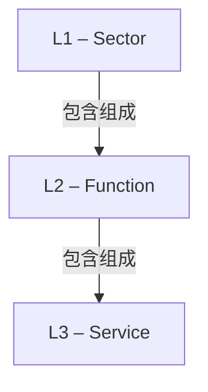

# G21D/fig1-1 · 政府参考模型的结构

类型：`architecture-metamodel`。第 1.3 节用这张图给出 GRM 各要素的结构视图，说明后续章节逐一展开的三个层级及其组成关系；第 2–12 章的部门图（图 2-1 至图 12-1）和附录 A 都是这一结构在 11 个部门上的实例。

英文 PDF 物理页：[23]。本页为架构语义分析，原文与原图分别保留。

## 原图与可编辑图


[完整 JSON](fig1-1.json) · [可编辑 Mermaid](fig1-1.mmd) · [仅关系图](fig1-1.relations.mmd) · [层级分解图](fig1-1.hierarchy.mmd)

图形重建表达语义，不复制源图布局。虚线表示解释、矩阵映射或分组关系，不自动表示不确定性的概率。



## 架构分析

自上而下读三个灰色框：L1 部门、L2 功能、L3 服务。相邻两框之间的竖线表示组合关系，实心菱形紧贴上方的框，表示上方是整体、下方是部分，即“部门由功能组成”“功能由服务组成”。线上没有箭头，也没有标注数量（多重性）。图中不列出具体的部门、功能或服务名称。

- 本图有 3 个具名或隐含元素、2 条关系和 0 条包含/分组记录。
- 本图没有可直接确认为人员直属汇报的关系；视觉上下位置、能力分解和治理职责分别读取。
- 三个层级标签及两条实线和实心菱形全部核对；没有箭头、方向标签或多重性数字。
- 原文第23页写12个sectors，表1-1和第2–12章实际为11；保留原文不一致。

### 如何用于项目

- 使用本图的实体类型作为建模词表，建立本地实体ID，再分别填入关系端点与证据。
- 核对主动/被动关系的语义方向和基数；实现、使能、使用、包含及实例化分别建模。

### 结构所表达的逻辑

- 三个框是层级类型：L1 Sector、L2 Function、L3 Service，不是三个实际政府机构。
- 两个实心菱形表示整体端的组合含义；关系方向是语义阅读，不是原图箭头。
- 第23页定义Sector为政府业务领域，Function为聚合层面的政府活动，Service为组件层面的进一步细化；没有图示第四层。
- 第21页允许直接使用、扩展或定制GRM；这种分类层级不能推广为所有现实服务都不能跨域复用。
- 第24页将模型置于ADM Phase B；Drivers for Change是各部门讨论的元因素，不是人员主管。

## 上下级与包含

三个层级类型自上而下：L1 部门 → L2 功能 → L3 服务，每一层由下一层组成。这是类型之间的组成关系，不是具体实例；具体实例见图 2-1 至图 12-1。

|父项|子项|层级类型|依据与解释|
|---|---|---|---|
|—|—|无视觉包含|关系中明确的组成/特化见 JSON semantic_hierarchy。|

### 业务组成与特化

|父项/范围/类型|子项/责任对象/实例|语义|
|---|---|---|
|第 1 层：部门|第 2 层：功能|composition|
|第 2 层：功能|第 3 层：服务|composition|

## 全部元素与角色

|元素ID|原文名称|类型|含义|直接父项|深度|
|---|---|---|---|---|---|
|l1_sector|L1 – Sector|concept|政府的业务领域；共 11 个（表 1-1、第 2–12 章）。|—||
|l2_function|L2 – Function|concept|在聚合层面界定政府做什么；11 个部门图共 36 个功能。|—||
|l3_service|L3 – Service|concept|在组件层面进一步界定政府做什么；11 个部门图共 194 项服务（表 8-1 另列 2 项）。|—||

## 全部关系

两条竖向细实线，上端各有一个实心菱形，贴着上方的框。按 UML 记法（背景知识），实心菱形表示组合关系，菱形所在一端是整体；关系清单中 from 为整体（上层）、to 为部分（下层），arrow 记为 forward 只表示这一读向，线上并没有箭头。图中没有多重性或文字标签。

|主体|语义关系|客体|显式线/隐式|原文标签|依据|
|---|---|---|---|---|---|
|第 1 层：部门|包含组成|第 2 层：功能|显式连线||实心菱形位于上层端，组合语义读为上层包含下层；原图并无箭头，未标多重性。|
|第 2 层：功能|包含组成|第 3 层：服务|显式连线||实心菱形位于上层端，组合语义读为上层包含下层；原图并无箭头，未标多重性。|

## 11 个部门的 L2/L3 数量（派生：据图 2-1 至图 12-1 统计，不在本图中）

```json
{
  "id": "t_sector_counts",
  "title_zh": "11 个部门的 L2/L3 数量（派生：据图 2-1 至图 12-1 统计，不在本图中）",
  "columns": [
    "L1 部门",
    "部门图",
    "L2 功能数",
    "L3 服务数"
  ],
  "rows": [
    [
      "国际事务与贸易 International Affairs and Trade",
      "图 2-1",
      "3",
      "7"
    ],
    [
      "国防与安全 Defense and Security",
      "图 3-1",
      "3",
      "10"
    ],
    [
      "一般政府与地方服务 General Government and Local Services",
      "图 4-1",
      "3",
      "26"
    ],
    [
      "青少年与教育 Young People and Education",
      "图 5-1",
      "3",
      "14"
    ],
    [
      "健康与社区福祉 Health and Community Wellbeing",
      "图 6-1",
      "3",
      "22"
    ],
    [
      "司法、治安与内政 Judiciary, Justice, and Home Affairs",
      "图 7-1",
      "2",
      "13"
    ],
    [
      "财政 Financial",
      "图 8-1",
      "5",
      "17（表 8-1 为 19）"
    ],
    [
      "增长、住房与环境 Growth, Housing, and Environment",
      "图 9-1",
      "4",
      "27"
    ],
    [
      "政策、绩效、人口与创新 Policy, Performance, Population, and Innovation",
      "图 10-1",
      "3",
      "15"
    ],
    [
      "共享服务 Shared Services",
      "图 11-1",
      "5",
      "33"
    ],
    [
      "交通与运营 Transport and Operations",
      "图 12-1",
      "2",
      "10"
    ],
    [
      "合计",
      "—",
      "36",
      "194"
    ]
  ],
  "notes_zh": "本表不是对图 1-1 的转录：图 1-1 只画三个层级，不列部门。数字按各部门图中的框数统计，用于把三层结构与 11 个部门对应起来；部门清单与定义见表 1-1。"
}
```

## 本轮语义修正

- 实心菱形位于上层端，组合语义读为上层包含下层；原图并无箭头，未标多重性。
- 实心菱形位于上层端，组合语义读为上层包含下层；原图并无箭头，未标多重性。

## 误读检查

- 菱形不是箭头，不表示数据流、指挥关系或时间顺序，只标出组合关系的整体一端。
- 三个框是层级类型，不是三个具体的部门、功能或服务。
- 图中没有“变革驱动因素”，也没有“说明”层；分类表中的“说明”列只是对每个功能与服务的文字解释。
- 中文稿引用的 figs/g21d_fig1-1.svg 画的是 11 个部门的名称网格，不是本图；其底部所说的“功能—服务—说明三层”也与本图的“部门—功能—服务”三层不一致。

## 原文证据

### [PDF 第 21 页](../../../documents/G21D.md#page-21)

> The Business Architecture defines the business strategy, governance, organization, business information, and key business processes of an Enterprise Architecture. An architecture approach determines how to effect change within the appropriate cost, benefit, and risk parameters.
> A challenge to this approach arises due to a lack of consistency in the application of architecture standards used to inform Business Architects or those intending to develop a Business Architecture or technical solution on the expected Architecture Building Blocks (ABBs) for governments worldwide.
### [PDF 第 22 页](../../../documents/G21D.md#page-22)

> Table 1-1 shows the names and description of various types of sectors that are in the GRM.
### [PDF 第 23 页](../../../documents/G21D.md#page-23)

> Figure 1-1 provides a view of the structure of each element of the GRM.
### [PDF 第 24 页](../../../documents/G21D.md#page-24)

> The intent of the GRM is that this will sit in Phase B: Business Architecture of the TOGAF Architecture Development Method (ADM) cycle. This will provide a reference for individuals in the public sector and a pattern for accelerating the development of a reference model within the Business Architecture space.

## 来源与分析状态

所有元素/关系均有来源定位；未把历史解释重命名为本轮逐线视觉确认。源图与语义图是两种视图，布局不证明汇报或因果。

源 PDF SHA-256：`220ead5fef846c52417b9b7a915ff4a64f327680b384c369840926b85958786a`。

源图记录：[原始解释与转录](../../../figures/G21D/fig1-1.json)。

```json
{
  "quality": {
    "graph_integrity": "checked",
    "semantic_analysis": "typed-graph-and-context-analysis",
    "visual_review": "source-content-audited",
    "notice_zh": "所有元素/关系均有来源定位；未把历史解释重命名为本轮逐线视觉确认。源图与语义图是两种视图，布局不证明汇报或因果。"
  },
  "source_uncertainty": {
    "confidence": "high",
    "uncertainties_zh": [
      "实心菱形按 UML 组合关系解读属于背景知识，原文没有解释这一记法。"
    ],
    "analyzed_from": [
      "英文 PDF 第 23 页原图截图",
      "英文 PDF 第 21–24 页正文（1.2–1.4 节、表 1-1）",
      "中文稿 G21De_政府参考模型.md 第 142–205 行",
      "figs/g21d_fig1-1.svg 源码",
      "图 2-1 至图 12-1 的分析结果（用于统计数量）"
    ],
    "date": "2026-10-31"
  },
  "source_conflicts": [
    {
      "kind": "sector-count-mismatch",
      "pdf_page": 23,
      "printed_sector_count": 12,
      "observed_sector_chapters": 11,
      "resolution_zh": "保留原文12与目录/表格11两种证据，不凭图自动补造第12类。"
    }
  ]
}
```
