# G21D/fig10-1 · 拟议的政策、绩效、人口与创新部门 L1–L3 要素的结构与内容概览

类型：`decomposition-or-organization-model`。第 10 章开篇用这张图概览“政策、绩效、人口与创新”部门（L1）下的功能（L2）与服务（L3），随后的表 10-1 逐项给出说明。它是图 1-1 三层结构在本部门的具体展开，与其余 10 个部门图采用同一模板，附录 A 第 51 页把它与图 9-1 汇总在同一页。

英文 PDF 物理页：[55]。本页为架构语义分析，原文与原图分别保留。

## 原图与可编辑图


[完整 JSON](fig10-1.json) · [可编辑 Mermaid](fig10-1.mmd) · [仅关系图](fig10-1.relations.mmd) · [层级分解图](fig10-1.hierarchy.mmd)

图形重建表达语义，不复制源图布局。虚线表示解释、矩阵映射或分组关系，不自动表示不确定性的概率。

```mermaid
flowchart TB
  %% Semantic reconstruction; see original source image for exact layout.
  n0["Policy, Performance, Population, and Innovation"]
  n1["Policy"]
  n2["Planning and Performance"]
  n3["Innovation and Strategy"]
  n4["Collaborative Policy"]
  n5["Policy Secretariat"]
  n6["Social Policy"]
  n7["Environmental Policy"]
  n8["Economic Policy"]
  n9["Capacity Planning"]
  n10["Key Performance Indicators"]
  n11["Population Statistics (and Census)"]
  n12["Social Strategy"]
  n13["Environmental Strategy"]
  n14["Economic Strategy"]
  n15["Population Strategy"]
  n16["Housing Strategy"]
  n17["Short, Medium-Term Strategy"]
  n18["Long-Term Strategy"]
  n0 -.->|"reference_taxonomy_decomposition"| n1
  n0 -.->|"reference_taxonomy_decomposition"| n2
  n0 -.->|"reference_taxonomy_decomposition"| n3
  n1 -.->|"reference_taxonomy_decomposition"| n4
  n1 -.->|"reference_taxonomy_decomposition"| n5
  n1 -.->|"reference_taxonomy_decomposition"| n6
  n1 -.->|"reference_taxonomy_decomposition"| n7
  n1 -.->|"reference_taxonomy_decomposition"| n8
  n2 -.->|"reference_taxonomy_decomposition"| n9
  n2 -.->|"reference_taxonomy_decomposition"| n10
  n2 -.->|"reference_taxonomy_decomposition"| n11
  n3 -.->|"reference_taxonomy_decomposition"| n12
  n3 -.->|"reference_taxonomy_decomposition"| n13
  n3 -.->|"reference_taxonomy_decomposition"| n14
  n3 -.->|"reference_taxonomy_decomposition"| n15
  n3 -.->|"reference_taxonomy_decomposition"| n16
  n3 -.->|"reference_taxonomy_decomposition"| n17
  n3 -.->|"reference_taxonomy_decomposition"| n18
```



## 架构分析

最外层浅蓝色大框是 L1 部门，顶部白色粗体字是部门名称。框内三个等宽的白色圆角框是 L2 功能，从左到右依次为政策、规划与绩效、创新与战略。每个功能框里自上而下排列的胶囊形小框是 L3 服务。图中没有连线或箭头，上下级关系完全由框的嵌套表达，同一功能内的服务是并列的。

- 本图有 19 个具名或隐含元素、0 条关系和 18 条包含/分组记录。
- 包含/分组树最大深度为 2；根节点为 政策、绩效、人口与创新。
- 本图没有可直接确认为人员直属汇报的关系；视觉上下位置、能力分解和治理职责分别读取。
- 原图靠嵌套表达结构，没有连线；新语义图将包含单独显式化，不补造流程、数据流或依赖。
- 19个标签及1/3/15三层全部核对；Policy5项、Planning and Performance3项、Innovation and Strategy7项。
- Short, Medium-Term Strategy是一个服务框，不能按逗号拆成两个。

### 如何用于项目

- 按父项展开所有直接子项，检查同层粒度、重叠和缺项。
- 保留组成、分类、能力分解与组织汇报的区别；将示例名称替换为已确认的项目对象。

### 结构所表达的逻辑

- Policy、Planning and Performance、Innovation and Strategy为三个平行功能，图中没有顺序或因果连线。
- Short, Medium-Term Strategy是一个原图节点；表10-1对不同时间尺度作说明，不据此拆图。
- 表10-1标题含Local Innovation，图与章标题无Local；属于原文名称差异。
- Collaborative Policy的表格说明印为wants and meets of the marketplace，保留异常原词，不能静默改为needs。

## 上下级与包含

按本图的部门→功能→服务框嵌套保存参考分类；同层平行，无执行或优先级次序；不推广为现实服务唯一归属规则。

|父项|子项|层级类型|依据与解释|
|---|---|---|---|
|政策、绩效、人口与创新|政策|reference_taxonomy_decomposition|Sector/Function/Service参考分类由真实嵌套表达，不构成组织编制或人员汇报。|
|政策、绩效、人口与创新|规划与绩效|reference_taxonomy_decomposition|Sector/Function/Service参考分类由真实嵌套表达，不构成组织编制或人员汇报。|
|政策、绩效、人口与创新|创新与战略|reference_taxonomy_decomposition|Sector/Function/Service参考分类由真实嵌套表达，不构成组织编制或人员汇报。|
|政策|协同政策|reference_taxonomy_decomposition|Sector/Function/Service参考分类由真实嵌套表达，不构成组织编制或人员汇报。|
|政策|政策秘书处|reference_taxonomy_decomposition|Sector/Function/Service参考分类由真实嵌套表达，不构成组织编制或人员汇报。|
|政策|社会政策|reference_taxonomy_decomposition|Sector/Function/Service参考分类由真实嵌套表达，不构成组织编制或人员汇报。|
|政策|环境政策|reference_taxonomy_decomposition|Sector/Function/Service参考分类由真实嵌套表达，不构成组织编制或人员汇报。|
|政策|经济政策|reference_taxonomy_decomposition|Sector/Function/Service参考分类由真实嵌套表达，不构成组织编制或人员汇报。|
|规划与绩效|能力规划（产能规划）|reference_taxonomy_decomposition|Sector/Function/Service参考分类由真实嵌套表达，不构成组织编制或人员汇报。|
|规划与绩效|关键绩效指标|reference_taxonomy_decomposition|Sector/Function/Service参考分类由真实嵌套表达，不构成组织编制或人员汇报。|
|规划与绩效|人口统计（与普查）|reference_taxonomy_decomposition|Sector/Function/Service参考分类由真实嵌套表达，不构成组织编制或人员汇报。|
|创新与战略|社会战略|reference_taxonomy_decomposition|Sector/Function/Service参考分类由真实嵌套表达，不构成组织编制或人员汇报。|
|创新与战略|环境战略|reference_taxonomy_decomposition|Sector/Function/Service参考分类由真实嵌套表达，不构成组织编制或人员汇报。|
|创新与战略|经济战略|reference_taxonomy_decomposition|Sector/Function/Service参考分类由真实嵌套表达，不构成组织编制或人员汇报。|
|创新与战略|人口战略|reference_taxonomy_decomposition|Sector/Function/Service参考分类由真实嵌套表达，不构成组织编制或人员汇报。|
|创新与战略|住房战略|reference_taxonomy_decomposition|Sector/Function/Service参考分类由真实嵌套表达，不构成组织编制或人员汇报。|
|创新与战略|中短期战略|reference_taxonomy_decomposition|Sector/Function/Service参考分类由真实嵌套表达，不构成组织编制或人员汇报。|
|创新与战略|长期战略|reference_taxonomy_decomposition|Sector/Function/Service参考分类由真实嵌套表达，不构成组织编制或人员汇报。|

## 全部元素与角色

|元素ID|原文名称|类型|含义|直接父项|深度|
|---|---|---|---|---|---|
|l1_policy_perf_pop_innovation|Policy, Performance, Population, and Innovation|other|GRM 第 1 层“部门”，即政府的一个业务领域；词表没有对应类型，故用 other。英文表 10-1 标题写作 Policy, Performance, Population, and Local Innovation。|—||
|l2_policy|Policy|function|制定并评估与环境、社会、经济及市场相关的当前计划与政策的可持续性（表 10-1）。|政策、绩效、人口与创新|1|
|l2_planning_performance|Planning and Performance|function|识别并规划达成目标最佳方式的持续过程（表 10-1）。|政策、绩效、人口与创新|1|
|l2_innovation_strategy|Innovation and Strategy|function|为达成目标、回应未满足的市场需求并利用新兴技术而采用的计划、举措与活动（表 10-1）。|政策、绩效、人口与创新|1|
|l3_collaborative_policy|Collaborative Policy|service|监测、管理并回应市场需求。|政策|2|
|l3_policy_secretariat|Policy Secretariat|service|协调分析与需求评估，启动战略文件起草，以确立公共政策并简化政策程序。|政策|2|
|l3_social_policy|Social Policy|service|为减少不平等、确保适当福利而实施的活动、指南、原则与立法。|政策|2|
|l3_environmental_policy|Environmental Policy|service|为尽量减少社会对环境的影响而实施的活动、指南、原则与立法。|政策|2|
|l3_economic_policy|Economic Policy|service|服务：经济政策|政策|2|
|l3_capacity_planning|Capacity Planning|service|确定政府为满足规划要求可用的最大变革与生产能力；中文稿译作“能力规划”，不是基于 capability 的规划。|规划与绩效|2|
|l3_kpis|Key Performance Indicators|service|衡量结果与活动，确定战略目标的达成情况并确定改进标准。|规划与绩效|2|
|l3_population_statistics|Population Statistics (and Census)|service|生成人口统计与普查数据，监测人口趋势与基准，为研究、政策制定与规划提供依据。|规划与绩效|2|
|l3_social_strategy|Social Strategy|service|服务：社会战略|创新与战略|2|
|l3_environmental_strategy|Environmental Strategy|service|实现环境目标并应对气候变化的计划、举措与活动。|创新与战略|2|
|l3_economic_strategy|Economic Strategy|service|服务：经济战略|创新与战略|2|
|l3_population_strategy|Population Strategy|service|服务：人口战略|创新与战略|2|
|l3_housing_strategy|Housing Strategy|service|实现住房目标并促进住房灵活性与可负担性的计划、举措与活动。|创新与战略|2|
|l3_short_medium_term_strategy|Short, Medium-Term Strategy|service|确定年度与近期目标并识别达成目标的最佳方法；是一项服务，不是两项。|创新与战略|2|
|l3_long_term_strategy|Long-Term Strategy|service|确定战略目标并识别达成目标的最佳方法。|创新与战略|2|

### 政策、绩效、人口与创新：属性

```json
{
  "table_label_en": "Policy, Performance, Population, and Local Innovation"
}
```

## 全部关系

图中没有任何连线或箭头。服务框位于功能框内，表示该服务属于该功能；功能框位于部门框内，表示该功能属于本部门（图 1-1 用菱形组合线表示同样的组成关系）。元素清单用 parent/level 记录这种嵌套，因此关系清单为空。

|主体|语义关系|客体|显式线/隐式|原文标签|依据|
|---|---|---|---|---|---|

## 误读检查

- “Capacity Planning（能力规划）”按表 10-1 指确定政府可用的最大变革与生产能力（产能/容量），不是 TOGAF 中基于能力（capability）的规划。
- “Short, Medium-Term Strategy（中短期战略）”是一项服务，不是“短期战略”和“中期战略”两项；“Population Statistics (and Census)”同样是一项服务。
- 同一功能内服务的上下次序不表示优先级；只有中短期战略与长期战略之间按时间跨度区分。
- 英文原文表 10-1 标题多了“Local”（Local Innovation），与图和章名不一致；以图为准。
- 中文稿引用的中文化 PNG 字号混乱（“中短期战略”比功能标题还大），不能用字号判断层级，应以框的嵌套为准。
- 图框下方的浅灰色线条是 PDF 评估版水印的残影，不属于图的内容。

## 原文证据

### [PDF 第 24 页](../../../documents/G21D.md#page-24)

> The intent of the GRM is that this will sit in Phase B: Business Architecture of the TOGAF Architecture Development Method (ADM) cycle. This will provide a reference for individuals in the public sector and a pattern for accelerating the development of a reference model within the Business Architecture space.
### [PDF 第 55 页](../../../documents/G21D.md#page-55)

> As shown in Figure 10-1, Policy, Performance, Population, and Innovation involves the development of policy across the government, the provision of statistics for population and performance against benchmarks to ensure continuous improvement, and incorporates strategic and long-term planning to identify future risks, opportunities, and solutions.
> Figure 10-1: Structure and Content Overview of the L1-L3 Elements of the Proposed Policy, Performance,
### [PDF 第 56 页](../../../documents/G21D.md#page-56)

> Table 10-1: Sector: Policy, Performance, Population, and Local Innovation
### [PDF 第 57 页](../../../documents/G21D.md#page-57)

> Several factors are driving change in the sector, whereby the government will need to consider the points below.
> Ageing population due to declining worldwide fertility rates is having a significant effect on policy. This will reduce the number of individuals of working age, increase dependency on social care, and result in reductions in the growth rate of potential output and the natural rate of unemployment.

## 来源与分析状态

所有元素/关系均有来源定位；未把历史解释重命名为本轮逐线视觉确认。源图与语义图是两种视图，布局不证明汇报或因果。

源 PDF SHA-256：`220ead5fef846c52417b9b7a915ff4a64f327680b384c369840926b85958786a`。

源图记录：[原始解释与转录](../../../figures/G21D/fig10-1.json)。

```json
{
  "quality": {
    "graph_integrity": "checked",
    "semantic_analysis": "typed-graph-and-context-analysis",
    "visual_review": "source-content-audited",
    "notice_zh": "所有元素/关系均有来源定位；未把历史解释重命名为本轮逐线视觉确认。源图与语义图是两种视图，布局不证明汇报或因果。"
  },
  "source_uncertainty": {
    "confidence": "high",
    "uncertainties_zh": [],
    "analyzed_from": [
      "英文 PDF 第 55 页原图截图",
      "英文 PDF 第 55–57 页正文（第 10 章开篇、表 10-1）",
      "英文 PDF 第 71 页附录 A 图示（同内容面板，用于复核标签）",
      "中文稿 G21De_政府参考模型.md 第 929–985 行",
      "figs/zh/g21de_fig10-1_zh.png（逐项对照）"
    ],
    "date": "2026-10-31"
  },
  "source_conflicts": [
    {
      "kind": "label-variant",
      "figure": "Policy, Performance, Population, and Innovation",
      "table": "Policy, Performance, Population, and Local Innovation",
      "resolution_zh": "保留原名称差异。"
    },
    {
      "kind": "source-wording-ambiguity",
      "pdf_page": 56,
      "quote_en": "wants and meets of the marketplace",
      "resolution_zh": "原词meets不自动纠正成needs。"
    }
  ]
}
```
