# G21D/fig11-1 · 拟议的共享服务部门 L1–L3 要素的结构与内容概览

类型：`decomposition-or-organization-model`。第 11 章开篇用这张图概览“共享服务”部门（L1）下的功能（L2）与服务（L3），随后的表 11-1 逐项给出说明。它是图 1-1 三层结构在本部门的具体展开，与其余 10 个部门图采用同一模板，附录 A 第 52 页把它与图 12-1 汇总在同一页。

英文 PDF 物理页：[59]。本页为架构语义分析，原文与原图分别保留。

## 原图与可编辑图


[完整 JSON](fig11-1.json) · [可编辑 Mermaid](fig11-1.mmd) · [仅关系图](fig11-1.relations.mmd) · [层级分解图](fig11-1.hierarchy.mmd)

图形重建表达语义，不复制源图布局。虚线表示解释、矩阵映射或分组关系，不自动表示不确定性的概率。

```mermaid
flowchart TB
  %% Semantic reconstruction; see original source image for exact layout.
  n0["Shared Services"]
  n1["People and Corporate Services"]
  n2["Communications"]
  n3["Commercial Services"]
  n4["Transformation"]
  n5["Finance Hub"]
  n6["People and Organizational Change"]
  n7["Culture and Modernization"]
  n8["Human Resources"]
  n9["Business Administration Support"]
  n10["Business Continuity"]
  n11["Compliance"]
  n12["Employee Health and Safety"]
  n13["Soft Facilities Management"]
  n14["External Media"]
  n15["Internal Communications"]
  n16["Marketing"]
  n17["Web Design"]
  n18["International Communications"]
  n19["Market Engagement"]
  n20["Market Creation"]
  n21["Commercial Negotiations"]
  n22["Contract Management"]
  n23["Procurement"]
  n24["Business Processes"]
  n25["IT Operations"]
  n26["Information Management"]
  n27["Information Security"]
  n28["Digital Government"]
  n29["Enterprise Architecture"]
  n30["Data Protection"]
  n31["Portfolio and Performance Management"]
  n32["Standardized Processes"]
  n33["Analytics"]
  n34["Reporting"]
  n35["Transactional Services"]
  n36["Debt Management"]
  n37["Pension Fund Administration"]
  n38["Payroll"]
  n0 -.->|"reference_taxonomy_decomposition"| n1
  n0 -.->|"reference_taxonomy_decomposition"| n2
  n0 -.->|"reference_taxonomy_decomposition"| n3
  n0 -.->|"reference_taxonomy_decomposition"| n4
  n0 -.->|"reference_taxonomy_decomposition"| n5
  n1 -.->|"reference_taxonomy_decomposition"| n6
  n1 -.->|"reference_taxonomy_decomposition"| n7
  n1 -.->|"reference_taxonomy_decomposition"| n8
  n1 -.->|"reference_taxonomy_decomposition"| n9
  n1 -.->|"reference_taxonomy_decomposition"| n10
  n1 -.->|"reference_taxonomy_decomposition"| n11
  n1 -.->|"reference_taxonomy_decomposition"| n12
  n1 -.->|"reference_taxonomy_decomposition"| n13
  n2 -.->|"reference_taxonomy_decomposition"| n14
  n2 -.->|"reference_taxonomy_decomposition"| n15
  n2 -.->|"reference_taxonomy_decomposition"| n16
  n2 -.->|"reference_taxonomy_decomposition"| n17
  n2 -.->|"reference_taxonomy_decomposition"| n18
  n3 -.->|"reference_taxonomy_decomposition"| n19
  n3 -.->|"reference_taxonomy_decomposition"| n20
  n3 -.->|"reference_taxonomy_decomposition"| n21
  n3 -.->|"reference_taxonomy_decomposition"| n22
  n3 -.->|"reference_taxonomy_decomposition"| n23
  n4 -.->|"reference_taxonomy_decomposition"| n24
  n4 -.->|"reference_taxonomy_decomposition"| n25
  n4 -.->|"reference_taxonomy_decomposition"| n26
  n4 -.->|"reference_taxonomy_decomposition"| n27
  n4 -.->|"reference_taxonomy_decomposition"| n28
  n4 -.->|"reference_taxonomy_decomposition"| n29
  n4 -.->|"reference_taxonomy_decomposition"| n30
  n4 -.->|"reference_taxonomy_decomposition"| n31
  n5 -.->|"reference_taxonomy_decomposition"| n32
  n5 -.->|"reference_taxonomy_decomposition"| n33
  n5 -.->|"reference_taxonomy_decomposition"| n34
  n5 -.->|"reference_taxonomy_decomposition"| n35
  n5 -.->|"reference_taxonomy_decomposition"| n36
  n5 -.->|"reference_taxonomy_decomposition"| n37
  n5 -.->|"reference_taxonomy_decomposition"| n38
```



## 架构分析

最外层浅蓝色大框是 L1 部门，顶部白色粗体字是部门名称。框内五个白色圆角框是 L2 功能，排成两行：上排从左到右为人员与公司服务、沟通、商业服务；下排为转型（在沟通下方）和财务共享中心（在商业服务下方），左下角空白。每个功能框里自上而下排列的胶囊形小框是 L3 服务。五个功能框是同级的。图中没有连线或箭头，上下级关系完全由框的嵌套表达。

- 本图有 39 个具名或隐含元素、0 条关系和 38 条包含/分组记录。
- 包含/分组树最大深度为 2；根节点为 共享服务。
- 本图没有可直接确认为人员直属汇报的关系；视觉上下位置、能力分解和治理职责分别读取。
- 原图靠嵌套表达结构，没有连线；新语义图将包含单独显式化，不补造流程、数据流或依赖。
- 39标签及1/5/33三层核对；五功能下数量8/5/5/8/7。
- Transformation与Finance Hub位于下排但仍是直接属于Shared Services的L2功能。
- Pension Fund Administration与图8-1的Pension Fund Management分别保留。

### 如何用于项目

- 按父项展开所有直接子项，检查同层粒度、重叠和缺项。
- 保留组成、分类、能力分解与组织汇报的区别；将示例名称替换为已确认的项目对象。

### 结构所表达的逻辑

- People and Corporate Services、Communications、Commercial Services、Transformation、Finance Hub五个功能并列；Corporate为机构层面。
- Enterprise Architecture位于Transformation，作为L3服务，不把它推为企业架构团队或人员编制。
- 表11-1的Internal Communications面向domestic citizens；不得仅按名称限定为内部员工沟通。
- Pension Fund Administration是养老基金行政经办，包含开立退休储蓄账户、支付福利和核算交易，不与图8-1的基金管理自动合并。

## 上下级与包含

按本图的部门→功能→服务框嵌套保存参考分类；同层平行，无执行或优先级次序；不推广为现实服务唯一归属规则。

|父项|子项|层级类型|依据与解释|
|---|---|---|---|
|共享服务|人员与公司服务（人员与机构服务）|reference_taxonomy_decomposition|Sector/Function/Service参考分类由真实嵌套表达，不构成组织编制或人员汇报。|
|共享服务|沟通|reference_taxonomy_decomposition|Sector/Function/Service参考分类由真实嵌套表达，不构成组织编制或人员汇报。|
|共享服务|商业服务|reference_taxonomy_decomposition|Sector/Function/Service参考分类由真实嵌套表达，不构成组织编制或人员汇报。|
|共享服务|转型|reference_taxonomy_decomposition|Sector/Function/Service参考分类由真实嵌套表达，不构成组织编制或人员汇报。|
|共享服务|财务共享中心|reference_taxonomy_decomposition|Sector/Function/Service参考分类由真实嵌套表达，不构成组织编制或人员汇报。|
|人员与公司服务（人员与机构服务）|人员与组织变革|reference_taxonomy_decomposition|Sector/Function/Service参考分类由真实嵌套表达，不构成组织编制或人员汇报。|
|人员与公司服务（人员与机构服务）|文化与现代化|reference_taxonomy_decomposition|Sector/Function/Service参考分类由真实嵌套表达，不构成组织编制或人员汇报。|
|人员与公司服务（人员与机构服务）|人力资源|reference_taxonomy_decomposition|Sector/Function/Service参考分类由真实嵌套表达，不构成组织编制或人员汇报。|
|人员与公司服务（人员与机构服务）|业务行政支持|reference_taxonomy_decomposition|Sector/Function/Service参考分类由真实嵌套表达，不构成组织编制或人员汇报。|
|人员与公司服务（人员与机构服务）|业务连续性|reference_taxonomy_decomposition|Sector/Function/Service参考分类由真实嵌套表达，不构成组织编制或人员汇报。|
|人员与公司服务（人员与机构服务）|合规|reference_taxonomy_decomposition|Sector/Function/Service参考分类由真实嵌套表达，不构成组织编制或人员汇报。|
|人员与公司服务（人员与机构服务）|员工健康与安全|reference_taxonomy_decomposition|Sector/Function/Service参考分类由真实嵌套表达，不构成组织编制或人员汇报。|
|人员与公司服务（人员与机构服务）|软性设施管理|reference_taxonomy_decomposition|Sector/Function/Service参考分类由真实嵌套表达，不构成组织编制或人员汇报。|
|沟通|对外媒体|reference_taxonomy_decomposition|Sector/Function/Service参考分类由真实嵌套表达，不构成组织编制或人员汇报。|
|沟通|内部沟通（国内传播）|reference_taxonomy_decomposition|Sector/Function/Service参考分类由真实嵌套表达，不构成组织编制或人员汇报。|
|沟通|营销|reference_taxonomy_decomposition|Sector/Function/Service参考分类由真实嵌套表达，不构成组织编制或人员汇报。|
|沟通|网页设计|reference_taxonomy_decomposition|Sector/Function/Service参考分类由真实嵌套表达，不构成组织编制或人员汇报。|
|沟通|国际传播|reference_taxonomy_decomposition|Sector/Function/Service参考分类由真实嵌套表达，不构成组织编制或人员汇报。|
|商业服务|市场接触|reference_taxonomy_decomposition|Sector/Function/Service参考分类由真实嵌套表达，不构成组织编制或人员汇报。|
|商业服务|市场创建|reference_taxonomy_decomposition|Sector/Function/Service参考分类由真实嵌套表达，不构成组织编制或人员汇报。|
|商业服务|商业谈判|reference_taxonomy_decomposition|Sector/Function/Service参考分类由真实嵌套表达，不构成组织编制或人员汇报。|
|商业服务|合同管理|reference_taxonomy_decomposition|Sector/Function/Service参考分类由真实嵌套表达，不构成组织编制或人员汇报。|
|商业服务|采购|reference_taxonomy_decomposition|Sector/Function/Service参考分类由真实嵌套表达，不构成组织编制或人员汇报。|
|转型|业务流程|reference_taxonomy_decomposition|Sector/Function/Service参考分类由真实嵌套表达，不构成组织编制或人员汇报。|
|转型|IT 运营|reference_taxonomy_decomposition|Sector/Function/Service参考分类由真实嵌套表达，不构成组织编制或人员汇报。|
|转型|信息管理|reference_taxonomy_decomposition|Sector/Function/Service参考分类由真实嵌套表达，不构成组织编制或人员汇报。|
|转型|信息安全|reference_taxonomy_decomposition|Sector/Function/Service参考分类由真实嵌套表达，不构成组织编制或人员汇报。|
|转型|数字政府|reference_taxonomy_decomposition|Sector/Function/Service参考分类由真实嵌套表达，不构成组织编制或人员汇报。|
|转型|企业架构|reference_taxonomy_decomposition|Sector/Function/Service参考分类由真实嵌套表达，不构成组织编制或人员汇报。|
|转型|数据保护|reference_taxonomy_decomposition|Sector/Function/Service参考分类由真实嵌套表达，不构成组织编制或人员汇报。|
|转型|组合与绩效管理|reference_taxonomy_decomposition|Sector/Function/Service参考分类由真实嵌套表达，不构成组织编制或人员汇报。|
|财务共享中心|标准化流程|reference_taxonomy_decomposition|Sector/Function/Service参考分类由真实嵌套表达，不构成组织编制或人员汇报。|
|财务共享中心|分析|reference_taxonomy_decomposition|Sector/Function/Service参考分类由真实嵌套表达，不构成组织编制或人员汇报。|
|财务共享中心|报告|reference_taxonomy_decomposition|Sector/Function/Service参考分类由真实嵌套表达，不构成组织编制或人员汇报。|
|财务共享中心|交易服务|reference_taxonomy_decomposition|Sector/Function/Service参考分类由真实嵌套表达，不构成组织编制或人员汇报。|
|财务共享中心|债务管理|reference_taxonomy_decomposition|Sector/Function/Service参考分类由真实嵌套表达，不构成组织编制或人员汇报。|
|财务共享中心|养老基金行政经办|reference_taxonomy_decomposition|按当前原图审校显式区分分类、包含与其他层级语义。|
|财务共享中心|薪酬发放|reference_taxonomy_decomposition|Sector/Function/Service参考分类由真实嵌套表达，不构成组织编制或人员汇报。|

## 全部元素与角色

|元素ID|原文名称|类型|含义|直接父项|深度|
|---|---|---|---|---|---|
|l1_shared_services|Shared Services|other|GRM 第 1 层“部门”，即政府的一个业务领域；词表没有对应类型，故用 other。|—||
|l2_people_corporate_services|People and Corporate Services|function|合并或整合人员与全企业所需的支持服务（表 11-1）；Corporate 指机构层面。|共享服务|1|
|l2_communications|Communications|function|为支持传播服务的提供而对信息、监管与媒体服务进行增长、提供与管理（表 11-1）。|共享服务|1|
|l2_commercial_services|Commercial Services|function|与供应商、伙伴及第三方进行寻源、管理与采购合同，以支持新项目与机会（表 11-1）。|共享服务|1|
|l2_transformation|Transformation|function|对某项职能的全面重新评估与彻底改造（表 11-1）。|共享服务|1|
|l2_finance_hub|Finance Hub|function|表 11-1 的概述为金融服务机构总部所在的金融中心，与其下的共性财务服务不符；中文稿按服务内容意译。|共享服务|1|
|l3_people_org_change|People and Organizational Change|service|围绕改变政府战略、流程、文化与技术的各项流程。|人员与公司服务（人员与机构服务）|2|
|l3_culture_modernization|Culture and Modernization|service|更新人员服务并管理员工文化。|人员与公司服务（人员与机构服务）|2|
|l3_human_resources|Human Resources|service|服务：人力资源|人员与公司服务（人员与机构服务）|2|
|l3_business_admin_support|Business Administration Support|service|服务：业务行政支持|人员与公司服务（人员与机构服务）|2|
|l3_business_continuity|Business Continuity|service|服务：业务连续性|人员与公司服务（人员与机构服务）|2|
|l3_compliance|Compliance|service|对人员指南与法规的直接监控与监督。|人员与公司服务（人员与机构服务）|2|
|l3_employee_health_safety|Employee Health and Safety|service|服务：员工健康与安全|人员与公司服务（人员与机构服务）|2|
|l3_soft_facilities_mgmt|Soft Facilities Management|service|管理非必要设施，使工作场所更舒适宜人。|人员与公司服务（人员与机构服务）|2|
|l3_external_media|External Media|service|政府与外部环境之间的信息流动。|沟通|2|
|l3_internal_communications|Internal Communications|service|对使信息能够传输给本国公民的行业进行监管、增长与管理；不是机构内部沟通。中文稿译作“内部沟通”。|沟通|2|
|l3_marketing|Marketing|service|服务：营销|沟通|2|
|l3_web_design|Web Design|service|服务：网页设计|沟通|2|
|l3_international_communications|International Communications|service|对使信息能够传输到海外的行业进行监管、增长与管理。|沟通|2|
|l3_market_engagement|Market Engagement|service|项目采购之前与供应商接触。|商业服务|2|
|l3_market_creation|Market Creation|service|消除贸易壁垒并提供产权，以便为某种商品或服务建立市场。|商业服务|2|
|l3_commercial_negotiations|Commercial Negotiations|service|服务：商业谈判|商业服务|2|
|l3_contract_management|Contract Management|service|服务：合同管理|商业服务|2|
|l3_procurement|Procurement|service|风险评估、备选方案评估、授予合同与持续的合同管理。|商业服务|2|
|l3_business_processes|Business Processes|service|监测、评估与改进现有业务流程、活动与职能。|转型|2|
|l3_it_operations|IT Operations|service|服务：IT 运营|转型|2|
|l3_information_management|Information Management|service|服务：信息管理|转型|2|
|l3_information_security|Information Security|service|保护信息与系统免遭未经授权的访问、使用、修改或破坏。|转型|2|
|l3_digital_government|Digital Government|service|服务：数字政府|转型|2|
|l3_enterprise_architecture|Enterprise Architecture|service|为组织的流程、人员与技术定义当前、过渡与目标战略。|转型|2|
|l3_data_protection|Data Protection|service|服务：数据保护|转型|2|
|l3_portfolio_performance_mgmt|Portfolio and Performance Management|service|支持政府持有的投资与资产的管理与有效性。|转型|2|
|l3_standardized_processes|Standardized Processes|service|服务：标准化流程|财务共享中心|2|
|l3_analytics|Analytics|service|服务：分析|财务共享中心|2|
|l3_reporting|Reporting|service|提供与报告财务信息，分析财务交易。|财务共享中心|2|
|l3_transactional_services|Transactional Services|service|监督合并、收购等业务交易。|财务共享中心|2|
|l3_debt_management|Debt Management|service|服务：债务管理|财务共享中心|2|
|l3_pension_fund_administration|Pension Fund Administration|service|开立退休储蓄账户、支付退休福利并核算相关交易；不同于图8-1的Pension Fund Management。表11-1标Pension Fund Administration (PFA)。|财务共享中心|2|
|l3_payroll|Payroll|service|服务：薪酬发放|财务共享中心|2|

### 养老基金行政经办：属性

```json
{
  "table_label_en": "Pension Fund Administration (PFA)"
}
```

## 全部关系

图中没有任何连线或箭头。服务框位于功能框内，表示该服务属于该功能；功能框位于部门框内，表示该功能属于本部门（图 1-1 用菱形组合线表示同样的组成关系）。元素清单用 parent/level 记录这种嵌套，因此关系清单为空。

|主体|语义关系|客体|显式线/隐式|原文标签|依据|
|---|---|---|---|---|---|

## 误读检查

- “Internal Communications（内部沟通）”与“International Communications（国际传播）”相对，按表 11-1 是对国内通信与传播行业的监管、增长与管理，不是机构内部沟通。
- “Finance Hub（财务共享中心）”在表 11-1 中的功能概述是“大量且多样的金融服务机构总部所在的金融中心”，与其下列出的共性财务服务不相符；中文稿按服务内容译为“财务共享中心”。理解该功能时以其下的服务为准。
- 下排的转型、财务共享中心是与上排同级的 L2 功能，不是沟通、商业服务的子功能；左下角空白不表示缺少某个功能。
- 中文稿中“养老基金管理”同时用于本图的 Pension Fund Administration 和图 8-1 的 Pension Fund Management，两者不是同一项服务。
- 中文稿引用的中文化 PNG 字号混乱（部分服务标签比功能标题还大），不能用字号判断层级，应以框的嵌套为准。

## 原文证据

### [PDF 第 24 页](../../../documents/G21D.md#page-24)

> The intent of the GRM is that this will sit in Phase B: Business Architecture of the TOGAF Architecture Development Method (ADM) cycle. This will provide a reference for individuals in the public sector and a pattern for accelerating the development of a reference model within the Business Architecture space.
### [PDF 第 59 页](../../../documents/G21D.md#page-59)

> As shown in Figure 11-1, Shared Services co-ordinates and manages people, communications, finance, and transformation services on behalf of the public in order to facilitate the transfer of information and oversight of people, processes, and technology to support procurement and align to corporate strategy.
> Figure 11-1: Structure and Content Overview of the L1-L3 Elements of the Proposed Shared Services Sector
### [PDF 第 60 页](../../../documents/G21D.md#page-60)

### [PDF 第 61 页](../../../documents/G21D.md#page-61)

### [PDF 第 62 页](../../../documents/G21D.md#page-62)

> Shared Services will also change influenced by common drivers that the government will need to consider.
> To meet new demands and public sector needs, there is a requirement for changes in the composition of the workforce through modernizing people acquisition, training, and retention. Intellectual property is also the differentiating and competitive factor in the public sector. With shortages in younger, tech-savvy staff, training is therefore key, including in the public sector.

## 来源与分析状态

所有元素/关系均有来源定位；未把历史解释重命名为本轮逐线视觉确认。源图与语义图是两种视图，布局不证明汇报或因果。

源 PDF SHA-256：`220ead5fef846c52417b9b7a915ff4a64f327680b384c369840926b85958786a`。

源图记录：[原始解释与转录](../../../figures/G21D/fig11-1.json)。

```json
{
  "quality": {
    "graph_integrity": "checked",
    "semantic_analysis": "typed-graph-and-context-analysis",
    "visual_review": "source-content-audited",
    "notice_zh": "所有元素/关系均有来源定位；未把历史解释重命名为本轮逐线视觉确认。源图与语义图是两种视图，布局不证明汇报或因果。"
  },
  "source_uncertainty": {
    "confidence": "high",
    "uncertainties_zh": [],
    "analyzed_from": [
      "英文 PDF 第 59 页原图截图",
      "英文 PDF 第 59–62 页正文（第 11 章开篇、表 11-1）",
      "英文 PDF 第 72 页附录 A 图示（同内容面板，用于复核标签）",
      "中文稿 G21De_政府参考模型.md 第 1010–1105 行",
      "figs/zh/g21de_fig11-1_zh.png（逐项对照）"
    ],
    "date": "2026-10-31"
  },
  "source_conflicts": []
}
```
