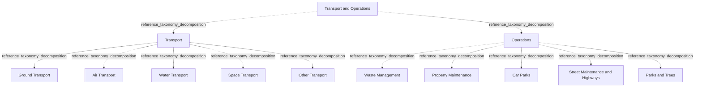

# G21D/fig12-1 · 拟议的交通与运营部门 L1–L3 要素的结构与内容概览

类型：`decomposition-or-organization-model`。第 12 章开篇用这张图概览“交通与运营”部门（L1）下的功能（L2）与服务（L3），随后的表 12-1 逐项给出说明。它是 11 个部门图中的最后一张，也是图 1-1 三层结构在本部门的具体展开；附录 A 第 52 页把它与图 11-1 汇总在同一页。

英文 PDF 物理页：[64]。本页为架构语义分析，原文与原图分别保留。

## 原图与可编辑图


[完整 JSON](fig12-1.json) · [可编辑 Mermaid](fig12-1.mmd) · [仅关系图](fig12-1.relations.mmd) · [层级分解图](fig12-1.hierarchy.mmd)

图形重建表达语义，不复制源图布局。虚线表示解释、矩阵映射或分组关系，不自动表示不确定性的概率。



## 架构分析

最外层浅蓝色大框是 L1 部门，顶部白色粗体字是部门名称。框内两个白色圆角框是 L2 功能，左为交通，右为运营。每个功能框里自上而下排列的胶囊形小框是 L3 服务。图中没有连线或箭头，上下级关系完全由框的嵌套表达，同一功能内的服务是并列的。

- 本图有 13 个具名或隐含元素、0 条关系和 12 条包含/分组记录。
- 包含/分组树最大深度为 2；根节点为 交通与运营。
- 本图没有可直接确认为人员直属汇报的关系；视觉上下位置、能力分解和治理职责分别读取。
- 原图靠嵌套表达结构，没有连线；新语义图将包含单独显式化，不补造流程、数据流或依赖。
- 13标签及1/2/10三层完整核对；Transport与Operations各5个服务；无连接线。
- Other Transport仅为剩余运输分类，不能补造原图未列的具体交通方式。

### 如何用于项目

- 按父项展开所有直接子项，检查同层粒度、重叠和缺项。
- 保留组成、分类、能力分解与组织汇报的区别；将示例名称替换为已确认的项目对象。

### 结构所表达的逻辑

- Transport含Ground/Air/Water/Space/Other Transport五项；Operations含Waste Management、Property Maintenance、Car Parks、Street Maintenance and Highways、Parks and Trees。
- 表12-1标题Transport Operations省略and，图与章标题为Transport and Operations，保留来源用词。
- 同层排列不表达执行时序、业务优先级或组织汇报关系。

## 上下级与包含

按本图的部门→功能→服务框嵌套保存参考分类；同层平行，无执行或优先级次序；不推广为现实服务唯一归属规则。

|父项|子项|层级类型|依据与解释|
|---|---|---|---|
|交通与运营|交通|reference_taxonomy_decomposition|Sector/Function/Service参考分类由真实嵌套表达，不构成组织编制或人员汇报。|
|交通与运营|运营|reference_taxonomy_decomposition|Sector/Function/Service参考分类由真实嵌套表达，不构成组织编制或人员汇报。|
|交通|地面交通|reference_taxonomy_decomposition|Sector/Function/Service参考分类由真实嵌套表达，不构成组织编制或人员汇报。|
|交通|航空交通|reference_taxonomy_decomposition|Sector/Function/Service参考分类由真实嵌套表达，不构成组织编制或人员汇报。|
|交通|水上交通|reference_taxonomy_decomposition|Sector/Function/Service参考分类由真实嵌套表达，不构成组织编制或人员汇报。|
|交通|航天交通|reference_taxonomy_decomposition|Sector/Function/Service参考分类由真实嵌套表达，不构成组织编制或人员汇报。|
|交通|其他交通|reference_taxonomy_decomposition|Sector/Function/Service参考分类由真实嵌套表达，不构成组织编制或人员汇报。|
|运营|废弃物管理|reference_taxonomy_decomposition|Sector/Function/Service参考分类由真实嵌套表达，不构成组织编制或人员汇报。|
|运营|物业维护|reference_taxonomy_decomposition|Sector/Function/Service参考分类由真实嵌套表达，不构成组织编制或人员汇报。|
|运营|停车场|reference_taxonomy_decomposition|Sector/Function/Service参考分类由真实嵌套表达，不构成组织编制或人员汇报。|
|运营|街道维护与公路|reference_taxonomy_decomposition|Sector/Function/Service参考分类由真实嵌套表达，不构成组织编制或人员汇报。|
|运营|公园与树木|reference_taxonomy_decomposition|Sector/Function/Service参考分类由真实嵌套表达，不构成组织编制或人员汇报。|

## 全部元素与角色

|元素ID|原文名称|类型|含义|直接父项|深度|
|---|---|---|---|---|---|
|l1_transport_operations|Transport and Operations|other|GRM 第 1 层“部门”，即政府的一个业务领域；词表没有对应类型，故用 other。英文表 12-1 标题写作 Transport Operations。|—||
|l2_transport|Transport|function|人员与货物在陆地、空中、海上与太空的安全转移与可用性（表 12-1）。|交通与运营|1|
|l2_operations|Operations|function|废弃物、公共物业、绿化、停车设施与街道的维护及一般管理（表 12-1）。|交通与运营|1|
|l3_ground_transport|Ground Transport|service|确保人员与货物在陆地上的安全转移与可用性。|交通|2|
|l3_air_transport|Air Transport|service|服务：航空交通|交通|2|
|l3_water_transport|Water Transport|service|服务：水上交通|交通|2|
|l3_space_transport|Space Transport|service|服务：航天交通|交通|2|
|l3_other_transport|Other Transport|service|陆地、空中、水上与太空之外、按经纬度界定的其他人员与货物移动。|交通|2|
|l3_waste_management|Waste Management|service|废弃物的处置、回收、监测、收集或移动。|运营|2|
|l3_property_maintenance|Property Maintenance|service|确保政府拥有建筑与物业的安全、保养与维护。|运营|2|
|l3_car_parks|Car Parks|service|公共停车场的安全、保养与维护。|运营|2|
|l3_street_maintenance_highways|Street Maintenance and Highways|service|道路、人行道与公路的修理、保养与维护。|运营|2|
|l3_parks_trees|Parks and Trees|service|国家公园、公共公园与保护区内树木与绿化的维护、种植与保护。|运营|2|

### 交通与运营：属性

```json
{
  "table_label_en": "Transport Operations"
}
```

## 全部关系

图中没有任何连线或箭头。服务框位于功能框内，表示该服务属于该功能；功能框位于部门框内，表示该功能属于本部门（图 1-1 用菱形组合线表示同样的组成关系）。元素清单用 parent/level 记录这种嵌套，因此关系清单为空。

|主体|语义关系|客体|显式线/隐式|原文标签|依据|
|---|---|---|---|---|---|

## 误读检查

- “运营（Operations）”是公共设施维护，不是政府整体运营。
- “Other Transport（其他交通）”按表 12-1 指陆地、空中、水上与太空之外、按经纬度界定的人员与货物移动，范围较模糊。
- 英文表 12-1 标题写作“Transport Operations”（漏了“and”），与图和章名不一致；以图为准。
- 同一功能内服务的上下次序不表示优先级或流程先后。
- 中文稿引用的中文化 PNG 字号不统一（“街道维护与公路”特别大），不能用字号判断层级，应以框的嵌套为准。
- 图框右侧与下方的浅灰色线条是 PDF 评估版水印的残影，不属于图的内容。

## 原文证据

### [PDF 第 24 页](../../../documents/G21D.md#page-24)

> The intent of the GRM is that this will sit in Phase B: Business Architecture of the TOGAF Architecture Development Method (ADM) cycle. This will provide a reference for individuals in the public sector and a pattern for accelerating the development of a reference model within the Business Architecture space.
### [PDF 第 64 页](../../../documents/G21D.md#page-64)

> As shown in Figure 12-1, Transport and Operations includes activities that enable general operations including maintenance and general management, and guarantee the safe transfer and availability of people and goods over land, air, sea, and space.
> Figure 12-1: Structure and Content Overview of the L1-L3 Elements of the Proposed Transport and Operations
### [PDF 第 65 页](../../../documents/G21D.md#page-65)

> For the Transport and Operations sector, effective mobility in cities remains a critical enabler for productivity, economic growth, and sustainability.
> Governments must respond to changes in public opinion towards climate change that will drive innovation and prompt greater focus on alternative fuels, energy availability, and global responses. There is also an expectation that vehicle emissions will drop as alternative fuels and energy sources emerge.

## 来源与分析状态

所有元素/关系均有来源定位；未把历史解释重命名为本轮逐线视觉确认。源图与语义图是两种视图，布局不证明汇报或因果。

源 PDF SHA-256：`220ead5fef846c52417b9b7a915ff4a64f327680b384c369840926b85958786a`。

源图记录：[原始解释与转录](../../../figures/G21D/fig12-1.json)。

```json
{
  "quality": {
    "graph_integrity": "checked",
    "semantic_analysis": "typed-graph-and-context-analysis",
    "visual_review": "source-content-audited",
    "notice_zh": "所有元素/关系均有来源定位；未把历史解释重命名为本轮逐线视觉确认。源图与语义图是两种视图，布局不证明汇报或因果。"
  },
  "source_uncertainty": {
    "confidence": "high",
    "uncertainties_zh": [],
    "analyzed_from": [
      "英文 PDF 第 64 页原图截图",
      "英文 PDF 第 64–65 页正文（第 12 章开篇、表 12-1）",
      "英文 PDF 第 72 页附录 A 图示（同内容面板，用于复核标签）",
      "中文稿 G21De_政府参考模型.md 第 1133–1176 行",
      "figs/zh/g21de_fig12-1_zh.png（逐项对照）"
    ],
    "date": "2026-10-31"
  },
  "source_conflicts": [
    {
      "kind": "label-variant",
      "figure": "Transport and Operations",
      "table": "Transport Operations",
      "resolution_zh": "保留图与表原名。"
    }
  ]
}
```
